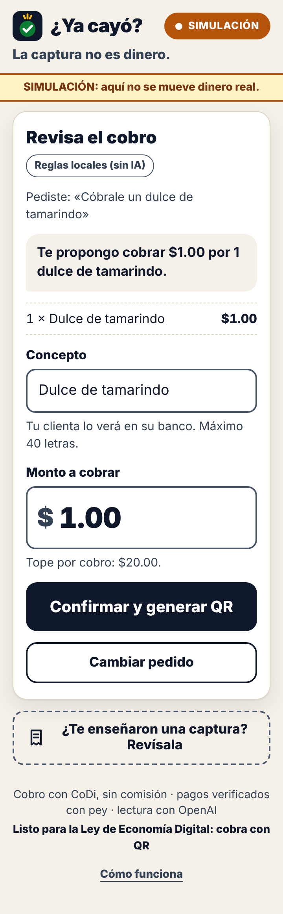
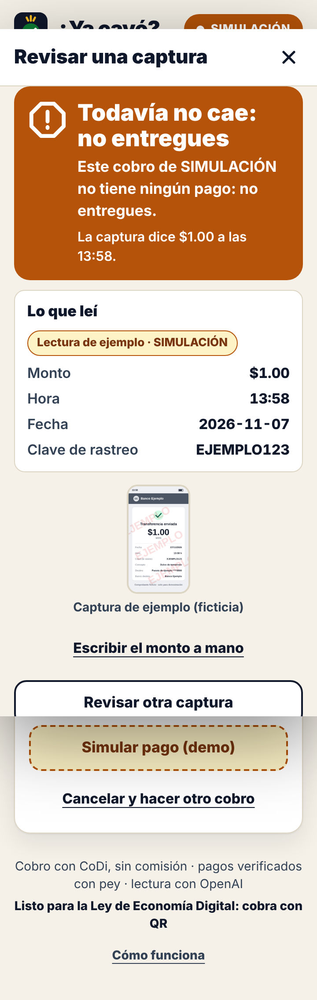
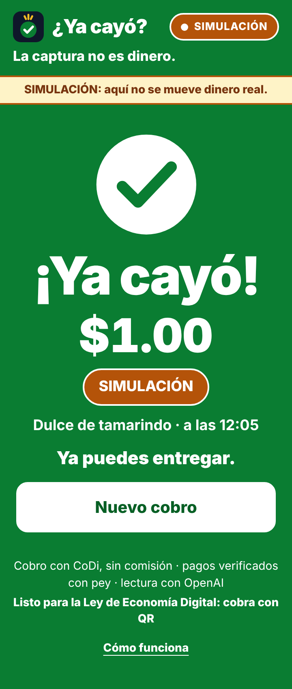
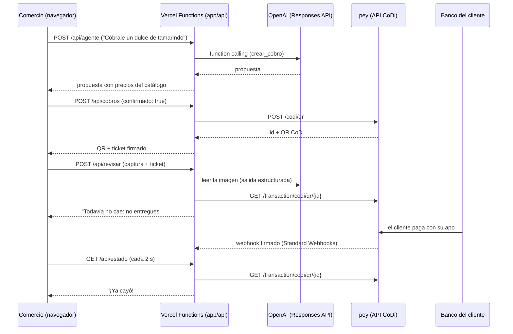

# ¿Ya cayó? — la captura no es dinero

Caja de cobro CoDi para comercios de barrio. Dices lo que vendiste y la IA de OpenAI arma el cobro; si el cliente te enseña una captura de "ya te transferí", la IA la lee, pero **quien decide es pey**: el dinero llegó o no llegó. Sin comisión.

**Demo en vivo:** [POR LLENAR: URL de producción en Vercel] · **Video de respaldo (24 s, SIMULACIÓN):** [`docs/video/demo-ya-cayo.mp4`](docs/video/demo-ya-cayo.mp4) · **Video narrado (≤ 3 min):** [POR LLENAR] · **Deck:** [POR LLENAR: enlace público] · **Guion del pitch:** [`docs/PITCH.md`](docs/PITCH.md)

Hecho en el *DevDay Exchange Community Hackathon: Mexico City* (sábado 7 de noviembre de 2026, UTOPÍA Elena Poniatowska Amor, Coyoacán) para el reto **"Prototipa herramientas de bien público con OpenAI y CoDi"**, con la API de OpenAI y cobros CoDi vía la API de pey.

> **Modo de la demo:** la pantalla siempre lo dice. **SIMULACIÓN** = sin llaves: el QR no cobra y el pago se simula con un botón. **MODO PRUEBA** = pey en producción con montos de $0.01 a $1 que no se devuelven (pey no tiene sandbox, K03.3). **COMERCIO** = cuenta del comercio. Modo de la URL pública: [POR LLENAR].

## El problema
En un puesto de barrio —una dulcería, como ejemplo— el cliente enseña el celular y dice "ya te transferí". Una captura se fabrica en segundos y circulan plantillas de comprobantes falsos; la forma segura de saberlo es revisar el saldo o el CEP de Banxico con la clave de rastreo, cosa que nadie hace con fila [SD41]. El fraude digital crece: 2.48 millones de reclamaciones por posible fraude en el primer semestre de 2025, según Condusef [SD38]. Y cobrar con tarjeta le cuesta a una miscelánea hasta 3.95 % por cobro con débito (Banxico, julio de 2026) [SD24].

## La solución
- **Cobra con tus palabras:** "Cóbrale un dulce de tamarindo" → la IA propone $1.00 con el detalle → tú confirmas.
- **Sin comisión:** el QR CoDi lo genera pey; el dinero va de banco a banco.
- **La captura no es dinero:** la IA lee monto, hora y clave de rastreo de la captura, y el **código** lo compara con lo que pey dice que llegó: "Todavía no cae: no entregues" o "¡Ya cayó!".
- **Nunca acusa:** la app no dice "falso"; dice qué sabe y qué no.
- **Bien público:** cero comisión, sin cuentas y sin datos guardados; código abierto ([POR LLENAR: licencia]).

## Por qué ahora
- La **Ley de Economía Digital para Pagos Digitales y Electrónicos** se firmó el 4 de noviembre de 2026; su artículo 19-IV prevé disposiciones de Banxico y la CNBV sobre cobros con QR en terminales, y Hacienda tiene 15 días hábiles para definir sectores [SD64, K06.5]. No afirmamos una fecha obligatoria de QR.
- El **14 de diciembre de 2026** vence el plazo de Banxico (Circular 9/2026) para que las apps bancarias procesen los cobros CoDi con el mismo estándar [K06.5].

## Demo en 3 pasos
1. **Cobra con tus palabras.** Toca "Cóbrale un dulce de tamarindo": la IA propone $1.00 y tú confirmas → QR CoDi de pey.
2. **La captura no es dinero.** "Revisar una captura" → "Usar captura de ejemplo" (comprobante **ficticio**): la IA lee $1.00, 13:58 y la clave EJEMPLO123; pey no tiene ese pago → **"Todavía no cae: no entregues"**.
3. **¡Ya cayó!** El cliente paga con la app de su banco (en SIMULACIÓN, "Simular pago (demo)") → pantalla verde, vibración y voz: "Ya cayó tu dinero: un peso".

<p>
  
  
  
</p>

Capturas reales de la app en SIMULACIÓN, a 360 px de ancho, generadas con [`scripts/demo_e2e.py`](scripts/demo_e2e.py).

## Cómo probarlo
**Como juez (2 minutos):** abre [POR LLENAR: URL] en el celular → "Cóbrale un dulce de tamarindo" → "Confirmar y generar QR" → "Revisar una captura" → "Usar captura de ejemplo" → "Simular pago (demo)" (o paga $1 con tu banco si está en MODO PRUEBA; ese peso no se devuelve).

**En tu máquina** (Node 22):
```bash
cd app
npm install
npm test          # pruebas con fetch simulado: no llaman servicios reales
npm run local     # http://localhost:3000 — SIMULACIÓN si no hay llaves
```
Variables: [`.env.example`](.env.example) (para local, cópialo a `app/.env`, que git ignora). En Vercel: Root Directory = `app`, Framework Preset = Other y las variables en Settings → Environment Variables.

## Cómo usa la IA (y dónde no decide)
| Tarea | API de OpenAI | Lo que decide el código |
|---|---|---|
| Entender la venta | Responses API con function calling: herramienta `crear_cobro` con esquema estricto | Precios del catálogo, suma, tope `MAX_MONTO_MXN`. El QR solo se crea cuando la persona confirma |
| Leer la captura | Responses API con imagen (`input_image`) y salida estructurada (`text.format`, JSON Schema estricto): `es_comprobante`, `monto`, `fecha`, `hora`, `clave_rastreo`, `legible` | El veredicto: compara con el estado del cobro en pey o con sus pagos recientes |

Modelo por defecto: `gpt-6.1-sol` (variable `OPENAI_MODEL`, K04.2). Sin llave o si la IA falla, la venta se entiende con reglas locales y la captura se resuelve escribiendo el monto a mano.

## Arquitectura



- Frontend: HTML, CSS y JavaScript sin framework ni build (`app/index.html`, `app/css/`, `app/js/`).
- Backend: Vercel Functions en Node.js (`app/api/`), código compartido en `app/lib/`. Sin base de datos: la verdad del pago vive en pey y cada cobro viaja en un **ticket firmado** (HMAC-SHA256).
- Contrato de la API: [`docs/CONTRATO-API.md`](docs/CONTRATO-API.md). Producto: [`docs/PRD.md`](docs/PRD.md).

## Seguridad y privacidad
- Las llaves (`OPENAI_API_KEY`, `PEY_API_KEY`, `PEY_WEBHOOK_SECRET`, `APP_SECRET`) viven solo como variables de entorno del servidor; el navegador solo habla con `/api` y el repo público no contiene ninguna.
- Ningún cobro sin confirmación explícita (`confirmado: true`); tope por cobro en el servidor (`MAX_MONTO_MXN`, 20 por defecto). En MODO PRUEBA el tope es **$1** aunque la variable diga más: es dinero real que no se devuelve (K03.3).
- El servidor no confía en montos del navegador: usa el ticket firmado; un ticket alterado se rechaza.
- Webhooks verificados con Standard Webhooks (firma HMAC y tolerancia de 5 minutos).
- No se guarda nada: la captura se manda a OpenAI solo para leerla y no se almacena; los registros llevan códigos e ids, nunca llaves, imágenes ni cuerpos completos.

## Qué es real y qué es simulación
| Pieza | SIMULACIÓN (sin llaves) | Con llaves |
|---|---|---|
| Entender la venta | Reglas locales (`origen: "reglas"`) | OpenAI, function calling |
| QR | Generado en el servidor; no cobra | QR CoDi real de pey |
| Pago | Botón "Simular pago (demo)" | Pago desde la app del banco, confirmado por pey |
| Leer la captura | Lectura de ejemplo etiquetada (`origen: "simulacion"`) | OpenAI, imagen + salida estructurada |

## Cómo se construyó
- **Antes del evento (5 y 6 de noviembre):** base de conocimiento en Markdown con fuentes fechadas ([`conocimiento/`](conocimiento/INDICE.md), [`fuentes/REGISTRO.md`](fuentes/REGISTRO.md)), reglas para agentes ([`AGENTS.md`](AGENTS.md)) y plantillas. Sin código del producto.
- **Durante el evento (7 de noviembre):** todo `app/` y `docs/`. El historial de git tiene la hora de cada paso.
- **Quién hizo qué:** Codex revisó la documentación de pey y el marco normativo (PR #1, fusionado). Claude Code escribió el contrato de la API y construyó la app con tres subagentes en paralelo —pagos (pey), IA (OpenAI) e interfaz— más la integración y las pruebas. José eligió el problema, fijó las reglas (la IA propone, la persona confirma, pey confirma el pago, nunca decir "falso"), aprobó el plan, se encarga del despliegue en Vercel (pendiente al escribir esto) y presenta.

## Limitaciones honestas
- Prototipo para un solo comercio, sin cuentas ni historial.
- Sin cobro previo, la comparación usa los pagos recientes de pey; que `trackingKey` sea la clave de rastreo SPEI no está verificado (⚪).
- La lectura depende de la calidad de la imagen; si no se lee, se pide el monto a mano.
- pey no tiene sandbox: el MODO PRUEBA usa dinero real de centavos que no se devuelve.
- Sin verificar en la documentación oficial (marcados `TODO(⚪)` en el código): `store: false` en la Responses API y los formatos de imagen que acepta (K04.15); el código de error de pey para una llave inválida, su límite de peticiones y el largo máximo del concepto (K03.8, K03.7); que `trackingKey` sea la clave de rastreo SPEI (K07.3).
- **No probado todavía:** el micrófono y la voz en español (el Chrome de las pruebas automáticas no tiene voces) y el cobro real con pey (aún no hay llave, así que no se ha generado ningún QR real). Todo lo demás se probó en SIMULACIÓN.

## Qué sigue
1. Piloto con comercios de barrio: medir cobros confirmados y capturas revisadas.
2. Corte del día y recibo para el cliente.
3. Hackatón México (14 de noviembre al 12 de diciembre).

## Mapa del repo
| Ruta | Qué es |
|---|---|
| [`app/`](app/README.md) | El producto: interfaz, funciones de Vercel, código compartido y pruebas. |
| [`docs/`](docs/PRD.md) | PRD, contrato de la API, guion del pitch y revisión de pey. |
| [`AGENTS.md`](AGENTS.md) | Reglas para agentes de código. [`CLAUDE.md`](CLAUDE.md) lo reutiliza. |
| [`conocimiento/`](conocimiento/INDICE.md) | Base de conocimiento (RAG). Empieza en `INDICE.md`; todo junto en `TODO-EN-UNO.md`. |
| [`fuentes/REGISTRO.md`](fuentes/REGISTRO.md) | De dónde sale cada dato (con fecha de consulta). |
| [`dia-del-evento/`](dia-del-evento/RUNBOOK.md) | Runbook, checklist y prompts del día. |
| [`plantillas/`](plantillas/PRD.md) | Plantillas de PRD, README de entrega y deck. |
| [`scripts/`](scripts/verificar_conocimiento.py) | Verificación de la base y generación de `TODO-EN-UNO.md`. |
| [`BITACORA.md`](BITACORA.md) | Estado, decisiones y evidencia. |

## Créditos y licencia
- DevDay Exchange Community Hackathon: Mexico City, organizado por AI Builders México con UTOPÍAS, SEDECO y pey.
- Licencia: [POR LLENAR].
