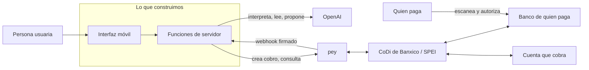

# Base de conocimiento completa — HackathonOpenAi

> Archivo generado por `scripts/construir_todo_en_uno.py` el 2026-11-07. No lo edites a mano: edita los archivos de `conocimiento/`, `pey/`, `codi/` o `docs/PROYECTO.md` y vuelve a correr el script.
> Úsalo cuando un asistente (por ejemplo ChatGPT) necesite leer todo de una vez. Cada sección conserva su ID (K03.4, etc.) para citarla.

## Contenido
- `conocimiento/INDICE.md` — Índice de la base de conocimiento
- `docs/PROYECTO.md` — Proyecto · Objetivo del hackatón y definición sistémica
- `conocimiento/00-bases-del-concurso.md` — Bases del concurso: qué pide el DevDay Exchange Community Hackathon CDMX y cómo se evalúa
- `conocimiento/01-evento-verificado.md` — Ficha verificada del evento: DevDay Exchange Community Hackathon CDMX (7 nov 2026)
- `conocimiento/02-organizadores-y-que-buscan.md` — Organizadores y qué buscan: OpenAI/Codex, AI Builders México, pey, SpaceXAI y Gobierno CDMX
- `conocimiento/03-codi-y-api-pey.md` — CoDi y API de Pey
- `conocimiento/08-criterios-y-jueces.md` — Criterios, jueces y cómo ganar: rúbrica, preguntas, errores y ganadores previos
- `pey/README.md` — Documentación de pey (API CoDi) en Markdown
- `pey/01-que-es-pey-y-codi.md` — Qué es pey y su API CoDi
- `pey/02-primeros-pasos-cuenta-llaves-y-prueba.md` — Primeros pasos: perfil, cuenta de pago, API key y prueba en producción
- `pey/03-referencia-api-convenciones.md` — Referencia de la API: convenciones generales
- `pey/04-api-codi-qr-y-push.md` — API CoDi: crear QR y notificación push
- `pey/05-api-cuentas-bancarias.md` — API de cuentas bancarias: registrar y consultar CLABEs
- `pey/06-api-ligas-de-pago.md` — API de links de pago: crear, actualizar monto y consultar
- `pey/07-api-transacciones.md` — API de transacciones: consultar pagos
- `pey/08-tipos-de-datos.md` — Tipos de datos de pey
- `pey/09-webhooks.md` — Webhooks de pey: configuración, firma y eventos
- `pey/10-tutorial-mostrar-qr-codi.md` — Tutorial: mostrar un QR CoDi
- `pey/11-errores-y-limites.md` — Errores y límites de la API de pey
- `pey/12-recursos-de-marca.md` — Recursos de marca de pey y CoDi
- `pey/13-registro-de-cambios.md` — Registro de cambios de la API de pey
- `pey/14-tutoriales-paso-a-paso.md` — Tutoriales oficiales de pey, paso a paso
- `codi/README.md` — CoDi® (Cobro Digital de Banco de México) en Markdown
- `codi/01-que-es-codi.md` — 01 · Qué es CoDi y para qué sirve
- `codi/02-como-funciona.md` — 02 · Cómo funciona CoDi
- `codi/03-actores-y-participantes.md` — 03 · Actores y participantes
- `codi/04-como-paga-y-cobra-una-persona.md` — 04 · Cómo paga (y cómo cobra) una persona, paso a paso
- `codi/05-seguridad-y-proteccion.md` — 05 · Seguridad y protección del usuario
- `codi/06-regulacion-y-plazos.md` — 06 · Regulación y plazos
- `codi/07-cifras-de-uso.md` — 07 · Cifras de uso de CoDi (con fecha)
- `codi/08-preguntas-frecuentes.md` — 08 · Preguntas frecuentes
- `codi/09-marca-logotipos-y-material.md` — 09 · Marca, logotipos y material de difusión
- `codi/10-codi-spei-dimo.md` — 10 · CoDi, SPEI y DiMo comparados
- `codi/11-como-encaja-pey.md` — 11 · Cómo encaja pey
- `AGENTS.md` — AGENTS.md

<!-- ===== INICIO: conocimiento/INDICE.md ===== -->

# Índice de la base de conocimiento

> Generado por `scripts/construir_indice.py` el 2026-11-07. No lo edites a mano.

## Cómo usar este índice (agentes y personas)
1. Busca tu pregunta en **Preguntas → archivo** o el tema en **Archivos**.
2. Abre solo el archivo o la sección que necesitas. Cada sección tiene un ID (`K03.4`) para citarla.
3. ⚪ = dato no verificado: confírmalo antes de usarlo en código o en el pitch.
4. ¿Necesitas todo de una vez (por ejemplo, en ChatGPT)? Abre [`TODO-EN-UNO.md`](TODO-EN-UNO.md).
5. De dónde sale cada dato: [`../fuentes/REGISTRO.md`](../fuentes/REGISTRO.md).

## Archivos
| ID | Archivo | Qué cubre | Confianza | Marcas ⚪ |
|---|---|---|---|---|
| **K00** | [Bases del concurso: qué pide el DevDay Exchange Community Hackathon CDMX y cómo se evalúa](00-bases-del-concurso.md) | Resumen único y verificado del reto, lo dicho en el arranque, la ley de pagos digitales, el calendario, la entrega, la evaluación, los premios, las reglas y los pendientes; léelo primero para arrancar un proyecto sin leer lo demás. | media | 14 |
| **K01** | [Ficha verificada del evento: DevDay Exchange Community Hackathon CDMX (7 nov 2026)](01-evento-verificado.md) | Fecha, horario, sede, agenda, reto, premios, cómo llegar, qué llevar y pendientes del hackatón; léelo la noche anterior y al llegar. | alta | 21 |
| **K02** | [Organizadores y qué buscan: OpenAI/Codex, AI Builders México, pey, SpaceXAI y Gobierno CDMX](02-organizadores-y-que-buscan.md) | Quién es cada organizador o aliado, qué quiere ver en los proyectos y qué los aleja; léelo para elegir la idea y armar el pitch. | media | 10 |
| **K03** | [CoDi y API de Pey](03-codi-y-api-pey.md) | Qué es CoDi y cómo se usa la API CoDi de Pey (alta, llaves, endpoints, estados, webhooks, pagos reales de prueba, errores), con ejemplos probados en Node/Vercel y reglas para usarla desde un agente. Léelo completo antes de escribir código de cobro. | media | 22 |
| **K08** | [Criterios, jueces y cómo ganar: rúbrica, preguntas, errores y ganadores previos](08-criterios-y-jueces.md) | Criterios probables con pesos (inferencia), rúbrica 1–5, preguntas de jueces, errores que restan, ganadores previos y cómo demostrar Codex; léelo al elegir la idea y antes del pitch. | media | 11 |

## Preguntas → archivo
| Pregunta | Abre |
|---|---|
| ¿Qué pide el reto y qué es obligatorio? | K00 |
| ¿Qué dijeron los organizadores en el arranque del 7 de noviembre? | K00 |
| ¿Qué es la Ley de Economía Digital para Pagos Digitales y Electrónicos y qué no se puede afirmar de ella? | K00 |
| ¿Cuándo se entrega, cuándo decide el jurado y cuándo es el voto de la comunidad? | K00 |
| ¿Qué se entrega y dónde? | K00 |
| ¿Qué criterios son oficiales y cuáles son inferidos? | K00 |
| ¿Qué premios hay? | K00 |
| ¿Qué puede descalificar o restar puntos? | K00 |
| ¿Qué falta confirmar con los organizadores? | K00 |
| ¿Cuándo, dónde y a qué hora es el hackatón? | K01 |
| ¿Por qué hay dos horarios distintos y a qué hora conviene llegar? | K01 |
| ¿Cuál es el reto oficial y qué tecnologías se esperan? | K01 |
| ¿Cuándo y dónde se entrega el proyecto y cuándo se anuncian ganadores? | K01 |
| ¿Qué premio hay y quién organiza? | K01 |
| ¿Cómo llego en transporte público a UTOPÍA Coyoacán? | K01 |
| ¿Qué falta confirmar con los organizadores al llegar? | K01 |
| ¿Qué dijeron los organizadores en el arranque? | K01 |
| ¿Quién organiza el hackatón y qué quiere cada actor? | K02 |
| ¿Qué es el programa de Embajadores de Codex y qué valora? | K02 |
| ¿Qué novedades de OpenAI (DevDay 2026) conviene mostrar? | K02 |
| ¿Quién es AI Builders México y cuál es su misión? | K02 |
| ¿Qué es pey, qué ofrece su API y qué éxito busca? | K02 |
| ¿Qué es SpaceXAI y por qué aparece en el ecosistema del evento? | K02 |
| ¿Qué papel tienen UTOPÍAS y SEDECO? | K02 |
| ¿Qué conquista a los organizadores y qué los aleja? | K02 |
| ¿Qué pidieron los organizadores en el arranque del 7 de noviembre? | K02 |
| ¿Qué es CoDi y cómo paga un cliente con QR o con notificación? | K03 |
| ¿Qué es Pey, cuánto cuesta su API CoDi y a dónde llega el dinero? | K03 |
| ¿Cómo saco hoy una API key de Pey y cuánto tarda en activarse? | K03 |
| ¿Cuál es la URL base, el header de autenticación y los campos para crear y consultar un cobro CoDi? | K03 |
| ¿En qué formato llega el QR y cómo se mapean los estados de Pey a los de la app? | K03 |
| ¿Cómo verifico la firma de los webhooks de Pey en una Vercel Function o en Codespaces? | K03 |
| ¿Hay sandbox? ¿Cómo hago un pago real en la demo y cuál es el plan B? | K03 |
| ¿Qué errores y límites debo manejar? | K03 |
| ¿Cómo expongo la API de Pey como herramientas de un agente de IA sin riesgos? | K03 |
| ¿Cómo se evaluará el proyecto y qué pesa más? | K08 |
| ¿Cómo me autoevalúo antes de entregar? | K08 |
| ¿Cómo funciona el voto de la comunidad y cómo me preparo? | K08 |
| ¿Qué preguntarán los jueces? | K08 |
| ¿Qué errores restan puntos o descalifican? | K08 |
| ¿Qué tipo de proyectos han ganado en hackatones de Codex y OpenAI, y por qué? | K08 |
| ¿Cómo demuestro en el pitch que usé Codex? | K08 |
| ¿Qué pidieron en el arranque y cómo cambia la evaluación? | K08 |

## Secciones de cada archivo

### K00 · Bases del concurso: qué pide el DevDay Exchange Community Hackathon CDMX y cómo se evalúa
Archivo: [`00-bases-del-concurso.md`](00-bases-del-concurso.md)

- `K00.1` Qué hay de nuevo al 7 de noviembre
- `K00.2` Reto oficial y requisitos
- `K00.3` Lo que dijeron en el arranque (7 de noviembre)
- `K00.4` La ley de pagos digitales, en lo esencial
- `K00.5` Calendario
- `K00.6` Qué entregar y cómo
- `K00.7` Cómo se evalúa: oficial, dicho e inferido
- `K00.8` Premios
- `K00.9` Reglas que descalifican o restan
- `K00.10` Pendientes ⚪
- `K00.11` Dónde está el detalle

### K01 · Ficha verificada del evento: DevDay Exchange Community Hackathon CDMX (7 nov 2026)
Archivo: [`01-evento-verificado.md`](01-evento-verificado.md)

- `K01.1` Datos clave verificados
- `K01.2` Horario: la discrepancia y qué hacer
- `K01.3` Agenda oficial de sábado a martes
- `K01.4` Reto oficial y tecnologías esperadas
- `K01.5` Organizadores y aliados (resumen)
- `K01.6` Premios y cómo se eligen ganadores
- `K01.7` La sede: UTOPÍA Elena Poniatowska Amor
- `K01.8` Cómo llegar en transporte público
- `K01.9` Qué llevar
- `K01.10` Lo que sigue: calendario hasta diciembre
- `K01.11` Pendiente de confirmar al llegar (⚪)

### K02 · Organizadores y qué buscan: OpenAI/Codex, AI Builders México, pey, SpaceXAI y Gobierno CDMX
Archivo: [`02-organizadores-y-que-buscan.md`](02-organizadores-y-que-buscan.md)

- `K02.1` Mapa de actores y qué quiere cada uno
- `K02.2` OpenAI y el DevDay Exchange
- `K02.3` Programa de Embajadores de Codex
- `K02.4` Lo nuevo de OpenAI que conviene mostrar (DevDay 2026)
- `K02.5` AI Builders México: quiénes son
- `K02.6` AI Builders México: misión y apuesta por CoDi
- `K02.7` pey: empresa, API y certificación
- `K02.8` pey: por qué abrió su API y qué éxito busca
- `K02.9` Contexto: por qué CoDi importa (y por qué no ha despegado)
- `K02.10` SpaceXAI (y su relación con Cursor)
- `K02.11` Gobierno CDMX: UTOPÍAS y SEDECO
- `K02.12` Lo que los conquista
- `K02.13` Lo que los aleja
- `K02.14` Lo que pidieron en el arranque (7 de noviembre)

### K03 · CoDi y API de Pey
Archivo: [`03-codi-y-api-pey.md`](03-codi-y-api-pey.md)

- `K03.1` Qué es CoDi y cómo paga un cliente
- `K03.2` Qué es Pey y su API CoDi
- `K03.3` Alta y llaves
- `K03.4` Endpoints, formato del QR y estados
- `K03.5` Webhooks
- `K03.6` Desarrollo vs producción: demo con pago real y plan B
- `K03.7` Ejemplos mínimos en Node.js 20+ (probados)
- `K03.8` Errores comunes y límites
- `K03.9` La API como herramienta de un agente de IA
- `K03.10` Documentación completa de pey (carpeta `pey/`)

### K08 · Criterios, jueces y cómo ganar: rúbrica, preguntas, errores y ganadores previos
Archivo: [`08-criterios-y-jueces.md`](08-criterios-y-jueces.md)

- `K08.1` Lo que sí sabemos de la evaluación (oficial)
- `K08.2` Criterios publicados en eventos hermanos
- `K08.3` Criterios probables y pesos estimados (inferencia)
- `K08.4` Rúbrica 1–5: impacto (C1) y ejecución (C2)
- `K08.5` Rúbrica 1–5: OpenAI y Codex (C3), originalidad (C4) y pitch (C5)
- `K08.6` El voto de la comunidad
- `K08.7` Preguntas típicas de jueces
- `K08.8` Errores que restan o descalifican
- `K08.9` Llaves y secretos en un repo público
- `K08.10` Qué ha ganado: OpenAI Build Week 2026 (oficial)
- `K08.11` Otros ganadores y patrones comunes
- `K08.12` Cómo demostrar el uso de Codex en el pitch
- `K08.13` Checklist de autoevaluación antes de entregar

<!-- ===== FIN: conocimiento/INDICE.md ===== -->

<!-- ===== INICIO: docs/PROYECTO.md ===== -->

# Proyecto · Objetivo del hackatón y definición sistémica

> Documento rector. Dice **qué** hay que lograr, **por qué**, **con quién** y **bajo qué reglas**, antes de decidir qué se construye. El problema concreto (una taquería de la CDMX que solo acepta efectivo; José la conoce como cliente) se llena en la sección P12 y después se baja a `docs/PRD.md`. Secciones numeradas P1–P12 para citarlas ("según P6…"). Cada dato remite a su archivo de la base: [K00](../conocimiento/00-bases-del-concurso.md), [K01](../conocimiento/01-evento-verificado.md), [K02](../conocimiento/02-organizadores-y-que-buscan.md), [K03](../conocimiento/03-codi-y-api-pey.md), [K08](../conocimiento/08-criterios-y-jueces.md), [`pey/`](../pey/README.md) y [`codi/`](../codi/README.md).

## P1 · Objetivo del hackatón

**Lo que dice el reto escrito** (K00.2): prototipar herramientas de **bien público** con **OpenAI** y **CoDi**, cobrando a través de la **API de pey**. Ejemplos oficiales: cobro para comercios de barrio, comercio comunitario, flujos con QR y solicitudes de pago, y flujos empresariales sobre pagos instantáneos.

**Lo que se pidió en el arranque** (K00.3, notas de José del 7-nov):
1. Una solución **creativa**.
2. **De la mano de la nueva ley de pagos digitales**, aprovechándola.
3. Una **aplicación de un servicio, del que sea**, que **integre la API de pey** (que funciona con CoDi).
4. Se puede usar **Claude** además de las herramientas de OpenAI.

**Un producto para pey.** Según José, el hackatón es especialmente para hacer un producto sobre pey. Lo que pey busca, por lo que publica y por inferencia (K02.7–K02.8, ⚪ la parte inferida): que más negocios y servicios cobren con CoDi a través de su API, que es gratuita, de autoservicio y funciona con cualquier banco; casos de uso nuevos; y retroalimentación sobre su API y su documentación. Para este proyecto eso significa: **el cobro con pey va en el flujo principal, no de adorno**, y la demo muestra el ciclo completo de un cobro real.

## P2 · Objetivo del proyecto

**General:** que una persona resuelva un problema real (el de P12) con un **servicio** que **cobra con CoDi a través de pey**, donde la **IA de OpenAI** hace algo que un formulario no podría, desplegado en una URL pública y demostrable en **3 pasos**.

**Específicos** (cada uno se puede comprobar):

| # | Objetivo | Cómo se comprueba |
|---|---|---|
| O1 | Un cobro real con pey de punta a punta, de $0.01 a $1 | Id del cobro, hora del pago y pantalla de confirmación |
| O2 | La IA de OpenAI tiene un papel necesario y acotado | Salida estructurada validada por código; la persona confirma |
| O3 | Demo de 3 pasos en el celular, en el dominio de producción | URL pública probada dos veces |
| O4 | Sin llaves, todo el flujo corre en **SIMULACIÓN** rotulada | La pantalla dice SIMULACIÓN |
| O5 | Entrega completa: repo, README, video y pitch | Lista de K08.13 marcada |
| O6 | Todos los criterios de la rúbrica en 4 o más | Autoevaluación con K08.4–K08.5 |
| O7 | Entregado antes del domingo a las 12:00 (cierre a las 13:00) | Captura de la confirmación |

**Fuera de alcance:** cuentas de usuario complejas, varias empresas, devoluciones (pey no las tiene, `pey/`), base de datos si no hace falta, promesas de cumplimiento legal y datos personales reales.

## P3 · Requisitos

**Del concurso (obligatorios):**

| ID | Requisito | Cómo se cumple | Fuente |
|---|---|---|---|
| R1 | Usar OpenAI | Una llamada necesaria en el flujo principal | K00.2 |
| R2 | Cobrar con CoDi a través de la API de pey | Crear cobro → pago → confirmación por consulta o webhook | K00.2, K03, `pey/` |
| R3 | Bien público | El beneficio para la persona usuaria se dice en una frase | K00.2 |
| R4 | Entregar en el portal antes del domingo 8 a las 13:00 | Paquete de K00.6 | K00.5–K00.6 |
| R5 | Creatividad | Un ángulo propio explicable en una frase | K00.3, K08.5 |
| R6 | Aprovechar la ley de pagos digitales sin exagerarla | Adopción voluntaria y preparación; nada de obligaciones ni fechas que la ley no tiene | K00.4 |

**De calidad (reglas de este repo, `AGENTS.md`):**

| ID | Requisito |
|---|---|
| Q1 | Español de México; mobile-first a 360 px; botones de al menos 44 px; accesible (AA, teclado, etiquetas) |
| Q2 | Nada inventado; todo lo simulado dice SIMULACIÓN |
| Q3 | Dinero real con cuidado: confirmación explícita, tope en el servidor, montos de $0.01 a $1 en pruebas |
| Q4 | Llaves solo en el servidor; nunca en el navegador, el repo, los logs ni el chat |
| Q5 | Webhooks de pey con firma verificada |
| Q6 | Pruebas automáticas con `fetch` simulado y evidencia de cada avance en `BITACORA.md` |

## P4 · El sistema: actores y límites



**Límite del sistema:** dentro está solo nuestro código (interfaz y funciones). pey, OpenAI, Banxico, los bancos, Vercel y GitHub son externos: fallan, cambian o tardan, y el diseño tiene que aguantarlo (P6, P11).

| Actor | Qué quiere | Qué aporta | Fuente |
|---|---|---|---|
| Persona usuaria (por definir en P12) | Resolver su problema sin complicarse | El caso real | P12 |
| Quien paga | Pagar rápido, seguro y sin comisión | El pago desde la app de su banco | `codi/` |
| pey | Más servicios cobrando con su API, casos nuevos, retroalimentación | La API, la cuenta de prueba y los webhooks | K02.7–K02.8 |
| Banxico (CoDi y SPEI) | Pagos digitales instantáneos y gratuitos | La red de pagos | `codi/`, K03.1 |
| OpenAI | Usos interesantes y visibles de sus modelos | La API | K00.2, K02 |
| AI Builders México, UTOPÍAS y SEDECO | Bien público, adopción de pagos digitales, comunidad | El evento, mentores y jurado | K02 |
| Jurado y comunidad | Proyectos útiles que funcionen y se entiendan | La evaluación y el voto | K08 |
| José | Ganar con un proyecto honesto y útil | El problema, las decisiones y el pitch | K00 |
| Agentes (Claude Code, Codex) | Instrucciones claras y verificables | El código, las pruebas y la documentación | `AGENTS.md` |

## P5 · Flujos

**Dinero (CoDi con pey).** Detalle técnico: K03.4–K03.5 y `pey/04`, `pey/07`, `pey/09`; la parte de Banxico, `codi/`.

```mermaid
sequenceDiagram
    participant U as Persona usuaria
    participant A as Nuestro sistema
    participant P as pey
    participant B as CoDi / banco de quien paga
    U->>A: pide cobrar (con la ayuda de la IA)
    A->>A: valida monto y tope; la persona confirma
    A->>P: POST /codi/qr (o /codi/pn)
    P-->>A: id + QR (o folio de la solicitud)
    B->>P: quien paga escanea y autoriza en su banco
    P-->>A: webhook firmado (pago recibido)
    A->>P: GET /transaction/codi/qr/{id} (confirmación)
    A-->>U: "pagado", solo si pey lo confirma
```

**Información (IA).** Entrada de la persona (texto, voz o imagen) → OpenAI interpreta → **salida estructurada** → el código valida (montos, tope, catálogo, estado) → la persona confirma → acción (crear el cobro). **El modelo nunca confirma pagos ni decide montos solo** (K02.12, K08.5).

**Estados de un cobro.** `pendiente` → `pagado` (solo con PAID de pey y mismo monto) · `expirado` (sin pago al vencer; un pago tardío gana) · `no_verificable` (pey no responde o no reconoce el cobro con esa llave). Nunca se muestra "pagado" sin confirmación de pey (K03.4).

## P6 · Restricciones

| Restricción | Efecto en el diseño | Fuente |
|---|---|---|
| pey solo tiene producción; en pruebas se cobra dinero real de $0.01 a $1 que no se devuelve | Tope en el servidor, confirmación explícita y SIMULACIÓN rotulada sin llaves | K03.3, `pey/02` |
| La CLABE propia tarda 5 días hábiles | Usar la cuenta de prueba de pey en el concurso | K03.3 |
| pey no documenta idempotencia ni devoluciones | No reintentar creaciones a ciegas; no prometer reembolsos | `pey/04`, `pey/11` |
| Un webhook por llave; los previews de Vercel piden sesión | Registrar el webhook en el dominio de producción y consultar el estado como respaldo | K03.5 |
| La ley no obliga hoy a nadie a aceptar QR | Presentar el proyecto como adopción voluntaria y preparación | K00.4 |
| Repo público | Cero llaves y cero datos personales; los ejemplos son ficticios | K00.9 |
| Tiempo: el sábado cierra a las 16:00 y la entrega es el domingo a las 13:00 | Un flujo principal pequeño que funcione antes que muchas funciones | K00.5, K08.3 |
| La API de OpenAI se paga aparte de ChatGPT Plus | Llamadas pocas y cortas; camino sin IA si se acaba el saldo | K00 ⚪ costo por llamada sin medir |

## P7 · Arquitectura de referencia

Sirve para cualquier servicio; el PRD la ajusta.

- **Interfaz:** HTML, CSS y JavaScript sin framework ni build; móvil primero; el modo de pago siempre visible.
- **Servidor:** funciones de Vercel en Node.js 22; código compartido fuera de `api/` (`AGENTS.md` §5).
- **Rutas mínimas:** `GET /api/salud` (modo y si hay llaves, sin mostrarlas) · `POST /api/<acción de la IA>` · `POST /api/cobros` (exige confirmación) · `GET /api/estado` (consulta a pey) · `POST /api/webhook-pey` (firma verificada).
- **Estado:** la verdad del pago vive en pey; si hace falta guardar un pedido sin base de datos, se firma en el servidor para que el navegador no pueda alterarlo.
- **Pruebas:** `node:test` con `fetch` simulado; un recorrido de la demo en navegador antes de desplegar.

## P8 · Criterios de éxito (rúbrica de K08)

| Criterio (peso inferido) | Un 5 significa | Evidencia |
|---|---|---|
| C1 Impacto y alineación (25%) | Persona concreta, dolor medible, cobro CoDi y la ley bien usada | Frase de valor y dato con fuente |
| C2 Ejecución (25%) | URL pública en celular: crear cobro → pago → webhook verificado → acción | Id del cobro real y video |
| C3 OpenAI y herramientas (20%) | IA necesaria y acotada; uso visible de agentes con evidencia | Esquema de salida, commits con hora, bitácora |
| C4 Creatividad (20%) | Un ángulo propio en una frase | La frase del pitch |
| C5 Pitch y diseño (10%) | Problema → demo → impacto en 3 minutos; interfaz clara | Ensayo cronometrado |

## P9 · Entregables y calendario

| Cuándo | Qué |
|---|---|
| Sábado, en cuanto se defina P12 | `docs/PRD.md` con demo de 3 pasos y criterios de aceptación |
| Sábado, primera hora de construcción | Esqueleto desplegado en SIMULACIÓN |
| Sábado, antes de las 16:00 | Cobro real con pey en producción y video de respaldo |
| Domingo, antes de las 12:00 | Entrega en el portal: URL, repo con README, video y pitch (K00.6, K08.13) |

## P10 · Método de trabajo

- **Herramienta:** Claude Code dentro de GitHub Codespaces, programando solo con prompts; Codex CLI también está disponible. Paso a paso y biblioteca de prompts: [`docs/GUIA-CODESPACES.md`](../docs/GUIA-CODESPACES.md). Comandos por fase en `.claude/commands/`: `/arrancar` → `/prd` → `/construir` (las veces que haga falta) → `/verificar` → `/desplegar` → `/entregar`.
- **Ciclo:** una tarea a la vez; plan corto → construir → verificar → evidencia → commit. José aprueba lo irreversible (push a `main`, despliegues, cobros reales).
- **Lecciones del primer intento (se conservan):** escribir primero un contrato de API permite repartir el trabajo entre agentes en paralelo sin choques; la SIMULACIÓN completa sin llaves salva la demo; en SIMULACIÓN ningún texto dice que pey confirmó algo; una verificación independiente antes de dar algo por terminado encuentra errores que el autor no ve.

## P11 · Riesgos y mitigación

| Riesgo | Señal | Mitigación |
|---|---|---|
| No hay llaves de pey u OpenAI a tiempo | `/api/salud` dice que faltan | SIMULACIÓN rotulada; camino sin IA (reglas o captura manual) |
| pey responde 503 o falla la red | El estado no cambia | Mensaje "no se puede verificar"; reintento; video de respaldo |
| OpenAI sin saldo o lenta | Error 429 o tiempo de espera | Respuesta de respaldo sin IA; no bloquear el cobro |
| Falla el internet de la sede | Sin conexión | Hotspot del celular y video |
| Demasiadas funciones | Pasa de las 13:00 sin cobro real | Congelar funciones y cerrar el flujo principal (K08.3) |
| Datos personales o llaves en el repo | Revisión del diff | Verificador del repo y revisión antes de cada push |
| Citar mal la ley | Una frase con obligación o fecha | Usar solo lo de K00.4 |

## P12 · El problema (lo define José)

Estado: **respondido** (7-nov, 15:02 y 15:22). Producto: [`docs/PRD.md`](../docs/PRD.md); API: [`docs/CONTRATO-API.md`](../docs/CONTRATO-API.md). Las ideas anteriores («¿Ya cayó?» y «Tócale») se retiraron; su código sigue en el historial de git.

1. **¿Quién lo vive?** Tacos El Gran Abanico, una taquería con mesas, y sus clientes. Menú, precios y existencias de ejemplo.
2. **¿Qué pasa hoy?** Cobrar exige efectivo o terminal, y el inventario y las ventas se llevan a mano.
3. **¿Qué cuesta hoy?** Comisiones de terminal, tiempo dando cambio y no saber qué ingredientes se gastaron (⚪ sin cifra medida).
4. **¿Qué haría la app?** Un punto de venta: el cliente toca la etiqueta NFC de su mesa, ve su cuenta, escribe su celular y paga con CoDi; al confirmarse el pago se descuentan ingredientes y se registra la venta.
5. **¿Dónde entra pey y CoDi?** La taquería le cobra al cliente con `POST /codi/pn`; el pago se confirma con el webhook `codi.pn.payment_received` o `GET /transaction/{id}` ([`pey/04`](../pey/04-api-codi-qr-y-push.md), [`pey/07`](../pey/07-api-transacciones.md), [`pey/09`](../pey/09-webhooks.md)).
6. **¿Qué hace la IA de OpenAI?** Analiza ventas e inventario después de los pagos y sugiere qué reabastecer y cuáles son las horas pico (código listo; se activa con la llave).
7. **¿Cómo aprovecha la ley?** Adopción voluntaria de pagos digitales sin comisión, antes de que la SHCP defina sectores (K00.4).
8. **¿Qué tiene de creativo?** La mesa es la terminal: una etiqueta NFC de pocos pesos reemplaza a la terminal y al ticket, y el pago confirmado mueve el inventario solo.

<!-- ===== FIN: docs/PROYECTO.md ===== -->

<!-- ===== INICIO: conocimiento/00-bases-del-concurso.md ===== -->

---
id: K00
titulo: "Bases del concurso: qué pide el DevDay Exchange Community Hackathon CDMX y cómo se evalúa"
resumen: "Resumen único y verificado del reto, lo dicho en el arranque, la ley de pagos digitales, el calendario, la entrega, la evaluación, los premios, las reglas y los pendientes; léelo primero para arrancar un proyecto sin leer lo demás."
responde:
  - "¿Qué pide el reto y qué es obligatorio?"
  - "¿Qué dijeron los organizadores en el arranque del 7 de noviembre?"
  - "¿Qué es la Ley de Economía Digital para Pagos Digitales y Electrónicos y qué no se puede afirmar de ella?"
  - "¿Cuándo se entrega, cuándo decide el jurado y cuándo es el voto de la comunidad?"
  - "¿Qué se entrega y dónde?"
  - "¿Qué criterios son oficiales y cuáles son inferidos?"
  - "¿Qué premios hay?"
  - "¿Qué puede descalificar o restar puntos?"
  - "¿Qué falta confirmar con los organizadores?"
actualizado: 2026-11-07
confianza: media
fuentes: [SA01, SA03, SA04, SA05, SA11, SA32, SA43, SA45, SA50, SA53, SA54, SA62, SB02, SD01, SD02, SD64, SF01]
---

# K00 · Bases del concurso

## TL;DR

- **Reto oficial:** prototipar herramientas de bien público con OpenAI y CoDi, cobrando a través de la API gratuita de pey; se participa solo o en equipo [SA01].
- **Arranque (7 de noviembre, en persona):** pidieron una solución creativa que vaya de la mano con la nueva ley de pagos digitales y la aproveche: una aplicación de un servicio, del que sea, que integre la API de pey (funciona con CoDi). También dijeron que se puede usar Claude además de las herramientas de OpenAI [SF01].
- **Ley:** la Ley de Economía Digital para Pagos Digitales y Electrónicos promueve los pagos digitales. El decreto se expidió el 4 de noviembre de 2026 y entra en vigor al día siguiente de su publicación en el DOF (⚪ fecha no verificada). Hoy no obliga a ningún comercio a aceptar QR ni pagos digitales: los sectores los definirá la SHCP [SD64].
- **Calendario:** construcción el sábado 7 (10:00–16:00), entrega en el portal del evento el domingo 8 a las 13:00, jurado el lunes 9 por la mañana y luego voto de la comunidad (de 1 a 3 ganadores más). Premio: bolsa de 10 boletos al DevDay Exchange oficial de OpenAI, el martes 10 a las 14:00 [SA01][SA04].
- **Sin publicar al 7 de noviembre:** criterios, jueces, URL y formato del portal, regla de código previo, elegibilidad y reparto de boletos (⚪) [SA01].
- **Resta o descalifica (inferido; no hay reglas escritas):** salirse del reto, exponer llaves, inventar datos, cobrar sin confirmación, entregar tarde y afirmar obligaciones legales que la ley no impone (K00.9).

## K00.1 · Qué hay de nuevo al 7 de noviembre

| Qué se revisó | Resultado | Fuente |
|---|---|---|
| Página oficial en Luma | Sin cambios de fondo respecto al 6 de noviembre: mismo reto, agenda, entrega, premio y voto. Criterios, elegibilidad y boletos siguen "por confirmar"; no hay jueces nombrados, URL del portal ni avisos con fecha. Confirmados: 265 (264 el día anterior) | [SA01] |
| Sitio y página de eventos de AI Builders México | No mencionan este hackatón ni su portal, jurado o criterios | [SA32][SA62] |
| Página de inicio de pey | No menciona el hackatón | [SB02] |
| Búsquedas web del 7 de noviembre (hackatón, UTOPÍAS, SEDECO, pey) | No encontré publicaciones nuevas desde el 6 de noviembre | — |
| Arranque del evento | Lo único nuevo de hoy viene de lo que se dijo en persona (K00.3) | [SF01] |
| Ley de pagos digitales | Revisé el texto del decreto en el SIDOF; no muestra la fecha de publicación en el DOF (K00.4) | [SD64] |

## K00.2 · Reto oficial y requisitos

- **El reto, resumido:** prototipar herramientas de bien público con OpenAI y CoDi. La página describe CoDi como la red de pagos instantáneos y gratuitos de Banco de México, y dice que se usa a través de la API de pey, a la que llama gratuita y de código abierto [SA01]. ⚪ La página de la API de pey no menciona que sea de código abierto [SA11].
- **Ejemplos oficiales:** cobro para comercios de barrio, comercio comunitario, flujos con QR y solicitudes de pago, y flujos empresariales sobre pagos instantáneos [SA01].

| Requisito | Estado | Fuente |
|---|---|---|
| Usar OpenAI | Obligatorio: está en el reto escrito | [SA01] |
| Cobros CoDi con la API de pey | Obligatorio: está en el reto escrito y se repitió en el arranque | [SA01][SF01] |
| Bien público | Enfoque del reto escrito | [SA01] |
| Solución creativa | Se pidió en el arranque | [SF01] |
| Aprovechar la nueva ley de pagos digitales | Se pidió en el arranque (K00.4) | [SF01] |
| Codex | No se exige por escrito; el evento es de la comunidad Codex y el anfitrión es el Codex Ambassador local | [SA01] |
| Claude | Permitido además de las herramientas de OpenAI, según el arranque (⚪ no está por escrito) | [SF01] |
| Participación | Solo o en equipo; llevar laptop | [SA01] |

- **API de pey:** autoservicio, gratuita por ahora, funciona con cualquier banco y avisa con webhooks firmados (Standard Webhooks); documentación en docs.pey.mx [SA11]. Detalle técnico: K03 y la [documentación de pey](../pey/README.md).
- **Quién organiza:** AI Builders México, con UTOPÍAS, SEDECO y pey; anfitriones Ben Kim (Codex Ambassador local) y Esteban Constante. Es un hackatón comunitario, separado del DevDay Exchange oficial [SA01]. AI Builders describe su misión como que cobrar no cueste un porcentaje de la venta [SA03].

## K00.3 · Lo que dijeron en el arranque (7 de noviembre)

Fuente: notas de José, tomadas en persona [SF01]. No hay versión escrita pública.

1. La solución debe ser **creativa**.
2. Hay que ir **de la mano con la nueva ley de pagos digitales** y aprovecharla (qué dice la ley: K00.4).
3. El objetivo es desarrollar **una aplicación de un servicio, del que sea**, que **integre la API de pey**, que funciona con CoDi.
4. Se puede usar **Claude** además de las herramientas de OpenAI.

Cómo leerlo (inferencia, ⚪):
- "Un servicio, del que sea" amplía los ejemplos oficiales: no tiene que ser una tienda; sirve cualquier servicio que cobre, siempre que el cobro con pey esté en el flujo principal y OpenAI tenga un papel real [SA01][SF01].
- Claude se suma; no sustituye a OpenAI, que sigue en el reto escrito [SA01].
- Si los organizadores publican reglas escritas, esas mandan sobre estas notas.

## K00.4 · La ley de pagos digitales, en lo esencial

- **Qué es:** la Ley de Economía Digital para Pagos Digitales y Electrónicos. Es de orden público, aplica en todo el país y su objeto es promover que se adopten y usen los medios de pago digitales y electrónicos [SD64].
- **Fechas:** las mesas directivas del Congreso firmaron el decreto el 20 de octubre de 2026 y la presidenta lo expidió el 4 de noviembre de 2026 [SD64]. Entra en vigor al día siguiente de su publicación en el DOF. ⚪ La versión del SIDOF consultada el 7 de noviembre no muestra la fecha de publicación y tampoco la encontré en prensa [SD64].
- **Lo que sigue (transitorios):** desde que entre en vigor, la SHCP tiene 15 días hábiles para determinar los sectores estratégicos y las actividades donde el pago digital podrá ser la única forma aceptada. Cuando publique esa determinación, las autoridades tienen otros 15 días hábiles para emitir reglas generales con condiciones y plazos de transición gradual. La ley no trae presupuesto adicional [SD64].
- **Comercios y servicios:** el artículo 11 dice que los proveedores "podrán implementar" medios de pago digitales, así que no hay una obligación general. La obligación de aceptar solo pagos digitales aplicará únicamente en los sectores que designe la SHCP (artículo 13), y la ley no nombra ninguno [SD64].
- **Gobierno:** los tres órdenes de gobierno deben tomar medidas para aceptar pagos digitales en trámites y servicios (artículo 10) [SD64].
- **QR:** el artículo 19, fracción IV, faculta a Banxico, con la CNBV como supervisora, para emitir reglas que obliguen a quien ofrece terminales punto de venta a aceptar pagos con QR conforme a sus especificaciones. Es una facultad, no una regla ya emitida [SD64].
- **Contingencias:** se permite efectivo o cheque durante una contingencia (artículo 15), pero eso no exime para siempre (artículo 16) [SD64].
- **No menciona** CoDi ni DiMo por nombre [SD64].

**Lo que NO se puede afirmar:**
- Que aceptar QR o pagos digitales ya es obligatorio para los comercios, o que lo será en una fecha concreta: depende de la SHCP y de reglas que todavía no existen [SD64].
- Que la ley rige desde una fecha concreta, mientras no se confirme su publicación en el DOF (⚪).
- Que exista una obligación general de QR en la CDMX el 19 de noviembre: esa fecha no aparece en el texto [SD64].

**Otro plazo, que no es esta ley:** el 14 de diciembre de 2026 vence el plazo para que los participantes del SPEI cumplan las Circulares 9/2026 y 10/2026 de Banxico, que homologan las transferencias desde el celular; la 9/2026 incluye procesar los mensajes de cobro de CoDi [SD01][SD02]. Según la prensa, antes de esa fecha los bancos deben permitir recibir transferencias con el número de celular, y la CLABE sigue funcionando [SA43].

**Recomendación:** presenta el proyecto como una ayuda para adoptar pagos digitales de forma voluntaria y prepararse antes de que se definan sectores y reglas. Cita la ley por su nombre, apóyate en este archivo y no prometas cumplimiento legal.

## K00.5 · Calendario

| Cuándo | Qué | Fuente |
|---|---|---|
| Sáb 7 nov, 10:00–16:00 | Arranque y construcción presencial en UTOPÍA Elena Poniatowska Amor (Av. Miguel Hidalgo 128, San Lucas, Coyoacán), con mentores de AI Builders México | [SA01][SF01] |
| Dom 8 nov, 13:00 | Cierre de entregas en el portal del evento; se puede seguir construyendo después del sábado | [SA01] |
| Lun 9 nov, mañana | El jurado anuncia ganadores; después, la comunidad vota por 1 a 3 ganadores más | [SA01] |
| Mar 10 nov, 14:00 | DevDay Exchange oficial de OpenAI en la CDMX (el premio); la sede se comparte al aprobar la solicitud | [SA04] |
| 14 dic | Plazo de las Circulares 9/2026 y 10/2026 de Banxico (K00.4) | [SD01] |

- El encabezado en inglés de la página muestra 9:00–15:00; el encabezado en español y la agenda escrita dicen 10:00–16:00 (detalle: K01) [SA01].
- ⚪ La página no dice la zona horaria del cierre del domingo; se asume la hora del centro de México.
- ⚪ No se ha publicado la mecánica del voto: quién vota, dónde y hasta cuándo.

## K00.6 · Qué entregar y cómo

- **Oficial:** el proyecto se entrega en "el portal del evento" antes del domingo 8 a las 13:00 [SA01]. Al 7 de noviembre no hay URL del portal ni formato publicado (repo, video, demo o formulario) (⚪) [SA01].
- **Paquete recomendado (inferencia a partir de eventos hermanos):**
  1. Demo desplegada con URL pública que funcione en celular y siga en línea para el voto; en Bangkok se pidió mantener los enlaces accesibles para evaluar [SA05].
  2. Repo público con README: problema, usuario, papel de OpenAI, cobro CoDi con pey, qué es real y qué es SIMULACIÓN, limitaciones, herramientas de IA usadas y qué existía antes del sábado.
  3. Video de menos de 3 minutos, como en Build Week de OpenAI [SA45].
  4. Pitch corto con una diapositiva; en San Francisco fueron 2 minutos de pitch y 2 de preguntas [SA50].
- Como el jurado anuncia el lunes, el paquete tiene que convencer aunque no estés presente (inferencia; K08).

**Recomendación:** entrega antes de las 12:00 del domingo y guarda una captura de la confirmación.

## K00.7 · Cómo se evalúa: oficial, dicho e inferido

| Nivel | Qué se sabe | Fuente |
|---|---|---|
| Oficial (por escrito) | Habrá demos de proyectos y evaluación; el jurado anuncia el lunes 9 por la mañana; luego, el voto comunitario elige de 1 a 3 ganadores más; criterios, elegibilidad y boletos "se confirmarán"; no hay jueces nombrados | [SA01] |
| Dicho en el arranque | Creatividad; aprovechar la nueva ley de pagos digitales; aplicación de un servicio que integre la API de pey con CoDi | [SF01] |
| Inferido (no oficial) | Impacto y alineación con el reto 25%; ejecución con cobro CoDi 25%; uso de OpenAI 20%; creatividad y originalidad 20%; pitch 10% | K08 |

La rúbrica de 1 a 5, las preguntas típicas del jurado y la lista de autoevaluación están en K08.

## K00.8 · Premios

- Bolsa de 10 boletos al DevDay Exchange oficial de OpenAI en la CDMX, el martes 10 de noviembre a las 14:00 [SA01][SA04].
- Hay ganadores del jurado (lunes por la mañana) y de 1 a 3 más por voto de la comunidad [SA01].
- No se anuncian efectivo, créditos ni lugares (1.º, 2.º, 3.º); la asignación, la elegibilidad y las condiciones de los boletos se confirmarán más adelante (⚪) [SA01].
- El DevDay Exchange incluye sesiones técnicas con los equipos de producto e ingeniería de OpenAI y conversación abierta con el equipo [SA04].

## K00.9 · Reglas que descalifican o restan

No hay reglas de descalificación publicadas (⚪) [SA01]. Esta tabla junta lo que se deduce del reto, los riesgos verificados y las reglas de este repo (`AGENTS.md`).

| Regla | Por qué | Fuente |
|---|---|---|
| El flujo principal usa OpenAI y cobra con CoDi a través de pey | Es el reto; sin eso el proyecto queda fuera de tema | [SA01][SF01] |
| Cero llaves en el repo, en el navegador y en los logs | GitHub detecta llaves de OpenAI en repos públicos y OpenAI las desactiva, así que la demo se rompe; GitHub bloquea por defecto los push con secretos en repos públicos | [SA54][SA53] |
| Nada inventado: sin testimonios, cifras ni comercios sin fuente; todo lo simulado dice "SIMULACIÓN" | Credibilidad | `AGENTS.md` |
| Ningún cobro sin confirmación explícita de la persona, y con monto máximo | Se cobra dinero real (K03) | `AGENTS.md` |
| Entregar antes del domingo a las 13:00 | Es el cierre publicado | [SA01] |
| Declarar qué existía antes del sábado | ⚪ La regla de código previo no está publicada | [SA01] |
| No afirmar obligaciones ni fechas que la ley no tiene | Cualquier juez puede comprobarlo (K00.4) | [SD64] |
| No presumir alianzas con gobierno, bancos o pey, ni exponer datos personales (CLABE, teléfonos) | Riesgo ético y legal | Inferencia |

## K00.10 · Pendientes ⚪

Nada de esto está publicado; pregúntalo a los organizadores y anota la respuesta en `BITACORA.md`:

1. URL del portal y formato de entrega: repo, video (¿duración?), demo o formulario.
2. Criterios, pesos y nombres de los jueces.
3. ¿Se permite código previo o plantillas? ¿Cómo se declara?
4. Elegibilidad y reparto de los 10 boletos; ¿hay primer lugar?
5. Mecánica del voto comunitario.
6. Confirmación por escrito de que se permite Claude y de si hay que declararlo.
7. ¿Codex es obligatorio o solo recomendado?
8. Fecha de publicación de la ley en el DOF y, después, los sectores que defina la SHCP.
9. API de pey: ¿hay entorno de prueba o solo producción? (K03).
10. Zona horaria del cierre del domingo y hora real de salida del sábado (15:00 o 16:00).

## K00.11 · Dónde está el detalle

- [K01 · Ficha del evento](01-evento-verificado.md): horario, sede, cómo llegar y calendario.
- [K02 · Organizadores y qué buscan](02-organizadores-y-que-buscan.md).
- [K03 · CoDi y API de pey](03-codi-y-api-pey.md).
- [K08 · Criterios, jueces y cómo ganar](08-criterios-y-jueces.md).
- [Documentación de pey en Markdown](../pey/README.md): guías, referencia de la API, webhooks y errores.

## Fuentes

| ID | Título | URL | Consultado |
|---|---|---|---|
| SA01 | DevDay Exchange Community Hackathon: Mexico City (página oficial en Luma) | https://luma.com/f755f0k6 | 2026-11-07 |
| SA03 | Newsletter de AI Builders, 31 oct 2026 | (correo; sin URL pública) | 2026-11-06 (previo) |
| SA04 | OpenAI DevDay Exchange 2026 | https://events.openai.com/devdayexchange2026/ | 2026-11-06 |
| SA05 | DevDay Exchange Community: Bangkok | https://luma.com/6m83xldb | 2026-11-06 |
| SA11 | pey: API CoDi | https://pey.mx/api-codi | 2026-11-06 |
| SA32 | AI Builders México (sitio oficial) | https://aibuilders.mx/ | 2026-11-07 |
| SA43 | ADN40: Nuevas reglas para transferencias bancarias; fecha límite 14 de diciembre | https://www.adn40.mx/mexico/2026-09-12/nuevas-reglas-para-hacer-transferencias-bancarias-en-mexico-la-fecha-limite-es-el-14-de-diciembre/ | 2026-11-06 |
| SA45 | OpenAI Developers Blog: Build Week winners | https://developers.openai.com/blog/build-week-winners | 2026-11-06 |
| SA50 | Codex Community Mini-Hackathon, San Francisco #5 | https://luma.com/7025i1j5 | 2026-11-06 |
| SA53 | GitHub Blog: Keeping secrets out of public repositories (29 feb 2024) | https://github.blog/2024-02-29-keeping-secrets-out-of-public-repositories | 2026-11-06 |
| SA54 | GitHub Changelog: RubyGems, Adobe and OpenAI are now secret scanning integrators (8 jun 2021) | https://github.blog/changelog/2021-06-08-rubygems-adobe-and-openai-are-now-github-secret-scanning-integrators | 2026-11-06 |
| SA62 | AI Builders México: página de eventos | https://aibuilders.mx/eventos | 2026-11-07 |
| SB02 | pey®: página de inicio | https://pey.mx/ | 2026-11-07 |
| SD01 | DOF · Circular 9/2026 de Banxico (modifica la 14/2017; homologación de transferencias móviles) | https://dof.gob.mx/nota_detalle_popup.php?codigo=5790862 | 2026-11-07 |
| SD02 | SIDOF · Circular 10/2026 de Banxico (modifica la 3/2012), DOF 17-jun-2026 | https://sidof.segob.gob.mx/notas/5790863 | 2026-11-06 (previo) |
| SD64 | DOF · Ley de Economía Digital: texto y transitorios | https://sidof.segob.gob.mx/notas/docFuente/5803017 | 2026-11-07 |
| SF01 | Arranque del evento, notas de José (en persona, no público) | (sin URL; no público) | 2026-11-07 |

(previo) = dato verificado por el equipo antes de esta sesión y no reconsultado aquí.

<!-- ===== FIN: conocimiento/00-bases-del-concurso.md ===== -->

<!-- ===== INICIO: conocimiento/01-evento-verificado.md ===== -->

---
id: K01
titulo: "Ficha verificada del evento: DevDay Exchange Community Hackathon CDMX (7 nov 2026)"
resumen: "Fecha, horario, sede, agenda, reto, premios, cómo llegar, qué llevar y pendientes del hackatón; léelo la noche anterior y al llegar."
responde:
  - "¿Cuándo, dónde y a qué hora es el hackatón?"
  - "¿Por qué hay dos horarios distintos y a qué hora conviene llegar?"
  - "¿Cuál es el reto oficial y qué tecnologías se esperan?"
  - "¿Cuándo y dónde se entrega el proyecto y cuándo se anuncian ganadores?"
  - "¿Qué premio hay y quién organiza?"
  - "¿Cómo llego en transporte público a UTOPÍA Coyoacán?"
  - "¿Qué falta confirmar con los organizadores al llegar?"
  - "¿Qué dijeron los organizadores en el arranque?"
actualizado: 2026-11-07
confianza: alta
fuentes: [SA01, SA02, SA03, SA04, SA05, SA06, SA07, SA11, SA15, SA16, SA17, SA18, SA19, SA20, SA21, SA22, SA23, SA24, SA25, SA26, SA33, SA34, SA35, SA43, SA44, SA55, SA56, SA57, SA61, SD01, SD64, SF01]
---

# K01 · Ficha verificada del evento

## TL;DR

- **Cuándo y dónde:** sábado 7 de noviembre de 2026 en UTOPÍA Elena Poniatowska Amor, Av. Miguel Hidalgo 128, Barrio de San Lucas, Coyoacán, CP 04100. La agenda oficial marca 10:00–16:00 (GMT-6); **llega a las 9:00** [SA01].
- **Reto:** herramientas de bien público con OpenAI y CoDi usando la API gratuita de pey; ejemplos oficiales: cobro para comercios de barrio, comercio comunitario, QR y solicitudes de pago, flujos empresariales [SA01]. En el arranque pidieron una solución creativa que aproveche la nueva ley de pagos digitales: la app de un servicio, del que sea, que integre la API de pey; Claude se permite además de OpenAI [SF01].
- **Entrega:** domingo 8 de noviembre a las 13:00 en el portal del evento; se vale seguir construyendo después del sábado [SA01].
- **Ganadores:** el jurado los anuncia el lunes 9 por la mañana; después un voto de la comunidad elige de 1 a 3 ganadores más [SA01].
- **Premio:** bolsa de 10 boletos al DevDay Exchange oficial de OpenAI en CDMX (martes 10 de noviembre, 14:00); no se anuncian efectivo ni créditos [SA01][SA04].
- **Sin publicar al 7 de noviembre** (página revisada de nuevo): criterios, jueces, elegibilidad, reglas de código previo, URL y formato de entrega y reparto de boletos (⚪) [SA01]; pregúntalo (K01.11). Resumen de todo el concurso: [K00](00-bases-del-concurso.md).

## K01.1 · Datos clave verificados

| Campo | Dato | Fuente |
|---|---|---|
| Nombre | DevDay Exchange Community Hackathon: Mexico City | [SA01] |
| Fecha | Sábado 7 de noviembre de 2026 | [SA01] |
| Horario | 10:00–16:00 GMT-6 según agenda y boleto (ver K01.2) | [SA01] |
| Sede | UTOPÍA Elena Poniatowska Amor, Av. Miguel Hidalgo 128, San Lucas, Coyoacán, 04100 CDMX | [SA01] |
| Calendario | Codex Community Events (Luma) | [SA01] |
| Anfitriones | Ben Kim (presentado como el Codex Ambassador local) y Esteban Constante | [SA01] |
| Organizan | AI Builders México, con UTOPÍAS, SEDECO y pey | [SA01] |
| Carácter | Hackatón comunitario, separado del DevDay Exchange oficial | [SA01] |
| Cupo | Limitado y con aprobación del anfitrión; la página mostraba 265 personas confirmadas el 7 de noviembre (264 el 6) | [SA01] |
| Participación | Solo o en equipo; llevar laptop | [SA01] |
| Idioma | Página bilingüe (español e inglés) | [SA01] |

No confundir con "OpenAI DevDay Exchange Community: Mexico City", otro evento del mismo calendario comunitario, organizado por Mexico Tech Week [SA57].

## K01.2 · Horario: la discrepancia y qué hacer

- El boleto (correo de aprobación) dice 10:00–16:00 GMT-6 y el encabezado en español de Luma, 10:00–16:00. La agenda escrita, en español y en inglés, también dice 10:00–16:00 [SA01].
- El encabezado en inglés de la misma página muestra 9:00–15:00 [SA01], igual que el newsletter The Build Log (9:00 a. m.–3:00 p. m.) [SA02].
- Explicación probable (inferencia, ⚪ no verificado): Luma ajusta el encabezado a la zona horaria de quien ve la página, y 10:00 en GMT-6 se ve como 9:00 en GMT-7. También es posible que el horario cambiara y no se actualizara todo. La agenda escrita por los organizadores coincide con el boleto.
- El boleto indica GMT-6 [SA01]; en noviembre esa es la hora del centro de México (inferencia, ⚪ no verificado en esta sesión).

**Recomendación:** llegar a las 9:00. Cubres ambos horarios y usas 9:00–10:00 para registrarte, conseguir Wi-Fi y enchufe, abrir Codex web, probar la API key de pey, ubicar a Ben Kim y a los mentores y hacer las preguntas de K01.11. Planea como si el trabajo presencial terminara a las 15:00: a esa hora debe existir una versión entregable (demo, README y video), y 15:00–16:00 queda de colchón. La entrega cierra el domingo a las 13:00 [SA01], así que el sábado en la noche puedes pulir, pero no dependas de eso.

## K01.3 · Agenda oficial de sábado a martes

| Cuándo | Qué pasa | Fuente |
|---|---|---|
| Sáb 7 nov, 10:00–16:00 | Construcción presencial en UTOPÍA Coyoacán con mentores de AI Builders México; en el arranque se dieron indicaciones de palabra (K01.4) | [SA01][SF01] |
| Sáb 7 nov (sin hora) | La página menciona demos de proyectos y evaluación; ⚪ no dice si hay demo en vivo el sábado | [SA01] |
| Dom 8 nov, 13:00 | Fecha límite de entrega en el portal del evento (sin URL publicada) | [SA01] |
| Lun 9 nov, mañana | Anuncio de ganadores del jurado; después, voto comunitario por 1–3 ganadores más | [SA01] |
| Mar 10 nov, 14:00 | DevDay Exchange oficial de OpenAI en CDMX; la sede se comparte al aprobar la solicitud | [SA04] |

⚪ La página no aclara la zona horaria de la entrega del domingo; se asume hora de la Ciudad de México.

**Recomendación:** trata el sábado a las 15:30 como entrega interna (repo, demo desplegada, README y video de respaldo). El domingo solo corrige y entrega antes de las 12:00, con una hora de margen. Si ganas, necesitarás libre el martes por la tarde.

## K01.4 · Reto oficial y tecnologías esperadas

- El reto, en palabras de la página: "Prototipa herramientas de bien público con OpenAI y CoDi" [SA01].
- Ahí CoDi se describe como la red de pagos instantáneos y gratuitos de Banco de México, a la que se accede con la API gratuita de pey, que la página llama de código abierto [SA01]. ⚪ La página de la API de pey no menciona código abierto ni repositorio [SA11].
- Ideas de ejemplo oficiales: cobro para comercios de barrio, comercio comunitario, códigos QR y flujos de solicitud de pago, y flujos empresariales sobre pagos instantáneos [SA01].
- Tecnologías: OpenAI y Codex; el anfitrión es Codex Ambassador y la página enlaza a Codex, aunque no exige Codex por escrito [SA01]; los newsletters confirman OpenAI, CoDi y la API de Pey [SA02].
- **Arranque (7 de noviembre, en persona):** la solución debe ser creativa; hay que ir de la mano con la nueva ley de pagos digitales y aprovecharla; el objetivo es desarrollar la aplicación de un servicio, del que sea, que integre la API de pey, que funciona con CoDi. También dijeron que se puede usar Claude además de las herramientas de OpenAI [SF01]. ⚪ No está por escrito. Qué dice la ley y qué no: [K00](00-bases-del-concurso.md) (K00.4).
- API de pey: autoservicio, gratuita por ahora, funciona con cualquier banco, webhooks firmados con Standard Webhooks y documentación en docs.pey.mx; su página habla de llaves de prueba y de producción [SA11], pero K03 reporta que la referencia técnica solo documenta producción (⚪). Detalle: K03.
- En Bengaluru, hackatón hermano, se sugirió explorar lo nuevo del DevDay 2026: agentes persistentes, plugins de ChatGPT, Agents API, MCP events y Codex en la nube [SA07].

**Recomendación:** que un solo flujo muestre las tres piezas: (1) IA de OpenAI resolviendo algo real para un comercio o servicio, (2) un cobro CoDi con pey de punta a punta (monto chico en producción o, como plan B, SIMULACIÓN etiquetada; ver K03) y (3) evidencia de cómo se construyó (Codex, y Claude si se usa [SF01]). Súmale el ángulo creativo y la conexión con la ley que se pidieron en el arranque, sin afirmar obligaciones que la ley no tiene.

## K01.5 · Organizadores y aliados (resumen)

- **Codex Community Events:** calendario comunitario de Luma que presenta este evento y otros DevDay Exchange Community [SA01][SA57].
- **Ben Kim:** anfitrión, presentado como el Codex Ambassador local [SA01]; aparece como organizador en eventos previos de AI Builders México (OpenAI Codex en Plaza Carso, Zero to Agent y v0) [SA33][SA34][SA35].
- **Esteban Constante:** coanfitrión; el listado de eventos de Luma en CDMX lo muestra junto a Ben Kim como organizadores [SA01][SA56].
- **AI Builders México:** organiza y aporta mentores [SA01].
- **Aliados:** UTOPÍAS (programa del Gobierno de la CDMX) [SA44], SEDECO (Secretaría de Desarrollo Económico de la CDMX) [SA61] y pey [SA01].
- **OpenAI:** no figura como anfitrión; el evento es comunitario y el premio es acceso a su DevDay Exchange oficial [SA01][SA04].
- **SpaceXAI:** no aparece en la página del 7 de noviembre; sí coorganiza el Hackatón México nacional con AI Builders y Pey [SA03].

Detalle de cada actor y de lo que busca: K02.

## K01.6 · Premios y cómo se eligen ganadores

- Premio publicado: bolsa de 10 boletos al DevDay Exchange oficial en la Ciudad de México [SA01].
- No hay lugares (1.º, 2.º, 3.º) publicados ni premios en efectivo o créditos. ⚪ No se sabe si habrá "primer lugar" ni cuántos boletos recibe cada ganador o equipo.
- Mecánica: el jurado anuncia ganadores el lunes 9 por la mañana y después la comunidad vota por 1–3 ganadores más [SA01].
- La propia página dice que la asignación de boletos, la elegibilidad y las condiciones se confirmarán más adelante; seguía igual el 7 de noviembre [SA01] (⚪).
- Precedentes: París y Bengaluru también repartieron 10 boletos a su DevDay Exchange; en Bengaluru se aclaró que participar o presentar no garantizaba boleto [SA06][SA07].
- Valor del premio: el DevDay Exchange oficial incluye sesiones técnicas con equipos de producto e ingeniería de OpenAI, proyectos reales y flujos de Codex, orientación práctica para proyectos propios y conversación con el equipo; empieza a las 14:00 [SA04].

**Recomendación:** apunta a ganar por jurado (no dependas del voto) y prepara en paralelo material fácil de compartir para la votación comunitaria (K08.6). Mantén libre el martes 10 por la tarde.

## K01.7 · La sede: UTOPÍA Elena Poniatowska Amor

- La inauguró la jefa de Gobierno Clara Brugada el domingo 9 de agosto de 2026 [SA20], con inversión de 242 millones de pesos [SA17][SA18]. Ocupa el predio conocido como El Parián: casi 20 mil m² según Chilango [SA15] (ADN40 reportó 10 mil m² [SA21]).
- Servicios: comedor comunitario, lavandería, CADI, Casa de Día para personas mayores, consultorios, centro para personas con Parkinson, alberca semiolímpica, gimnasio, tortillería de maíz nativo y Museo Coyote, con experiencia inmersiva de Frida Kahlo y Diego Rivera [SA15][SA19].
- Tecnología: centro de transformación digital con 150 computadoras e impresoras 3D, escuela de videojuegos y animación, y formación para jóvenes en videojuegos, apps y drones [SA15][SA19].
- Otros espacios: foro de artes escénicas, auditorio para más de 40 personas, salas de museo, foros al aire libre y Sala de Acción Climática [SA15][SA19].
- Según las notas de la inauguración, beneficia a más de 130 mil habitantes [SA16][SA17][SA18].
- ⚪ No verificado: sala del hackatón, Wi-Fi para participantes, enchufes, comida y horario de acceso.

**Recomendación:** compórtate como invitado del Gobierno de la CDMX, aliado del evento: cuida el espacio y, si el proyecto puede servir a comercios o locatarios de Coyoacán, dilo en el pitch sin inventar alianzas.

## K01.8 · Cómo llegar en transporte público

- **Dirección:** Av. Miguel Hidalgo 128, Barrio de San Lucas, Coyoacán, CP 04100 [SA01]. En 2024 se informó que el predio también tiene acceso por la calle Progreso [SA22]; ADN40 lo ubica sobre Vicente García Torres, a un kilómetro del Museo Frida Kahlo [SA21].
- **Metro Línea 2, General Anaya** (en Calzada de Tlalpan, entre Ermita y Tasqueña) [SA25]: una guía de 2026 la señala como la estación más cercana al mercado de Coyoacán, en el centro; se sale hacia la calle 20 de Agosto y se camina unos 15 minutos por Xicoténcatl, o se toma transporte de conexión [SA23]. ⚪ El tiempo hasta Hidalgo 128 no está verificado (estimación propia: 15–25 minutos a pie).
- **Metro Línea 3, Coyoacán o Viveros:** alternativas con caminata más larga; desde Coyoacán son 15–20 minutos solo hasta el centro histórico [SA24][SA23].
- **App de transporte (Uber o Didi):** opción directa [SA23].
- **Aviso:** la Línea 2 operó en 2026 con cierres parciales por obras en Calzada de Tlalpan (hasta junio, según la prensa) [SA26][SA25]; ⚪ estado del servicio el sábado no verificado.

**Recomendación:** sal con margen para llegar entre 8:45 y 9:00; en la mañana revisa avisos del Metro y traza la ruta en tu app de mapas con la dirección completa; ten la app de transporte como plan B.

## K01.9 · Qué llevar

- **Oficial:** laptop; se puede ir solo o en equipo [SA01].
- **Precedentes:** Bengaluru pidió laptop, cargador y una idea, y configurar Codex antes de llegar [SA07]; Bangkok pidió laptop y cargador [SA05].

**Recomendación:** lista mínima:
- Laptop con cargador y, si puedes, un multicontacto pequeño.
- Celular cargado con app bancaria compatible con CoDi para probar el escaneo de QR, y datos para compartir internet si falla el Wi-Fi (⚪).
- Sesiones iniciadas desde casa: GitHub, ChatGPT (Codex web) y Codespaces; cuenta de pey y API key creadas desde antes (pasos de alta: K03) [SA11].
- Llave de API de OpenAI con saldo (⚪ no se anuncian créditos), guardada solo como secreto y nunca en el repo público (K08.9).
- Identificación oficial por si la piden al entrar a la sede pública (⚪).
- Agua, algo de comer (⚪ comida) y audífonos.
- Plantilla de pitch de una diapositiva y guion del video de respaldo.

## K01.10 · Lo que sigue: calendario hasta diciembre

| Fecha | Qué | Fuente |
|---|---|---|
| Dom 8 nov, 13:00 | Cierre de entregas | [SA01] |
| Lun 9 nov, mañana | Ganadores del jurado y voto comunitario | [SA01] |
| Lun 9 nov, 10:00 | Otro evento: RSI Kavak x OpenAI Hackathon (Capital Reforma), visto en una agenda pública; ⚪ no verificado | [SA55] |
| Mar 10 nov, 14:00 | DevDay Exchange oficial de OpenAI en CDMX, última de ocho ciudades | [SA04] |
| Sáb 14 nov | Arranque presencial del Cursor Hackatón México en 7 ciudades | [SA03] |
| 14 nov–12 dic | Hackatón México (hackatonmexico.com): CoDi y API de Pey; individual o en equipo; más de 1 millón de pesos en premios, créditos y recursos; con SpaceXAI y Pey | [SA03] |
| 12 dic / 14 dic | Entregas / resultados del Hackatón México | [SA03] |
| 14 dic | Fecha límite para que los bancos permitan recibir transferencias con el número de celular (circulares 9/2026 y 10/2026 de Banxico); la 9/2026 fija ese plazo en su segundo transitorio | [SA43][SD01] |
| Por definir (⚪) | Ley de Economía Digital para Pagos Digitales y Electrónicos (decreto expedido el 4 nov): entra en vigor al día siguiente de su publicación en el DOF; desde ahí, la SHCP tiene 15 días hábiles para definir sectores y luego hay 15 más para reglas (K00.4) | [SD64] |

**Recomendación:** diseña el proyecto de hoy para que pueda crecer en el Hackatón México; ⚪ confirma si allá se permite continuar un proyecto iniciado el 7 de noviembre.

## K01.11 · Pendiente de confirmar al llegar (⚪)

Al 7 de noviembre nada de esto estaba publicado [SA01]; pregúntalo a Ben Kim o a los mentores de AI Builders:

1. Criterios de evaluación, pesos y quiénes son los jueces (la página dice que se confirmarán) [SA01].
2. ¿Habrá demo en vivo el sábado? ¿Cuánto dura el pitch? ¿Hay preguntas del jurado?
3. URL del portal del evento y qué se entrega: repo, demo desplegada, video (¿duración?), presentación o formulario.
4. ¿Se permite código previo, plantillas o librerías propias? ¿La base de conocimiento preparada antes cuenta como código previo?
5. OpenAI es parte del reto [SA01] y en el arranque dijeron que Claude también se permite [SF01]: ¿se puede confirmar por escrito? ¿Codex es obligatorio? ¿Cómo quieren la evidencia?
6. Elegibilidad y condiciones de los boletos: ¿cuántos por ganador o equipo? ¿Existe "primer lugar"?
7. Mecánica del voto comunitario: dónde, quién vota y hasta cuándo.
8. ¿Hay créditos de OpenAI o de pey para participantes?
9. API de pey: ¿hay entorno o llaves de prueba, o solo producción (K03)? ¿Qué monto usar en la demo? ¿Hay repositorio de código abierto?
10. Hora real de cierre presencial (15:00 o 16:00), Wi-Fi, enchufes, comida y acceso.
11. ¿El proyecto puede continuar en el Hackatón México?
12. Política de fotos y video, y uso de datos de comercios reales.
13. ¿Cómo pesará en la evaluación aprovechar la nueva ley de pagos digitales, que se mencionó en el arranque [SF01]?

**Recomendación:** anota las respuestas en `BITACORA.md` y actualiza K00 y K08 si se publican criterios.

## Fuentes

| ID | Título | URL | Consultado |
|---|---|---|---|
| SA01 | DevDay Exchange Community Hackathon: Mexico City (página oficial en Luma; coincide con el boleto del participante) | https://luma.com/f755f0k6 | 2026-11-07 |
| SA02 | Newsletter The Build Log, AI Builders, 26 oct y 2 nov 2026 | (correo; sin URL pública) | 2026-11-06 (previo) |
| SA03 | Newsletter de AI Builders, 31 oct 2026 | (correo; sin URL pública) | 2026-11-06 (previo) |
| SA04 | OpenAI DevDay Exchange 2026 | https://events.openai.com/devdayexchange2026/ | 2026-11-06 |
| SA05 | DevDay Exchange Community: Bangkok | https://luma.com/6m83xldb | 2026-11-06 |
| SA06 | DevDay Exchange Community: Paris | https://luma.com/6nccj7gu | 2026-11-06 |
| SA07 | DevDay Exchange Community Meetup & Hackathon: Bengaluru | https://luma.com/0bdmf0sw | 2026-11-06 |
| SA11 | pey: API CoDi | https://pey.mx/api-codi | 2026-11-06 |
| SA15 | Chilango: Utopía Elena Poniatowska abre en Coyoacán | https://www.chilango.com/ciudad/utopia-elena-poniatowska-amor-abre-sus-puertas-en-coyoacan-estos-servicios-ofrecera/ | 2026-11-06 |
| SA16 | Excélsior: Brugada inaugura la Utopía "Elena Poniatowska Amor" en Coyoacán | https://www.excelsior.com.mx/ciudad-de-mexico/utopia-elena-poniatowska | 2026-11-06 (previo) |
| SA17 | Publimetro: CDMX estrena Utopía Elena Poniatowska Amor en Coyoacán; costo 242 mdp | https://www.publimetro.com.mx/noticias/2026/08/10/cdmx-estrena-utopia-elena-poniatowska-amor-en-coyoacan-costo-242-mdp | 2026-11-06 (previo) |
| SA18 | Crónica: Abre en Coyoacán la Utopía Elena Poniatowska con inversión de 242 mdp | https://www.cronica.com.mx/metropoli/2026/08/09/abre-en-coyoacan-la-utopia-elena-poniatowska-con-inversion-de-242-mdp/ | 2026-11-06 (previo) |
| SA19 | Mexico Solidarity: Utopía Elena Poniatowska Inaugurated in Coyoacán | https://mexicosolidarity.com/utopia-poniatowska-coyoacan/ | 2026-11-06 |
| SA20 | Récord: Utopía Elena Poniatowska, así es el nuevo espacio gratuito de Coyoacán | https://www.record.com.mx/historia/utopia-elena-poniatowska-asi-es-el-nuevo-espacio-gratuito-de-coyoacan-2026081002203937212 | 2026-11-06 |
| SA21 | ADN40: Fecha de inauguración de la Utopía Coyoacán | https://www.adn40.mx/ciudad/2026-08-04/fecha-de-inauguracion-de-la-utopia-coyoacan-con-espacio-inmersivo-de-frida-kahlo/ | 2026-11-06 |
| SA22 | Chilango: Coyoacán tendrá nuevo centro comunitario, El Parián (2024) | https://www.chilango.com/noticias/el-parian-coyoacan-nuevo-centro-comunitario/ | 2026-11-06 |
| SA23 | Eje Central: Cómo llegar al mercado de Coyoacán en Metro o transporte público | https://www.ejecentral.com.mx/nuestro-eje/como-llegar-al-mercado-de-coyoacan-en-metro-uber-o-transporte-publico-para-comer-antojitos-y-comprar-artesanias | 2026-11-06 |
| SA24 | Excélsior: Coyoacán para primerizos | https://www.excelsior.com.mx/estilo-de-vida/que-hacer-coyoacan-guia-para-principiantes | 2026-11-06 |
| SA25 | Wikipedia: General Anaya metro station (Mexico City) | https://en.wikipedia.org/wiki/General_Anaya_metro_station_(Mexico_City) | 2026-11-06 |
| SA26 | Crónica: L2 del Metro opera con cierres parciales hasta junio por obras en Calzada de Tlalpan (titular) | https://www.cronica.com.mx/metropoli/2026/05/29/l2-del-metro-opera-con-cierres-parciales-y-servicio-dividido-hasta-junio-por-obras-en-calzada-de-tlalpan/ | 2026-11-06 |
| SA33 | OpenAI Codex: Mexico City (AI Builders Mexico, T1) | https://luma.com/suipk589 | 2026-11-06 |
| SA34 | Zero to Agent: Mexico City | https://luma.com/wp947zvj | 2026-11-06 |
| SA35 | v0 Prompt to Production, Mexico City | https://luma.com/fdg8riz2 | 2026-11-06 |
| SA43 | ADN40: Nuevas reglas para transferencias bancarias; fecha límite 14 de diciembre | https://www.adn40.mx/mexico/2026-09-12/nuevas-reglas-para-hacer-transferencias-bancarias-en-mexico-la-fecha-limite-es-el-14-de-diciembre/ | 2026-11-06 |
| SA44 | ADN40: Construirán 100 Utopías en CDMX: qué son | https://www.adn40.mx/ciudad/2024-10-05/construiran-100-utopias-en-cdmx-que-son-y-en-donde-estaran/ | 2026-11-06 |
| SA55 | Foundercal: Startup & Tech Events in Mexico City (nov 2026) | https://foundercal.com/cities/mexico-city | 2026-11-06 |
| SA56 | Luma: Popular events in Mexico City (listado) | https://luma.com/mexico-city | 2026-11-06 |
| SA57 | Codex Community Events (calendario de Luma) | https://luma.com/codex-community | 2026-11-06 |
| SA61 | Crónica: Digitalizarán trámites para locatarios de mercados públicos en la CDMX | https://www.cronica.com.mx/metropoli/2025/01/11/digitalizaran-tramites-para-locatarios-de-mercados-publicos-en-la-cdmx/ | 2026-11-06 |
| SD01 | DOF · Circular 9/2026 de Banxico (modifica la 14/2017; homologación de transferencias móviles) | https://dof.gob.mx/nota_detalle_popup.php?codigo=5790862 | 2026-11-07 |
| SD64 | DOF · Ley de Economía Digital: texto y transitorios | https://sidof.segob.gob.mx/notas/docFuente/5803017 | 2026-11-07 |
| SF01 | Arranque del evento, notas de José (en persona, no público) | (sin URL; no público) | 2026-11-07 |

(previo) = dato verificado por el equipo antes de esta sesión y no reconsultado aquí.

<!-- ===== FIN: conocimiento/01-evento-verificado.md ===== -->

<!-- ===== INICIO: conocimiento/02-organizadores-y-que-buscan.md ===== -->

---
id: K02
titulo: "Organizadores y qué buscan: OpenAI/Codex, AI Builders México, pey, SpaceXAI y Gobierno CDMX"
resumen: "Quién es cada organizador o aliado, qué quiere ver en los proyectos y qué los aleja; léelo para elegir la idea y armar el pitch."
responde:
  - "¿Quién organiza el hackatón y qué quiere cada actor?"
  - "¿Qué es el programa de Embajadores de Codex y qué valora?"
  - "¿Qué novedades de OpenAI (DevDay 2026) conviene mostrar?"
  - "¿Quién es AI Builders México y cuál es su misión?"
  - "¿Qué es pey, qué ofrece su API y qué éxito busca?"
  - "¿Qué es SpaceXAI y por qué aparece en el ecosistema del evento?"
  - "¿Qué papel tienen UTOPÍAS y SEDECO?"
  - "¿Qué conquista a los organizadores y qué los aleja?"
  - "¿Qué pidieron los organizadores en el arranque del 7 de noviembre?"
actualizado: 2026-11-07
confianza: media
fuentes: [SA01, SA02, SA03, SA04, SA05, SA06, SA07, SA11, SA12, SA13, SA14, SA15, SA27, SA28, SA29, SA30, SA31, SA32, SA33, SA34, SA35, SA36, SA37, SA38, SA39, SA40, SA41, SA42, SA43, SA44, SA45, SA50, SA53, SA54, SA59, SA60, SA61, SD64, SF01]
---

# K02 · Organizadores y qué buscan

## TL;DR

- Es un hackatón comunitario: lo encabeza un Embajador de Codex (Ben Kim) con AI Builders México, y lo apoyan UTOPÍAS, SEDECO y pey; OpenAI no es anfitrión directo [SA01].
- Todos convergen en lo mismo: IA de OpenAI más cobros CoDi vía pey para comercios reales, con enfoque de bien público [SA01][SA03].
- La comunidad Codex quiere ver Codex usado de forma visible, práctica e interesante, y lo nuevo del DevDay 2026 (Agents API, plugins con MCP Events, Codex en la nube) [SA07][SA29][SA50].
- AI Builders quiere que cobrar no cueste un porcentaje y que builders mexicanos hagan herramientas que acerquen CoDi a comercios y personas [SA03].
- pey quiere comercios cobrando con CoDi a través de su API gratuita (cualquier banco, webhooks firmados) [SA11][SA12].
- En el arranque (7 de noviembre) pidieron una solución creativa, ir de la mano con la nueva ley de pagos digitales y una app de un servicio, del que sea, que integre la API de pey; Claude se permite además de OpenAI [SF01] (K02.14).
- Los aleja: demo sin cobro real, IA decorativa, datos inventados, llaves expuestas, proyectos sin un comercio o servicio concreto y afirmaciones falsas sobre la ley (K02.13).

## K02.1 · Mapa de actores y qué quiere cada uno

| Actor | Rol el 7 de noviembre | Qué quiere ver | Base |
|---|---|---|---|
| Ben Kim / Codex Community Events | Anfitrión; Codex Ambassador local | Uso visible y práctico de Codex; comunidad | [SA01][SA27] |
| Esteban Constante | Coanfitrión | ⚪ sin información pública adicional | [SA01] |
| AI Builders México | Organizador; mentores | Herramientas con IA, hechas por builders mexicanos, que acerquen CoDi a comercios | [SA01][SA03] |
| pey | Aliado; API CoDi | Integraciones reales de su API; comercios cobrando | [SA01][SA11] |
| UTOPÍAS (Gobierno CDMX) | Aliado; sede | Impacto comunitario y bien público (inferencia) | [SA01][SA44] |
| SEDECO (CDMX) | Aliado | Desarrollo económico; comercios y mercados (inferencia) | [SA01][SA60][SA61] |
| OpenAI | Tecnología; su DevDay Exchange es el premio | Proyectos con sus herramientas, idealmente las nuevas | [SA04][SA07] |
| SpaceXAI | No figura el 7 nov; coorganiza el Hackatón México | ⚪ | [SA03] |

**Recomendación:** el pitch debe hablarle a los cuatro públicos en una frase cada uno: a la comunidad Codex (cómo lo construiste), a AI Builders y pey (cuántos comercios podrían cobrar sin comisión), al gobierno (bien público local) y a OpenAI (qué hace la IA que antes no se podía).

## K02.2 · OpenAI y el DevDay Exchange

- El DevDay 2026 de OpenAI tuvo su keynote el 29 de septiembre de 2026 [SA30].
- DevDay Exchange 2026 lleva el evento a ocho ciudades: Bengaluru, Tokio, Seúl, Berlín, París, Londres, São Paulo y Ciudad de México (10 de noviembre). Cada sede empieza a las 14:00 [SA04].
- Incluye sesiones técnicas con equipos de producto e ingeniería de OpenAI, proyectos reales y flujos de Codex de fundadores y desarrolladores, orientación práctica para proyectos propios y conversaciones abiertas con el equipo; la sede se revela al aprobar la solicitud [SA04].
- Aparte, la comunidad organiza eventos DevDay Exchange Community en muchas ciudades, a veces días antes del oficial (París, Bengaluru). Son independientes: registrarse en ellos no da acceso al oficial [SA06][SA07], y en Bangkok se aclaró que no era un evento oficial de OpenAI [SA05].
- En CDMX, el premio del hackatón comunitario es justamente acceso al evento oficial [SA01].

**Recomendación:** cierra el pitch conectando con el premio: el proyecto es lo que llevarías a platicar con el equipo de OpenAI el martes, con una pregunta técnica concreta (por ejemplo, cómo escalar agentes que manejan cobros con seguridad).

## K02.3 · Programa de Embajadores de Codex

- Programa de la comunidad de OpenAI Developers para organizadores de eventos, creadores de contenido y usuarios avanzados que reúnen builders y llevan la perspectiva de la comunidad a OpenAI. Es voluntario, no pagado, dura seis meses y pide al menos una contribución útil al mes; sus valores: comunidad primero, abierto a todos, curiosidad y ayuda [SA27].
- Rutas: eventos (meetups, talleres, hackatones) y contenido (tutoriales, demos, flujos de trabajo) [SA27].
- Apoyo de OpenAI: suscripción Pro y créditos de Codex y API; para eventos aprobados, posibles créditos para asistentes, comida, premios de hackatón y artículos promocionales [SA27]. Las solicitudes están cerradas [SA27].
- Un embajador describe el rol como puente entre el equipo de producto y las comunidades: crear experiencias de aprendizaje, conocimiento reutilizable, conexiones y retroalimentación sobre fricciones de uso [SA28].
- En este evento, Ben Kim es el anfitrión y se presenta como el Codex Ambassador local [SA01].

**Recomendación:** dale al embajador lo que su programa valora: (a) un flujo de Codex que otros puedan copiar (AGENTS.md, prompts y bitácora en el repo público), (b) retroalimentación concreta sobre Codex (qué funcionó y qué no) y (c) algo útil para la comunidad, como un README que enseñe a integrar la API de pey con OpenAI.

## K02.4 · Lo nuevo de OpenAI que conviene mostrar (DevDay 2026)

- **Modelos:** GPT-6 Astra y GPT-6.1 Sol; este último se acerca a Astra en código y uso de computadora a una quinta parte del precio, con entrada en caché a 0.10 USD por millón de tokens [SA29][SA31].
- **Agents API:** el mismo arnés de agentes de Codex, con entornos aislados, compactación de contexto, búsqueda de herramientas, subagentes y uso de computadora [SA29][SA31].
- **Codex:** tareas en la nube que se lanzan desde cualquier dispositivo y siguen corriendo con la laptop cerrada; CLI con voz y /agents; revisión de código en PRs; Codex Security Cloud [SA29][SA30][SA31].
- **Plugins de ChatGPT y MCP Events:** paneles, barra lateral y visores dentro de ChatGPT; las apps conectadas pueden avisar a ChatGPT cuando algo ocurre [SA29][SA31].
- **Decisions API** (vista previa limitada, modelo Luna) para clasificar y enrutar [SA29]; **Dots** (agentes persistentes) y **ChatGPT Space** [SA29][SA30]; **Sign in with ChatGPT** [SA30][SA31].
- El hackatón hermano de Bengaluru invitaba a explorar varias de estas piezas [SA07].
- ⚪ No verificado: qué está disponible para un participante individual con ChatGPT Plus y API de pago.

**Recomendación:** idea natural para el reto: el webhook de pey (pago recibido) dispara una acción del agente o un aviso en ChatGPT. Úsalo solo si la pieza está disponible y probada; si no, la API estándar de OpenAI bien acotada gana más que una novedad rota.

## K02.5 · AI Builders México: quiénes son

- Comunidad que convierte ideas en productos digitales con IA. Su sitio declara más de 5,000 builders, más de 45 eventos y más de 2,500 asistentes (cifras autodeclaradas) [SA32].
- Programas: talleres para empresas, bootcamp, residencia y eventos presenciales y en línea [SA32].
- Logos de aliados en su sitio: Cursor, Reve, Stripe, v0, OpenAI, Gemini y SpaceXAI; clientes empresariales mostrados: BBVA, Walmart, PwC, Rappi y Grupo Gigante [SA32].
- Canales: WhatsApp, LinkedIn, Discord y newsletter [SA32]; su newsletter se llama The Build Log [SA02].
- Liderazgo público: el sitio nombra a "Ben" como cofundador [SA32]; en sus eventos aparecen como organizadores Ben Kim, Javier Rivero y Ricardo García [SA33][SA34][SA35]. Inferencia: Ben es Ben Kim (⚪ no confirmado).
- Historial: "OpenAI Codex: Mexico City" en Plaza Carso, con T1 como anfitrión y 137 asistentes, con demos en vivo y flujos de Codex [SA33][SA59]; "Zero to Agent" con Vercel y v0 (95 asistentes) [SA34]; "v0 Prompt to Production" (unos 200 asistentes) [SA35].

Inferencia: comunidad multiherramienta (OpenAI, Vercel, Cursor, SpaceXAI) que premia construir y lanzar productos reales rápido; conoce bien Codex porque ya organizó eventos con OpenAI.

## K02.6 · AI Builders México: misión y apuesta por CoDi

- Misión declarada en su newsletter del 31 de octubre: que cobrar no cueste un porcentaje de la venta. Subraya que CoDi cobra y paga al instante entre cuentas con 0% de comisión y que buscan herramientas con IA que acerquen esos pagos a más comercios, negocios y personas, hechas por builders mexicanos [SA03].
- Ruta de eventos: 7 de noviembre (este hackatón), 14 de noviembre (arranque presencial del Cursor Hackatón México en 7 ciudades) y 14 de noviembre–12 de diciembre (Hackatón México con CoDi y la API de Pey, organizado con SpaceXAI y Pey) [SA03].
- El 7 de noviembre sus mentores acompañan la construcción presencial [SA01][SA02].
- La nota de merca20 sobre el hackatón nacional resalta que el dinero llega directo a la cuenta del comercio [SA13].

**Recomendación:** usa su vocabulario, que es también el del reto: comisión 0%, dinero directo a la cuenta del comercio, builder mexicano, herramienta que un comercio puede usar hoy. Muestra que el proyecto puede seguir en el Hackatón México (continuidad real), sin pedir trato especial.

## K02.7 · pey: empresa, API y certificación

- **Empresa:** mipey.mx se presenta como certificada por Banxico, con la visión de ser el procesador de pagos digitales para los negocios informales de México [SA12]. ⚪ No verificado: tipo exacto de certificación, fundadores, financiamiento y tamaño.
- **API CoDi:** permite a negocios y desarrolladores aceptar cobros CoDi desde su propio software sin construir la conexión desde cero; autoservicio; gratuita por ahora; funciona con cualquier banco; menciona llaves de prueba y de producción; webhooks REST firmados con Standard Webhooks y secreto para verificar la firma; documentación en docs.pey.mx [SA11]. ⚪ K03 reporta que la referencia técnica solo documenta producción.
- **Código abierto:** la página del hackatón describe la API como gratuita y de código abierto [SA01]; ⚪ la página de la API no lo menciona.
- **Prensa:** merca20 informó que Pey, AI Builders México y SpaceXAI harían un hackatón de pagos digitales [SA13]; informabtl destacó que la API genera QR con importe y concepto, y que el 14 de diciembre cambian las transferencias en México [SA14].
- **Contexto regulatorio:** antes del 14 de diciembre de 2026 los bancos deben permitir recibir transferencias con el número de celular, según las circulares 9/2026 y 10/2026 de Banxico; la CLABE sigue funcionando [SA43]. Aparte, el 4 de noviembre de 2026 se expidió el decreto de la Ley de Economía Digital para Pagos Digitales y Electrónicos: promueve los pagos digitales, no obliga hoy a los comercios y deja a la SHCP definir los sectores donde el pago digital podrá ser la única forma aceptada [SD64]. Lo esencial y lo que no se puede afirmar: [K00](00-bases-del-concurso.md) (K00.4).

Detalle técnico de endpoints y webhooks: K03.

## K02.8 · pey: por qué abrió su API y qué éxito busca

Evidencia:
- Gratuita, autoservicio y para cualquier banco: barrera mínima para integradores [SA11].
- Visión declarada: procesador de pagos para negocios informales [SA12].
- Apoya hackatones para que la comunidad construya sobre su API [SA01][SA03][SA13].

Inferencia (⚪, pey no lo declara así): abrir la API convierte a cada builder en un canal de distribución hacia comercios que pey no alcanzaría solo. Su éxito probable se mide en comercios activos cobrando con CoDi vía pey, volumen de cobros, casos de uso nuevos (voz, chat, QR impresos, cobro a domicilio) y retroalimentación sobre la API y su documentación.

**Recomendación:** en la demo, muestra el ciclo completo: crear cobro → QR o solicitud de pago → pago → webhook verificado → la IA actúa (registra la venta, avisa al comercio, concilia). Menciona métricas que le importan a pey: minutos para que un comercio reciba su primer cobro, pasos necesarios y comisión 0%. Si encuentras errores o huecos en la documentación, repórtalos con cortesía: es retroalimentación valiosa.

## K02.9 · Contexto: por qué CoDi importa (y por qué no ha despegado)

- Cobrar con tarjeta cuesta a los negocios hasta 1.91% (crédito) y 1.15% (débito); el promedio en México es 1.36% frente a cerca de 0.2% en otros países. CoDi transfiere al instante entre cuentas con QR o NFC, sin comisiones y a cualquier hora, pero requiere internet y app bancaria compatible [SA40].
- El 85.2% de las personas usa efectivo en compras menores a 500 pesos (dato de la CNBV citado por El Cronista) [SA41].
- En 2022, Banxico reportaba más de 14 millones de cuentas validadas en CoDi, pero solo un poco más de 1 millón con al menos un pago; se mencionaban como causas el lanzamiento en pandemia y la desconfianza [SA42].
- En 2026 las autoridades buscaban abaratar y facilitar los pagos digitales, incluida la adopción de CoDi [SA41].

**Recomendación:** el problema de fondo no es la tecnología sino la adopción: fricción, desconfianza y hábito del efectivo. Un proyecto que ataque eso (alta del comercio en minutos, confirmación de pago clara para quien cobra y quien paga, conciliación automática, explicaciones en español sencillo) toca el dolor real que AI Builders y pey quieren resolver.

## K02.10 · SpaceXAI (y su relación con Cursor)

- SpaceXAI es el nuevo nombre de xAI tras su fusión con SpaceX: la fusión se anunció en febrero de 2026 y el cambio de nombre se anunció en mayo y luego se hizo oficial [SA36].
- SpaceX anunció en junio de 2026 la compra de Cursor (Anysphere) por 60 mil millones de dólares en acciones [SA38] y la completó el 14 de agosto de 2026; Cursor menciona su trabajo con SpaceXAI para entrenar modelos y el lanzamiento de Grok 4.6 [SA37].
- En México: SpaceXAI coorganiza con AI Builders y Pey el Hackatón México nacional [SA03] y aparece entre los logos aliados de AI Builders [SA32]. Un hackatón de Cursor en Mérida (13–14 de noviembre) se registra en Luma con una dirección que incluye "spacexai" (inferencia de vínculo) [SA39].
- No aparece como organizador del hackatón del 7 de noviembre [SA01].

**Recomendación:** es un evento de la comunidad Codex: construye y presenta con OpenAI y Codex. En el arranque dijeron que también se puede usar Claude [SF01]; si lo usas, que se sume sin quitarle a OpenAI su papel en el reto. No hables mal de herramientas de la competencia; si preguntan, explica por qué OpenAI por sus méritos. Para el Hackatón México ⚪ revisa qué herramientas exige o permite.

## K02.11 · Gobierno CDMX: UTOPÍAS y SEDECO

- **UTOPÍAS** (Unidades de Transformación y Organización para la Inclusión y Armonía Social): programa insignia de la jefa de Gobierno Clara Brugada, con espacios de deporte, cultura y bienestar cerca de casa; el plan es construir 100 en la ciudad [SA44]. La sede del hackatón es una de ellas [SA15].
- **SEDECO** (Secretaría de Desarrollo Económico de la CDMX) es aliada del evento [SA01][SA61]. Entre sus temas están los mercados públicos: la ciudad tiene 339 [SA60], y en 2025 SEDECO impulsó digitalizar trámites de más de 75 mil locatarios con la plataforma SITRAMERP [SA61]; ese proceso de digitalización provocó protestas de locatarios [SA60].

Inferencia: al gobierno le interesan herramientas de bien público para comercios de barrio, mercados y economía local, que incluyan a personas mayores o con poca experiencia digital, y que no se sientan impuestas.

**Recomendación:** si el proyecto sirve a locatarios o comercios de barrio, hazlo voluntario, simple y sin trámites extra. Puedes proponer Coyoacán o un mercado público como piloto posible, sin afirmar alianzas que no existen.

## K02.12 · Lo que los conquista

Síntesis de este archivo; las fuentes van en cada punto:
- Un problema real de un comercio o servicio mexicano, del que sea, dicho en una frase y alineado con el reto de bien público [SA01][SF01].
- Una solución creativa, como se pidió en el arranque [SF01].
- Que aproveche la nueva ley de pagos digitales con datos correctos: adopción voluntaria y preparación, no obligaciones inventadas [SF01][SD64].
- Cobro CoDi de punta a punta con pey, confirmado por webhook verificado [SA11].
- IA con un papel necesario y acotado: el código determinista maneja montos y estados, el modelo interpreta y explica, y la persona confirma (patrón de los ganadores de Build Week) [SA45].
- Uso visible de Codex y, si funciona, de una novedad de OpenAI [SA07][SA50].
- Narrativa de comisión 0% y dinero directo al comercio [SA03][SA13].
- Repo público reutilizable por la comunidad, coherente con los valores del programa de embajadores [SA27].

**Recomendación:** suma tres detalles que casi nadie cuida: diseño para personas no expertas (texto grande, voz, español coloquial), limitaciones declaradas con honestidad y un siguiente paso creíble (piloto o Hackatón México).

## K02.13 · Lo que los aleja

Síntesis de riesgos; las fuentes van en cada punto:
- Proyecto sin pey ni CoDi, o con cobro solo simulado sin decirlo, cuando el reto lo pide explícitamente [SA01].
- Envoltorio de chat genérico sin conexión con el cobro ni con el comercio.
- Un modelo que decide montos sin validación determinista ni confirmación humana [SA45].
- Datos, comercios o testimonios inventados presentados como reales.
- Llaves expuestas en el repo público: GitHub detecta llaves de OpenAI en repos públicos y OpenAI las desactiva, lo que además rompe la demo [SA54][SA53].
- Demo sin respaldo cuando falla el internet.
- Hablar mal de otras herramientas u organizadores, o presumir alianzas con gobierno, bancos o pey que no existen.
- Exponer datos personales (CLABE, teléfonos) de personas reales.
- Afirmar que la ley ya obliga a aceptar QR o pagos digitales, o dar fechas que la ley no tiene: los sectores los definirá la SHCP [SD64].

**Recomendación:** antes de entregar, revisa esta lista contra el repo y la demo; corrige cualquier punto en rojo antes de pulir lo visual.

## K02.14 · Lo que pidieron en el arranque (7 de noviembre)

Según las notas de José, tomadas en persona (no hay versión escrita) [SF01]:
- La solución debe ser creativa.
- Hay que ir de la mano con la nueva ley de pagos digitales y aprovecharla.
- El objetivo es desarrollar la aplicación de un servicio, del que sea, que integre la API de pey, que funciona con CoDi.
- Se puede usar Claude además de las herramientas de OpenAI.

Lectura por actor (inferencia, ⚪):
- **pey y AI Builders:** confirman que su prioridad es la integración real de la API de pey; "un servicio, del que sea" abre el reto más allá de las tiendas [SF01].
- **Gobierno (UTOPÍAS y SEDECO):** la ley es política pública reciente; un proyecto que ayude a adoptar pagos digitales encaja con su agenda, siempre que no se presente como obligación [SD64].
- **OpenAI y la comunidad Codex:** OpenAI sigue en el reto escrito [SA01]; Claude se permite como herramienta adicional [SF01].

**Recomendación:** que el pitch diga en una frase qué tiene de creativo y cómo ayuda a aprovechar la ley, con lo que la ley sí dice (K00.4).

## Fuentes

| ID | Título | URL | Consultado |
|---|---|---|---|
| SA01 | DevDay Exchange Community Hackathon: Mexico City (página oficial en Luma) | https://luma.com/f755f0k6 | 2026-11-07 |
| SA02 | Newsletter The Build Log, AI Builders, 26 oct y 2 nov 2026 | (correo; sin URL pública) | 2026-11-06 (previo) |
| SA03 | Newsletter de AI Builders, 31 oct 2026 | (correo; sin URL pública) | 2026-11-06 (previo) |
| SA04 | OpenAI DevDay Exchange 2026 | https://events.openai.com/devdayexchange2026/ | 2026-11-06 |
| SA05 | DevDay Exchange Community: Bangkok | https://luma.com/6m83xldb | 2026-11-06 |
| SA06 | DevDay Exchange Community: Paris | https://luma.com/6nccj7gu | 2026-11-06 |
| SA07 | DevDay Exchange Community Meetup & Hackathon: Bengaluru | https://luma.com/0bdmf0sw | 2026-11-06 |
| SA11 | pey: API CoDi | https://pey.mx/api-codi | 2026-11-06 |
| SA12 | mipey.mx | https://mipey.mx | 2026-11-06 (previo) |
| SA13 | merca20.com: nota sobre el hackatón de pagos digitales de Pey, AI Builders México y SpaceXAI | merca20.com (URL exacta no registrada) | 2026-11-06 (previo) |
| SA14 | informabtl.com: nota sobre la API CoDi de Pey y el cambio del 14 de diciembre | informabtl.com (URL exacta no registrada) | 2026-11-06 (previo) |
| SA15 | Chilango: Utopía Elena Poniatowska abre en Coyoacán | https://www.chilango.com/ciudad/utopia-elena-poniatowska-amor-abre-sus-puertas-en-coyoacan-estos-servicios-ofrecera/ | 2026-11-06 |
| SA27 | OpenAI Developers: Codex Ambassadors | https://developers.openai.com/community/codex-ambassadors | 2026-11-06 |
| SA28 | HackerNoon: OpenAI Codex Ambassador Program, what does an ambassador actually do | https://hackernoon.com/openai-codex-ambassador-program-what-does-an-ambassador-actually-do | 2026-11-06 |
| SA29 | InfoQ: OpenAI DevDay 2026 | https://infoq.com/news/2026/10/openai-devday-2026 | 2026-11-06 |
| SA30 | BGR: Everything OpenAI announced at DevDay 2026 | https://www.bgr.com/2272332/openai-devday-2026-announcements/ | 2026-11-06 |
| SA31 | The Neuron: OpenAI DevDay 2026, ChatGPT is becoming an AI operating system | https://www.theneuron.ai/news/openai-devday-2026-chatgpt-is-becoming-an-ai-operating-system/ | 2026-11-06 |
| SA32 | AI Builders México (sitio oficial) | https://aibuilders.mx/ | 2026-11-06 |
| SA33 | OpenAI Codex: Mexico City (AI Builders Mexico, T1) | https://luma.com/suipk589 | 2026-11-06 |
| SA34 | Zero to Agent: Mexico City | https://luma.com/wp947zvj | 2026-11-06 |
| SA35 | v0 Prompt to Production, Mexico City | https://luma.com/fdg8riz2 | 2026-11-06 |
| SA36 | Mezha: xAI is now SpaceXAI | https://mezha.ua/en/news/xai-now-spacexai-312996/ | 2026-11-06 |
| SA37 | Cursor: Joining SpaceX | https://cursor.com/hi/blog/joining-spacex | 2026-11-06 |
| SA38 | Built In: SpaceX plans to acquire AI coding startup Cursor for $60B | https://builtin.com/articles/spacex-acquires-cursor-60b-20260616 | 2026-11-06 |
| SA39 | vibecoding.app: Cursor Hackathon Mérida (nov 2026) | https://vibecoding.app/ai-events/cursor-hackathon-merida-2026-11 | 2026-11-06 |
| SA40 | El Imparcial: Negocios pueden evitar pagar hasta 1.91% por cobrar con tarjeta (CoDi) | https://www.elimparcial.com/dinero/2026/04/11/negocios-en-mexico-pueden-evitar-el-pago-de-hasta-191-por-cobrar-con-tarjeta-con-esta-solucion-del-banco-de-mexico-que-elimina-cargos-y-entrega-el-dinero-en-segundos/ | 2026-11-06 |
| SA41 | El Cronista: La guerra contra el efectivo, más pagos digitales en 2026 | https://www.cronista.com/mexico/finanzas-economia/la-guerra-en-contra-del-efectivo-autoridades-en-mexico-van-por-mas-pagos-digitales-en-2026 | 2026-11-06 |
| SA42 | DPL News: México, desestiman a CoDi población y comercios (2022) | https://dplnews.com/?p=173032 | 2026-11-06 |
| SA43 | ADN40: Nuevas reglas para transferencias bancarias; fecha límite 14 de diciembre | https://www.adn40.mx/mexico/2026-09-12/nuevas-reglas-para-hacer-transferencias-bancarias-en-mexico-la-fecha-limite-es-el-14-de-diciembre/ | 2026-11-06 |
| SA44 | ADN40: Construirán 100 Utopías en CDMX: qué son | https://www.adn40.mx/ciudad/2024-10-05/construiran-100-utopias-en-cdmx-que-son-y-en-donde-estaran/ | 2026-11-06 |
| SA45 | OpenAI Developers Blog: Build Week winners | https://developers.openai.com/blog/build-week-winners | 2026-11-06 |
| SA50 | Codex Community Mini-Hackathon, San Francisco #5 | https://luma.com/7025i1j5 | 2026-11-06 |
| SA53 | GitHub Blog: Keeping secrets out of public repositories (29 feb 2024) | https://github.blog/2024-02-29-keeping-secrets-out-of-public-repositories | 2026-11-06 |
| SA54 | GitHub Changelog: RubyGems, Adobe and OpenAI are now secret scanning integrators (8 jun 2021) | https://github.blog/changelog/2021-06-08-rubygems-adobe-and-openai-are-now-github-secret-scanning-integrators | 2026-11-06 |
| SA59 | Get on Board: OpenAI Codex – Mexico City (8 abr 2026) | https://www.getonbrd.com/events/2026/openai-codex-mexico-city-valdivia-chile | 2026-11-06 |
| SA60 | Expansión Política: Las 14 acciones que emprenderá la CDMX para mejorar los mercados | https://politica.expansion.mx/cdmx/2025/02/12/las-14-acciones-que-emprendera-la-cdmx-para-mejorar-los-mercados | 2026-11-06 |
| SA61 | Crónica: Digitalizarán trámites para locatarios de mercados públicos en la CDMX | https://www.cronica.com.mx/metropoli/2025/01/11/digitalizaran-tramites-para-locatarios-de-mercados-publicos-en-la-cdmx/ | 2026-11-06 |
| SD64 | DOF · Ley de Economía Digital: texto y transitorios | https://sidof.segob.gob.mx/notas/docFuente/5803017 | 2026-11-07 |
| SF01 | Arranque del evento, notas de José (en persona, no público) | (sin URL; no público) | 2026-11-07 |

(previo) = dato verificado por el equipo antes de esta sesión y no reconsultado aquí.

<!-- ===== FIN: conocimiento/02-organizadores-y-que-buscan.md ===== -->

<!-- ===== INICIO: conocimiento/03-codi-y-api-pey.md ===== -->

---
id: K03
titulo: "CoDi y API de Pey"
resumen: "Qué es CoDi y cómo se usa la API CoDi de Pey (alta, llaves, endpoints, estados, webhooks, pagos reales de prueba, errores), con ejemplos probados en Node/Vercel y reglas para usarla desde un agente. Léelo completo antes de escribir código de cobro."
responde:
  - "¿Qué es CoDi y cómo paga un cliente con QR o con notificación?"
  - "¿Qué es Pey, cuánto cuesta su API CoDi y a dónde llega el dinero?"
  - "¿Cómo saco hoy una API key de Pey y cuánto tarda en activarse?"
  - "¿Cuál es la URL base, el header de autenticación y los campos para crear y consultar un cobro CoDi?"
  - "¿En qué formato llega el QR y cómo se mapean los estados de Pey a los de la app?"
  - "¿Cómo verifico la firma de los webhooks de Pey en una Vercel Function o en Codespaces?"
  - "¿Hay sandbox? ¿Cómo hago un pago real en la demo y cuál es el plan B?"
  - "¿Qué errores y límites debo manejar?"
  - "¿Cómo expongo la API de Pey como herramientas de un agente de IA sin riesgos?"
actualizado: 2026-11-07
confianza: media
fuentes: [SB01, SB02, SB03, SB04, SB05, SB06, SB07, SB08, SB09, SB10, SB11, SB12, SB13, SB14, SB15, SB16, SB17, SB18, SB19, SB20, SB21, SB22, SB23, SB24, SB25, SB26, SB27, SB28, SB29, SB30, SB31, SB32, SB33, SB34, SB35, SB36, SB37, SB38, SB39, SB40, SB41, SB42, SB43, SB44, SB45, SB46, SB47, SB48, SB49, SB50, SB51, SB52, SB53, SB54, SB55, SB56, SB57, SB58, SB59, SB60, SB61, SB62]
---

# K03 · CoDi y API de Pey

## TL;DR

- **CoDi** (Banxico) cobra con QR o con notificación al celular sobre SPEI, 24/7, sin comisión para quien paga ni para quien cobra; el cliente autoriza en la app de su banco [SB29][SB31].
- **API de Pey**: REST en `https://api.pey.mx`, el único entorno documentado (producción), con `Authorization: Bearer <API key>`; gratuita por ahora, self-service, y el dinero llega directo a la cuenta bancaria del comercio [SB01][SB10][SB38].
- **Alta**: portal.mipey.mx → Finanzas (cuenta `codi`) → Desarrollador → "Crear API Key". Tu CLABE tarda 5 días hábiles con Banxico; para probar ya, registra la cuenta de prueba publicada en la guía: se activa al instante, pero lo que le pagues NO se devuelve (usa $0.01 a $1) [SB07].
- **Flujo de demo**: `POST /codi/qr` (monto en pesos) con `generateImage: true` → muestras `qrImage` (PNG en base64) → confirmas con `GET /transaction/codi/qr/{id}` (`PAID`) o con el webhook `codi.qr.payment_received` [SB10][SB17].
- **Webhooks**: firmados con Standard Webhooks (HMAC-SHA256 sobre `id.timestamp.cuerpo`), uno por API key; regístralo como `<dominio de producción>/api/webhook-pey`, nunca con un preview [SB08][SB39][SB43].
- **Seguridad**: el repo es público, así que la llave y el secreto viven solo en variables de entorno del servidor; el agente propone, la persona confirma y el servidor impone `MAX_MONTO_MXN`.
- **Documentación completa de pey en Markdown** (11 endpoints, 4 webhooks, tipos, errores y marca; consultada el 2026-11-07): [pey/README.md](../pey/README.md) [SB47]. Ver K03.10.

## K03.1 · Qué es CoDi y cómo paga un cliente

CoDi® (Cobro Digital) es la plataforma de Banco de México para cobrar y pagar con transferencias desde el celular: corre sobre SPEI, opera 24/7, liquida de inmediato y no cobra comisión ni a quien paga ni a quien cobra [SB29][SB35]. El pagador autoriza cada operación, así que no hay contracargos [SB26].

**Canales.** QR (fijo en el negocio o generado por venta), NFC [SB26] y notificación al celular del pagador [SB30].

**Cómo paga el cliente con QR.** App de su banco → CoDi → pagar → escanea el QR o lo importa de la galería → escribe el monto si el QR no lo trae → autoriza con NIP, huella o token → ambos reciben confirmación [SB31]. El menú cambia por banco (en BBVA: "Pagar con CoDi") y permiten pagar BBVA, Santander, Banamex, Banorte, HSBC, Scotiabank, Banco Azteca e Inbursa, entre otros [SB33]. Nu, Mercado Pago y similares: ⚪ no verificado.

**Quién cobra.** Cualquiera con cuenta en un banco participante y app compatible, como la app CoDi Banxico [SB26][SB30]. Un software de terceros, como Pey, debe certificarse ante Banxico [SB27].

**Devoluciones.** Quien cobró puede devolver parcial o totalmente [SB28]; la API de Pey no tiene endpoint para eso (K03.4).

**Límites.** Cada banco fija su máximo; en 2019 Banxico pedía que no fuera menor a $8,000 MXN [SB32]. Desde el 23-feb-2026 los participantes del SPEI deben aceptar mensajes de cobro de hasta 6,000 UDIS (o más, si el banco quiere) y también sin monto, según la Circular 2/2025; detalle y fuentes en [`codi/02-como-funciona.md`](../codi/02-como-funciona.md).

**Contexto 2026 (pitch).** Los bancos deben homologar sus transferencias móviles, CoDi incluido, a más tardar el 14 de diciembre de 2026; además existe la cuenta "nivel 2 Bis", sin RFC, para micro y pequeños comercios [SB36][SB38].

## K03.2 · Qué es Pey y su API CoDi

Pey (pey®) es una empresa de tecnología enfocada en integrar CoDi a negocios [SB02]; el pie de su documentación dice Koshi SA de CV [SB24]. Afirma que Banxico aprobó su integración con CoDi [SB03], requisito para terceros desarrolladores [SB27].

**API CoDi.** Self-service, con cualquier banco y gratuita «por el momento» [SB01]: sin cuota ni cobro por solicitud [SB06], por condiciones comerciales vigentes, no permanentes [SB38]. El dinero llega directo a la cuenta bancaria del comercio, sin cuenta en Pey [SB37][SB38]; Banxico prohíbe cuentas concentradoras [SB27].

**Qué hace** [SB06][SB10]: QR CoDi; push CoDi a un celular; registro de CLABEs de personas o empresas para cobrar a nombre de cada una (`bankAccountId`); links de pago (CoDi, tarjetas, Apple Pay y Google Pay); consulta de transacciones.

**Otros productos.** App pey (iOS y Android) que reúne los pagos CoDi de cualquier banco y comparte la vista de cobros sin dar credenciales [SB04]; soluciones para restaurantes y boletera; portal de negocios [SB02][SB05].

**Sin documentar:** la comisión por tarjeta en links de pago (⚪ no verificado) y la visión de procesador para negocios informales, que viene de los organizadores (⚪ no verificado en pey.mx).

**Dato extra.** Pey co-organiza el "Hackatón México" (14 nov a 12 dic 2026), con más de un millón de pesos en premios y créditos [SB37].

**Recomendación:** ángulo multi-comercio: registra la CLABE de cada puesto (`POST /bank-account`, `entity: "PERSON"`) y cobra con su `bankAccountId`: sin comisión y con dinero directo. Pey lo resume: «ahora falta facilitar la experiencia de quien recibe el dinero» [SB37].

## K03.3 · Alta y llaves

Todo pasa en `portal.mipey.mx` [SB07][SB08]:

1. **Perfil.** Qué datos pide (correo, RFC, INE…): ⚪ no verificado. Ten tu CLABE a la mano.
2. **Finanzas → cuenta de pago `codi`** (solo cuentas mexicanas). Tu CLABE tarda 5 días hábiles en registrarse ante Banxico: no estará lista para el concurso. Mientras, registra la **cuenta de prueba** que publica la guía dentro del paso "2. Agrega una cuenta de pago"; la sección "Prueba en producción" solo la menciona y enlaza a ese paso [SB58]. Se activa de inmediato, pero lo que se le pague no se devuelve; usa montos como $0.01 MXN [SB07][SB58]. También hay registro por API: `POST /bank-account` [SB13].
3. **Desarrollador → "Crear API Key"**: nombre y cuenta vinculada (una `codi`; una `stripe` si quieres tarjetas) [SB07]. Si la llave se muestra una sola vez: ⚪ no verificado; cópiala de inmediato.
4. **Webhook**: engrane de la llave → URL → crear; guarda el secreto de firma (rotable). Un webhook por llave [SB08].
5. **Secretos** en Vercel y Codespaces: `PEY_API_KEY` y `PEY_WEBHOOK_SECRET`. Nunca en el repo.

**Entornos.** Pey solo documenta producción (`https://api.pey.mx`); el entorno de pruebas está "próximamente" [SB09][SB10]. La landing menciona llaves de prueba y de producción [SB01], pero la referencia técnica no (⚪ pregúntalo a Pey en el evento). Por eso el repo no usa `PEY_ENV`: la URL base es siempre la de producción, y lo que se muestra en pantalla es `MODO_PAGO` (`simulacion`, `prueba` o `comercio`; ver `.env.example`).

**Recomendación:** antes de la demo, activa CoDi en la app bancaria con la que pagarás (algunos bancos validan con un depósito de un centavo y un SMS) [SB34], paga $0.01 de punta a punta con el `curl` de abajo y graba la pantalla. Con la cuenta de prueba, pon en el servidor un tope de monto bajo (en pruebas, $0.01 a $1).

```bash
# Prueba de humo: crea un QR de 1 centavo. La llave sale de tu variable de entorno, nunca del repo.
curl -sS https://api.pey.mx/codi/qr \
  -H "Authorization: Bearer $PEY_API_KEY" \
  -H "Content-Type: application/json" \
  -H "Accept: application/json" \
  -d '{"amount":0.01,"concept":"Prueba hackaton","expiration":600,"numRef":"1","generateImage":false}'
# Esperado: HTTP 201 con {"id": "...", "qrString": "..."}. Convierte qrString en QR y págalo desde tu app.
```

## K03.4 · Endpoints, formato del QR y estados

Base `https://api.pey.mx`; headers `Authorization: Bearer <PEY_API_KEY>`, `Content-Type: application/json` y `Accept: application/json` [SB10][SB23]. Los esquemas completos están en el OpenAPI (`docs.pey.mx/openapi.json`, versión 2026-10-20), no en las páginas de referencia [SB10][SB11][SB12]. El 2026-11-07 seguía la misma versión, con 11 rutas en 5 grupos [SB10][SB57]; campo por campo en [pey/03](../pey/03-referencia-api-convenciones.md).

| Método y ruta | Uso | Éxito |
|---|---|---|
| `POST /codi/qr` | Crear QR | 201 |
| `POST /codi/pn` | Push a un celular | 200 |
| `GET /transaction/codi/qr/{id}` | Pagos de un QR (20/página) | 200 |
| `GET /transaction/{id}` | Una transacción | 200 |
| `GET /transaction/api-key` | Todo lo cobrado (80/página) | 200 |
| `GET /transaction/bank-account/{id}` | Pagos `PAID` de una cuenta registrada (80/página) | 200 |
| `POST /bank-account`, `GET /bank-account/{id}` | CLABEs | 200 |
| `POST /payment-link/create`, `/update`, `GET /payment-link/{id}` | Links de pago | 200 |

**Monto:** pesos como número con decimales (150.00, 0.01), no centavos [SB07][SB10].

**Revisión 2026-11-07:** `GET /transaction/bank-account/{id}` regresa solo pagos `PAID` de QR y push creados con ese `bankAccountId`, de la más reciente a la más antigua; cuenta ajena o inexistente → 404 `BANK_ACCOUNT_NOT_FOUND` [SB10][SB48]. `GET /bank-account/{id}` también da 404 con cuentas de otra llave [SB50]; `codiStatus` va de `PENDING` a `PROCESSING` y a `ACTIVE` (o `ERROR`, con `errorMessage`) [SB51]. `GET /transaction/api-key` toma la llave del header `Authorization` [SB49]. En transacciones, `amountBreakdown.fee` lo paga quien paga y `payableType` vale `PAYMENT_LINK`, `API_CODI_QR` o `API_CODI_PN` [SB10]; `applicationFee` es la comisión que retiene pey y puede ser `null` [SB52].

**QR:** la respuesta trae `id` (IDC de Banxico), `qrString` y, con `generateImage: true`, `qrImage` (PNG base64; puede tardar o venir `null`). Muéstralo como `data:image/png;base64,…`; si es `null`, convierte `qrString` en QR con una librería [SB10][SB23]. Pey no regresa el vencimiento: calcúlalo con `expiration` [SB10].

**Estados:** un QR no es una transacción; sus pagos salen de `GET /transaction/codi/qr/{id}`, cada uno con `status` `PENDING` o `PAID` y los campos del bloque de abajo [SB10][SB14][SB15][SB21][SB22]. Una push se sigue con su `transactionId` en `GET /transaction/{id}` [SB10].

| Respuesta de Pey | Estado sugerido |
|---|---|
| `PAID` vinculado al cobro, con monto esperado y moneda MXN | `pagado`; validar del lado servidor |
| Lista vacía o solo `PENDING` | `pendiente` |
| 404 `NOT_FOUND` | `no_verificable` + aviso visible: según la doc, el QR no existe o es de **otra llave** [SB15]. Causa típica: un QR de respaldo creado con una llave distinta a la de Production |
| Pasó `expiraEn` sin `PAID` | `expirado` (lo calcula la app) |

**Cancelar o devolver:** no hay endpoint (⚪ no verificado si hay otra vía); usa `expiration` corta y devuelve desde la app bancaria del titular [SB10][SB28].

```jsonc
// POST /codi/qr: cuerpo (ejemplo propio con los campos del OpenAPI)
{
  "amount": 25.5,            // pesos MXN, obligatorio, >= 0; 0 = el cliente escribe el monto
  "concept": "2 tacos",      // lo ve el cliente en su app
  "expiration": 600,         // segundos; 0 = no vence (default); si se usa, mínimo 360
  "numRef": "1234",          // 1 a 7 dígitos; default "0"
  "generateImage": true,     // default false; agrega qrImage
  "bankAccountId": "01J...", // opcional: cuenta registrada y ACTIVE; sin él usa la cuenta codi de la llave
  "metadata": { "pedidoId": "A-17" } // hasta 50 claves; clave <= 40 y valor <= 500 caracteres; regresan como texto
}
// Respuesta 201
{ "id": "<IDC asignado por Banxico>", "qrString": "<texto a convertir en QR>", "qrImage": "<base64 PNG o null>" }

// GET /transaction/codi/qr/{id}: respuesta 200 (cada item es un objeto transacción)
{ "items": [ { "id": "<ULID>", "status": "PAID", "amount": 25.5, "currency": "MXN", "paymentMethod": "CODI",
               "amountBreakdown": { "base": 25.5, "tip": 0, "fee": 0 }, "dateCreated": 1794000000,
               "datePaid": 1794000060, "metadata": { "trackingKey": "...", "externalMetadata": { "pedidoId": "A-17" } } } ],
  "nextToken": null }

// POST /codi/pn: cuerpo (amount > 0 y <= 1,000,000; phoneNumber de 10 dígitos; expiration >= 360, default 360)
{ "amount": 25.5, "phoneNumber": "5500000000", "concept": "2 tacos", "expiration": 360, "numRef": "1234" }
// Respuesta 200
{ "transactionId": "<ULID para seguir el pago>", "codiId": "<folio CoDi de 20 dígitos>" }

// Errores 4xx/5xx (todas las rutas)
{ "error": { "message": "...", "type": "INVALID_AMOUNT", "requestId": "..." } }
```

## K03.5 · Webhooks

**Eventos** (payload plano con `type`; no hay eventos documentados de pago rechazado o vencido) [SB17][SB18][SB19][SB20]:
- `codi.qr.payment_received`: `amount`, `apiKeyId`, `bankAccountId` (si lo mandaste), `codiQrId` (el `id` del QR), `concept`, `datePaid` (Unix en segundos), `metadata`, `numRef`, `transactionId` y `type`.
- `codi.pn.payment_received`: igual, sin `codiQrId`.
- `bank.account.updated`: solo al pasar a `ACTIVE`; trae `bankAccountId`, `name`, `ownerType` (`API_KEY`), `ownerId`, `taxId` (opcional), `codiStatus`, `clabe` y `entity`, sin `alias` ni `dateCreated` [SB19].
- `payment_link.status_updated`: `apiKeyId`, `paymentLinkId`, `status`, `clientReferenceId` y `transactions`. El webhook documenta `status` `paid`, `pending` o `processing`; `GET /payment-link/{id}` además admite `partial` (⚪ significado no documentado) [SB20][SB55].

**Firma.** Standard Webhooks [SB08][SB16]: headers `webhook-id`, `webhook-timestamp` y `webhook-signature` (`v1,<base64>`, quizá varias separadas por espacio) [SB06][SB39]. Se firma `id.timestamp.cuerpo` con HMAC-SHA256; la llave es el secreto sin `whsec_`, decodificado de base64 [SB39][SB40]. Compara en tiempo constante y rechaza timestamps viejos (la especificación no fija tolerancia; **Recomendación:** 5 minutos) [SB39]. Lee el cuerpo crudo con `await request.text()` [SB42].

**Respuesta.** Cualquier 2xx es entrega exitosa [SB39]; el ejemplo de Pey responde 200 [SB16]. pey llama a `webhook-id` llave de idempotencia y su ejemplo responde 500 ante firma inválida (aquí se usa 401; ambos cuentan como entrega fallida) [SB16][SB39]. Reintentos y timeout de Pey: ⚪ no verificado. Deduplica por `webhook-id`; depura en Desarrollador → engrane → "Webhook Logs" [SB16].

**URL pública.**
- Vercel: `https://<proyecto>.vercel.app/api/webhook-pey` [SB41], siempre con el dominio de producción: la protección estándar bloquea previews y URLs de deployment [SB43].
- Codespaces: PORTS → clic derecho → Port Visibility → Public (o `gh codespace ports visibility <puerto>:public`); URL `https://<codespace>-<puerto>.app.github.dev`. Un puerto privado exige token y Pey no entraría [SB44].
- Un webhook por llave: al cambiar de Codespaces a Vercel, edita la URL en el portal [SB08].

Código del handler: K03.7.

## K03.6 · Desarrollo vs producción: demo con pago real y plan B

**No hay sandbox:** Pey recomienda probar en producción, con bancos y webhooks reales, montos como $0.01 MXN [SB07][SB09]; no documenta simulador de pagos (⚪ no verificado).

**Guion de pago real (Recomendación):**
1. Antes de la demo: CoDi activo en tu app bancaria [SB33], un pago de $0.01 de punta a punta y video de la pantalla.
2. Demo: QR de $1 con `expiration: 600`, en grande; pagas desde tu celular; la UI pasa a "Pagado" por polling o webhook.
3. Con la cuenta de prueba ese dinero no regresa [SB07]; di en el pitch que en producción cae directo en la CLABE del comercio [SB38].
4. Prefiere QR: la push depende de que el celular del pagador esté ligado a CoDi [SB28][SB30] (⚪ no verificado en detalle).
5. UI: usa los archivos oficiales de "Recursos de marca": `pey_codi_light.svg` en fondo claro, `pey_codi_dark.svg` en fondo oscuro y `loading_codi.gif` ("Animación de pago CoDi") mientras esperas el pago [SB25]. La única regla publicada es descargarlos en vez de recrearlos. Ni la página en español ni la inglesa publican colores, tipografía, área de respeto, tamaño mínimo o usos prohibidos, así que no inventes un color de marca (⚪) [SB25][SB62]. Detalle y guía propia: [pey/12](../pey/12-recursos-de-marca.md).

**Plan B escalonado:**
- **B1, no llega el webhook:** polling a `GET /transaction/codi/qr/{id}` cada 2 a 5 s mientras el QR siga vigente (límite de peticiones: ⚪ no verificado) [SB10][SB15].
- **B2, Pey da 503 (`SERVICE_UNAVAILABLE`, `FLAGS_UNAVAILABLE`) o falla la red:** QR de respaldo creado antes de la demo con `expiration: 0` (no vence) y el video [SB10]; no subas ese QR al repo.
- **B3, todo falla:** modo SIMULACIÓN con la etiqueta visible que exige AGENTS.md, nunca presentado como pago real. El script firmado de K03.7 prueba tu webhook sin pagar.

**Recomendación:** pregunta a los mentores de Pey si hay llaves o entorno especial para el hackatón (⚪ no verificado). La documentación del 2026-11-07 tampoco resuelve límite de peticiones, idempotencia de creación, reintentos y orden de webhooks ni requisitos para dar de alta comercios reales: pregúntalos también [SB10][SB16].

## K03.7 · Ejemplos mínimos en Node.js 20+ (probados)

> Revisión 2026-11-07: los ejemplos históricos no son un checkout completo. Antes de producción, asociar el QR a un pedido del servidor y validar monto, moneda y destinatario; no basta encontrar cualquier PAID. La corrección de 404 a no_verificable es documental y no se ha ejecutado como aplicación. Si hay efectos de negocio, deduplica `webhook-id` y `transactionId` en almacenamiento persistente (la memoria de una función serverless no dura) y no repitas una creación tras un timeout sin reconciliar: pey no documenta idempotencia (⚪).

Node 20+ ya trae `fetch`. Vercel crea una función por archivo dentro de `api/`; exportas `GET` o `POST`, que reciben un `Request` web. Para módulos ES usa `.mjs` o `"type": "module"` en el `package.json` más cercano [SB41]. No encontré un SDK oficial de Pey (⚪ no verificado). Pey sugiere los SDK de Standard Webhooks [SB16]; aquí se usa `node:crypto` para no depender de nada [SB40].

Las rutas siguen la estructura del repo (`app/` es la raíz en Vercel). Si el proyecto ya tiene helpers de respuesta y configuración, úsalos en lugar de los de aquí. La UI no necesita base de datos: hace polling a `/api/estado?id=…`, que consulta a Pey. El webhook sirve para bitácora o automatizaciones.

Evidencia: estos archivos pasaron 9 pruebas con `fetch` simulado en Node 22.23 (las 2 del extracto de abajo incluidas), con el vector de ejemplo de Svix para la firma y una llamada HTTP real del script de simulación al handler. En esa versión, `node --test app/tests/` (carpeta) falló con `MODULE_NOT_FOUND`; funcionaron `node --test "app/tests/*.test.js"` y `node --test` dentro de `app/` (lo que corre `npm test --prefix app`).

```js
// app/api/_lib/pey.js: cliente mínimo de la API CoDi de Pey (Node.js 20+, ESM, sin dependencias).
// Necesita "type": "module" en app/package.json (o archivos .mjs). Campos según openapi.json 2026-10-20 (K03.4).
const BASE = "https://api.pey.mx"; // único entorno documentado (producción) (K03.3)
const MAX_MONTO = Number(process.env.MAX_MONTO_MXN ?? 500); // tope del producto (AGENTS.md), no es límite de Pey

export class PeyError extends Error {
  constructor(status, cuerpo) {
    super(cuerpo?.error?.message ?? `Pey respondió HTTP ${status}`);
    this.status = status;
    this.tipo = cuerpo?.error?.type;           // p. ej. INVALID_AMOUNT, INVALID_STATE, SERVICE_UNAVAILABLE
    this.requestId = cuerpo?.error?.requestId; // guárdalo para pedir soporte a Pey
  }
}

async function pey(ruta, { method = "GET", body } = {}) {
  if (!process.env.PEY_API_KEY) throw new Error("Falta la variable PEY_API_KEY");
  const res = await fetch(`${BASE}${ruta}`, {
    method,
    headers: {
      Authorization: `Bearer ${process.env.PEY_API_KEY}`,
      Accept: "application/json",
      ...(body ? { "Content-Type": "application/json" } : {}),
    },
    body: body ? JSON.stringify(body) : undefined,
    signal: AbortSignal.timeout(20_000), // generateImage puede hacer lenta la respuesta
  });
  const texto = await res.text();
  let datos = null;
  try { datos = texto ? JSON.parse(texto) : null; } catch { datos = { crudo: texto }; }
  if (!res.ok) throw new PeyError(res.status, datos);
  return datos;
}

/** Crea un QR CoDi. Monto en PESOS (número con decimales), no en centavos.
 *  Devuelve { id (IDC de Banxico), qrString, qrImage (base64 PNG o null) }. */
export async function crearCobroQR({ monto, concepto, referencia = "0", vigenciaSeg = 600, metadata = {} }) {
  if (!(Number.isFinite(monto) && monto > 0 && monto <= MAX_MONTO)) throw new Error(`El monto debe ser mayor que 0 y hasta ${MAX_MONTO} pesos`);
  if (!/^[0-9]{1,7}$/.test(referencia)) throw new Error("La referencia debe tener de 1 a 7 dígitos");
  if (!(vigenciaSeg === 0 || vigenciaSeg >= 360)) throw new Error("La vigencia debe ser 0 (no vence) o de al menos 360 s");
  return pey("/codi/qr", {
    method: "POST",
    body: {
      amount: Math.round(monto * 100) / 100,
      concept: String(concepto).slice(0, 40), // ⚪ Pey no documenta largo máximo; 40 es decisión propia
      expiration: vigenciaSeg,
      numRef: referencia,
      generateImage: true, // pide la imagen PNG en base64 (qrImage)
      metadata,            // regresa como metadata.externalMetadata, con valores convertidos a texto
    },
  });
}

/** Pagos de un QR (20 por página). Un QR no es una transacción: se consulta con su IDC. */
export function consultarCobrosDeQR(idc, nextToken) {
  const qs = nextToken ? `?nextToken=${encodeURIComponent(nextToken)}` : "";
  return pey(`/transaction/codi/qr/${encodeURIComponent(idc)}${qs}`);
}

/** Detalle de una transacción (ULID), p. ej. el transactionId de una notificación push. */
export const consultarTransaccion = (id) => pey(`/transaction/${encodeURIComponent(id)}`);

/** Todas las transacciones de tu llave: 80 por página, de la más reciente a la más antigua. */
export function listarTransacciones(nextToken) {
  const qs = nextToken ? `?nextToken=${encodeURIComponent(nextToken)}` : "";
  return pey(`/transaction/api-key${qs}`);
}

/** Convierte cualquier error en una respuesta en español, sin detalles internos ni secretos. */
export function respuestaDeError(e) {
  if (e instanceof PeyError) {
    console.error("Pey", e.status, e.tipo, e.requestId); // nunca registres la llave ni cuerpos completos
    // ⚪ Pey no documenta el código exacto de llave inválida; INVALID_STATE aparece como "CoDi no habilitado".
    const noHabilitada = e.status === 401 || e.status === 403 || e.tipo === "INVALID_STATE";
    const mensaje = noHabilitada
      ? "Tu cuenta de Pey todavía no está habilitada para cobrar."
      : "Pey no pudo procesar la solicitud. Intenta de nuevo.";
    return Response.json({ error: mensaje }, { status: e.status >= 500 ? 502 : 400 });
  }
  return Response.json({ error: e.message }, { status: 400 });
}
```

```js
// app/api/cobros.js: POST {monto, concepto} -> 201 con el QR. Vercel Function (Node.js, firma Web estándar).
import { crearCobroQR, respuestaDeError } from "./_lib/pey.js";

const VIGENCIA_SEG = 600; // 10 minutos

export async function POST(request) {
  try {
    const { monto, concepto } = await request.json();
    const qr = await crearCobroQR({ monto: Number(monto), concepto: concepto ?? "Cobro", vigenciaSeg: VIGENCIA_SEG });
    const ahora = Date.now();
    return Response.json({
      id: qr.id, // IDC de Banxico: con él se consulta el estado
      qrImage: qr.qrImage ? `data:image/png;base64,${qr.qrImage}` : null, // puede venir null
      qrString: qr.qrString, // respaldo: conviértelo en QR si no hubo imagen
      creadoEn: new Date(ahora).toISOString(),
      expiraEn: new Date(ahora + VIGENCIA_SEG * 1000).toISOString(), // Pey no regresa el vencimiento: se calcula
    }, { status: 201 });
  } catch (e) {
    return respuestaDeError(e);
  }
}
```

```js
// app/api/estado.js: GET ?id=<IDC> -> {id, estado: "pendiente" | "pagado"}. Pey es la fuente de verdad (sin BD).
import { consultarCobrosDeQR, PeyError, respuestaDeError } from "./_lib/pey.js";

export async function GET(request) {
  const id = new URL(request.url).searchParams.get("id");
  if (!id) return Response.json({ error: "Falta el id del cobro" }, { status: 400 });
  try {
    const { items = [] } = await consultarCobrosDeQR(id);
    const pago = items.find((t) => t.status === "PAID"); // estados de Pey: PENDING | PAID
    return Response.json({ id, estado: pago ? "pagado" : "pendiente", transactionId: pago?.id ?? null });
  } catch (e) {
    // 404 no demuestra falta de pago: mostrar no_verificable y revisar QR/llave [SB15].
    if (e instanceof PeyError && e.status === 404) {
      return Response.json({ id, estado: "no_verificable", transactionId: null, aviso: "qr_no_encontrado_con_esta_llave" });
    }
    return respuestaDeError(e);
  }
}
// "expirado" lo decide el navegador comparando la hora actual con expiraEn: Pey no tiene ese estado.
```

```js
// app/api/webhook-pey.js: eventos de Pey firmados con Standard Webhooks (HMAC-SHA256).
import crypto from "node:crypto";

const TOLERANCIA_SEG = 300; // decisión propia: la especificación no fija un valor

export function verificarFirma({ secreto, id, timestamp, firmas, cuerpo }) {
  if (!secreto || !id || !timestamp || !firmas) return false;
  const ts = Number(timestamp);
  if (!Number.isInteger(ts) || Math.abs(Date.now() / 1000 - ts) > TOLERANCIA_SEG) return false;
  const llave = Buffer.from(secreto.replace(/^whsec_/, ""), "base64"); // secreto sin prefijo, decodificado
  const esperada = crypto.createHmac("sha256", llave).update(`${id}.${timestamp}.${cuerpo}`).digest();
  return firmas.split(" ").some((f) => {
    const [version, b64] = f.split(",");
    if (version !== "v1" || !b64) return false;
    const recibida = Buffer.from(b64, "base64");
    return recibida.length === esperada.length && crypto.timingSafeEqual(recibida, esperada);
  });
}

export async function POST(request) {
  const cuerpo = await request.text(); // cuerpo CRUDO: no lo parsees ni lo reformatees antes de verificar
  if (!cuerpo) return new Response("cuerpo vacío", { status: 400 });
  const ok = verificarFirma({
    secreto: process.env.PEY_WEBHOOK_SECRET,
    id: request.headers.get("webhook-id"),
    timestamp: request.headers.get("webhook-timestamp"), // ⚪ viene del estándar; Pey no lo muestra explícitamente
    firmas: request.headers.get("webhook-signature"),
    cuerpo,
  });
  if (!ok) return new Response("firma inválida", { status: 401 });

  let evento;
  try { evento = JSON.parse(cuerpo); } catch { return new Response("JSON inválido", { status: 400 }); }
  // Payload plano con "type". Registra solo identificadores, nunca el cuerpo completo ni datos personales.
  console.log("webhook", request.headers.get("webhook-id"), evento.type, evento.codiQrId ?? evento.transactionId ?? "");
  // Idempotente: aquí no se guarda nada (el estado se consulta en Pey); si algún día guardas, deduplica por webhook-id.
  return new Response("ok", { status: 200 }); // responde rápido: cualquier 2xx cuenta como entregado
}
```

```js
// scripts/simular-webhook.mjs: prueba TU endpoint con un evento falso firmado con TU secreto (solo desarrollo).
// Uso: PEY_WEBHOOK_SECRET=whsec_... node scripts/simular-webhook.mjs https://<tu-app>/api/webhook-pey <IDC>
import crypto from "node:crypto";

const [url, idc = "SIMULADO"] = process.argv.slice(2);
const secreto = process.env.PEY_WEBHOOK_SECRET;
if (!url || !secreto) throw new Error("Falta la URL o PEY_WEBHOOK_SECRET");

const ahora = Math.floor(Date.now() / 1000);
const cuerpo = JSON.stringify({
  type: "codi.qr.payment_received",
  amount: 1,
  codiQrId: idc,
  concept: "(SIMULACIÓN) demo",
  numRef: "1",
  datePaid: ahora,
  transactionId: `SIM${ahora}`,
  apiKeyId: "SIMULADO",
  metadata: { externalMetadata: { simulacion: "true" } },
});
const id = `msg_sim_${ahora}`;
const llave = Buffer.from(secreto.replace(/^whsec_/, ""), "base64");
const firma = crypto.createHmac("sha256", llave).update(`${id}.${ahora}.${cuerpo}`).digest("base64");

const res = await fetch(url, {
  method: "POST",
  headers: {
    "content-type": "application/json",
    "webhook-id": id,
    "webhook-timestamp": String(ahora),
    "webhook-signature": `v1,${firma}`,
  },
  body: cuerpo,
});
console.log(res.status, await res.text());
```

```js
// app/tests/pey.test.js (extracto): fetch simulado + firma de webhooks. Corre con: npm test --prefix app
import { test } from "node:test";
import assert from "node:assert/strict";
import crypto from "node:crypto";

process.env.PEY_API_KEY = "llave_de_prueba";
process.env.PEY_WEBHOOK_SECRET = `whsec_${crypto.randomBytes(32).toString("base64")}`;
const respuestas = [];
globalThis.fetch = async () => { const r = respuestas.shift(); return new Response(JSON.stringify(r.body), { status: r.status }); };

const estado = await import("../api/estado.js");
const webhook = await import("../api/webhook-pey.js");

function firmar(cuerpo, secreto = process.env.PEY_WEBHOOK_SECRET, ts = Math.floor(Date.now() / 1000)) {
  const id = `msg_${crypto.randomUUID()}`;
  const llave = Buffer.from(secreto.replace(/^whsec_/, ""), "base64");
  const firma = crypto.createHmac("sha256", llave).update(`${id}.${ts}.${cuerpo}`).digest("base64");
  return { "webhook-id": id, "webhook-timestamp": String(ts), "webhook-signature": `v1,${firma}` };
}

test("estado: PAID → pagado; lista vacía → pendiente", async () => {
  respuestas.push({ status: 200, body: { items: [{ id: "01T", status: "PAID", amount: 1 }], nextToken: null } });
  assert.equal((await (await estado.GET(new Request("http://x/api/estado?id=a1b2c3d4e5"))).json()).estado, "pagado");
  respuestas.push({ status: 200, body: { items: [], nextToken: null } });
  assert.equal((await (await estado.GET(new Request("http://x/api/estado?id=a1b2c3d4e5"))).json()).estado, "pendiente");
});

test("webhook: válido 200, repetido 200, firma ajena 401, sin firma 401, vacío 400", async () => {
  const cuerpo = JSON.stringify({ type: "codi.qr.payment_received", codiQrId: "a1b2c3d4e5", amount: 1, transactionId: "01T" });
  const h = firmar(cuerpo);
  const enviar = (headers, body = cuerpo) => webhook.POST(new Request("http://x/api/webhook-pey", { method: "POST", headers, body }));
  assert.equal((await enviar(h)).status, 200);
  assert.equal((await enviar(h)).status, 200);
  assert.equal((await enviar(firmar(cuerpo, `whsec_${crypto.randomBytes(32).toString("base64")}`))).status, 401);
  assert.equal((await enviar({})).status, 401);
  assert.equal((await enviar(h, "")).status, 400);
});
```

## K03.8 · Errores comunes y límites

**Formato de error:** `{ "error": { "message", "type", "requestId" } }` [SB10]. Tipos:
- **400:** `INVALID_REQUEST`, `INCOMPLETE_PARAMETERS`, `INVALID_PARAMETER` (o `INVALID_PARAMETERS` en transacciones), `INVALID_AMOUNT`, `INVALID_STATE` (p. ej. CoDi no habilitado), `PEY_CONSISTENCY_ERROR`, `BAD_REQUEST`, `INVALID_CLABE`; en links de pago además `AUTH_ERROR`, `REQUEST_PARSING_ERROR`, `INVALID_URL`, `INVALID_HAS_TIP` e `INVALID_CLIENT_REFERENCE_ID` [SB10][SB53].
- **403** (links): `FORBIDDEN`, link de otra llave [SB54][SB55]. **404:** `NOT_FOUND`, `BANK_ACCOUNT_NOT_FOUND`. **409** (links): `PAYMENT_LINK_NOT_PENDING`, `CONCURRENT_UPDATE` [SB54]. **500:** `INTERNAL_SERVER_ERROR`. **503:** `SERVICE_UNAVAILABLE`, `FLAGS_UNAVAILABLE`. Tabla por endpoint: [pey/11](../pey/11-errores-y-limites.md).
- Llave ausente o inválida: código ⚪ no verificado. Los ejemplos `authError` del OpenAPI dan 400 (`INVALID_REQUEST` en transacciones, "apiKeyId not included in request"; `AUTH_ERROR` en links); el 403 de los links es por un link ajeno, no por llave inválida [SB10][SB55]. **Recomendación:** trata 401, 403 e `INVALID_STATE` como "Tu cuenta de Pey todavía no está habilitada para cobrar." (así lo hace `respuestaDeError` de K03.7).

**Límites documentados** [SB10][SB08]: QR `amount` >= 0 sin máximo publicado; push `amount` > 0 y <= 1,000,000; `phoneNumber` de 10 dígitos; `expiration` 0 o >= 360 s (push: >= 360, default 360); `numRef` de 1 a 7 dígitos; `metadata` hasta 50 claves (40/500 caracteres); páginas de 80, o 20 en QR; un webhook por llave; `bankAccountId` solo `ACTIVE`. Links: `amount` > 0, `successUrl` y `backUrl` HTTPS, `clientReferenceId` <= 255 y monto editable solo en `pending` [SB10][SB54]. Cuentas: `alias` y `name` de 1 a 255 caracteres, `clabe` de 18 dígitos con dígito verificador válido y banco con CoDi habilitado [SB10][SB13]; una cuenta `codi` y una `stripe` por llave [SB07].

**No documentado (⚪ no verificado):** límite de peticiones, idempotencia, largo de `concept`, máximo por banco, qué ve el cliente con un QR vencido y reintentos de webhooks.

**Recomendaciones:**
- QR vencido: cuenta regresiva y QR nuevo.
- No reintentes a ciegas `POST /codi/qr` ni `/codi/pn` tras un timeout (la push llegaría dos veces); revisa antes `GET /transaction/api-key`. Deduplica webhooks por `webhook-id` [SB16] y pagos por `transactionId`.
- Ante 503, reintenta solo los GET, con espera creciente.
- Errores típicos: parsear antes de verificar la firma, webhook con URL de preview, puerto privado en Codespaces, `numRef` con letras, `expiration` de 60, montos en centavos.

## K03.9 · La API como herramienta de un agente de IA

En la Responses API cada herramienta lleva `type: "function"`, `name`, `description`, `parameters` (JSON Schema) y `strict` [SB45]. El modelo responde con items `function_call` (`call_id`, `name` y `arguments` como texto JSON) y tú devuelves un `function_call_output` con el mismo `call_id` [SB45]. Los ejemplos con `strict: true` listan todo en `required`, usan `additionalProperties: false` y modelan lo opcional con `["string", "null"]` [SB46]. Qué palabras clave se respetan en modo estricto: ⚪ no verificado; valida otra vez en el servidor. `crear_cobro` usa dos campos (`monto`, `concepto`). La herramienta solo propone: el servidor crea el QR hasta que la persona confirma.

**Reglas de seguridad (Recomendación):**
1. **Confirmación humana:** `crear_cobro` no cobra; devuelve una propuesta. Solo el botón "Confirmar" de la UI llama `POST /api/cobros`, fuera del control del modelo.
2. **Tope en el servidor:** `MAX_MONTO_MXN`, diga lo que diga el modelo.
3. **Llaves fuera del navegador:** todas las llamadas a Pey salen del servidor; nunca uses prefijos públicos como `NEXT_PUBLIC_` o `VITE_` para `PEY_API_KEY`.
4. **Texto no confiable:** el concepto, la metadata y los mensajes de clientes son datos, no instrucciones; nunca deben disparar herramientas.
5. **Verdad de pago:** el agente solo dice "pagado" si `consultar_cobro` lo confirma o llegó un webhook con firma válida.
6. **Bitácora:** registra cada llamada con `requestId`, sin datos personales, y limita llamadas por sesión.

```json
[
  {
    "type": "function",
    "name": "crear_cobro",
    "description": "Prepara un cobro CoDi con QR en pesos mexicanos. NO cobra: devuelve una propuesta que la persona debe confirmar en pantalla.",
    "strict": true,
    "parameters": {
      "type": "object",
      "properties": {
        "monto": { "type": "number", "description": "Monto en pesos MXN, mayor que 0 y menor o igual al máximo configurado." },
        "concepto": { "type": "string", "description": "Concepto corto que verá quien paga, p. ej. '2 tacos al pastor'." }
      },
      "required": ["monto", "concepto"],
      "additionalProperties": false
    }
  },
  {
    "type": "function",
    "name": "consultar_cobro",
    "description": "Dice si un cobro con QR ya fue pagado. Usa el id que regresó la creación del cobro.",
    "strict": true,
    "parameters": {
      "type": "object",
      "properties": {
        "id": { "type": "string", "description": "Identificador del QR asignado por Banxico (campo id del cobro)." }
      },
      "required": ["id"],
      "additionalProperties": false
    }
  },
  {
    "type": "function",
    "name": "resumen_de_ventas",
    "description": "Resume los pagos recibidos (estado PAID) en un rango de fechas: total, número de pagos y ticket promedio.",
    "strict": true,
    "parameters": {
      "type": "object",
      "properties": {
        "desde": { "type": "string", "description": "Fecha inicial YYYY-MM-DD, hora de Ciudad de México." },
        "hasta": { "type": "string", "description": "Fecha final YYYY-MM-DD, inclusive." },
        "metodo": { "type": ["string", "null"], "enum": ["CODI", "CARD", null], "description": "Filtra por método de pago; null = todos." }
      },
      "required": ["desde", "hasta", "metodo"],
      "additionalProperties": false
    }
  }
]
```

```js
// Fragmento para app/api/_lib/agente.js: ejecutor de herramientas (servidor; el modelo nunca ve PEY_API_KEY).
import { consultarCobrosDeQR, listarTransacciones, PeyError } from "./pey.js";

export async function resumenDeVentas({ desde, hasta, metodo = null }) {
  // CDMX usa UTC-6 todo el año desde 2022 (sin horario de verano).
  const ini = Date.parse(`${desde}T00:00:00-06:00`) / 1000;
  const fin = Date.parse(`${hasta}T23:59:59-06:00`) / 1000;
  if (!Number.isFinite(ini) || !Number.isFinite(fin) || ini > fin) throw new Error("Rango de fechas inválido");
  let total = 0, pagos = 0, nextToken = null, paginas = 0;
  do {
    const r = await listarTransacciones(nextToken ?? undefined);
    const items = r.items ?? [];
    for (const t of items) {
      const f = t.datePaid ?? t.dateCreated;
      if (t.status !== "PAID" || f < ini || f > fin) continue;
      if (metodo && t.paymentMethod !== metodo) continue;
      total += t.amount;
      pagos += 1;
    }
    if (items.length && items.at(-1).dateCreated < ini) break; // vienen de la más reciente a la más antigua
    nextToken = r.nextToken;
  } while (nextToken && ++paginas < 20); // tope de seguridad: 20 páginas
  const r2 = (n) => Math.round(n * 100) / 100;
  return { desde, hasta, metodo, pagos, total_mxn: r2(total), ticket_promedio_mxn: pagos ? r2(total / pagos) : 0 };
}

export async function ejecutarHerramienta(nombre, args) {
  switch (nombre) {
    case "crear_cobro":
      // NO cobra. La UI muestra la propuesta con un botón "Confirmar"; solo ese botón llama POST /api/cobros,
      // y el servidor vuelve a validar el monto contra MAX_MONTO_MXN.
      return { estado: "requiere_confirmacion_humana", propuesta: { monto: args.monto, concepto: args.concepto } };
    case "consultar_cobro":
      try {
        const { items = [] } = await consultarCobrosDeQR(args.id);
        const pago = items.find((t) => t.status === "PAID");
        return pago ? { estado: "pagado", monto: pago.amount, transactionId: pago.id } : { estado: "pendiente" };
      } catch (e) {
        if (e instanceof PeyError && e.status === 404) return { estado: "no_verificable", aviso: "qr_no_encontrado_con_esta_llave" };
        throw e;
      }
    case "resumen_de_ventas":
      return resumenDeVentas(args);
    default:
      return { error: `Herramienta desconocida: ${nombre}` };
  }
}
// Devuelve cada resultado al modelo como {type: "function_call_output", call_id, output: JSON.stringify(resultado)}.
```

## K03.10 · Documentación completa de pey (carpeta `pey/`)

Toda la documentación pública de pey quedó en Markdown, con redacción propia, en [pey/README.md](../pey/README.md): las 37 URL del mapa del sitio [SB47], el OpenAPI completo (11 rutas) [SB10] y la página comercial [SB01], consultados el 2026-11-07. Úsala para campos, tipos, errores y ejemplos endpoint por endpoint; este archivo sigue siendo la síntesis con decisiones y código probado.

| Necesitas… | Archivo |
|---|---|
| Alta, llaves, cuenta de prueba y entornos | [pey/02](../pey/02-primeros-pasos-cuenta-llaves-y-prueba.md) |
| QR y push | [pey/04](../pey/04-api-codi-qr-y-push.md) |
| Cuentas bancarias (multi-cuenta) | [pey/05](../pey/05-api-cuentas-bancarias.md) |
| Links de pago | [pey/06](../pey/06-api-ligas-de-pago.md) |
| Consultar pagos | [pey/07](../pey/07-api-transacciones.md) |
| Tipos y enumeraciones | [pey/08](../pey/08-tipos-de-datos.md) |
| Webhooks y sus campos | [pey/09](../pey/09-webhooks.md) |
| Errores y límites | [pey/11](../pey/11-errores-y-limites.md) |
| Logos y changelog | [pey/12](../pey/12-recursos-de-marca.md), [pey/13](../pey/13-registro-de-cambios.md) |
| Los 3 tutoriales oficiales en su orden (encabezados, avisos, valores del ejemplo) | [pey/14](../pey/14-tutoriales-paso-a-paso.md) |
| Lista práctica de lo que necesita el producto y lo que pey no tiene | [pey/README.md](../pey/README.md#lo-que-vamos-a-necesitar-para-el-producto) |

Fuentes revisadas por primera vez hoy: [SB48] a [SB57]. El changelog no tiene entradas generales ni política de versiones [SB56]; los tipos de transacción y de cuenta bancaria están en [SB51] y [SB52].

**Segunda pasada (2026-11-07).** Se abrieron una por una todas las páginas de Tutoriales, Referencia de la API, Registro de cambios y Recursos de marca. Resultados:
- Hay 3 tutoriales: "Crear una API key" y "Configurar webhooks" en Primeros pasos, y "Mostrar un QR CoDi" en Ejemplos [SB59].
- El changelog tiene solo 2 entradas: "Introducción", sin cambios, y "Cuentas bancarias". **Ninguna trae fecha**, ni en su página ni en la etiqueta "general", y el sitemap no tiene `lastmod` [SB60][SB61][SB47].
- La versión en inglés de Recursos de marca tiene los mismos 5 archivos y tampoco publica reglas [SB62].
- Corrección: la cuenta de prueba está en el paso 2 del tutorial, no en "Prueba en producción" (K03.3) [SB58].

## Fuentes

| ID | Título | URL | Consultado |
|---|---|---|---|
| SB01 | pey®: API CoDi® (página de producto) | https://pey.mx/api-codi | 2026-11-06 |
| SB02 | pey®: página de inicio | https://pey.mx/ | 2026-11-06 |
| SB03 | pey®: CoDi® | https://pey.mx/codi | 2026-11-06 |
| SB04 | pey®: Personas y PyMEs (app) | https://pey.mx/personas-pymes | 2026-11-06 |
| SB05 | pey®: Accede a pey® (app y portal de negocios) | https://pey.mx/acceso | 2026-11-06 |
| SB06 | Documentación de pey: inicio | https://docs.pey.mx | 2026-11-06 |
| SB07 | Documentación de pey: Crear una API key | https://docs.pey.mx/docs/tutorials/getting-started/create-an-api-key/ | 2026-11-06 |
| SB08 | Documentación de pey: Configurar webhooks | https://docs.pey.mx/docs/tutorials/getting-started/set-up-webhooks/ | 2026-11-06 |
| SB09 | Documentación de pey: CoDi API, introducción | https://docs.pey.mx/docs/api/codi-api | 2026-11-06 |
| SB10 | CoDi API: especificación OpenAPI (versión 2026-10-20) | https://docs.pey.mx/openapi.json | 2026-11-06 |
| SB11 | Documentación de pey: Create QR | https://docs.pey.mx/docs/api/create-qr | 2026-11-06 |
| SB12 | Documentación de pey: Create Push Notification | https://docs.pey.mx/docs/api/create-push-notification | 2026-11-06 |
| SB13 | Documentación de pey: Register Bank Account | https://docs.pey.mx/docs/api/register-bank-account | 2026-11-06 |
| SB14 | Documentación de pey: Get Transaction | https://docs.pey.mx/docs/api/get-transaction | 2026-11-06 |
| SB15 | Documentación de pey: Get CoDi QR Transactions | https://docs.pey.mx/docs/api/get-co-di-qr-transactions | 2026-11-06 |
| SB16 | Documentación de pey: Webhooks, introducción | https://docs.pey.mx/docs/webhooks/introduction | 2026-11-06 |
| SB17 | Documentación de pey: webhook CoDi QR, pago recibido | https://docs.pey.mx/docs/webhooks/codi/qr | 2026-11-06 |
| SB18 | Documentación de pey: webhook CoDi notificación push, pago recibido | https://docs.pey.mx/docs/webhooks/codi/pn | 2026-11-06 |
| SB19 | Documentación de pey: webhook cuenta bancaria actualizada | https://docs.pey.mx/docs/webhooks/bank-account/updated | 2026-11-06 |
| SB20 | Documentación de pey: webhook actualización de estado del link de pago | https://docs.pey.mx/docs/webhooks/payment-link/status-update | 2026-11-06 |
| SB21 | Documentación de pey: tipo Respuesta de metadata | https://docs.pey.mx/docs/types/metadata-response | 2026-11-06 |
| SB22 | Documentación de pey: tipo Desglose del monto | https://docs.pey.mx/docs/types/amount-breakdown | 2026-11-06 |
| SB23 | Documentación de pey: tutorial Mostrar un QR CoDi | https://docs.pey.mx/docs/tutorials/use-cases/display-codi-qr | 2026-11-06 |
| SB24 | Documentación de pey: registro de cambios, Cuentas bancarias | https://docs.pey.mx/docs/changelog/bank-accounts | 2026-11-06 |
| SB25 | Documentación de pey: Recursos de marca | https://docs.pey.mx/brand-assets | 2026-11-06 |
| SB26 | Banco de México: CoDi, Cobro Digital | https://www.banxico.org.mx/sistemas-de-pago/codi-cobro-digital-banco-me.html | 2026-11-06 |
| SB27 | Banco de México: Guía de participación en CoDi® para comercios y terceros desarrolladores (actualizada 2 may 2023) | https://www.banxico.org.mx/sistemas-de-pago/d/%7BA21AA19F-C855-9E64-98A4-832D9A51B2B0%7D.pdf | 2026-11-06 |
| SB28 | CoDi (codi.org.mx): Preguntas frecuentes | https://www.codi.org.mx/secundarias/preguntas_frecuentes.html | 2026-11-06 |
| SB29 | CoDi (codi.org.mx): ¿Qué es CoDi®? | https://www.codi.org.mx/secundarias/que_es_codi.html | 2026-11-06 |
| SB30 | CoDi (codi.org.mx): CoDi® para cobrar | https://www.codi.org.mx/secundarias/cobrar.html | 2026-11-06 |
| SB31 | CoDi (codi.org.mx): CoDi® para pagar | https://www.codi.org.mx/secundarias/pagar.html | 2026-11-06 |
| SB32 | Xataka México: CoDi, la guía definitiva (2019) | https://www.xataka.com.mx/aplicaciones/codi-guia-definitiva-como-pagar-como-vender-que-no-solo-codigos-qr-que-bancos-participan-mexico | 2026-11-06 |
| SB33 | Expansión: cómo pagar con CoDi en BBVA, Santander y otros bancos (2026) | https://expansion.mx/finanzas-personales/2026/07/27/como-pagar-codi-bba-santander-bancos | 2026-11-06 |
| SB34 | Expansión: cobrar sin comisiones con CoDi (abril 2026) | https://expansion.mx/finanzas-personales/2026/04/09/cobrar-con-tarjeta-sin-comisiones-codi-banxico | 2026-11-06 |
| SB35 | Publimetro: CoDi y DiMo mueven tu dinero desde tu celular (junio 2026) | https://www.publimetro.com.mx/noticias/2026/06/29/aun-pagas-en-efectivo-codi-y-dimo-mueven-tu-dinero-desde-tu-celular/ | 2026-11-06 |
| SB36 | Bloomberg Línea: Banxico emite medidas para simplificar pagos digitales (junio 2026) | https://www.bloomberglinea.com/latinoamerica/mexico/banxico-emite-medidas-para-simplificar-pagos-digitales-y-ampliar-limite-en-cuentas-sin-registro-ante-el-sat/ | 2026-11-06 |
| SB37 | Merca2.0: Pey, AI Builders México y SpaceXAI realizarán hackatón de pagos digitales (noviembre 2026) | https://www.merca20.com/pey-ai-builders-mexico-y-spacexai-realizaran-hackaton-de-pagos-digitales-en-mexico/ | 2026-11-06 |
| SB38 | InformaBTL: el 14 de diciembre cambiarán las transferencias; Pey apuesta por pagos QR sin comisiones (noviembre 2026) | https://www.informabtl.com/pagos-qr-mexico-14-diciembre-2026-pey-codi/ | 2026-11-06 |
| SB39 | Standard Webhooks: especificación | https://github.com/standard-webhooks/standard-webhooks/blob/main/spec/standard-webhooks.md | 2026-11-06 |
| SB40 | Svix: Verifying Webhooks Manually | https://docs.svix.com/receiving/verifying-payloads/how-manual | 2026-11-06 |
| SB41 | Vercel: Using the Node.js Runtime with Vercel Functions | https://vercel.com/docs/functions/runtimes/node-js | 2026-11-06 |
| SB42 | Vercel KB: How do I get the raw body of a Serverless Function? | https://vercel.com/kb/guide/how-do-i-get-the-raw-body-of-a-serverless-function | 2026-11-06 |
| SB43 | Vercel: Deployment Protection | https://vercel.com/docs/deployment-protection | 2026-11-06 |
| SB44 | GitHub Docs: Forwarding ports in your codespace | https://docs.github.com/en/codespaces/developing-in-a-codespace/forwarding-ports-in-your-codespace | 2026-11-06 |
| SB45 | OpenAI: Function calling | https://developers.openai.com/api/docs/guides/function-calling | 2026-11-06 |
| SB46 | OpenAI: Structured model outputs | https://developers.openai.com/api/docs/guides/structured-outputs | 2026-11-06 |
| SB47 | Documentación de pey: mapa del sitio (37 URL) | https://docs.pey.mx/sitemap.xml | 2026-11-07 |
| SB48 | Documentación de pey: Get Bank Account Transactions | https://docs.pey.mx/docs/api/get-bank-account-transactions | 2026-11-07 |
| SB49 | Documentación de pey: Get API Key Transactions | https://docs.pey.mx/docs/api/get-api-key-transactions | 2026-11-07 |
| SB50 | Documentación de pey: Get Bank Account | https://docs.pey.mx/docs/api/get-bank-account | 2026-11-07 |
| SB51 | Documentación de pey: tipo Cuenta bancaria | https://docs.pey.mx/docs/types/bank-account | 2026-11-07 |
| SB52 | Documentación de pey: tipo Objeto de transacción | https://docs.pey.mx/docs/types/transaction-object | 2026-11-07 |
| SB53 | Documentación de pey: Create Payment Link | https://docs.pey.mx/docs/api/create-payment-link | 2026-11-07 |
| SB54 | Documentación de pey: Update Payment Link | https://docs.pey.mx/docs/api/update-payment-link | 2026-11-07 |
| SB55 | Documentación de pey: Get Payment Link | https://docs.pey.mx/docs/api/get-payment-link | 2026-11-07 |
| SB56 | Documentación de pey: registro de cambios, introducción | https://docs.pey.mx/docs/changelog/introduction | 2026-11-07 |
| SB57 | Documentación de pey: Referencia de la API (categoría) | https://docs.pey.mx/docs/category/api-reference | 2026-11-07 |
| SB58 | Documentación de pey: Crear una API key, paso "2. Agrega una cuenta de pago" (cuenta de prueba) | https://docs.pey.mx/docs/tutorials/getting-started/create-an-api-key#2-agrega-una-cuenta-de-pago | 2026-11-07 |
| SB59 | Documentación de pey: Tutoriales (categoría) | https://docs.pey.mx/docs/category/tutorials | 2026-11-07 |
| SB60 | Documentación de pey: Registro de cambios (categoría) | https://docs.pey.mx/docs/category/changelog | 2026-11-07 |
| SB61 | Documentación de pey: etiqueta "general" del registro de cambios | https://docs.pey.mx/docs/tags/general | 2026-11-07 |
| SB62 | Documentación de pey: Brand assets (versión en inglés de Recursos de marca) | https://docs.pey.mx/en/brand-assets | 2026-11-07 |

<!-- ===== FIN: conocimiento/03-codi-y-api-pey.md ===== -->

<!-- ===== INICIO: conocimiento/08-criterios-y-jueces.md ===== -->

---
id: K08
titulo: "Criterios, jueces y cómo ganar: rúbrica, preguntas, errores y ganadores previos"
resumen: "Criterios probables con pesos (inferencia), rúbrica 1–5, preguntas de jueces, errores que restan, ganadores previos y cómo demostrar Codex; léelo al elegir la idea y antes del pitch."
responde:
  - "¿Cómo se evaluará el proyecto y qué pesa más?"
  - "¿Cómo me autoevalúo antes de entregar?"
  - "¿Cómo funciona el voto de la comunidad y cómo me preparo?"
  - "¿Qué preguntarán los jueces?"
  - "¿Qué errores restan puntos o descalifican?"
  - "¿Qué tipo de proyectos han ganado en hackatones de Codex y OpenAI, y por qué?"
  - "¿Cómo demuestro en el pitch que usé Codex?"
  - "¿Qué pidieron en el arranque y cómo cambia la evaluación?"
actualizado: 2026-11-07
confianza: media
fuentes: [SA01, SA03, SA05, SA06, SA07, SA08, SA09, SA10, SA11, SA28, SA29, SA40, SA45, SA46, SA47, SA48, SA49, SA50, SA51, SA52, SA53, SA54, SA58, SD64, SF01]
---

# K08 · Criterios, jueces y cómo ganar

## TL;DR

- Al 7 de noviembre (página revisada de nuevo) los criterios oficiales siguen sin publicarse: habrá jurado y después un voto comunitario [SA01]. En el arranque pidieron creatividad, aprovechar la nueva ley de pagos digitales y la app de un servicio que integre la API de pey [SF01]. Los pesos de K08.3 son inferencia. Resumen del concurso: [K00](00-bases-del-concurso.md).
- En eventos hermanos se repiten cuatro ejes: utilidad o impacto, que funcione (ejecución técnica), uso interesante de Codex u OpenAI, y originalidad con un pitch claro [SA07][SA45][SA50].
- Lo que ha ganado: herramientas para un usuario concreto, con código determinista y un modelo acotado, la persona en control y buen detalle de UX [SA45].
- Restan o descalifican: demo que falla, datos inventados, no usar OpenAI ni pey, llaves expuestas, afirmar obligaciones que la ley no tiene y romper reglas de código previo (⚪ regla no publicada) [SA01][SA54][SD64].
- Demuestra cómo construiste (Codex; Claude también se permite [SF01]) con evidencia verificable: AGENTS.md, tareas en paralelo, PRs enlazados y tiempos, resumidos en una diapositiva (K08.12).
- Entrega antes del domingo a las 13:00 un paquete que se defienda solo: demo con URL, video corto y README claro [SA01].

## K08.1 · Lo que sí sabemos de la evaluación (oficial)

- La página oficial menciona demos de proyectos y evaluación, sin detallar el formato [SA01].
- El jurado anuncia ganadores el lunes 9 por la mañana; después, un voto comunitario elige de 1 a 3 ganadores más [SA01].
- Criterios, asignación de boletos, elegibilidad y condiciones se confirmarán más adelante [SA01] (⚪).
- Entrega en el portal del evento hasta el domingo 8 a las 13:00 [SA01].
- Reto: herramientas de bien público con OpenAI y CoDi usando la API de pey [SA01].
- Premio: bolsa de 10 boletos al DevDay Exchange oficial; ⚪ no se sabe si existe un "primer lugar" [SA01].
- Revisión del 7 de noviembre: la página sigue sin criterios, jueces nombrados, URL del portal ni formato de entrega [SA01].
- **Dicho en el arranque (de palabra, ⚪ no está por escrito):** la solución debe ser creativa; hay que ir de la mano con la nueva ley de pagos digitales y aprovecharla; el objetivo es la aplicación de un servicio, del que sea, que integre la API de pey; se puede usar Claude además de las herramientas de OpenAI [SF01].

Implicación (inferencia): como el anuncio llega dos días después, el jurado probablemente revisará lo entregado en el portal, y quizá también una demo en vivo el sábado (⚪). El paquete entregado tiene que convencer aunque no estés presente.

**Recomendación:** un juez debe poder entender y probar el proyecto en 2 minutos desde el README: problema en una frase, video o GIF, enlace a la demo, qué hace OpenAI, cómo se usó Codex, cómo se cobra con CoDi y pey, qué es simulación y qué es real, y limitaciones.

## K08.2 · Criterios publicados en eventos hermanos

| Evento | Criterios o formato publicado | Fuente |
|---|---|---|
| Bengaluru, DevDay Exchange Community (10 oct 2026) | Utilidad, ejecución técnica, originalidad y qué tan bien funciona; cada quien muestra qué construyó, qué problema resuelve y cómo usó herramientas de OpenAI | [SA07] |
| San Francisco, Codex Community Mini-Hackathon (26 may 2026) | Uso interesante de Codex, valor práctico, claridad del pitch, ejecución y viabilidad, preguntas y comunicación; 2 min de pitch, 2 de preguntas y 1 diapositiva; obligatorio usar ChatGPT y Codex | [SA50] |
| OpenAI Build Week (oficial, 2026) | Implementación técnica, diseño y UX, impacto potencial y calidad de la idea; proyecto ejecutable, repo y video de menos de 3 min | [SA45][SA46] |
| París (24–26 oct 2026) | Demo corta con preguntas y retroalimentación del jurado; Codex o API de OpenAI | [SA06] |
| Bangkok (3 oct 2026) | Votación del público; enlace desplegado y accesible para evaluar | [SA05] |
| JetBrains x Codex (abr 2026) | El jurado valoró visibilidad sobre lo que hacen los agentes, límites, corrección y seguridad por encima de la velocidad | [SA47] |
| Londres y Guadalajara | Se permitía proyecto nuevo o extender uno de código abierto existente | [SA10][SA08] |
| Nueva Delhi (1 nov 2026) | Construir algo real en un día; criterios no publicados | [SA09] |

## K08.3 · Criterios probables y pesos estimados (inferencia)

No es oficial: combina K08.2 con el reto escrito [SA01] y lo dicho en el arranque [SF01]. Respecto a la versión del 6 de noviembre, creatividad y originalidad sube de 15% a 20% y pitch baja de 15% a 10%, porque en el arranque se pidió creatividad de forma explícita.

| # | Criterio | Peso estimado | Por qué |
|---|---|---|---|
| C1 | Impacto, bien público y alineación con el reto: un servicio real que cobra con CoDi (comisión 0%) y aprovecha la nueva ley de pagos digitales | 25% | Es el reto oficial y la misión de AI Builders [SA01][SA03]; la ley se pidió en el arranque [SF01]; utilidad en Bengaluru [SA07] |
| C2 | Ejecución: funciona de punta a punta, con cobro CoDi con la API de pey | 25% | Ejecución y qué tan bien funciona [SA07][SA50]; integrar pey se pidió en el arranque [SF01] |
| C3 | Uso de OpenAI (y de Codex): necesario, interesante y visible | 20% | OpenAI está en el reto [SA01]; criterio explícito en San Francisco y Bengaluru [SA50][SA07]; el anfitrión es Codex Ambassador [SA01]; Claude se permite además [SF01] |
| C4 | Creatividad, originalidad y calidad de la idea | 20% | Creatividad pedida en el arranque [SF01]; originalidad en Bengaluru y Build Week [SA07][SA45] |
| C5 | Pitch, diseño y respuestas | 10% | [SA45][SA50] |

El voto comunitario es un carril aparte; ahí probablemente pesa lo fácil que es entender y compartir la demo (inferencia).

**Recomendación:** si falta tiempo, nunca sacrifiques C2 ni el cobro con pey; recorta funciones secundarias. Un proyecto pequeño que funciona le gana a uno grande que falla.

## K08.4 · Rúbrica 1–5: impacto (C1) y ejecución (C2)

| Nivel | C1 Impacto y utilidad | C2 Ejecución |
|---|---|---|
| 1 | Problema vago, sin usuario | Solo pantallas o diapositivas |
| 2 | Usuario genérico ("las pymes") | Piezas sueltas que no se conectan |
| 3 | Usuario claro, beneficio genérico | Funciona en local con datos simulados; lo simulado no está etiquetado |
| 4 | Usuario concreto y dolor medible | Demo desplegada; cobro de prueba de punta a punta |
| 5 | Usuario concreto (un comercio o servicio específico), dolor medible (comisión, tiempo de cobro, conciliación, efectivo), beneficio con supuestos explícitos, pensado para personas no expertas y con siguiente paso real | URL pública que funciona en celular; crear cobro → QR o solicitud → pago → webhook con firma verificada → acción de la IA; errores manejados; SIMULACIÓN visible si aplica; video de respaldo; README reproducible; cero llaves en el repo |

**Recomendación:** si C2 sigue en 3 o menos a las 13:00 del sábado, congela funciones nuevas y dedica todo a cerrar el flujo de cobro.

## K08.5 · Rúbrica 1–5: OpenAI y Codex (C3), originalidad (C4) y pitch (C5)

| Nivel | C3 OpenAI y Codex | C4 Creatividad y originalidad | C5 Pitch, diseño y respuestas |
|---|---|---|---|
| 1 | IA decorativa; Codex no aparece | Clon de una terminal de cobro | Demo sin historia y con jerga |
| 3 | Una llamada útil al modelo; Codex usado sin evidencia | Combinación conocida bien hecha | Historia clara, pero se pasa del tiempo |
| 5 | La IA es necesaria y está acotada (salida estructurada, montos validados por código, confirmación humana); evidencia de Codex: AGENTS.md, 3 o más tareas en paralelo, PRs fusionados con enlace y tiempos; una novedad de OpenAI solo si está probada | Ángulo propio y creativo explicable en una frase (por canal, población o caso de uso) que aprovecha la nueva ley sin exagerarla (K00.4) | Problema → demo → impacto en 3 minutos o menos; una diapositiva de cómo se construyó; respuestas de 20 segundos; interfaz simple en español claro |

Los niveles 2 y 4 quedan entre las descripciones vecinas.

**Recomendación:** autoevalúate a las 12:00 y a las 15:00 del sábado; cualquier criterio por debajo de 3 se vuelve la prioridad.

## K08.6 · El voto de la comunidad

- Existe: tras el anuncio del jurado del lunes 9, la comunidad elige de 1 a 3 ganadores más [SA01]. ⚪ No se ha publicado quién vota, dónde ni hasta cuándo.
- Precedente: en Bangkok hubo exhibición de proyectos y votación del público, y se pidió que los enlaces siguieran accesibles para evaluar [SA05].
- En San Francisco la claridad del pitch y la comunicación fueron criterios explícitos [SA50].

**Recomendación:**
- Demo con URL estable que funcione en celular y no pida registro.
- Video de 60–90 segundos, subtitulado en español, que muestre el cobro funcionando.
- Una frase y una imagen para compartir (problema y resultado).
- Si las reglas lo permiten (⚪), compártelo en redes y en los canales de la comunidad, sin spam y sin ofrecer nada a cambio de votos.
- No dependas del voto: es un carril extra; el jurado sigue siendo lo principal.

## K08.7 · Preguntas típicas de jueces

Lista inferida de los criterios de K08.2 y de las lecciones de Build Week [SA50][SA45]; prepara respuestas de 20 segundos:

1. ¿Quién es el usuario exacto y cómo sabes que tiene este problema? (Si es un supuesto, dilo.)
2. ¿El cobro es real o simulado? (Di exactamente qué es real: cobro en producción con monto chico, cuenta de prueba o SIMULACIÓN etiquetada; ver K03.)
3. ¿Por qué CoDi y no tarjeta o transferencia? (Comisión 0%, dinero inmediato y directo a la cuenta [SA03][SA40].)
4. ¿Qué hace la IA que un formulario no podría hacer?
5. ¿Cómo evitas que el modelo invente montos o datos? (Validación en código y confirmación de la persona [SA45].)
6. ¿Qué hizo Codex y qué decidiste tú? (Números, PRs y decisiones.)
7. ¿Qué pasa si falla el webhook o el internet? (Estado pendiente, reintento, confirmación manual.)
8. ¿Dónde viven las llaves y los datos personales? (Solo en el servidor, como secretos; ver K08.9.)
9. ¿Cuánto cuesta operar por comercio al mes? (Estimación con supuestos.)
10. ¿Qué construiste hoy y qué existía antes? (Historial de commits y PRs con hora.)
11. ¿Qué sigue en dos semanas? (Piloto o Hackatón México [SA03].)
12. ¿Qué tiene de creativo? (Se pidió en el arranque [SF01].)
13. ¿Cómo se relaciona con la nueva ley de pagos digitales? (Lo que sí dice: promueve los pagos digitales y la SHCP definirá sectores; lo que no: no obliga hoy a los comercios a aceptar QR [SD64]; detalle en K00.4.)

**Recomendación:** ensaya en voz alta la 2, la 5, la 6 y la 13: tocan dinero, confianza en la IA, autoría y la ley, los temas más sensibles de este reto.

## K08.8 · Errores que restan o descalifican

| Error | Por qué cuesta | Cómo evitarlo |
|---|---|---|
| Usar código previo si no se permite (⚪ regla no publicada; Londres y Guadalajara permitían extender código abierto [SA10][SA08]) | Posible descalificación | Escribir el código del proyecto el sábado; declarar en el README qué existía antes (base de conocimiento, plantillas) y qué se hizo ese día |
| Datos, comercios o testimonios inventados presentados como reales | Pierdes credibilidad | Etiquetar los datos de ejemplo; nada de cifras sin fuente |
| Demo que falla | Golpe directo a C2 | Video de respaldo, datos semilla, modo SIMULACIÓN etiquetado como plan B y dos ensayos completos |
| No usar OpenAI | Está en el reto escrito [SA01]; en San Francisco era obligatorio usar ChatGPT y Codex [SA50] | Usar OpenAI en el flujo principal y mostrarlo; Claude se permite además [SF01] (K08.12) |
| Afirmar que la ley obliga hoy a aceptar QR o pagos digitales, o dar fechas que no tiene | Error que cualquier juez puede comprobar; la ley deja los sectores a la SHCP [SD64] | Usar lo que dice K00.4 |
| Llaves expuestas | OpenAI desactiva llaves filtradas en repos públicos y la demo se rompe [SA54] | K08.9 |
| Salirse del reto (sin CoDi ni pey) | Baja C1 [SA01] | El cobro con pey va en el flujo principal |
| Pasarse del tiempo | En San Francisco: 2 min de pitch y 2 de preguntas [SA50] | Ensayar con cronómetro |
| Entregar tarde | Cierre: domingo 13:00 [SA01] | Entregar antes de las 12:00 |
| Cobros reales sin consentimiento o datos personales expuestos | Riesgo ético y legal | Confirmación explícita y monto máximo, como pide `AGENTS.md` |

## K08.9 · Llaves y secretos en un repo público

- Desde febrero de 2024, GitHub activa por defecto la protección de push contra secretos en repos públicos; se puede omitir, pero no conviene [SA53].
- GitHub revisa los commits públicos en busca de llaves de OpenAI y se las envía a OpenAI, que las desactiva y avisa al dueño en segundos [SA54].
- En la guía de entornos de Codex en la nube (versión legacy), los secretos solo están disponibles para el script de configuración y se eliminan antes de que trabaje el agente; las variables de entorno sí duran toda la tarea, y el internet del agente viene apagado por defecto [SA52]. ⚪ Revisa la guía vigente de Codex antes de configurar secretos.

**Recomendación:**
- `.env` ya está en `.gitignore`; deja `.env.example` solo con nombres de variables.
- Llaves de OpenAI y de pey, y el secreto del webhook, solo como secretos del hosting o de Codespaces; nunca en prompts, capturas, logs ni issues.
- Si una llave se filtra, revócala y crea otra de inmediato, antes de la demo.
- Para la demo pública usa montos mínimos y un monto máximo configurado; la página de pey menciona llaves de prueba [SA11], pero K03 reporta que solo hay producción (⚪): revisa K03 antes de decidir.
- Verifica la firma de cada webhook con el secreto [SA11].

## K08.10 · Qué ha ganado: OpenAI Build Week 2026 (oficial)

- Más de 8,000 proyectos de casi 47,000 builders en 186 países; ocho ganadores se reparten 100 mil dólares, y los primeros lugares reciben además pases a DevDay, tiempo con el equipo de Codex y un año de ChatGPT Pro [SA45].
- Primeros lugares por categoría [SA45]:
  - Second Voice: ayuda a conversar a personas con disartria; sugiere frases y la persona las confirma antes de que se digan.
  - veTriage: triage telefónico para una clínica veterinaria, ya en piloto; no toma decisiones médicas.
  - Echo Canvas: diseño de audio espacial en el navegador; geometría y audio son deterministas y el modelo trabaja con esquemas acotados.
  - Mechanica: museo 3D de máquinas antiguas; el guía con IA cita evidencia o se abstiene.
- Lecciones que destaca OpenAI: separar el código determinista del modelo, acotar al modelo con límites, dejar a la persona en control, cuidar los detalles de UX y partir de experiencia vivida [SA45].
- En Mechanica, Codex ayudó al equipo a construir simulación física, animación y 3D fuera de su especialidad [SA46].

**Recomendación:** aplica el patrón al reto: montos, QR, firmas y estados de pago van en código determinista; el modelo interpreta lenguaje natural, explica y redacta; el comerciante confirma antes de cobrar.

## K08.11 · Otros ganadores y patrones comunes

- JetBrains x Codex (abril de 2026): primer lugar para hyperreasoning, proyecto de una sola persona: un agente que decide qué rutas de razonamiento explorar antes de generar código. El jurado premió visibilidad, límites, corrección y seguridad más que velocidad [SA47].
- OpenAI Codex Hackathon (febrero de 2026): Yolodex, finalista que ganó 10 mil dólares, convierte video en datos de entrenamiento: extrae cuadros, agentes de Codex etiquetan objetos y en minutos sale un dataset para YOLO [SA48].
- Codex Community Hackathon Hanoi (junio de 2026): 150 builders elegidos entre 271 solicitudes; destacaron proyectos educativos, aunque no se publicaron ganadores [SA49].
- Un análisis de ganadores de hackatones de IA encontró rasgos comunes: problema entendible en una frase, demo que muestra comportamiento, IA necesaria, ejecución visible y usuario claro [SA58].
- Un manual de hackatón con Codex lo resume así: "Judges evaluate working demos, not production readiness." [SA51]

Patrón (inferencia): gana quien resuelve un problema concreto con evidencia de que funciona, no quien tiene más funciones. Y una sola persona sí puede ganar (hyperreasoning).

## K08.12 · Cómo demostrar el uso de Codex en el pitch

Evidencia que un juez puede verificar:

1. **AGENTS.md** en la raíz con stack, comandos de prueba, convenciones y una sección de "terminado cuando" [SA51]; Codex lo usa para encontrar los comandos de lint y de pruebas [SA52].
2. **Tareas en paralelo** en Codex web: de 3 a 5 tareas independientes (interfaz, integración con pey, webhook, prompts, pruebas) en carpetas distintas, con captura de la lista de tareas [SA10][SA51].
3. **PRs:** al terminar, Codex muestra su respuesta y el diff, y desde ahí puedes abrir un PR [SA52]; enlaza los PRs en el README con su hora.
4. **Revisión:** pide a Codex revisar los PRs (la revisión de código en PRs fue novedad del DevDay 2026 [SA29]); ⚪ verifica cómo se activa en la documentación vigente.
5. **Bitácora de tiempos:** tabla hora → tarea → resultado (por ejemplo, 10:20 tarea lanzada, 10:45 PR fusionado).
6. **Una diapositiva** "Cómo lo construí con Codex": tareas, PRs, horas y el prompt clave.
7. **Honestidad:** qué falló con Codex y cómo lo corregiste; los embajadores valoran ese tipo de retroalimentación [SA28].
8. **Otras herramientas:** si usas Claude (permitido según el arranque [SF01]), declara en el README qué hizo cada herramienta.

**Recomendación:** anota en `BITACORA.md` la hora y el objetivo de cada tarea al lanzarla; al final esa bitácora se convierte casi sola en la diapositiva y en la respuesta a "¿qué hizo Codex y qué decidiste tú?".

## K08.13 · Checklist de autoevaluación antes de entregar

- [ ] Demo con URL pública que funciona en celular, probada dos veces de punta a punta.
- [ ] Cobro con pey: crear → QR o solicitud → pago → webhook verificado → acción de la IA.
- [ ] Todo lo simulado dice SIMULACIÓN de forma visible (regla de `AGENTS.md`).
- [ ] Video de 60–90 segundos (y de menos de 3 minutos si piden uno más largo, como en Build Week [SA45]).
- [ ] README: problema, usuario, demo, papel de OpenAI, herramientas de IA usadas (Codex, Claude), cobro CoDi, limitaciones y qué existía antes.
- [ ] El README y el pitch explican cómo el proyecto aprovecha la nueva ley de pagos digitales sin afirmar obligaciones que no tiene (K00.4).
- [ ] Cero llaves y cero datos personales en el repo; historial revisado.
- [ ] AGENTS.md, PRs enlazados y bitácora de tiempos.
- [ ] Pitch de 3 minutos o menos ensayado, con respuestas a K08.7.
- [ ] Rúbrica K08.4–K08.5 con todos los criterios en 4 o más.
- [ ] Entregado en el portal antes del domingo a las 12:00 (cierre a las 13:00) [SA01].
- [ ] Material listo para el voto comunitario (K08.6).

## Fuentes

| ID | Título | URL | Consultado |
|---|---|---|---|
| SA01 | DevDay Exchange Community Hackathon: Mexico City (página oficial en Luma) | https://luma.com/f755f0k6 | 2026-11-07 |
| SA03 | Newsletter de AI Builders, 31 oct 2026 | (correo; sin URL pública) | 2026-11-06 (previo) |
| SA05 | DevDay Exchange Community: Bangkok | https://luma.com/6m83xldb | 2026-11-06 |
| SA06 | DevDay Exchange Community: Paris | https://luma.com/6nccj7gu | 2026-11-06 |
| SA07 | DevDay Exchange Community Meetup & Hackathon: Bengaluru | https://luma.com/0bdmf0sw | 2026-11-06 |
| SA08 | DevDay Exchange Community Guadalajara (REU) | https://reu.mx/eventos/devday-exchange-community | 2026-11-06 (previo) |
| SA09 | DevDay Exchange Community Hackathon: New Delhi | https://luma.com/6t5uk4lo | 2026-11-06 |
| SA10 | OpenAI Build Week Community Hackathon – London | https://luma.com/codex-hack-ldn | 2026-11-06 |
| SA11 | pey: API CoDi | https://pey.mx/api-codi | 2026-11-06 |
| SA28 | HackerNoon: OpenAI Codex Ambassador Program, what does an ambassador actually do | https://hackernoon.com/openai-codex-ambassador-program-what-does-an-ambassador-actually-do | 2026-11-06 |
| SA29 | InfoQ: OpenAI DevDay 2026 | https://infoq.com/news/2026/10/openai-devday-2026 | 2026-11-06 |
| SA40 | El Imparcial: Negocios pueden evitar pagar hasta 1.91% por cobrar con tarjeta (CoDi) | https://www.elimparcial.com/dinero/2026/04/11/negocios-en-mexico-pueden-evitar-el-pago-de-hasta-191-por-cobrar-con-tarjeta-con-esta-solucion-del-banco-de-mexico-que-elimina-cargos-y-entrega-el-dinero-en-segundos/ | 2026-11-06 |
| SA45 | OpenAI Developers Blog: Build Week winners | https://developers.openai.com/blog/build-week-winners | 2026-11-06 |
| SA46 | remio: OpenAI Build Week winners show what Codex can build beyond demos | https://www.remio.ai/post/openai-build-week-winners-show-what-codex-can-build-beyond-demos | 2026-11-06 |
| SA47 | JetBrains AI Blog: Building the future of IDEs inside the first JetBrains Codex hackathon | https://blog.jetbrains.com/ai/2026/04/building-the-future-of-ides-inside-the-first-jetbrains-codex-hackathon/ | 2026-11-06 |
| SA48 | Createwith: OpenAI hackathon winners create Yolodex | https://www.createwith.com/tool/chatgpt/updates/openai-hackathon-winners-create-yolodex | 2026-11-06 |
| SA49 | MOR Software: Codex Community Hackathon Hanoi 2026 | https://morsoftware.com/news/codex-community-hackathon-hanoi-2026 | 2026-11-06 |
| SA50 | Codex Community Mini-Hackathon, San Francisco #5 | https://luma.com/7025i1j5 | 2026-11-06 |
| SA51 | Daniel Vaughan: The Codex CLI Hackathon Playbook | https://codex.danielvaughan.com/2026/05/15/codex-cli-hackathon-sprint-playbook-rapid-prototyping-time-constrained-development/ | 2026-11-06 |
| SA52 | OpenAI: Codex Cloud environment (guía legacy) | https://learn.chatgpt.com/docs/environments/cloud-environment | 2026-11-06 |
| SA53 | GitHub Blog: Keeping secrets out of public repositories (29 feb 2024) | https://github.blog/2024-02-29-keeping-secrets-out-of-public-repositories | 2026-11-06 |
| SA54 | GitHub Changelog: RubyGems, Adobe and OpenAI are now secret scanning integrators (8 jun 2021) | https://github.blog/changelog/2021-06-08-rubygems-adobe-and-openai-are-now-github-secret-scanning-integrators | 2026-11-06 |
| SA58 | DEV Community: What AI hackathon winners actually have in common | https://dev.to/jsb-securedme/what-ai-hackathon-winners-actually-have-in-common-1kla | 2026-11-06 |
| SD64 | DOF · Ley de Economía Digital: texto y transitorios | https://sidof.segob.gob.mx/notas/docFuente/5803017 | 2026-11-07 |
| SF01 | Arranque del evento, notas de José (en persona, no público) | (sin URL; no público) | 2026-11-07 |

(previo) = dato verificado por el equipo antes de esta sesión y no reconsultado aquí.

<!-- ===== FIN: conocimiento/08-criterios-y-jueces.md ===== -->

<!-- ===== INICIO: pey/README.md ===== -->

# Documentación de pey (API CoDi) en Markdown

Versión de trabajo, en español de México y con redacción propia, de toda la documentación pública de pey, consultada el **2026-11-07**. Es la base RAG para agentes que construyan con pey. **No es documentación oficial:** ante cualquier duda, manda la página oficial enlazada al final de cada sección.

- **Qué se recorrió:** las 37 URL del [mapa del sitio](https://docs.pey.mx/sitemap.xml), el [OpenAPI completo](https://docs.pey.mx/openapi.json) (versión `2026-10-20`, 11 rutas) y la [página comercial de la API](https://pey.mx/api-codi). En una segunda pasada del mismo día se abrieron una por una todas las páginas de Tutoriales, Referencia de la API, Registro de cambios y Recursos de marca, incluidos sus índices, las etiquetas y la versión en inglés de Recursos de marca.
- **Marcas:** ⚪ = no confirmado en la fuente. "Recomendación" = decisión de ingeniería, no dicho por pey. Los ejemplos de código y JSON son propios, con valores ficticios.
- **Síntesis con código probado y decisiones:** [K03 · CoDi y API de pey](../conocimiento/03-codi-y-api-pey.md).
- **Datos personales:** no se copian la CLABE ni el titular de la cuenta de prueba, ni correos o teléfonos de personas; se enlaza la página oficial.

## Cómo usar esta carpeta (agentes)

1. ¿Vas a cobrar con QR? Lee [04](../pey/04-api-codi-qr-y-push.md) → [07](../pey/07-api-transacciones.md) → [09](../pey/09-webhooks.md).
2. ¿Dudas de alta, llaves o pruebas? [02](../pey/02-primeros-pasos-cuenta-llaves-y-prueba.md).
3. ¿Un error de la API? Busca su `error.type` en [11](../pey/11-errores-y-limites.md).
4. No inventes campos: si algo no está aquí ni en el OpenAPI, márcalo `TODO(⚪)`.

## Lo que vamos a necesitar para el producto

Lista corta para construir sobre pey en el hackatón. Cada punto enlaza al archivo que lo detalla.

1. **Cuenta y llave.** Perfil en portal.mipey.mx → **Finanzas**: cuenta de pago `codi` → **Desarrollador**: "Crear API Key" vinculada a esa cuenta. La llave vive solo en `PEY_API_KEY`, en el servidor. → [02](../pey/02-primeros-pasos-cuenta-llaves-y-prueba.md), [14](../pey/14-tutoriales-paso-a-paso.md)
2. **Cuenta de prueba y montos.** Tu CLABE tarda 5 días hábiles. Para probar hoy, registra la cuenta de prueba que publica el paso 2 del tutorial: se activa al instante. Todo se cobra de verdad y lo pagado **no se devuelve**, así que usa de $0.01 a $1, con tope en el servidor. No hay sandbox. → [02](../pey/02-primeros-pasos-cuenta-llaves-y-prueba.md)
3. **Crear el cobro.** QR: `POST /codi/qr` responde 201; `amount` va en pesos, `expiration` es 0 o al menos 360, `numRef` lleva de 1 a 7 dígitos y `generateImage: true` agrega `qrImage`. Push: `POST /codi/pn` responde 200 y pide un celular de 10 dígitos. Para la demo conviene el QR. → [04](../pey/04-api-codi-qr-y-push.md)
4. **Mostrar el QR.** Muestra `qrImage` como `data:image/png;base64,…` o dibuja `qrString` sin modificarlo. → [10](../pey/10-tutorial-mostrar-qr-codi.md)
5. **Confirmar el pago por consulta.** QR: `GET /transaction/codi/qr/{id}` hasta ver un `PAID` con el monto esperado. Push: `GET /transaction/{transactionId}`. → [07](../pey/07-api-transacciones.md)
6. **Confirmar el pago por webhook firmado.** Hay uno por llave y se crea desde el engrane de la llave con "Crear Webhook". El secreto va en `PEY_WEBHOOK_SECRET`. Verifica la firma Standard Webhooks con el cuerpo crudo, deduplica por `webhook-id` y espera el evento `codi.qr.payment_received`. → [09](../pey/09-webhooks.md)
7. **Ligas de pago (opcional).** `POST /payment-link/create` pide `successUrl` y `backUrl` con HTTPS. Confirma con `GET /payment-link/{id}` (`paid`) o con `payment_link.status_updated`; la redirección no prueba el pago. → [06](../pey/06-api-ligas-de-pago.md)
8. **Cobrar a nombre de varios comercios (opcional).** Registra cada cuenta con `POST /bank-account` y cobra con su `bankAccountId`, que solo sirve en `ACTIVE` (hasta 5 días hábiles). → [05](../pey/05-api-cuentas-bancarias.md)
9. **Errores frecuentes.** `INVALID_STATE` (la llave no tiene CoDi habilitado), `PEY_CONSISTENCY_ERROR` (llave sin cuenta vinculada), `INVALID_PARAMETER` (`expiration` menor que 360), `INVALID_AMOUNT`, y 503 `SERVICE_UNAVAILABLE` o `FLAGS_UNAVAILABLE` (reintenta solo los GET). Programa contra `error.type`. → [11](../pey/11-errores-y-limites.md)
10. **Marca permitida.** Solo los cinco archivos oficiales, descargados y sin redibujar: `pey_codi_light.svg` o `pey_codi_dark.svg` en la pantalla de cobro y `loading_codi.gif` mientras esperas el pago. pey no publica colores, tipografía ni reglas de uso. → [12](../pey/12-recursos-de-marca.md)
11. **Lo que NO existe en la documentación del 2026-11-07.**
    - Sandbox: está "próximamente". La página comercial menciona llaves de prueba, pero la referencia no ([01](../pey/01-que-es-pey-y-codi.md)).
    - Cancelar un QR o una push, y devoluciones por API.
    - Endpoints para listar cuentas o links, y para administrar el webhook por API ([03](../pey/03-referencia-api-convenciones.md)).
    - Idempotencia al crear cobros (solo los webhooks traen `webhook-id`), límite de peticiones y código de error para una llave inválida ([11](../pey/11-errores-y-limites.md)).
    - Eventos de pago rechazado o vencido, y política de reintentos de webhooks ([09](../pey/09-webhooks.md)).
    - Fechas en el changelog y política de versiones ([13](../pey/13-registro-de-cambios.md)).
    - Manual de marca ([12](../pey/12-recursos-de-marca.md)).

## Archivos

| Archivo | Tema | Páginas oficiales |
|---|---|---|
| [01-que-es-pey-y-codi.md](../pey/01-que-es-pey-y-codi.md) | Qué es pey, qué hace la API, dos formas de cobrar, precio, contradicción sobre llaves de prueba | [Inicio](https://docs.pey.mx/) · [API CoDi®](https://pey.mx/api-codi) · [Introducción](https://docs.pey.mx/docs/api/codi-api) |
| [02-primeros-pasos-cuenta-llaves-y-prueba.md](../pey/02-primeros-pasos-cuenta-llaves-y-prueba.md) | Portal, perfil, cuentas `codi`/`stripe`, crear API key, prueba en producción, entornos | [Crear una API key](https://docs.pey.mx/docs/tutorials/getting-started/create-an-api-key) |
| [03-referencia-api-convenciones.md](../pey/03-referencia-api-convenciones.md) | URL base, autenticación, IDs, montos, fechas, paginación, metadata, errores, mapa de endpoints | [Referencia de la API](https://docs.pey.mx/docs/category/api-reference) · [OpenAPI](https://docs.pey.mx/openapi.json) |
| [04-api-codi-qr-y-push.md](../pey/04-api-codi-qr-y-push.md) | `POST /codi/qr`, `POST /codi/pn` | [Create QR](https://docs.pey.mx/docs/api/create-qr) · [Create Push Notification](https://docs.pey.mx/docs/api/create-push-notification) |
| [05-api-cuentas-bancarias.md](../pey/05-api-cuentas-bancarias.md) | `POST /bank-account`, `GET /bank-account/{id}`, `codiStatus`, multi-cuenta | [Register Bank Account](https://docs.pey.mx/docs/api/register-bank-account) · [Get Bank Account](https://docs.pey.mx/docs/api/get-bank-account) |
| [06-api-ligas-de-pago.md](../pey/06-api-ligas-de-pago.md) | `POST /payment-link/create`, `/update`, `GET /payment-link/{id}` | [Create](https://docs.pey.mx/docs/api/create-payment-link) · [Update](https://docs.pey.mx/docs/api/update-payment-link) · [Get](https://docs.pey.mx/docs/api/get-payment-link) |
| [07-api-transacciones.md](../pey/07-api-transacciones.md) | Las 4 rutas `/transaction/...` y cuál usar para confirmar un pago | [Get Transaction](https://docs.pey.mx/docs/api/get-transaction) · [API Key](https://docs.pey.mx/docs/api/get-api-key-transactions) · [CoDi QR](https://docs.pey.mx/docs/api/get-co-di-qr-transactions) · [Bank Account](https://docs.pey.mx/docs/api/get-bank-account-transactions) |
| [08-tipos-de-datos.md](../pey/08-tipos-de-datos.md) | Transacción, desglose del monto, metadata, cuenta bancaria, error, enumeraciones | [Tipos](https://docs.pey.mx/docs/category/types) |
| [09-webhooks.md](../pey/09-webhooks.md) | Registro, firma Standard Webhooks, historial, 4 eventos con todos sus campos | [Webhooks](https://docs.pey.mx/docs/webhooks/introduction) · [Configurar webhooks](https://docs.pey.mx/docs/tutorials/getting-started/set-up-webhooks) |
| [10-tutorial-mostrar-qr-codi.md](../pey/10-tutorial-mostrar-qr-codi.md) | Tutorial oficial de QR y versión propia en JavaScript | [Mostrar un QR CoDi](https://docs.pey.mx/docs/tutorials/use-cases/display-codi-qr) |
| [11-errores-y-limites.md](../pey/11-errores-y-limites.md) | `error.type` por endpoint, cómo reaccionar, límites, lo no documentado | [OpenAPI](https://docs.pey.mx/openapi.json) |
| [12-recursos-de-marca.md](../pey/12-recursos-de-marca.md) | Los 5 archivos oficiales (nombres, formatos, descargas), versión en inglés, lo que no se publica y guía propia de uso | [Recursos de marca](https://docs.pey.mx/brand-assets) · [Brand assets](https://docs.pey.mx/en/brand-assets) |
| [13-registro-de-cambios.md](../pey/13-registro-de-cambios.md) | Las 2 entradas del changelog en orden (sin fechas publicadas), etiqueta "general", versionado y diferencias con K03 | [Registro de cambios](https://docs.pey.mx/docs/category/changelog) · [Etiqueta general](https://docs.pey.mx/docs/tags/general) |
| [14-tutoriales-paso-a-paso.md](../pey/14-tutoriales-paso-a-paso.md) | Los 3 tutoriales oficiales en su orden, con encabezados, anclas, avisos y valores del ejemplo | [Tutoriales](https://docs.pey.mx/docs/category/tutorials) |

## Endpoints (11)

| Método | Ruta | Éxito | Archivo |
|---|---|---|---|
| POST | `/codi/qr` | 201 | [04](../pey/04-api-codi-qr-y-push.md) |
| POST | `/codi/pn` | 200 | [04](../pey/04-api-codi-qr-y-push.md) |
| POST | `/bank-account` | 200 | [05](../pey/05-api-cuentas-bancarias.md) |
| GET | `/bank-account/{id}` | 200 | [05](../pey/05-api-cuentas-bancarias.md) |
| POST | `/payment-link/create` | 200 | [06](../pey/06-api-ligas-de-pago.md) |
| POST | `/payment-link/update` | 200 | [06](../pey/06-api-ligas-de-pago.md) |
| GET | `/payment-link/{id}` | 200 | [06](../pey/06-api-ligas-de-pago.md) |
| GET | `/transaction/{id}` | 200 | [07](../pey/07-api-transacciones.md) |
| GET | `/transaction/api-key` | 200 | [07](../pey/07-api-transacciones.md) |
| GET | `/transaction/codi/qr/{id}` | 200 | [07](../pey/07-api-transacciones.md) |
| GET | `/transaction/bank-account/{id}` | 200 | [07](../pey/07-api-transacciones.md) |

Eventos de webhook (4): `codi.qr.payment_received`, `codi.pn.payment_received`, `bank.account.updated`, `payment_link.status_updated` → [09](../pey/09-webhooks.md).

## Cobertura del mapa del sitio (37 URL, consultado 2026-11-07)

Todas las URL quedaron abiertas y cubiertas; ninguna está pendiente. Las de las cuatro secciones del menú superior (Tutoriales, Documentación, Registro de cambios y Recursos de marca) se abrieron por segunda vez el 2026-11-07, una por una.

| Sección | URL | Dónde quedó |
|---|---|---|
| Tutoriales | https://docs.pey.mx/docs/category/tutorials | 14 (índice: Primeros pasos y Ejemplos) |
| Tutoriales | https://docs.pey.mx/docs/category/getting-started | 14 (índice: 2 tutoriales) |
| Tutoriales | https://docs.pey.mx/docs/tutorials/getting-started/create-an-api-key | 02, 14 |
| Tutoriales | https://docs.pey.mx/docs/tutorials/getting-started/set-up-webhooks | 09, 14 |
| Tutoriales | https://docs.pey.mx/docs/category/examples | 10, 14 (índice: un solo ejemplo) |
| Tutoriales | https://docs.pey.mx/docs/tutorials/use-cases/display-codi-qr | 10, 14 |
| Referencia de la API | https://docs.pey.mx/docs/category/api-reference | 03 (índice y tabla por página) |
| Referencia de la API | https://docs.pey.mx/docs/api/codi-api | 01, 03 |
| Referencia de la API | https://docs.pey.mx/docs/api/create-qr | 03, 04 |
| Referencia de la API | https://docs.pey.mx/docs/api/create-push-notification | 03, 04 |
| Referencia de la API | https://docs.pey.mx/docs/api/register-bank-account | 03, 05 |
| Referencia de la API | https://docs.pey.mx/docs/api/get-bank-account | 03, 05 |
| Referencia de la API | https://docs.pey.mx/docs/api/create-payment-link | 03, 06 |
| Referencia de la API | https://docs.pey.mx/docs/api/update-payment-link | 03, 06 |
| Referencia de la API | https://docs.pey.mx/docs/api/get-payment-link | 03, 06 |
| Referencia de la API | https://docs.pey.mx/docs/api/get-transaction | 03, 07 |
| Referencia de la API | https://docs.pey.mx/docs/api/get-api-key-transactions | 03, 07 |
| Referencia de la API | https://docs.pey.mx/docs/api/get-co-di-qr-transactions | 03, 07 |
| Referencia de la API | https://docs.pey.mx/docs/api/get-bank-account-transactions | 03, 07 |
| Registro de cambios | https://docs.pey.mx/docs/category/changelog | 13 (índice: 2 entradas) |
| Registro de cambios | https://docs.pey.mx/docs/changelog/introduction | 13 |
| Registro de cambios | https://docs.pey.mx/docs/changelog/bank-accounts | 13 |
| Registro de cambios | https://docs.pey.mx/docs/tags | 13 (una sola etiqueta: general) |
| Registro de cambios | https://docs.pey.mx/docs/tags/general | 13 (las 2 entradas del changelog) |
| Recursos de marca | https://docs.pey.mx/brand-assets | 12 |
| Webhooks | https://docs.pey.mx/docs/category/webhooks | 09 (índice) |
| Webhooks | https://docs.pey.mx/docs/webhooks/introduction | 09 |
| Webhooks | https://docs.pey.mx/docs/webhooks/codi/qr | 09 |
| Webhooks | https://docs.pey.mx/docs/webhooks/codi/pn | 09 |
| Webhooks | https://docs.pey.mx/docs/webhooks/bank-account/updated | 09 |
| Webhooks | https://docs.pey.mx/docs/webhooks/payment-link/status-update | 09 |
| Tipos | https://docs.pey.mx/docs/category/types | 08 (índice: 4 tipos; abierto el 2026-11-07) |
| Tipos | https://docs.pey.mx/docs/types/transaction-object | 08 |
| Tipos | https://docs.pey.mx/docs/types/amount-breakdown | 08 |
| Tipos | https://docs.pey.mx/docs/types/metadata-response | 08 |
| Tipos | https://docs.pey.mx/docs/types/bank-account | 05, 08 |
| Inicio | https://docs.pey.mx/ | 01 |

**Fuera del mapa del sitio:**

| URL | Dónde quedó |
|---|---|
| https://docs.pey.mx/openapi.json | 03 a 08, 11 |
| https://docs.pey.mx/en/brand-assets | 12 (mismos 5 archivos; sus descargas apuntan a `/en/img/design/…`, ⚪ no verificadas) |
| https://docs.pey.mx/img/design/pey_blue.svg y los otros 4 archivos de marca | 12 (enlazados; ⚪ su contenido no se pudo leer: el lector web dio error) |
| Las demás páginas en inglés (`/en/...`) | ⚪ No se recorrieron por separado. Las páginas en español enlazan su versión en inglés. |

Notas del recorrido: las páginas `/docs/api/...` se dibujan en el navegador desde el OpenAPI. Leídas como texto solo traen descripción y códigos HTTP (resumidos en [03](../pey/03-referencia-api-convenciones.md)), así que los campos salen del OpenAPI. El sitemap no trae `lastmod`. docs.pey.mx no respondió a `curl` desde este entorno (el proxy regresa 403), así que todo se leyó con un lector web.

## Contradicciones y huecos principales

- **Llaves de prueba:** la página comercial dice que hay llaves de prueba y productivas; la documentación técnica solo tiene producción y un sandbox "próximamente" ([01](../pey/01-que-es-pey-y-codi.md)).
- **Estados de link de pago:** la API incluye `partial`; el webhook no ([06](../pey/06-api-ligas-de-pago.md)).
- **Respuesta ante firma inválida:** el ejemplo de pey responde 500; K03 usa 401. Ambos son "no 2xx" ([09](../pey/09-webhooks.md)).
- **Dónde está la cuenta de prueba:** en el paso "2. Agrega una cuenta de pago" del tutorial, no en "Prueba en producción", que solo la menciona. Se corrigió en [02](../pey/02-primeros-pasos-cuenta-llaves-y-prueba.md) y en K03.3.
- **Changelog sin fechas:** ninguna entrada trae fecha y el sitemap no tiene `lastmod` ([13](../pey/13-registro-de-cambios.md)).
- **⚪ Sin documentar:** límite de peticiones, idempotencia, código de llave inválida, reintentos y orden de webhooks, cancelación y devoluciones, comisión por tarjeta ([11](../pey/11-errores-y-limites.md)).

Fuente: [pey: mapa del sitio](https://docs.pey.mx/sitemap.xml) · [CoDi API: especificación OpenAPI](https://docs.pey.mx/openapi.json) · [pey: API CoDi®](https://pey.mx/api-codi) · [pey: Tutoriales](https://docs.pey.mx/docs/category/tutorials) · [pey: Referencia de la API](https://docs.pey.mx/docs/category/api-reference) · [pey: Registro de cambios](https://docs.pey.mx/docs/category/changelog) · [pey: Recursos de marca](https://docs.pey.mx/brand-assets) · consultado 2026-11-07

<!-- ===== FIN: pey/README.md ===== -->

<!-- ===== INICIO: pey/01-que-es-pey-y-codi.md ===== -->

---
titulo: "Qué es pey y su API CoDi"
resumen: "Quién está detrás de pey, qué hace su API (CoDi con QR y push, cuentas bancarias, links de pago, transacciones), cuánto cuesta, a dónde llega el dinero y la contradicción sobre llaves de prueba."
actualizado: 2026-11-07
fuentes:
  - https://pey.mx/api-codi
  - https://docs.pey.mx/
  - https://docs.pey.mx/docs/api/codi-api
---

# 01 · Qué es pey y su API CoDi

## Quién es pey

- pey (se escribe en minúsculas, con ®) ofrece una API pública para cobrar en México con CoDi® y con tarjeta. La documentación vive en `docs.pey.mx`, en español (predeterminado) y en inglés (rutas con `/en/`).
- El pie de la documentación muestra el copyright 2026 de **Koshi SA de CV**.
- pey.mx enlaza otros productos que no son parte de la API: Restaurantes, Boletera y Personas/PyMEs (app). Aquí solo se documenta la API.
- La portada de la documentación muestra logotipos de empresas (CMR, Grupo Presidente, Office Depot, SEDECO del Gobierno de la CDMX y El Micky). ⚪ No hay detalle de qué usa cada una: no lo presentes como testimonio ni cifra.

Fuente: [pey: documentación, inicio](https://docs.pey.mx/) · [pey: API CoDi®](https://pey.mx/api-codi) · consultado 2026-11-07

## Qué hace la API

La especificación se llama **CoDi API**, versión `2026-10-20`. Según su descripción, sirve para:

| Capacidad | Endpoints | Archivo |
|---|---|---|
| Cobrar con un **QR CoDi** generado vía Banxico | `POST /codi/qr` | [04](../pey/04-api-codi-qr-y-push.md) |
| Pedir un pago con una **notificación push CoDi** al celular del cliente | `POST /codi/pn` | [04](../pey/04-api-codi-qr-y-push.md) |
| **Registrar CLABEs** para cobrar a nombre de cada cuenta | `POST /bank-account`, `GET /bank-account/{id}` | [05](../pey/05-api-cuentas-bancarias.md) |
| Crear y consultar **links de pago** (checkout alojado) | `POST /payment-link/create`, `POST /payment-link/update`, `GET /payment-link/{id}` | [06](../pey/06-api-ligas-de-pago.md) |
| Consultar **transacciones** | `GET /transaction/{id}`, `GET /transaction/api-key`, `GET /transaction/codi/qr/{id}`, `GET /transaction/bank-account/{id}` | [07](../pey/07-api-transacciones.md) |
| Recibir **webhooks** firmados | 4 eventos | [09](../pey/09-webhooks.md) |

Fuente: [CoDi API: especificación OpenAPI](https://docs.pey.mx/openapi.json) · [CoDi API: introducción](https://docs.pey.mx/docs/api/codi-api) · consultado 2026-11-07

## Dos formas de cobrar

Las dos usan **la misma API key** y **el mismo endpoint de webhooks**:

1. **CoDi®**: transferencias por la red CoDi® de Banxico, liquidadas en pesos (MXN). Puedes mostrar un QR o mandar la solicitud de pago al número de celular del cliente.
2. **Links de pago**: una página de cobro alojada por pey que acepta CoDi, tarjetas, Apple Pay y Google Pay; al terminar (o cancelar) regresa al cliente a las URL de tu sitio.

El flujo base que muestra la portada: creas el cobro (QR o push) → lo compartes con tu cliente → recibes un webhook cuando llega el pago.

Fuente: [pey: documentación, inicio](https://docs.pey.mx/) · consultado 2026-11-07

## Precio y destino del dinero

- **Precio de la API:** la documentación dice que hoy no hay cuota de alta, plan mensual ni cobro por solicitud. La página comercial lo matiza: gratis «por el momento» y «100% gratuita» en sus preguntas frecuentes. No hay tabla de precios publicada.
- **Destino del dinero:** vinculas la cuenta bancaria que ya tienes (de cualquier banco); no necesitas abrir cuenta ni monedero en pey. La tecnología no depende de una institución financiera.
- **Comisiones con tarjeta:** ⚪ no publicadas. Lo único documentado es que las transacciones traen `applicationFee` (comisión retenida por pey; puede ser `null`) y `amountBreakdown.fee` (comisión que paga quien paga) — ver [08](../pey/08-tipos-de-datos.md).

Fuente: [pey: documentación, inicio](https://docs.pey.mx/) · [pey: API CoDi®](https://pey.mx/api-codi) · [CoDi API: especificación OpenAPI](https://docs.pey.mx/openapi.json) · consultado 2026-11-07

## Lo que promete la página comercial

pey.mx/api-codi presenta la API para empresas y equipos de desarrollo con cinco atributos: funciona con cualquier banco; sin costo por ahora; autoservicio (creas tus llaves sin esperar a que pey te contacte); infraestructura en la nube; y webhooks REST firmados con Standard Webhooks.

Sus tres pasos: preparar el acceso (guía del portal y una API key), conectar tu sistema (implementar las peticiones) y configurar webhooks (registrar la URL y validar firmas con el secreto). Enlaza a dos guías: [Crear una API key](https://docs.pey.mx/docs/tutorials/getting-started/create-an-api-key/) y [Configurar webhooks](https://docs.pey.mx/docs/tutorials/getting-started/set-up-webhooks/).

Contacto comercial para la API: [formulario con servicio "api-codi"](https://pey.mx/contacto?servicio=api-codi); la página también tiene un botón de WhatsApp (número no copiado aquí).

Fuente: [pey: API CoDi®](https://pey.mx/api-codi) · consultado 2026-11-07

## Contradicción: ¿hay llaves de prueba?

| Fuente | Qué dice |
|---|---|
| Página comercial (pey.mx/api-codi) | En sus preguntas frecuentes afirma que la documentación distingue llaves de prueba (desarrollo) y llaves productivas; su paso 1 habla de crear una API key "para el ambiente de desarrollo". |
| Documentación técnica (docs.pey.mx) | Solo existe producción (`https://api.pey.mx`); el entorno de pruebas aparece como "Próximamente" y recomienda probar en producción con montos pequeños como $0.01 MXN. La guía para crear llaves no menciona llaves de prueba. |

**Cómo actuar:** trata toda llave como productiva y todo pago como real. ⚪ Pregunta a pey si hay llaves de prueba para el hackatón. Detalle en [02](../pey/02-primeros-pasos-cuenta-llaves-y-prueba.md).

Fuente: [pey: API CoDi®](https://pey.mx/api-codi) · [pey: Crear una API key](https://docs.pey.mx/docs/tutorials/getting-started/create-an-api-key) · [CoDi API: introducción](https://docs.pey.mx/docs/api/codi-api) · consultado 2026-11-07

<!-- ===== FIN: pey/01-que-es-pey-y-codi.md ===== -->

<!-- ===== INICIO: pey/02-primeros-pasos-cuenta-llaves-y-prueba.md ===== -->

---
titulo: "Primeros pasos: perfil, cuenta de pago, API key y prueba en producción"
resumen: "Cómo darse de alta en portal.mipey.mx, qué cuentas de pago existen (codi y stripe), cómo crear la API key, cuánto tarda la CLABE y cómo probar sin sandbox."
actualizado: 2026-11-07
fuentes:
  - https://docs.pey.mx/docs/tutorials/getting-started/create-an-api-key
  - https://docs.pey.mx/docs/api/codi-api
  - https://docs.pey.mx/
---

# 02 · Primeros pasos: cuenta, llaves y prueba

## El portal

Todo el alta pasa en **portal.mipey.mx**:

| Sección del portal | URL | Para qué |
|---|---|---|
| Inicio / perfil | https://portal.mipey.mx/ | Crear tu perfil |
| Finanzas | https://portal.mipey.mx/finance | Crear cuentas de pago |
| Desarrollador | https://portal.mipey.mx/developers | Crear API keys, configurar el webhook y ver sus registros |

⚪ La guía no dice qué datos pide el perfil (correo, RFC, identificación…).

Fuente: [pey: Crear una API key](https://docs.pey.mx/docs/tutorials/getting-started/create-an-api-key) · consultado 2026-11-07

## Paso 1 · Crea un perfil

Entra a portal.mipey.mx y crea tu perfil. Si ya tienes uno, sáltate este paso.

Fuente: [pey: Crear una API key](https://docs.pey.mx/docs/tutorials/getting-started/create-an-api-key) · consultado 2026-11-07

## Paso 2 · Agrega una cuenta de pago

En **Finanzas** creas una cuenta de pago. Hay dos tipos:

| Tipo | Qué recibe | Cómo se da de alta |
|---|---|---|
| `codi` | Pagos CoDi® | Capturas directamente los datos de tu cuenta bancaria existente. Solo cuentas bancarias mexicanas. |
| `stripe` | Tarjetas, Apple Pay y Google Pay | Agregas tus datos bancarios por medio de la integración con Stripe. |

- **Tiempo:** el registro de una cuenta bancaria ante Banxico tarda **5 días hábiles** (la referencia de tipos dice "hasta 5 días hábiles").
- **Alternativa por API:** puedes registrar y consultar cuentas con `POST /bank-account` y `GET /bank-account/{id}`, y mandar su `id` como `bankAccountId` al crear un QR o una push. Ver [05](../pey/05-api-cuentas-bancarias.md).

Fuente: [pey: Crear una API key](https://docs.pey.mx/docs/tutorials/getting-started/create-an-api-key) · [pey: tipo Cuenta bancaria](https://docs.pey.mx/docs/types/bank-account) · consultado 2026-11-07

## Paso 3 · Crea una API key

1. Con la cuenta de pago lista, entra a **Desarrollador** (menú lateral del portal).
2. Da clic en **"Crear API Key"** y ponle un nombre.
3. Vincula una de tus cuentas de pago ya creadas.

Reglas: cada llave puede tener **una cuenta `codi` y una `stripe` al mismo tiempo**, y necesita **al menos una**. La cuenta `codi` vinculada es la que recibe los cobros CoDi cuando no mandas `bankAccountId`.

⚪ No documentado: si la llave se muestra una sola vez, si caduca, si hay permisos por llave o cuántas llaves puedes tener. Cópiala al crearla y guárdala como secreto del servidor.

Fuente: [pey: Crear una API key](https://docs.pey.mx/docs/tutorials/getting-started/create-an-api-key) · [CoDi API: especificación OpenAPI](https://docs.pey.mx/openapi.json) · consultado 2026-11-07

## Prueba en producción y cuenta de prueba

- **No hay sandbox.** pey dice que tendrá un entorno de pruebas dedicado "pronto"; mientras, recomienda probar en producción con bancos, notificaciones CoDi y webhooks reales, usando montos pequeños como **$0.01 MXN**.
- **Cuenta de prueba:** la guía publica una cuenta bancaria de prueba (CLABE y titular) **dentro del paso "2. Agrega una cuenta de pago"**, en el texto destacado "Comienza a probar de inmediato". La sección "Prueba en producción" solo la menciona y enlaza de regreso a ese paso. Se activa **de inmediato**, así que puedes probar el mismo día mientras se activa tu CLABE. **Lo que se le pague no se devuelve.**
- Por privacidad, esta carpeta **no copia** la CLABE ni el nombre del titular: tómalos del [paso 2 oficial](https://docs.pey.mx/docs/tutorials/getting-started/create-an-api-key#2-agrega-una-cuenta-de-pago).
- Orden completo del tutorial, con sus avisos: [14](../pey/14-tutoriales-paso-a-paso.md).

Fuente: [pey: Crear una API key, paso 2](https://docs.pey.mx/docs/tutorials/getting-started/create-an-api-key#2-agrega-una-cuenta-de-pago) · [pey: Crear una API key, Prueba en producción](https://docs.pey.mx/docs/tutorials/getting-started/create-an-api-key#test-in-production) · [CoDi API: introducción](https://docs.pey.mx/docs/api/codi-api) · consultado 2026-11-07

## Entornos

| Entorno | API | Portal |
|---|---|---|
| Producción | `https://api.pey.mx` | `portal.mipey.mx` |
| Pruebas | Próximamente | Próximamente |

El esquema de seguridad del OpenAPI se llama `dev-PublicApiLambdaAuthorizer`, pero el único servidor declarado es producción; no deduzcas un entorno "dev" de ese nombre. Sobre las llaves de prueba que menciona la página comercial, ver la contradicción en [01](../pey/01-que-es-pey-y-codi.md).

Fuente: [pey: documentación, inicio](https://docs.pey.mx/) · [CoDi API: especificación OpenAPI](https://docs.pey.mx/openapi.json) · consultado 2026-11-07

## Lista para un agente (Recomendación)

1. La llave y el secreto del webhook van solo en variables de entorno del servidor (en este repo: `PEY_API_KEY` y `PEY_WEBHOOK_SECRET`). Nunca en el navegador, el repo ni los logs.
2. Prueba de humo con 1 centavo (ejemplo propio; espera HTTP 201 con `id` y `qrString`):

```bash
curl -sS https://api.pey.mx/codi/qr \
  -H "Authorization: Bearer $PEY_API_KEY" \
  -H "Content-Type: application/json" \
  -H "Accept: application/json" \
  -d '{"amount":0.01,"concept":"Prueba de humo","expiration":600,"numRef":"42"}'
```

3. Convierte `qrString` en QR, págalo desde la app de tu banco y confirma con `GET /transaction/codi/qr/{id}` ([07](../pey/07-api-transacciones.md)) o con el webhook ([09](../pey/09-webhooks.md)).
4. Mientras uses la cuenta de prueba, pon un tope de monto bajo en tu servidor: ese dinero no regresa.

Fuente: [pey: Crear una API key](https://docs.pey.mx/docs/tutorials/getting-started/create-an-api-key) · [pey: tutorial Mostrar un QR CoDi](https://docs.pey.mx/docs/tutorials/use-cases/display-codi-qr) · consultado 2026-11-07

<!-- ===== FIN: pey/02-primeros-pasos-cuenta-llaves-y-prueba.md ===== -->

<!-- ===== INICIO: pey/03-referencia-api-convenciones.md ===== -->

---
titulo: "Referencia de la API: convenciones generales"
resumen: "URL base, autenticación Bearer, headers, identificadores (ULID, IDC, folio CoDi), montos, fechas, paginación con nextToken, metadata, formato de error, propiedad de recursos y mapa de los 11 endpoints."
actualizado: 2026-11-07
fuentes:
  - https://docs.pey.mx/openapi.json
  - https://docs.pey.mx/docs/api/codi-api
  - https://docs.pey.mx/docs/category/api-reference
---

# 03 · Referencia de la API: convenciones

## Especificación y servidor

- **Especificación:** OpenAPI 3.1.1, título "CoDi API", versión `2026-10-20`. Descarga: https://docs.pey.mx/openapi.json
- **Servidor único:** `https://api.pey.mx` (producción).
- Las páginas de referencia (`/docs/api/...`) se generan del OpenAPI y se dibujan en el navegador; leídas como texto solo muestran descripción y códigos de respuesta. **El OpenAPI es la fuente completa** de campos, tipos y errores.
- La sección `webhooks` del OpenAPI está vacía: los eventos solo se documentan en páginas ([09](../pey/09-webhooks.md)).
- La referencia agrupa los endpoints en: Introduction, CoDi (2), Bank Account (2), Payment Link (3) y Transaction (4).

Fuente: [CoDi API: especificación OpenAPI](https://docs.pey.mx/openapi.json) · [Referencia de la API (categoría)](https://docs.pey.mx/docs/category/api-reference) · consultado 2026-11-07

## Autenticación y headers

- Esquema `http`, tipo `bearer`: la API key va en el header `Authorization: Bearer <API key>`. Todas las rutas usan el mismo esquema (`dev-PublicApiLambdaAuthorizer`).
- El tutorial agrega `Content-Type: application/json` y `Accept: application/json`.
- **Sin llave o con llave inválida** no hay un 401 documentado. Lo que sí aparece en ejemplos de error: en transacciones, un 400 `INVALID_REQUEST` (ejemplo `authError`, "apiKeyId no incluido"); en links de pago, un 400 `AUTH_ERROR` (ejemplo `authError`). ⚪ El código real ante una llave mala no está confirmado: maneja 400, 401 y 403.

Fuente: [CoDi API: especificación OpenAPI](https://docs.pey.mx/openapi.json) · [pey: tutorial Mostrar un QR CoDi](https://docs.pey.mx/docs/tutorials/use-cases/display-codi-qr) · consultado 2026-11-07

## Identificadores

| Identificador | Formato | Dónde aparece |
|---|---|---|
| IDC del QR | texto asignado por Banxico (el tutorial muestra uno de 10 caracteres hexadecimales) | `id` de `POST /codi/qr`; `codiQrId` en el webhook; ruta de `GET /transaction/codi/qr/{id}` |
| Transacción | ULID | `transactionId` (push y webhooks), `id` de transacciones |
| Folio CoDi de la push | 20 dígitos, asignado por Banxico | `codiId` de `POST /codi/pn` |
| Cuenta bancaria | ULID | `id` / `bankAccountId` |
| Link de pago | ULID | `id` / `paymentLinkId` |
| API key | texto | `apiKeyId` en webhooks; `ownerId` en `bank.account.updated` |

Fuente: [CoDi API: especificación OpenAPI](https://docs.pey.mx/openapi.json) · [pey: tutorial Mostrar un QR CoDi](https://docs.pey.mx/docs/tutorials/use-cases/display-codi-qr) · consultado 2026-11-07

## Montos, moneda y fechas

- **Montos en pesos MXN** como número con decimales (`150`, `25.5`, `0.01`), **no en centavos**.
- `POST /payment-link/update` redondea a 2 decimales (mitad hacia arriba) antes de guardar; ⚪ el redondeo en los demás endpoints no está documentado: manda siempre 2 decimales.
- `currency` en transacciones usa códigos ISO 4217 (en la práctica `MXN`).
- **Fechas** (`dateCreated`, `datePaid`): marca de tiempo Unix **en segundos**.

Fuente: [CoDi API: especificación OpenAPI](https://docs.pey.mx/openapi.json) · consultado 2026-11-07

## Paginación

- Las listas regresan `{ "items": [...], "nextToken": "<texto o null>" }`, de la más reciente a la más antigua.
- Para la página siguiente manda `?nextToken=<valor>`; omítelo en la primera. `nextToken` es `null` cuando ya no hay más.
- Tamaño: **80** por página en `/transaction/api-key` y `/transaction/bank-account/{id}`; **20** en `/transaction/codi/qr/{id}`.
- Un `nextToken` inválido da 400 `INVALID_PARAMETERS` (ejemplo `invalidNextToken`).

Fuente: [CoDi API: especificación OpenAPI](https://docs.pey.mx/openapi.json) · consultado 2026-11-07

## metadata propia

- `POST /codi/qr`, `POST /codi/pn` y `POST /payment-link/create` aceptan `metadata`: hasta **50** pares; claves de hasta **40** caracteres; valores **escalares** (texto, número, booleano o null; sin objetos ni arreglos) de hasta **500** caracteres.
- Todo se guarda y regresa **como texto** (`12345` → `"12345"`, `false` → `"false"`, `null` → `"null"`).
- En transacciones y webhooks CoDi regresa dentro de `metadata.externalMetadata`; en `GET /payment-link/{id}` regresa en `metadata` del link. Ver [08](../pey/08-tipos-de-datos.md).

Fuente: [CoDi API: especificación OpenAPI](https://docs.pey.mx/openapi.json) · [pey: tipo Respuesta de metadata](https://docs.pey.mx/docs/types/metadata-response) · consultado 2026-11-07

## Formato de error y propiedad de recursos

Todas las rutas responden errores con la misma forma (ejemplo propio):

```json
{ "error": { "message": "Texto legible", "type": "INVALID_AMOUNT", "requestId": "req-ficticio-123" } }
```

- Programa contra `error.type` (enumeración estable por endpoint), no contra `message`. Guarda `requestId` para soporte.
- **Propiedad:** solo ves recursos creados o registrados con tu llave. Un QR, transacción o cuenta de otra llave responde **404** (igual que si no existiera); un link de pago de otra llave puede responder **403** `FORBIDDEN`.
- Catálogo completo por endpoint: [11](../pey/11-errores-y-limites.md).

Fuente: [CoDi API: especificación OpenAPI](https://docs.pey.mx/openapi.json) · consultado 2026-11-07

## Mapa de endpoints (11)

| Método | Ruta | Resumen en el OpenAPI | Éxito | Archivo |
|---|---|---|---|---|
| POST | `/codi/qr` | Create QR | 201 | [04](../pey/04-api-codi-qr-y-push.md) |
| POST | `/codi/pn` | Create Push Notification | 200 | [04](../pey/04-api-codi-qr-y-push.md) |
| POST | `/bank-account` | Register Bank Account | 200 | [05](../pey/05-api-cuentas-bancarias.md) |
| GET | `/bank-account/{id}` | Get Bank Account | 200 | [05](../pey/05-api-cuentas-bancarias.md) |
| POST | `/payment-link/create` | Create Payment Link | 200 | [06](../pey/06-api-ligas-de-pago.md) |
| POST | `/payment-link/update` | Update Payment Link | 200 | [06](../pey/06-api-ligas-de-pago.md) |
| GET | `/payment-link/{id}` | Get Payment Link | 200 | [06](../pey/06-api-ligas-de-pago.md) |
| GET | `/transaction/{id}` | Get Transaction | 200 | [07](../pey/07-api-transacciones.md) |
| GET | `/transaction/api-key` | Get API Key Transactions | 200 | [07](../pey/07-api-transacciones.md) |
| GET | `/transaction/codi/qr/{id}` | Get CoDi QR Transactions | 200 | [07](../pey/07-api-transacciones.md) |
| GET | `/transaction/bank-account/{id}` | Get Bank Account Transactions | 200 | [07](../pey/07-api-transacciones.md) |

No hay endpoints para cancelar un QR o una push, devolver un pago, listar cuentas bancarias, listar links de pago ni administrar el webhook.

Fuente: [CoDi API: especificación OpenAPI](https://docs.pey.mx/openapi.json) · consultado 2026-11-07

## Qué muestra cada página de la referencia (revisadas una por una)

La categoría "Referencia de la API" muestra cinco tarjetas: Introduction, CoDi (2 artículos), Bank Account (2), Payment Link (3) y Transaction (4). Las tarjetas de grupo abren directo su primer artículo: no hay páginas de grupo aparte. Las páginas escriben el parámetro de ruta como `:id` (por ejemplo `GET /bank-account/:id`); el OpenAPI lo escribe como `{id}`. Todas enlazan el OpenAPI ("Descargar especificación OpenAPI").

| Página | Método y ruta | Códigos que lista | Lo que agrega su texto |
|---|---|---|---|
| [Introduction](https://docs.pey.mx/docs/api/codi-api) | — | — | Versión `2026-10-20`; URL base solo de producción, `https://api.pey.mx`; consejo de probar en producción con $0.01 MXN y sandbox "pronto"; autenticación "Bearer Auth" (HTTP bearer en `Authorization`). Trae un contacto (no se copia aquí) y no trae licencia. |
| [Create QR](https://docs.pey.mx/docs/api/create-qr) | `POST /codi/qr` | 201, 400, 500, 503 | Crea un QR CoDi vía Banxico para recibir pagos. |
| [Create Push Notification](https://docs.pey.mx/docs/api/create-push-notification) | `POST /codi/pn` | 200, 400, 500, 503 | Manda vía Banxico una notificación de cobro a un teléfono. |
| [Register Bank Account](https://docs.pey.mx/docs/api/register-bank-account) | `POST /bank-account` | 200, 400, 500, 503 | Registra una CLABE bajo tu llave en `PENDING`; pasa a `ACTIVE` en hasta 5 días hábiles; revísala con Get Bank Account o espera el webhook; ya `ACTIVE`, usa su `id` como `bankAccountId`. |
| [Get Bank Account](https://docs.pey.mx/docs/api/get-bank-account) | `GET /bank-account/{id}` | 200, 400, 404, 500, 503 | Solo cuentas de tu llave; una inexistente o de otra llave da 404; sirve para ver el paso de `PENDING` a `ACTIVE`. |
| [Create Payment Link](https://docs.pey.mx/docs/api/create-payment-link) | `POST /payment-link/create` | 200, 400, 500 | Crea un link; al terminar o cancelar, el cliente regresa a tus URL. |
| [Update Payment Link](https://docs.pey.mx/docs/api/update-payment-link) | `POST /payment-link/update` | 200, 400, 403, 404, 409, 500 | Solo cambia `amount`, solo links de tu llave y solo en `pending`. |
| [Get Payment Link](https://docs.pey.mx/docs/api/get-payment-link) | `GET /payment-link/{id}` | 200, 400, 403, 404, 500 | Solo links creados con tu llave. |
| [Get Transaction](https://docs.pey.mx/docs/api/get-transaction) | `GET /transaction/{id}` | 200, 400, 404, 500 | Solo transacciones de tu llave; 404 si no existe o es de otra; un QR no es una transacción. |
| [Get API Key Transactions](https://docs.pey.mx/docs/api/get-api-key-transactions) | `GET /transaction/api-key` | 200, 400, 500 | Todas las de tu llave, 80 por página; la llave sale del header `Authorization`; sigue con `nextToken`. |
| [Get CoDi QR Transactions](https://docs.pey.mx/docs/api/get-co-di-qr-transactions) | `GET /transaction/codi/qr/{id}` | 200, 400, 404, 500 | Pagos de un QR de tu llave, 20 por página, con `nextToken`; 404 si no existe o es de otra. |
| [Get Bank Account Transactions](https://docs.pey.mx/docs/api/get-bank-account-transactions) | `GET /transaction/bank-account/{id}` | 200, 400, 404, 500, 503 | Solo pagadas, de la más reciente a la más antigua, 80 por página; QR y push creados con ese `bankAccountId`; sigue con `nextToken`; 404 si es ajena. |

Los campos, tipos y errores de cada ruta no aparecen como texto en estas páginas: salen del OpenAPI ([04](../pey/04-api-codi-qr-y-push.md) a [07](../pey/07-api-transacciones.md) y [11](../pey/11-errores-y-limites.md)).

Fuente: [Referencia de la API (categoría)](https://docs.pey.mx/docs/category/api-reference) · [CoDi API: introducción](https://docs.pey.mx/docs/api/codi-api) · páginas de cada endpoint enlazadas en la tabla · consultado 2026-11-07

## Lo que la referencia no documenta (⚪)

Límite de peticiones (rate limit), idempotencia o llaves de idempotencia, encabezado de versión, CORS (asume que solo se llama desde servidor), tiempos de respuesta garantizados, largo máximo de `concept` y política de compatibilidad entre versiones.

Fuente: [CoDi API: introducción](https://docs.pey.mx/docs/api/codi-api) · [CoDi API: especificación OpenAPI](https://docs.pey.mx/openapi.json) · consultado 2026-11-07

<!-- ===== FIN: pey/03-referencia-api-convenciones.md ===== -->

<!-- ===== INICIO: pey/04-api-codi-qr-y-push.md ===== -->

---
titulo: "API CoDi: crear QR y notificación push"
resumen: "POST /codi/qr y POST /codi/pn campo por campo: tipos, reglas, valores por defecto, respuestas, errores con ejemplos y cuándo usar cada uno."
actualizado: 2026-11-07
fuentes:
  - https://docs.pey.mx/openapi.json
  - https://docs.pey.mx/docs/api/create-qr
  - https://docs.pey.mx/docs/api/create-push-notification
---

# 04 · CoDi: QR y notificación push

## POST /codi/qr · Crear QR

Genera vía Banxico un QR CoDi para recibir un pago. Respuesta exitosa: **201**.

**Cuerpo (JSON):**

| Campo | Tipo | Obligatorio | Reglas | Default | Qué hace |
|---|---|---|---|---|---|
| `amount` | number | sí | `>= 0` | — | Monto en pesos MXN. Con `0`, quien paga escribe el monto al escanear. Sin máximo publicado. |
| `concept` | string | no | largo máximo ⚪ no documentado | — | Concepto que ve quien paga. |
| `expiration` | integer | no | `0`, o `>= 360` | `0` | Vigencia en segundos. `0` = no vence. Si la usas, mínimo 360 (6 min). |
| `numRef` | string | no | `^[0-9]{1,7}$` | `"0"` | Referencia numérica de 1 a 7 dígitos, solo números. |
| `generateImage` | boolean | no | — | `false` | Si es `true`, la respuesta trae `qrImage`. Generarla hace más lenta la respuesta; para ir rápido, pey sugiere dibujar el QR en tu lado a partir de `qrString`. |
| `bankAccountId` | string (ULID) | no | cuenta con `codiStatus: ACTIVE` | — | Cuenta registrada que recibe el pago. Sin él, se usa la cuenta `codi` vinculada a la API key. |
| `metadata` | object | no | hasta 50 pares; clave `<= 40`; valor escalar `<= 500` | — | Datos tuyos; regresan como texto en `metadata.externalMetadata`. |

**Respuesta 201:**

| Campo | Tipo | Qué es |
|---|---|---|
| `id` | string | IDC: identificador único que asigna Banxico. Con él consultas los pagos del QR. |
| `qrString` | string | Contenido que debes codificar como imagen QR. |
| `qrImage` | string o null | PNG en base64. Solo viene con `generateImage: true`; es `null` si falló la imagen (el QR sí se creó). |

**Errores:** 400 (`INVALID_REQUEST`, `PEY_CONSISTENCY_ERROR`, `INVALID_STATE`, `INVALID_AMOUNT`, `INVALID_PARAMETER`), 503 (`SERVICE_UNAVAILABLE`, `FLAGS_UNAVAILABLE`), 500 (`INTERNAL_SERVER_ERROR`). Ejemplos con nombre del OpenAPI:

| Ejemplo | HTTP | `error.type` | Causa (parafraseada) |
|---|---|---|---|
| `invalidAmount` | 400 | `INVALID_AMOUNT` | Monto no numérico o negativo |
| `invalidExpiration` | 400 | `INVALID_PARAMETER` | Vigencia distinta de 0 y menor a 360 s |
| `codiNotEnabled` | 400 | `INVALID_STATE` | La API key no tiene CoDi habilitado |
| `missingBankAccount` | 400 | `PEY_CONSISTENCY_ERROR` | La API key no tiene cuenta bancaria vinculada |
| `invalidRequest` | 400 | `INVALID_REQUEST` | Cuerpo que no es JSON válido |
| `maintenance` | 503 | `SERVICE_UNAVAILABLE` | Endpoint en mantenimiento; reintenta después |
| `invokeError` | 500 | `INTERNAL_SERVER_ERROR` | Falló la creación del QR |
| `requestIdError` | 500 | `INTERNAL_SERVER_ERROR` | Falló la obtención del ID de solicitud |

**Ejemplo propio (valores ficticios):**

```json
// Petición
{ "amount": 85.5, "concept": "Pedido 318", "expiration": 900, "numRef": "318",
  "generateImage": true, "metadata": { "pedido": "318", "mesa": 4 } }
// Respuesta 201
{ "id": "a0b1c2d3e4", "qrString": "<contenido CoDi a codificar>", "qrImage": "<PNG en base64 o null>" }
```

Notas: pey no devuelve la hora de vencimiento (calcúlala con `expiration`); no hay endpoint para cancelar un QR.

Fuente: [CoDi API: especificación OpenAPI](https://docs.pey.mx/openapi.json) · [pey: Create QR](https://docs.pey.mx/docs/api/create-qr) · consultado 2026-11-07

## POST /codi/pn · Crear notificación push

Manda vía Banxico una solicitud de pago CoDi al celular de quien paga. Respuesta exitosa: **200**.

**Cuerpo (JSON):**

| Campo | Tipo | Obligatorio | Reglas | Default | Qué hace |
|---|---|---|---|---|---|
| `amount` | number | sí | `> 0` y `<= 1,000,000` | — | Monto en pesos MXN. |
| `phoneNumber` | string | sí | `^[0-9]{10}$` | — | Celular de 10 dígitos que recibe la notificación. |
| `concept` | string | no | largo ⚪ no documentado | — | Concepto que ve quien paga. |
| `expiration` | integer | no | `>= 360` | `360` | Vigencia de la notificación en segundos. |
| `numRef` | string | no | `^[0-9]{1,7}$` | `"0"` | Referencia numérica de 1 a 7 dígitos. |
| `bankAccountId` | string (ULID) | no | cuenta `ACTIVE` | — | Cuenta que recibe; sin él, la cuenta `codi` de la llave. |
| `metadata` | object | no | igual que en QR | — | Datos tuyos, regresan como texto. |

**Respuesta 200:**

| Campo | Tipo | Qué es |
|---|---|---|
| `transactionId` | string (ULID) | ID interno para seguir el pago con `GET /transaction/{id}`. |
| `codiId` | string | Folio CoDi de 20 dígitos asignado por Banxico. |

**Errores:** 400 (`INVALID_REQUEST`, `INCOMPLETE_PARAMETERS`, `INVALID_PARAMETER`, `INVALID_AMOUNT`, `INVALID_STATE`, `PEY_CONSISTENCY_ERROR`, `BAD_REQUEST`), 503 (`SERVICE_UNAVAILABLE`, `FLAGS_UNAVAILABLE`), 500 (`INTERNAL_SERVER_ERROR`).

| Ejemplo | HTTP | `error.type` | Causa (parafraseada) |
|---|---|---|---|
| `missingPhone` | 400 | `INCOMPLETE_PARAMETERS` | Falta `phoneNumber` |
| `invalidPhone` | 400 | `INVALID_PARAMETER` | `phoneNumber` no es texto de 10 dígitos |
| `invalidAmount` | 400 | `INVALID_AMOUNT` | Monto no mayor que 0 |
| `codiNotEnabled` | 400 | `INVALID_STATE` | La llave no tiene CoDi habilitado |
| `maintenance` | 503 | `SERVICE_UNAVAILABLE` | Endpoint en mantenimiento |
| `invokeError` | 500 | `INTERNAL_SERVER_ERROR` | Falló la creación de la push |

**Ejemplo propio:**

```json
// Petición
{ "amount": 120, "phoneNumber": "5500000000", "concept": "Mensualidad", "expiration": 600, "numRef": "77" }
// Respuesta 200
{ "transactionId": "01JD0000000000000000000000", "codiId": "00000000000000000000" }
```

⚪ No documentado: qué pasa si el celular no está ligado a CoDi en ningún banco, y si existe un evento de push rechazada o vencida (solo hay evento de pago recibido).

Fuente: [CoDi API: especificación OpenAPI](https://docs.pey.mx/openapi.json) · [pey: Create Push Notification](https://docs.pey.mx/docs/api/create-push-notification) · consultado 2026-11-07

## QR o push: cuál usar (Recomendación)

| Criterio | QR (`/codi/qr`) | Push (`/codi/pn`) |
|---|---|---|
| Requiere conocer al cliente | No | Sí, su celular |
| Monto abierto (`amount: 0`) | Sí | No (`> 0`) |
| Vigencia mínima | 0 (no vence) o 360 s | 360 s |
| Cómo confirmar | `GET /transaction/codi/qr/{id}` o webhook `codi.qr.payment_received` | `GET /transaction/{transactionId}` o webhook `codi.pn.payment_received` |
| Riesgo de reintento | Un QR duplicado no cobra dos veces por sí solo | Reintentar tras un timeout puede mandar dos solicitudes al cliente |

Para una demo en vivo conviene el QR: no depende de datos del cliente. No reintentes a ciegas ninguna creación tras un timeout: la API no documenta idempotencia (⚪).

Fuente: [CoDi API: especificación OpenAPI](https://docs.pey.mx/openapi.json) · consultado 2026-11-07

<!-- ===== FIN: pey/04-api-codi-qr-y-push.md ===== -->

<!-- ===== INICIO: pey/05-api-cuentas-bancarias.md ===== -->

---
titulo: "API de cuentas bancarias: registrar y consultar CLABEs"
resumen: "POST /bank-account y GET /bank-account/{id}: campos, ciclo de vida de codiStatus (PENDING, PROCESSING, ACTIVE, ERROR), errores y cómo cobrar a nombre de cada cuenta con bankAccountId."
actualizado: 2026-11-07
fuentes:
  - https://docs.pey.mx/openapi.json
  - https://docs.pey.mx/docs/api/register-bank-account
  - https://docs.pey.mx/docs/api/get-bank-account
  - https://docs.pey.mx/docs/types/bank-account
  - https://docs.pey.mx/docs/changelog/bank-accounts
---

# 05 · Cuentas bancarias

## POST /bank-account · Registrar una cuenta

Registra una CLABE bajo tu API key para que pueda recibir pagos CoDi. La cuenta nace en `PENDING`; pey la registra ante Banxico (hasta 5 días hábiles) y la pasa a `ACTIVE`. Respuesta exitosa: **200**.

**Cuerpo (JSON), los cuatro campos son obligatorios:**

| Campo | Tipo | Reglas | Qué es |
|---|---|---|---|
| `alias` | string | 1 a 255 caracteres | Nombre amigable de la cuenta. |
| `name` | string | 1 a 255 caracteres | Nombre legal completo del titular (persona física o moral). |
| `clabe` | string | `^[0-9]{18}$` y dígito verificador válido | CLABE de 18 dígitos. El banco debe tener CoDi habilitado. |
| `entity` | string (enum) | `BUSINESS` o `PERSON` | Tipo de titular. |

**Respuesta 200:** `id` (ULID de la cuenta en pey) y `codiStatus` (`PENDING` | `PROCESSING` | `ACTIVE` | `ERROR`).

**Errores:** 400 (`INVALID_REQUEST`, `INCOMPLETE_PARAMETERS`, `INVALID_PARAMETER`, `INVALID_CLABE`), 503 (`SERVICE_UNAVAILABLE`, `FLAGS_UNAVAILABLE`), 500 (`INTERNAL_SERVER_ERROR`).

| Ejemplo | HTTP | `error.type` | Causa (parafraseada) |
|---|---|---|---|
| `missingFields` | 400 | `INCOMPLETE_PARAMETERS` | Faltan campos obligatorios |
| `invalidClabe` | 400 | `INVALID_CLABE` | CLABE inválida |
| `invalidEntity` | 400 | `INVALID_PARAMETER` | `entity` distinto de `BUSINESS` o `PERSON` |
| (sin nombre) | 503 | `SERVICE_UNAVAILABLE` | Endpoint en mantenimiento |
| (sin nombre) | 500 | `INTERNAL_SERVER_ERROR` | Falló la creación de la cuenta |

**Ejemplo propio (datos ficticios):**

```json
// Petición
{ "alias": "Puesto de tamales", "name": "Nombre Legal Ficticio", "clabe": "<CLABE de 18 dígitos>", "entity": "PERSON" }
// Respuesta 200
{ "id": "01JE0000000000000000000000", "codiStatus": "PENDING" }
```

⚪ La cuenta puede traer `taxId` (RFC) "si se proporcionó al registrar", pero el cuerpo de este endpoint no tiene campo `taxId`: no está documentado cómo se envía.

Fuente: [CoDi API: especificación OpenAPI](https://docs.pey.mx/openapi.json) · [pey: Register Bank Account](https://docs.pey.mx/docs/api/register-bank-account) · consultado 2026-11-07

## GET /bank-account/{id} · Consultar una cuenta

Regresa una cuenta registrada con `POST /bank-account` y su estado CoDi; sirve para ver cuándo pasa de `PENDING` a `ACTIVE`. Solo ves cuentas registradas con tu llave: las de otra llave o inexistentes dan **404**.

- **Parámetro de ruta:** `id` (obligatorio, ULID de la cuenta).
- **Respuesta 200:** el objeto Cuenta bancaria completo: `id`, `alias`, `name`, `clabe`, `entity`, `taxId` (opcional), `codiStatus`, `errorMessage` (solo con `ERROR`) y `dateCreated` (Unix en segundos). Detalle en [08](../pey/08-tipos-de-datos.md).
- **Errores:** 400 `INVALID_REQUEST` o `INCOMPLETE_PARAMETERS` (falta el id en la ruta); 404 `BANK_ACCOUNT_NOT_FOUND`; 503 `SERVICE_UNAVAILABLE` o `FLAGS_UNAVAILABLE`; 500 `INTERNAL_SERVER_ERROR` (falló la lectura de la cuenta).

```json
// Respuesta 200 (ejemplo propio)
{ "id": "01JE0000000000000000000000", "alias": "Puesto de tamales", "name": "Nombre Legal Ficticio",
  "clabe": "<CLABE de 18 dígitos>", "entity": "PERSON", "codiStatus": "ACTIVE", "dateCreated": 1794000000 }
```

Fuente: [CoDi API: especificación OpenAPI](https://docs.pey.mx/openapi.json) · [pey: Get Bank Account](https://docs.pey.mx/docs/api/get-bank-account) · consultado 2026-11-07

## Ciclo de vida de codiStatus

| Valor | Significado | Qué hacer |
|---|---|---|
| `PENDING` | Recibida; aún no se manda a Banxico | Esperar |
| `PROCESSING` | Registro ante Banxico en curso | Esperar (hasta 5 días hábiles en total) |
| `ACTIVE` | Registrada; ya puede recibir pagos CoDi | Usar su `id` como `bankAccountId` |
| `ERROR` | Falló el registro | Leer `errorMessage` y corregir |

- Solo las cuentas `ACTIVE` reciben pagos.
- Al pasar a `ACTIVE`, pey manda el webhook `bank.account.updated` (único aviso: `PENDING`, `PROCESSING` y `ERROR` no generan evento; consúltalos con `GET /bank-account/{id}`). Ver [09](../pey/09-webhooks.md).

Fuente: [pey: tipo Cuenta bancaria](https://docs.pey.mx/docs/types/bank-account) · [pey: webhook Cuenta bancaria actualizada](https://docs.pey.mx/docs/webhooks/bank-account/updated) · consultado 2026-11-07

## Cobrar a nombre de cada cuenta (multi-cuenta)

1. Registra la CLABE de cada persona o negocio con `POST /bank-account` y guarda el `id`.
2. Espera `ACTIVE` (webhook o consulta).
3. Crea el QR o la push con `bankAccountId: <id>`: el pago va a esa cuenta. Sin `bankAccountId`, va a la cuenta `codi` vinculada a la llave.
4. Los webhooks de pago traen `bankAccountId` solo si lo mandaste al crear el cobro.
5. Para ver lo cobrado por esa cuenta: `GET /transaction/bank-account/{id}` ([07](../pey/07-api-transacciones.md)).

No hay endpoint para listar, editar ni borrar cuentas registradas (⚪ ni vía documentada para hacerlo).

Fuente: [pey: registro de cambios, Cuentas bancarias](https://docs.pey.mx/docs/changelog/bank-accounts) · [CoDi API: especificación OpenAPI](https://docs.pey.mx/openapi.json) · consultado 2026-11-07

<!-- ===== FIN: pey/05-api-cuentas-bancarias.md ===== -->

<!-- ===== INICIO: pey/06-api-ligas-de-pago.md ===== -->

---
titulo: "API de links de pago: crear, actualizar monto y consultar"
resumen: "POST /payment-link/create, POST /payment-link/update y GET /payment-link/{id}: campos, estados (pending, processing, paid, partial), errores 400/403/404/409 y diferencias con el webhook."
actualizado: 2026-11-07
fuentes:
  - https://docs.pey.mx/openapi.json
  - https://docs.pey.mx/docs/api/create-payment-link
  - https://docs.pey.mx/docs/api/update-payment-link
  - https://docs.pey.mx/docs/api/get-payment-link
---

# 06 · Links de pago

## Qué es un link de pago

Una página de cobro alojada por pey. Acepta CoDi, tarjetas, Apple Pay y Google Pay; al terminar o cancelar, regresa al cliente a tus URL. Para tarjetas, la API key necesita una cuenta `stripe` vinculada ([02](../pey/02-primeros-pasos-cuenta-llaves-y-prueba.md)). ⚪ Comisión por tarjeta no publicada.

Fuente: [pey: documentación, inicio](https://docs.pey.mx/) · [pey: Create Payment Link](https://docs.pey.mx/docs/api/create-payment-link) · consultado 2026-11-07

## POST /payment-link/create · Crear

Respuesta exitosa: **200**.

| Campo | Tipo | Obligatorio | Reglas | Default | Qué hace |
|---|---|---|---|---|---|
| `amount` | number | sí | `> 0` | — | Monto en pesos MXN. |
| `successUrl` | string (uri) | sí | HTTPS | — | A dónde regresa el cliente tras pagar. |
| `backUrl` | string (uri) | sí | HTTPS | — | A dónde regresa si cancela o se regresa. |
| `hasTip` | boolean | no | — | `false` | Activa propina en la página de pago. |
| `clientReferenceId` | string | no | hasta 255 caracteres | — | Tu referencia (p. ej. número de pedido); regresa en el webhook. |
| `metadata` | object | no | 50 pares; clave `<= 40`; valor escalar `<= 500` | — | Regresa como texto. |

**Respuesta 200:** `id` (ULID del link) y `url` (dirección completa para pagar).

**Errores:** 400 (`AUTH_ERROR`, `PEY_CONSISTENCY_ERROR`, `REQUEST_PARSING_ERROR`, `INCOMPLETE_PARAMETERS`, `INVALID_URL`, `INVALID_AMOUNT`, `INVALID_HAS_TIP`, `INVALID_CLIENT_REFERENCE_ID`) y 500 (`INTERNAL_SERVER_ERROR`). No declara 503.

| Ejemplo | `error.type` | Causa (parafraseada) |
|---|---|---|
| `missingFields` | `INCOMPLETE_PARAMETERS` | Falta `amount`, `successUrl` o `backUrl` |
| `invalidUrl` | `INVALID_URL` | Alguna URL no es HTTPS |
| `invalidAmount` | `INVALID_AMOUNT` | Monto no mayor que 0 |
| `authError` | `AUTH_ERROR` | No se pudo leer la autenticación |
| `parseError` | `REQUEST_PARSING_ERROR` | Cuerpo ilegible |
| `missingApiKeyId` | `PEY_CONSISTENCY_ERROR` | Falta el id de la llave en la autenticación |
| `missingBankAccount` | `PEY_CONSISTENCY_ERROR` | La llave no tiene cuenta bancaria ni de Stripe |
| `invalidHasTip` | `INVALID_HAS_TIP` | `hasTip` no es booleano |
| `invalidClientReferenceId` | `INVALID_CLIENT_REFERENCE_ID` | Referencia no es texto o pasa de 255 |
| `ulidError`, `dbError`, `requestIdError` | `INTERNAL_SERVER_ERROR` (500) | Fallas internas |

```json
// Petición (ejemplo propio)
{ "amount": 349, "successUrl": "https://mi-tienda.example/gracias", "backUrl": "https://mi-tienda.example/carrito",
  "hasTip": false, "clientReferenceId": "pedido-2041" }
// Respuesta 200
{ "id": "01JF0000000000000000000000", "url": "https://<url de pago que entrega pey>" }
```

Fuente: [CoDi API: especificación OpenAPI](https://docs.pey.mx/openapi.json) · [pey: Create Payment Link](https://docs.pey.mx/docs/api/create-payment-link) · consultado 2026-11-07

## POST /payment-link/update · Cambiar el monto

Solo cambia `amount`; ningún otro atributo. Solo para links creados con tu llave y **solo mientras el estado sea `pending`**: en cuanto un pago empieza a procesarse o se completa, el monto queda fijo. Respuesta exitosa: **200**.

| Campo | Tipo | Obligatorio | Reglas |
|---|---|---|---|
| `paymentLinkId` | string (ULID) | sí | Link a modificar |
| `amount` | number | sí | `> 0`; se redondea a 2 decimales (mitad hacia arriba) |

El cuerpo no admite otros campos (`additionalProperties: false`). **Respuesta 200:** `id` y `amount` (nuevo monto).

| HTTP | `error.type` | Ejemplo y causa (parafraseada) |
|---|---|---|
| 400 | `INCOMPLETE_PARAMETERS` | `missingFields`: falta `paymentLinkId` o `amount` |
| 400 | `INVALID_PARAMETER` | `unexpectedField`: mandaste un campo extra (p. ej. `successUrl`) |
| 400 | `INVALID_AMOUNT` | `invalidAmount`: monto no mayor que 0 |
| 400 | `INVALID_REQUEST` | `invalidRequest`: la petición no trae el id de la llave |
| 400 | `REQUEST_PARSING_ERROR` | `notAnObject`: el cuerpo no es un objeto JSON |
| 403 | `FORBIDDEN` | Sin permiso sobre ese link |
| 404 | `NOT_FOUND` | El link no existe |
| 409 | `PAYMENT_LINK_NOT_PENDING` | `notPending`: ya no está `pending` |
| 409 | `CONCURRENT_UPDATE` | `concurrentUpdate`: dejó de estar `pending` (o perdiste permiso) durante la actualización |
| 500 | `INTERNAL_SERVER_ERROR` | `retrieveError`, `updateError` |

Fuente: [CoDi API: especificación OpenAPI](https://docs.pey.mx/openapi.json) · [pey: Update Payment Link](https://docs.pey.mx/docs/api/update-payment-link) · consultado 2026-11-07

## GET /payment-link/{id} · Consultar

Detalle de un link creado con tu llave. Parámetro de ruta `id` (ULID). Respuesta exitosa: **200**.

| Campo | Tipo | Notas |
|---|---|---|
| `id` | string | ULID |
| `amount` | number | MXN |
| `status` | enum | `pending` \| `processing` \| `paid` \| `partial` (significados ⚪ no definidos) |
| `successUrl`, `backUrl` | string (uri) | |
| `hasTip` | boolean | |
| `paymentMethods` | array de string | Métodos disponibles; sin enumeración formal (el ejemplo muestra `CODI` y `CARD`) |
| `dateCreated` | integer | Unix |
| `clientReferenceId` | string | |
| `metadata` | object | Valores como texto |
| `transactions` | array | Pagos del link: `transactionId`, `paymentMethod`, `datePaid`, `amount`, `amountBreakdown` (solo componentes distintos de cero), `applicationFee` (number o null), `metadata` |

Esta respuesta **no** incluye `url`: guárdala al crear el link.

**Errores:** 400 `AUTH_ERROR` (`authError`), `PEY_CONSISTENCY_ERROR` (`missingApiKeyId`), `INCOMPLETE_PARAMETERS` (`missingId`: falta el id en la ruta); 403 `FORBIDDEN`; 404 `NOT_FOUND`; 500 `INTERNAL_SERVER_ERROR` (`retrieveError`, `requestIdError`).

Fuente: [CoDi API: especificación OpenAPI](https://docs.pey.mx/openapi.json) · [pey: Get Payment Link](https://docs.pey.mx/docs/api/get-payment-link) · consultado 2026-11-07

## Estados: diferencia entre la API y el webhook

| Fuente | Valores de `status` |
|---|---|
| `GET /payment-link/{id}` (OpenAPI) | `pending`, `processing`, `paid`, `partial` |
| Webhook `payment_link.status_updated` | `paid`, `pending`, `processing` |

⚪ `partial` no aparece en el webhook y ninguna fuente explica su significado. Recomendación: trata cualquier valor desconocido como "no pagado" y confirma con `GET /payment-link/{id}`.

Fuente: [CoDi API: especificación OpenAPI](https://docs.pey.mx/openapi.json) · [pey: webhook Actualización de estado del link de pago](https://docs.pey.mx/docs/webhooks/payment-link/status-update) · consultado 2026-11-07

## Flujo típico (Recomendación)

1. Tu servidor crea el link con `clientReferenceId` = id de tu pedido y guarda `id` y `url`.
2. Rediriges al cliente a `url`.
3. Llega `payment_link.status_updated` con `status: "paid"` → verificas la firma y confirmas con `GET /payment-link/{id}`.
4. La redirección a `successUrl` no prueba el pago: el cliente puede abrir esa URL a mano.

Fuente: [CoDi API: especificación OpenAPI](https://docs.pey.mx/openapi.json) · [pey: webhooks, introducción](https://docs.pey.mx/docs/webhooks/introduction) · consultado 2026-11-07

<!-- ===== FIN: pey/06-api-ligas-de-pago.md ===== -->

<!-- ===== INICIO: pey/07-api-transacciones.md ===== -->

---
titulo: "API de transacciones: consultar pagos"
resumen: "GET /transaction/{id}, /transaction/api-key, /transaction/codi/qr/{id} y /transaction/bank-account/{id}: campos, paginación, errores y cuál usar para confirmar un pago."
actualizado: 2026-11-07
fuentes:
  - https://docs.pey.mx/openapi.json
  - https://docs.pey.mx/docs/api/get-transaction
  - https://docs.pey.mx/docs/api/get-api-key-transactions
  - https://docs.pey.mx/docs/api/get-co-di-qr-transactions
  - https://docs.pey.mx/docs/api/get-bank-account-transactions
---

# 07 · Transacciones

## Campos de una transacción (forma completa)

| Campo | Tipo | Notas |
|---|---|---|
| `id` | string | ULID |
| `status` | enum | `PENDING` \| `PAID` |
| `amount` | number | Total en MXN |
| `amountBreakdown` | object | `base`, `tip`, `fee`; el `fee` lo paga quien paga |
| `currency` | string | ISO 4217 |
| `paymentMethod` | enum | `CARD` \| `CODI` |
| `payableType` | enum | Qué se pagó: `PAYMENT_LINK` \| `API_CODI_QR` \| `API_CODI_PN` |
| `payableId` | string | ID del recurso pagado, si existe |
| `description` | string | Concepto o descripción, si existe |
| `applicationFee` | number | Comisión de la operación, si existe |
| `dateCreated` | integer | Unix |
| `datePaid` | integer | Unix; solo cuando ya está pagada |
| `metadata` | object | Depende del método y flujo; ver [08](../pey/08-tipos-de-datos.md) |

Fuente: [CoDi API: especificación OpenAPI](https://docs.pey.mx/openapi.json) · consultado 2026-11-07

## GET /transaction/{id} · Una transacción

- Una transacción recibida con tu llave. Si no existe o es de otra llave: **404** (no se distinguen los dos casos).
- **Un QR no es una transacción:** para los pagos de un QR usa `GET /transaction/codi/qr/{id}`.
- Sirve para seguir una push: usa el `transactionId` que regresó `POST /codi/pn`.
- **Ruta:** `id` (ULID). **Respuesta 200:** un objeto con los campos de arriba.
- **Errores:** 400 `INVALID_REQUEST` (`authError`: no viene el id de la llave) o `INCOMPLETE_PARAMETERS` (`missingId`); 404 `NOT_FOUND`; 500 `INTERNAL_SERVER_ERROR`.

Fuente: [CoDi API: especificación OpenAPI](https://docs.pey.mx/openapi.json) · [pey: Get Transaction](https://docs.pey.mx/docs/api/get-transaction) · consultado 2026-11-07

## GET /transaction/api-key · Todo lo de tu llave

- Todas las transacciones recibidas por tu llave (la llave sale del header `Authorization`), **80 por página**, de la más reciente a la más antigua.
- **Query:** `nextToken` (opcional). **Respuesta 200:** `{ items: [transacción completa…], nextToken }`; `nextToken` es `null` al final.
- **Errores:** 400 `INVALID_REQUEST` (`authError`) o `INVALID_PARAMETERS` (`invalidNextToken`); 500 `INTERNAL_SERVER_ERROR`.
- No hay filtros por fecha, estado ni método: filtra en tu servidor.

Fuente: [CoDi API: especificación OpenAPI](https://docs.pey.mx/openapi.json) · [pey: Get API Key Transactions](https://docs.pey.mx/docs/api/get-api-key-transactions) · consultado 2026-11-07

## GET /transaction/codi/qr/{id} · Pagos de un QR

- Pagos de un QR creado con tu llave, **20 por página**, de la más reciente a la más antigua. QR inexistente o de otra llave: **404** `NOT_FOUND`.
- **Ruta:** `id` = IDC del QR (el `id` que regresó `POST /codi/qr`). **Query:** `nextToken`.
- **Cada item:** `id`, `status` (`PENDING` | `PAID`), `amount`, `amountBreakdown`, `currency`, `paymentMethod` (`CODI`), `description`, `applicationFee`, `dateCreated`, `datePaid` (solo pagada) y `metadata`. El esquema de esta ruta no lista `payableType` ni `payableId`.
- **Errores:** 400 `INVALID_REQUEST` (`authError`), `INCOMPLETE_PARAMETERS` (`missingId`) o `INVALID_PARAMETERS` (`invalidNextToken`); 404 `NOT_FOUND`; 500 `INTERNAL_SERVER_ERROR`.

```json
// Respuesta 200 (ejemplo propio)
{ "items": [ { "id": "01JG0000000000000000000000", "status": "PAID", "amount": 85.5, "currency": "MXN",
               "paymentMethod": "CODI", "amountBreakdown": { "base": 85.5, "tip": 0, "fee": 0 },
               "description": "Pedido 318", "dateCreated": 1794000000, "datePaid": 1794000042,
               "metadata": { "externalMetadata": { "pedido": "318", "mesa": "4" } } } ],
  "nextToken": null }
```

Fuente: [CoDi API: especificación OpenAPI](https://docs.pey.mx/openapi.json) · [pey: Get CoDi QR Transactions](https://docs.pey.mx/docs/api/get-co-di-qr-transactions) · consultado 2026-11-07

## GET /transaction/bank-account/{id} · Lo cobrado por una cuenta registrada

- Transacciones **pagadas** que recibió una cuenta registrada con `POST /bank-account`: QR y push CoDi creados con ese `bankAccountId`. **80 por página**, de la más reciente a la más antigua. Cuenta inexistente o de otra llave: **404**.
- **Ruta:** `id` (ULID de la cuenta). **Query:** `nextToken`.
- **Cada item:** `id`, `status` (solo `PAID`), `amount`, `amountBreakdown`, `currency`, `paymentMethod` (solo `CODI`), `payableType` (`API_CODI_QR` | `API_CODI_PN`), `payableId`, `description`, `applicationFee`, `dateCreated`, `datePaid`, `metadata` (con `externalMetadata` de texto a texto; admite más campos).
- **Errores:** 400 `INVALID_REQUEST` (`authError`), `INCOMPLETE_PARAMETERS` (`missingId`) o `INVALID_PARAMETERS` (`invalidNextToken`); 404 `BANK_ACCOUNT_NOT_FOUND`; 503 `SERVICE_UNAVAILABLE` o `FLAGS_UNAVAILABLE`; 500 `INTERNAL_SERVER_ERROR`.

Fuente: [CoDi API: especificación OpenAPI](https://docs.pey.mx/openapi.json) · [pey: Get Bank Account Transactions](https://docs.pey.mx/docs/api/get-bank-account-transactions) · consultado 2026-11-07

## Cuál usar para confirmar un pago (Recomendación)

| Cobraste con… | Confirma con… | Pagado si… |
|---|---|---|
| QR | `GET /transaction/codi/qr/{id}` (IDC) | algún item tiene `status: "PAID"` y el `amount` esperado |
| Push | `GET /transaction/{transactionId}` | `status: "PAID"` |
| Link de pago | `GET /payment-link/{id}` | `status: "paid"` ([06](../pey/06-api-ligas-de-pago.md)) |
| Cuenta registrada | `GET /transaction/bank-account/{id}` | aparece el pago con su `payableId` |

- Un 404 no prueba que no pagaron: puede ser un ID equivocado o de otra llave.
- Compara monto y moneda en tu servidor; no basta con encontrar cualquier `PAID`.
- La ruta de pagos de un QR regresa una lista paginada, lo que sugiere que un QR puede tener más de un pago (⚪ no confirmado): revisa todos los items.
- ⚪ Límite de peticiones no documentado: si haces polling, espacia las consultas (p. ej. cada 3 a 5 s) y detente al vencer el cobro.

Fuente: [CoDi API: especificación OpenAPI](https://docs.pey.mx/openapi.json) · consultado 2026-11-07

<!-- ===== FIN: pey/07-api-transacciones.md ===== -->

<!-- ===== INICIO: pey/08-tipos-de-datos.md ===== -->

---
titulo: "Tipos de datos de pey"
resumen: "Objeto de transacción (forma resumida y completa), desglose del monto, respuesta de metadata (campos CoDi y externalMetadata), cuenta bancaria, objeto de error y todas las enumeraciones."
actualizado: 2026-11-07
fuentes:
  - https://docs.pey.mx/docs/types/transaction-object
  - https://docs.pey.mx/docs/types/amount-breakdown
  - https://docs.pey.mx/docs/types/metadata-response
  - https://docs.pey.mx/docs/types/bank-account
  - https://docs.pey.mx/openapi.json
---

# 08 · Tipos de datos

## Objeto de transacción (forma resumida)

Es la forma corta que aparece en `GET /payment-link/{id}` y en el webhook `payment_link.status_updated`. La forma completa (con estado, moneda y recurso pagado) sale de `GET /transaction/{id}` ([07](../pey/07-api-transacciones.md)).

| Campo | Tipo | Notas |
|---|---|---|
| `transactionId` | string | ULID |
| `paymentMethod` | string | Método usado (el ejemplo muestra `CARD`; la forma completa enumera `CARD` y `CODI`) |
| `datePaid` | number | Unix en segundos |
| `amount` | number | Total cobrado; incluye propina y comisión |
| `amountBreakdown` | object | Ver "Desglose del monto" |
| `applicationFee` | number o null | Comisión de aplicación que retiene pey |
| `metadata` | object | Depende del método y el flujo; ver "Respuesta de metadata" |

Fuente: [pey: tipo Objeto de transacción](https://docs.pey.mx/docs/types/transaction-object) · consultado 2026-11-07

## Desglose del monto (amountBreakdown)

| Campo | Tipo | Qué es |
|---|---|---|
| `base` | number | Monto base |
| `tip` | number | Propina incluida |
| `fee` | number | Comisión incluida; según el OpenAPI la paga quien paga |

- La página del tipo no da fórmula; el objeto de transacción dice que `amount` incluye propina y comisión, y el ejemplo del webhook de links es consistente con `amount = base + tip + fee` (⚪ inferencia, no regla escrita).
- En los links de pago, el desglose solo incluye componentes distintos de cero: trata un campo ausente como 0.

Fuente: [pey: tipo Desglose del monto](https://docs.pey.mx/docs/types/amount-breakdown) · [CoDi API: especificación OpenAPI](https://docs.pey.mx/openapi.json) · consultado 2026-11-07

## Respuesta de metadata

Los campos dependen del método de pago y del flujo:

| Campo | Tipo | Cuándo viene | Qué es |
|---|---|---|---|
| `clabe` | string | método `CODI` | CLABE (18 dígitos) que recibe |
| `bankCode` | number | método `CODI` | Código de banco de Banxico (5 dígitos) |
| `accountType` | number | método `CODI` | Código de tipo de cuenta de Banxico (2 dígitos) |
| `description` | string | método `CODI` | Descripción de la transacción |
| `trackingKey` | string | método `CODI` | Clave de rastreo interna de Banxico |
| `externalMetadata` | object | solo si mandaste `metadata` al crear el recurso por la API REST | Tus pares clave/valor, **todos como texto** |

- ⚪ No documentado: qué campos trae `metadata` en pagos con tarjeta.
- `clabe` y `trackingKey` son datos bancarios: no los registres en logs públicos.

Fuente: [pey: tipo Respuesta de metadata](https://docs.pey.mx/docs/types/metadata-response) · consultado 2026-11-07

## Cuenta bancaria

| Campo | Tipo | Notas |
|---|---|---|
| `id` | string | ULID; úsalo como `bankAccountId` |
| `alias` | string | Nombre amigable |
| `name` | string | Nombre legal completo del titular |
| `clabe` | string | 18 dígitos |
| `entity` | string | `BUSINESS` \| `PERSON` |
| `taxId` | string | RFC; solo si se dio al registrar |
| `codiStatus` | string | `PENDING` \| `PROCESSING` \| `ACTIVE` \| `ERROR` |
| `errorMessage` | string | Solo con `ERROR` |
| `dateCreated` | number | Unix en segundos |

`POST /bank-account` solo regresa `id` y `codiStatus`; el objeto completo sale de `GET /bank-account/{id}`. Ciclo de vida en [05](../pey/05-api-cuentas-bancarias.md).

Fuente: [pey: tipo Cuenta bancaria](https://docs.pey.mx/docs/types/bank-account) · consultado 2026-11-07

## Objeto de error

| Campo | Tipo | Qué es |
|---|---|---|
| `error.message` | string | Texto legible (no programes contra él) |
| `error.type` | string (enum por endpoint) | Código para tu lógica |
| `error.requestId` | string | ID para soporte |

Catálogo completo en [11](../pey/11-errores-y-limites.md).

Fuente: [CoDi API: especificación OpenAPI](https://docs.pey.mx/openapi.json) · consultado 2026-11-07

## Enumeraciones (resumen)

| Campo | Valores | Dónde |
|---|---|---|
| `status` (transacción) | `PENDING`, `PAID` | `/transaction/*` (`/transaction/bank-account/{id}` solo `PAID`) |
| `paymentMethod` | `CARD`, `CODI` | transacciones |
| `payableType` | `PAYMENT_LINK`, `API_CODI_QR`, `API_CODI_PN` | `/transaction/{id}`, `/transaction/api-key`, `/transaction/bank-account/{id}` |
| `status` (link de pago) | `pending`, `processing`, `paid`, `partial` | `GET /payment-link/{id}` (el webhook solo lista `paid`, `pending`, `processing`) |
| `codiStatus` | `PENDING`, `PROCESSING`, `ACTIVE`, `ERROR` | cuentas bancarias |
| `entity` | `BUSINESS`, `PERSON` | cuentas bancarias |
| `ownerType` | `API_KEY` (cuentas registradas por API) | webhook `bank.account.updated` |
| `type` (evento) | `codi.qr.payment_received`, `codi.pn.payment_received`, `bank.account.updated`, `payment_link.status_updated` | webhooks |

Fuente: [CoDi API: especificación OpenAPI](https://docs.pey.mx/openapi.json) · [pey: webhooks, introducción](https://docs.pey.mx/docs/webhooks/introduction) · consultado 2026-11-07

<!-- ===== FIN: pey/08-tipos-de-datos.md ===== -->

<!-- ===== INICIO: pey/09-webhooks.md ===== -->

---
titulo: "Webhooks de pey: configuración, firma y eventos"
resumen: "Cómo se registra el webhook (uno por API key), cómo verificar la firma Standard Webhooks con el cuerpo crudo, historial de entregas y los cuatro eventos con todos sus campos."
actualizado: 2026-11-07
fuentes:
  - https://docs.pey.mx/docs/webhooks/introduction
  - https://docs.pey.mx/docs/tutorials/getting-started/set-up-webhooks
  - https://docs.pey.mx/docs/webhooks/codi/qr
  - https://docs.pey.mx/docs/webhooks/codi/pn
  - https://docs.pey.mx/docs/webhooks/bank-account/updated
  - https://docs.pey.mx/docs/webhooks/payment-link/status-update
---

# 09 · Webhooks

## Cómo funcionan

- pey te avisa en tiempo real cuando pasa algo en tu cuenta, en lugar de que consultes la API a cada rato.
- El webhook se liga a la **API key**: **una llave tiene un solo webhook** (una sola URL). CoDi y links de pago llegan al mismo endpoint.
- Todas las peticiones van **firmadas con Standard Webhooks** (https://www.standardwebhooks.com/).
- La sección `webhooks` del OpenAPI está vacía: los eventos solo se documentan en las páginas de abajo.

Fuente: [pey: webhooks, introducción](https://docs.pey.mx/docs/webhooks/introduction) · [pey: Configurar webhooks](https://docs.pey.mx/docs/tutorials/getting-started/set-up-webhooks) · [pey: documentación, inicio](https://docs.pey.mx/) · consultado 2026-11-07

## Configurar el webhook en el portal

1. Ten una API key ([02](../pey/02-primeros-pasos-cuenta-llaves-y-prueba.md)).
2. En **Desarrollador** (https://portal.mipey.mx/developers), busca tu llave y da clic en su **ícono de engrane**.
3. En la ventana, escribe la URL que recibirá los eventos y da clic en **"Crear Webhook"**.
4. Se muestra el **secreto de firma**: guárdalo (lo necesitas para verificar). Puedes **rotarlo** cuando quieras desde el mismo engrane.

La URL debe ser pública y estable. ⚪ No documentado: si exige HTTPS, si se puede cambiar la URL sin borrar el webhook y si hay API para administrarlo.

Fuente: [pey: Configurar webhooks](https://docs.pey.mx/docs/tutorials/getting-started/set-up-webhooks) · consultado 2026-11-07

## Firma: Standard Webhooks

Lo que dice pey:
- Verifica la firma para confirmar que el evento viene de pey; recomienda los **SDK oficiales de Standard Webhooks** ([lista de implementaciones](https://github.com/standard-webhooks/standard-webhooks?tab=readme-ov-file#reference-implementations)).
- Verifica con el **cuerpo crudo**, sin parsear ni reformatear.
- El header **`webhook-id`** es la llave de idempotencia: úsalo para descartar entregas repetidas.
- Su ejemplo (Python con la librería de Standard Webhooks, en AWS Lambda detrás de API Gateway) lee el secreto de una variable de entorno o gestor de secretos (marcador con prefijo `whsec_`), responde 400 si el JSON no se puede leer, 200 si la firma es válida y **500** si no lo es.

Lo que viene de la especificación Standard Webhooks (pey no lo repite en sus páginas, ⚪ en pey): headers `webhook-id`, `webhook-timestamp` y `webhook-signature` (`v1,<firma en base64>`, puede haber varias separadas por espacio); la firma es HMAC-SHA256 de `id.timestamp.cuerpo` con el secreto sin `whsec_` decodificado de base64. Detalle y fuentes en [K03.5](../conocimiento/03-codi-y-api-pey.md).

Fuente: [pey: webhooks, introducción](https://docs.pey.mx/docs/webhooks/introduction) · consultado 2026-11-07

## Ejemplo propio de verificación (Node.js 20+, sin dependencias)

```js
// Verifica un webhook de pey (Standard Webhooks). `cuerpo` es el texto crudo: await request.text().
import crypto from "node:crypto";

export function firmaValida({ secreto, headers, cuerpo, toleranciaSeg = 300 }) {
  const id = headers.get("webhook-id");
  const ts = headers.get("webhook-timestamp");
  const firmas = headers.get("webhook-signature");
  if (!secreto || !id || !ts || !firmas) return false;
  if (Math.abs(Date.now() / 1000 - Number(ts)) > toleranciaSeg) return false; // evita repeticiones viejas
  const llave = Buffer.from(secreto.replace(/^whsec_/, ""), "base64");
  const esperada = crypto.createHmac("sha256", llave).update(`${id}.${ts}.${cuerpo}`).digest();
  return firmas.split(" ").some((f) => {
    const [version, b64] = f.split(",");
    const recibida = Buffer.from(b64 ?? "", "base64");
    return version === "v1" && recibida.length === esperada.length && crypto.timingSafeEqual(recibida, esperada);
  });
}
```

Una versión equivalente con pruebas automatizadas está en [K03.7](../conocimiento/03-codi-y-api-pey.md). La tolerancia de 5 minutos es decisión propia.

Fuente: [pey: webhooks, introducción](https://docs.pey.mx/docs/webhooks/introduction) · consultado 2026-11-07

## Respuesta, reintentos e historial

- Responde rápido con 2xx cuando la firma sea válida; el ejemplo de pey responde 200.
- **Historial:** Desarrollador → engrane de la llave → botón **"Webhook Logs"**. Muestra cada intento de entrega, el payload enviado, la respuesta de tu endpoint y otros datos. Úsalo para depurar.
- ⚪ No documentado: política y calendario de reintentos, tiempo máximo de espera, orden de entrega y si hay eventos duplicados. Diseña para entregas repetidas y fuera de orden.

Fuente: [pey: webhooks, introducción](https://docs.pey.mx/docs/webhooks/introduction) · consultado 2026-11-07

## Evento codi.qr.payment_received

Se dispara cuando entra un pago a un QR CoDi creado por la API.

| Campo | Tipo | Notas |
|---|---|---|
| `type` | string | `codi.qr.payment_received` |
| `amount` | number | MXN |
| `apiKeyId` | string | Llave dueña del webhook |
| `bankAccountId` | string | Solo si lo mandaste al crear el QR |
| `codiQrId` | string | IDC del QR (el `id` de `POST /codi/qr`) |
| `concept` | string | Concepto que vio quien pagó |
| `datePaid` | number | Unix en **segundos** |
| `metadata` | object | Campos CoDi (`clabe`, `bankCode`, `accountType`, `description`, `trackingKey`) y `externalMetadata` ([08](../pey/08-tipos-de-datos.md)) |
| `numRef` | string | Número de referencia (la página dice que lo asigna Banxico) |
| `transactionId` | string | ULID de la transacción |

```json
{ "type": "codi.qr.payment_received", "amount": 85.5, "apiKeyId": "llave-ficticia", "codiQrId": "a0b1c2d3e4",
  "concept": "Pedido 318", "datePaid": 1794000042, "numRef": "318", "transactionId": "01JG0000000000000000000000",
  "metadata": { "trackingKey": "<clave de rastreo>", "externalMetadata": { "pedido": "318" } } }
```

Fuente: [pey: webhook QR CoDi, pago recibido](https://docs.pey.mx/docs/webhooks/codi/qr) · consultado 2026-11-07

## Evento codi.pn.payment_received

Se dispara cuando se completa un pago de notificación push CoDi. Mismos campos que el evento de QR **sin `codiQrId`**: `type` (`codi.pn.payment_received`), `amount`, `apiKeyId`, `bankAccountId` (solo si lo mandaste al crear la push), `concept`, `datePaid`, `metadata`, `numRef` y `transactionId` (el mismo que regresó `POST /codi/pn`).

Fuente: [pey: webhook notificación push CoDi, pago recibido](https://docs.pey.mx/docs/webhooks/codi/pn) · consultado 2026-11-07

## Evento bank.account.updated

Se manda **solo** cuando una cuenta registrada por API pasa a `ACTIVE` (no por `PENDING`, `PROCESSING` ni `ERROR`).

| Campo | Tipo | Notas |
|---|---|---|
| `type` | string | `bank.account.updated` |
| `bankAccountId` | string | ULID; úsalo como `bankAccountId` en cobros |
| `name` | string | Nombre legal del titular |
| `ownerType` | string | `API_KEY` si se registró por API |
| `ownerId` | string | ID de la llave cuando `ownerType` es `API_KEY` |
| `taxId` | string | RFC; opcional |
| `codiStatus` | string | Siempre `ACTIVE` aquí |
| `clabe` | string | 18 dígitos |
| `entity` | string | `BUSINESS` \| `PERSON` |

No trae `alias`, `errorMessage` ni `dateCreated`: pídelos con `GET /bank-account/{id}`. Trae datos personales y bancarios: no los registres completos.

Fuente: [pey: webhook Cuenta bancaria actualizada](https://docs.pey.mx/docs/webhooks/bank-account/updated) · consultado 2026-11-07

## Evento payment_link.status_updated

Se dispara cuando cambia el estado de un link de pago.

| Campo | Tipo | Notas |
|---|---|---|
| `type` | string | `payment_link.status_updated` |
| `apiKeyId` | string | Llave dueña |
| `paymentLinkId` | string | ULID del link |
| `status` | string | `paid` \| `pending` \| `processing` (la API además tiene `partial`; ver [06](../pey/06-api-ligas-de-pago.md)) |
| `clientReferenceId` | string | La referencia que mandaste al crear |
| `transactions` | array | Objetos de transacción resumidos: `transactionId`, `paymentMethod`, `datePaid`, `amount`, `amountBreakdown`, `applicationFee`, `metadata` |

No trae el monto del link: si lo necesitas, usa `GET /payment-link/{id}`.

Fuente: [pey: webhook Actualización de estado del link de pago](https://docs.pey.mx/docs/webhooks/payment-link/status-update) · consultado 2026-11-07

## Reglas para el handler (Recomendación)

1. Lee el cuerpo crudo, verifica la firma y solo después parsea.
2. Deduplica por `webhook-id` (y por `transactionId` si generas efectos de negocio), en almacenamiento persistente: la memoria de una función serverless no dura.
3. Enruta por `type`; ignora con 2xx los tipos que no conozcas.
4. No confíes solo en el evento para dinero: confirma con la API ([07](../pey/07-api-transacciones.md)) y compara monto y moneda.
5. Registra solo identificadores (`webhook-id`, `type`, `transactionId`), nunca CLABE, nombre ni el cuerpo completo.
6. El secreto vive en una variable de entorno del servidor; si se filtra, rótalo desde el engrane.

Fuente: [pey: webhooks, introducción](https://docs.pey.mx/docs/webhooks/introduction) · consultado 2026-11-07

<!-- ===== FIN: pey/09-webhooks.md ===== -->

<!-- ===== INICIO: pey/10-tutorial-mostrar-qr-codi.md ===== -->

---
titulo: "Tutorial: mostrar un QR CoDi"
resumen: "Los tres pasos del tutorial oficial (crear el QR, dibujar la imagen desde qrString, esperar el webhook) y una versión propia en JavaScript para navegador y servidor."
actualizado: 2026-11-07
fuentes:
  - https://docs.pey.mx/docs/tutorials/use-cases/display-codi-qr
  - https://docs.pey.mx/openapi.json
---

# 10 · Tutorial: mostrar un QR CoDi

## Requisito

Una API key ligada a una cuenta de pago con acceso `codi` ([02](../pey/02-primeros-pasos-cuenta-llaves-y-prueba.md)). Es el único ejemplo de la categoría "Ejemplos" de la documentación. Encabezados oficiales, anclas y valores exactos del ejemplo: [14](../pey/14-tutoriales-paso-a-paso.md).

Fuente: [pey: tutorial Mostrar un QR CoDi](https://docs.pey.mx/docs/tutorials/use-cases/display-codi-qr) · [pey: Ejemplos](https://docs.pey.mx/docs/category/examples) · consultado 2026-11-07

## Paso 1 · Crear el QR

- `POST https://api.pey.mx/codi/qr` con `Authorization: Bearer <llave>`, `Content-Type: application/json` y `Accept: application/json`.
- El ejemplo oficial (Python con `requests`) manda monto, concepto, `expiration: 0` (sin vencimiento) y un `numRef`, y guarda la respuesta.
- La respuesta trae `id` (identificador del QR) y `qrString`. El `qrString` del ejemplo es un texto largo con forma de JSON y campos cifrados (claves como `TYP`, `v`, `ic`, `CRY`): **no lo modifiques**, solo codifícalo.
- Opción: `generateImage: true` agrega `qrImage` en base64 (PNG según el OpenAPI). El tutorial sugiere un decodificador base64 en línea para verlo; no subas QRs reales a sitios de terceros.

Fuente: [pey: tutorial Mostrar un QR CoDi](https://docs.pey.mx/docs/tutorials/use-cases/display-codi-qr) · [CoDi API: especificación OpenAPI](https://docs.pey.mx/openapi.json) · consultado 2026-11-07

## Paso 2 · Generar la imagen

- El tutorial usa la librería de Python `qrcode` (https://pypi.org/project/qrcode/): tamaño automático, corrección de errores nivel M, módulos de 10 px y borde de 4 módulos; negro sobre blanco; guarda un PNG.
- Cualquier app bancaria compatible con CoDi puede escanear la imagen resultante.
- No da guía de tamaño mínimo ni de contraste. **Recomendación:** muéstralo grande (al menos ~250 px de lado en pantalla), negro sobre blanco y con el borde blanco intacto.

Fuente: [pey: tutorial Mostrar un QR CoDi](https://docs.pey.mx/docs/tutorials/use-cases/display-codi-qr) · consultado 2026-11-07

## Paso 3 · Esperar el pago

Cuando el cliente escanea y paga, pey manda el webhook `codi.qr.payment_received` ([09](../pey/09-webhooks.md)). Como respaldo puedes consultar `GET /transaction/codi/qr/{id}` ([07](../pey/07-api-transacciones.md)).

Fuente: [pey: tutorial Mostrar un QR CoDi](https://docs.pey.mx/docs/tutorials/use-cases/display-codi-qr) · consultado 2026-11-07

## Versión propia en JavaScript

El tutorial solo trae Python. Equivalente propio: el servidor crea el QR y el navegador lo dibuja.

```js
// Servidor (Node 20+): crea el QR. La llave sale de una variable de entorno.
const r = await fetch("https://api.pey.mx/codi/qr", {
  method: "POST",
  headers: { Authorization: `Bearer ${process.env.PEY_API_KEY}`, "Content-Type": "application/json", Accept: "application/json" },
  body: JSON.stringify({ amount: 1, concept: "Demo", expiration: 600, numRef: "1", generateImage: true }),
});
const { id, qrString, qrImage } = await r.json(); // manda al navegador solo id, qrString y qrImage

// Navegador: usa la imagen de pey si vino; si no, dibuja qrString con una librería de QR.
const img = document.querySelector("#qr");
if (qrImage) img.src = `data:image/png;base64,${qrImage}`;
// else: genera el QR desde qrString con la librería que elijas (⚪ pey no recomienda ninguna en JS).
img.alt = "Código QR CoDi para pagar";
```

Fuente: [CoDi API: especificación OpenAPI](https://docs.pey.mx/openapi.json) · consultado 2026-11-07

<!-- ===== FIN: pey/10-tutorial-mostrar-qr-codi.md ===== -->

<!-- ===== INICIO: pey/11-errores-y-limites.md ===== -->

---
titulo: "Errores y límites de la API de pey"
resumen: "Catálogo de error.type por endpoint y código HTTP, cómo reaccionar a cada familia, límites documentados (montos, vigencias, referencias, metadata, paginación) y lo que no está documentado."
actualizado: 2026-11-07
fuentes:
  - https://docs.pey.mx/openapi.json
---

# 11 · Errores y límites

## Errores por endpoint

Forma común: `{ "error": { "message", "type", "requestId" } }`. Valores exactos del OpenAPI:

| Endpoint | 400 | 403 | 404 | 409 | 503 | 500 |
|---|---|---|---|---|---|---|
| `POST /codi/qr` | `INVALID_REQUEST`, `PEY_CONSISTENCY_ERROR`, `INVALID_STATE`, `INVALID_AMOUNT`, `INVALID_PARAMETER` | — | — | — | `SERVICE_UNAVAILABLE`, `FLAGS_UNAVAILABLE` | `INTERNAL_SERVER_ERROR` |
| `POST /codi/pn` | `INVALID_REQUEST`, `INCOMPLETE_PARAMETERS`, `INVALID_PARAMETER`, `INVALID_AMOUNT`, `INVALID_STATE`, `PEY_CONSISTENCY_ERROR`, `BAD_REQUEST` | — | — | — | igual | igual |
| `POST /bank-account` | `INVALID_REQUEST`, `INCOMPLETE_PARAMETERS`, `INVALID_PARAMETER`, `INVALID_CLABE` | — | — | — | igual | igual |
| `GET /bank-account/{id}` | `INVALID_REQUEST`, `INCOMPLETE_PARAMETERS` | — | `BANK_ACCOUNT_NOT_FOUND` | — | igual | igual |
| `POST /payment-link/create` | `AUTH_ERROR`, `PEY_CONSISTENCY_ERROR`, `REQUEST_PARSING_ERROR`, `INCOMPLETE_PARAMETERS`, `INVALID_URL`, `INVALID_AMOUNT`, `INVALID_HAS_TIP`, `INVALID_CLIENT_REFERENCE_ID` | — | — | — | — | igual |
| `POST /payment-link/update` | `INVALID_REQUEST`, `REQUEST_PARSING_ERROR`, `INCOMPLETE_PARAMETERS`, `INVALID_PARAMETER`, `INVALID_AMOUNT` | `FORBIDDEN` | `NOT_FOUND` | `PAYMENT_LINK_NOT_PENDING`, `CONCURRENT_UPDATE` | — | igual |
| `GET /payment-link/{id}` | `AUTH_ERROR`, `PEY_CONSISTENCY_ERROR`, `INCOMPLETE_PARAMETERS` | `FORBIDDEN` | `NOT_FOUND` | — | — | igual |
| `GET /transaction/{id}` | `INVALID_REQUEST`, `INCOMPLETE_PARAMETERS` | — | `NOT_FOUND` | — | — | igual |
| `GET /transaction/api-key` | `INVALID_REQUEST`, `INVALID_PARAMETERS` | — | — | — | — | igual |
| `GET /transaction/codi/qr/{id}` | `INVALID_REQUEST`, `INCOMPLETE_PARAMETERS`, `INVALID_PARAMETERS` | — | `NOT_FOUND` | — | — | igual |
| `GET /transaction/bank-account/{id}` | `INVALID_REQUEST`, `INCOMPLETE_PARAMETERS`, `INVALID_PARAMETERS` | — | `BANK_ACCOUNT_NOT_FOUND` | — | `SERVICE_UNAVAILABLE`, `FLAGS_UNAVAILABLE` | igual |

Ojo con la ortografía: CoDi y cuentas usan `INVALID_PARAMETER` (singular); las rutas de transacciones usan `INVALID_PARAMETERS` (plural). Los ejemplos con nombre de cada error están en [04](../pey/04-api-codi-qr-y-push.md), [05](../pey/05-api-cuentas-bancarias.md), [06](../pey/06-api-ligas-de-pago.md) y [07](../pey/07-api-transacciones.md).

Fuente: [CoDi API: especificación OpenAPI](https://docs.pey.mx/openapi.json) · consultado 2026-11-07

## Cómo reaccionar (Recomendación)

| Familia | Ejemplos de `type` | Qué hacer |
|---|---|---|
| Datos inválidos | `INVALID_AMOUNT`, `INVALID_PARAMETER(S)`, `INCOMPLETE_PARAMETERS`, `INVALID_URL`, `INVALID_CLABE`, `INVALID_HAS_TIP`, `INVALID_CLIENT_REFERENCE_ID`, `INVALID_REQUEST`, `REQUEST_PARSING_ERROR`, `BAD_REQUEST` | No reintentes igual: corrige la entrada y muestra un mensaje claro. Valida antes en tu servidor. |
| Cuenta o llave mal configurada | `INVALID_STATE` (CoDi no habilitado), `PEY_CONSISTENCY_ERROR` (llave sin cuenta vinculada), `AUTH_ERROR` | Revisa el portal: cuenta `codi` activa y vinculada a la llave. Mensaje sugerido: "Tu cuenta de pey todavía no está habilitada para cobrar." |
| No existe o no es tuyo | `NOT_FOUND`, `BANK_ACCOUNT_NOT_FOUND`, `FORBIDDEN` | Revisa el ID y que uses la misma llave con la que lo creaste. Un 404 no prueba que no hubo pago. |
| Estado no permite la acción | `PAYMENT_LINK_NOT_PENDING`, `CONCURRENT_UPDATE` | Vuelve a leer el link; no reintentes la actualización. |
| Servicio | `SERVICE_UNAVAILABLE`, `FLAGS_UNAVAILABLE` (503), `INTERNAL_SERVER_ERROR` (500) | Reintenta solo lecturas (GET) con espera creciente. Antes de repetir una creación, verifica si la primera sí se creó. |

Fuente: [CoDi API: especificación OpenAPI](https://docs.pey.mx/openapi.json) · consultado 2026-11-07

## Límites documentados

| Dato | Límite |
|---|---|
| `amount` en QR | `>= 0` (0 = monto abierto); sin máximo publicado |
| `amount` en push | `> 0` y `<= 1,000,000` |
| `amount` en links | `> 0`; al actualizar se redondea a 2 decimales |
| `expiration` en QR | `0` (no vence, default) o `>= 360` s |
| `expiration` en push | `>= 360` s (default 360) |
| `numRef` | 1 a 7 dígitos (`^[0-9]{1,7}$`), default `"0"` |
| `phoneNumber` | 10 dígitos |
| `metadata` | 50 pares; clave `<= 40`; valor escalar `<= 500`; regresa como texto |
| `clientReferenceId` | `<= 255` caracteres |
| `successUrl`, `backUrl` | HTTPS obligatorio |
| `alias`, `name` (cuenta) | 1 a 255 caracteres |
| `clabe` | 18 dígitos con dígito verificador válido; banco con CoDi habilitado |
| `bankAccountId` | solo cuentas `ACTIVE` |
| Página de resultados | 80 (`/transaction/api-key`, `/transaction/bank-account/{id}`); 20 (`/transaction/codi/qr/{id}`) |
| Webhook | uno por API key |
| Cuentas por llave | una `codi` y una `stripe`, mínimo una |
| Registro de CLABE | hasta 5 días hábiles |

Fuente: [CoDi API: especificación OpenAPI](https://docs.pey.mx/openapi.json) · [pey: Crear una API key](https://docs.pey.mx/docs/tutorials/getting-started/create-an-api-key) · [pey: Configurar webhooks](https://docs.pey.mx/docs/tutorials/getting-started/set-up-webhooks) · consultado 2026-11-07

## No documentado (⚪)

- Límite de peticiones por minuto y qué código regresa al excederlo.
- Idempotencia de `POST /codi/qr`, `POST /codi/pn` y `POST /payment-link/create`.
- Código HTTP exacto con una llave ausente o inválida (los ejemplos muestran 400 `INVALID_REQUEST` o `AUTH_ERROR`).
- Largo máximo de `concept`; monto máximo de un QR; límites por banco.
- Reintentos, timeout y orden de los webhooks; eventos de pago rechazado, vencido o devuelto.
- Cancelación de QR o push y devoluciones por API.
- Significado de `partial` en links y de `FLAGS_UNAVAILABLE`.

Fuente: [CoDi API: especificación OpenAPI](https://docs.pey.mx/openapi.json) · [pey: webhooks, introducción](https://docs.pey.mx/docs/webhooks/introduction) · consultado 2026-11-07

<!-- ===== FIN: pey/11-errores-y-limites.md ===== -->

<!-- ===== INICIO: pey/12-recursos-de-marca.md ===== -->

---
titulo: "Recursos de marca de pey y CoDi"
resumen: "Todo lo que publica la página oficial de recursos de marca: cinco archivos con nombre, formato y URL de descarga, la versión en inglés y la única regla publicada. También lo que no publica (colores, tipografía, área de respeto, tamaño mínimo, usos prohibidos) y una guía propia para el hackatón."
actualizado: 2026-11-07
fuentes:
  - https://docs.pey.mx/brand-assets
  - https://docs.pey.mx/en/brand-assets
  - https://pey.mx/api-codi
---

# 12 · Recursos de marca

## La página

- **URL:** https://docs.pey.mx/brand-assets, con el título "Recursos de marca" y enlace en el menú superior de la documentación. Versión en inglés: https://docs.pey.mx/en/brand-assets ("Brand assets").
- **Para qué es:** ofrece los logotipos oficiales de pey y de CoDi para usarlos en tu integración: checkout, app o documentación.
- **Única indicación de uso:** descarga los archivos **en lugar de recrearlos**.
- Pie de la página: "Copyright © 2026 Koshi SA de CV".

Fuente: [pey: Recursos de marca](https://docs.pey.mx/brand-assets) · consultado 2026-11-07

## Archivos oficiales (5)

| Nombre en la página | Archivo | Formato | Descarga oficial |
|---|---|---|---|
| Logotipo pey - azul | `pey_blue.svg` | SVG | https://docs.pey.mx/img/design/pey_blue.svg |
| Logotipo pey - blanco | `pey-logo-blanco.svg` | SVG | https://docs.pey.mx/img/design/pey-logo-blanco.svg |
| pey + CoDi - fondo claro | `pey_codi_light.svg` | SVG | https://docs.pey.mx/img/design/pey_codi_light.svg |
| pey + CoDi - fondo oscuro | `pey_codi_dark.svg` | SVG | https://docs.pey.mx/img/design/pey_codi_dark.svg |
| Animación de pago CoDi | `loading_codi.gif` | GIF | https://docs.pey.mx/img/design/loading_codi.gif |

- Solo los dos logos combinados dicen para qué fondo son (claro u oscuro). Para el logo de pey solo, la página dice el color (azul o blanco), no el fondo.
- La vista previa de la animación en la página usa `loading_codi_preview.gif` (https://docs.pey.mx/img/design/loading_codi_preview.gif); el botón de descarga apunta a `loading_codi.gif`.
- No hay PNG, PDF ni ZIP: solo cuatro SVG y un GIF.
- Esta carpeta **no guarda copias** de los archivos: enlaza los oficiales.
- ⚪ No pude leer el interior de los SVG (colores exactos y proporciones): el lector web dio error al abrirlos el 2026-11-07 y el proxy de este entorno bloquea `curl` a docs.pey.mx.

Fuente: [pey: Recursos de marca](https://docs.pey.mx/brand-assets) · consultado 2026-11-07

## Versión en inglés

Tiene los mismos cinco recursos: "pey logo - blue", "pey logo - white", "pey + CoDi - light background", "pey + CoDi - dark background" y "CoDi payment animation". Sus botones de descarga apuntan a `/en/img/design/<mismo archivo>` (por ejemplo, https://docs.pey.mx/en/img/design/pey_blue.svg). ⚪ No verifiqué que las rutas con `/en/` descarguen: usa las de la página en español. Tampoco publica reglas, colores ni tipografía.

Fuente: [pey: Brand assets (inglés)](https://docs.pey.mx/en/brand-assets) · consultado 2026-11-07

## Lo que la página no publica (⚪)

Revisado en español y en inglés el 2026-11-07:

- **Colores:** no hay paleta (ni hex, RGB, CMYK o Pantone). Solo aparecen las palabras "azul" y "blanco" en los nombres.
- **Tipografía:** no se menciona.
- **Área de respeto y tamaño mínimo:** no se mencionan.
- **Usos permitidos y prohibidos:** no hay lista (deformar, recolorear, rotar, efectos, fondos con poco contraste).
- **Aviso legal o licencia:** no hay aviso de marcas, licencia ni reglas para poner el logo junto a otra marca.
- **Marca CoDi® de Banxico:** la página no da reglas propias de CoDi; ⚪ no consulté si Banxico publica un manual de uso.
- pey.mx usa además `https://pey.mx/pey.svg` y `https://pey.mx/pey-white.svg` en su sitio. No aparecen en la página de recursos (⚪ no están confirmados como recursos para terceros).

Fuente: [pey: Recursos de marca](https://docs.pey.mx/brand-assets) · [pey: Brand assets (inglés)](https://docs.pey.mx/en/brand-assets) · [pey: API CoDi®](https://pey.mx/api-codi) · consultado 2026-11-07

## Guía propia para el producto (Recomendación, no es regla de pey)

**Permitido según la página:** usar estos cinco archivos oficiales en el checkout, la app o la documentación, descargados y sin recrearlos.

**Recomendaciones:**
1. En la pantalla de cobro con fondo claro usa `pey_codi_light.svg`; con fondo oscuro, `pey_codi_dark.svg`. Si solo va pey: el azul sobre fondo claro y el blanco sobre fondo oscuro.
2. Usa los SVG tal cual: sin deformar, recolorear, recortar, rotar ni agregar sombras, y escálalos de forma proporcional.
3. Mientras esperas la confirmación del pago, `loading_codi.gif` encaja con su nombre ("Animación de pago CoDi"). Acompáñalo de texto ("Esperando tu pago…") y ofrece una alternativa sin movimiento para quien tiene activado `prefers-reduced-motion`.
4. Pon texto alternativo en español, por ejemplo `alt="pey y CoDi"`.
5. No inventes un "azul pey" en hex para botones: no está publicado (⚪). Usa tu propia paleta con contraste AA.
6. No des a entender que pey o Banxico patrocinan o avalan el proyecto. En textos formales escribe "pey®" y "CoDi®", como lo hace pey en su sitio.

Fuente: [pey: Recursos de marca](https://docs.pey.mx/brand-assets) · [pey: API CoDi®](https://pey.mx/api-codi) · consultado 2026-11-07

<!-- ===== FIN: pey/12-recursos-de-marca.md ===== -->

<!-- ===== INICIO: pey/13-registro-de-cambios.md ===== -->

---
titulo: "Registro de cambios de la API de pey"
resumen: "Las dos entradas del changelog oficial (Introducción y Cuentas bancarias) en su orden, con lo que agregó y cambió cada una. Incluye la etiqueta 'general', la falta de fechas (ni en las páginas ni en el sitemap), la versión del OpenAPI y las diferencias con K03."
actualizado: 2026-11-07
fuentes:
  - https://docs.pey.mx/docs/category/changelog
  - https://docs.pey.mx/docs/changelog/introduction
  - https://docs.pey.mx/docs/changelog/bank-accounts
  - https://docs.pey.mx/docs/tags
  - https://docs.pey.mx/docs/tags/general
  - https://docs.pey.mx/sitemap.xml
  - https://docs.pey.mx/openapi.json
---

# 13 · Registro de cambios

## Cómo está organizado

| Página | URL | Qué contiene |
|---|---|---|
| Registro de cambios (categoría) | https://docs.pey.mx/docs/category/changelog | Lista dos entradas, en este orden: "Introducción" y "Cuentas bancarias", cada una con una línea de descripción. |
| Introducción | https://docs.pey.mx/docs/changelog/introduction | Entrada 1 |
| Cuentas bancarias | https://docs.pey.mx/docs/changelog/bank-accounts | Entrada 2, la última (no tiene página siguiente) |
| Etiquetas | https://docs.pey.mx/docs/tags | Una sola etiqueta: "general" |
| Etiqueta "general" | https://docs.pey.mx/docs/tags/general | "2 documentos etiquetados": las dos entradas |

**Fechas: ninguna.** Ninguna entrada publica fecha, versión ni autor. La página de la etiqueta tampoco, y el sitemap no trae `lastmod` (sus 37 URL solo dicen `changefreq` semanal y prioridad 0.5). ⚪ No se puede saber cuándo salió cada cambio. El único dato con forma de fecha es la versión del OpenAPI, `2026-10-20`, que versiona la especificación; ⚪ no está confirmado que corresponda a la entrada "Cuentas bancarias".

Fuente: [pey: Registro de cambios](https://docs.pey.mx/docs/category/changelog) · [pey: etiqueta general](https://docs.pey.mx/docs/tags/general) · [pey: etiquetas](https://docs.pey.mx/docs/tags) · [pey: mapa del sitio](https://docs.pey.mx/sitemap.xml) · consultado 2026-11-07

## Entrada 1 · Introducción (sin fecha)

- Da la bienvenida a la documentación pública de pey.
- Dice que esta sección llevará el registro general de cambios conforme evolucione la API, y que por ahora no tiene contenido.
- Etiqueta: general. **No registra ningún cambio.**

Fuente: [pey: registro de cambios, Introducción](https://docs.pey.mx/docs/changelog/introduction) · consultado 2026-11-07

## Entrada 2 · Cuentas bancarias (sin fecha)

En resumen: ya puedes registrar cuentas bancarias CoDi por API y elegir qué cuenta recibe cada pago CoDi. Etiqueta: general.

**Nuevos endpoints** (así se llama la sección oficial):

| Elemento | Qué agrega | Detalle |
|---|---|---|
| Register Bank Account (`POST /bank-account`) | Registra una CLABE bajo tu API key. Empieza en `PENDING` y pasa a `ACTIVE` cuando pey termina el registro ante Banxico. | [05](../pey/05-api-cuentas-bancarias.md) |
| Get Bank Account (`GET /bank-account/{id}`) | Regresa una cuenta registrada con su `codiStatus`. | [05](../pey/05-api-cuentas-bancarias.md) |
| Tipo "Cuenta bancaria" | Describe el objeto y sus valores de estado. | [08](../pey/08-tipos-de-datos.md) |
| Webhook "Cuenta bancaria actualizada" (`bank.account.updated`) | Se manda cuando una cuenta registrada por API pasa a `ACTIVE`. | [09](../pey/09-webhooks.md) |

**Cambios:**

| Elemento | Qué cambió | Detalle |
|---|---|---|
| Create QR (`POST /codi/qr`) y Create Push Notification (`POST /codi/pn`) | Aceptan `bankAccountId` opcional. Si no lo mandas, el pago va a la cuenta CoDi vinculada a tu API key. | [04](../pey/04-api-codi-qr-y-push.md) |
| Webhooks "Notificación push" (`codi.pn.payment_received`) y "QR" (`codi.qr.payment_received`) | Incluyen `bankAccountId` cuando se mandó en la petición. | [09](../pey/09-webhooks.md) |
| Get Bank Account Transactions (`GET /transaction/bank-account/{id}`) | Ahora documenta `externalMetadata` y solo lista transacciones CoDi. | [07](../pey/07-api-transacciones.md) |

No lista eliminaciones, pasos de migración ni avisos de cambios incompatibles.

Enlaces de la entrada: [Register Bank Account](https://docs.pey.mx/docs/api/register-bank-account), [Get Bank Account](https://docs.pey.mx/docs/api/get-bank-account), [Cuenta bancaria](https://docs.pey.mx/docs/types/bank-account), [Cuenta bancaria actualizada](https://docs.pey.mx/docs/webhooks/bank-account/updated), [Create QR](https://docs.pey.mx/docs/api/create-qr), [Create Push Notification](https://docs.pey.mx/docs/api/create-push-notification), [Notificación push](https://docs.pey.mx/docs/webhooks/codi/pn), [QR](https://docs.pey.mx/docs/webhooks/codi/qr) y [Get Bank Account Transactions](https://docs.pey.mx/docs/api/get-bank-account-transactions).

Fuente: [pey: registro de cambios, Cuentas bancarias](https://docs.pey.mx/docs/changelog/bank-accounts) · consultado 2026-11-07

## Versionado

- El OpenAPI (3.1.1) declara la versión `2026-10-20` y seguía igual el 2026-11-07.
- ⚪ No documentado: un header para fijar la versión, la política de compatibilidad y cómo se avisan los cambios incompatibles.
- **Recomendación:** antes de la demo, vuelve a abrir la categoría del changelog y revisa la versión del OpenAPI. Si cambió algo, compáralo contra [03](../pey/03-referencia-api-convenciones.md) a [11](../pey/11-errores-y-limites.md).

Fuente: [pey: registro de cambios, Introducción](https://docs.pey.mx/docs/changelog/introduction) · [CoDi API: especificación OpenAPI](https://docs.pey.mx/openapi.json) · consultado 2026-11-07

## Diferencias frente a la síntesis previa del repo (K03, consultas del 2026-11-06)

- Endpoint que K03 no listaba: `GET /transaction/bank-account/{id}`.
- Errores de links de pago que K03 no listaba: `AUTH_ERROR`, `REQUEST_PARSING_ERROR`, `INVALID_URL`, `INVALID_HAS_TIP`, `INVALID_CLIENT_REFERENCE_ID` y `FORBIDDEN` (403 por un link de otra llave, no por una llave inválida).
- `amountBreakdown.fee` lo paga quien paga; en links, el desglose omite los componentes en cero.
- Según pey, `webhook-id` es la llave de idempotencia; su ejemplo responde 500 ante una firma inválida.
- Sigue publicada la misma versión del OpenAPI (`2026-10-20`).
- La cuenta de prueba está en el paso "2. Agrega una cuenta de pago" del tutorial, no en "Prueba en producción" (corregido en K03.3 y en [02](../pey/02-primeros-pasos-cuenta-llaves-y-prueba.md)).

Fuente: [CoDi API: especificación OpenAPI](https://docs.pey.mx/openapi.json) · [pey: webhooks, introducción](https://docs.pey.mx/docs/webhooks/introduction) · [pey: Crear una API key, paso 2](https://docs.pey.mx/docs/tutorials/getting-started/create-an-api-key#2-agrega-una-cuenta-de-pago) · consultado 2026-11-07

<!-- ===== FIN: pey/13-registro-de-cambios.md ===== -->

<!-- ===== INICIO: pey/14-tutoriales-paso-a-paso.md ===== -->

---
titulo: "Tutoriales oficiales de pey, paso a paso"
resumen: "Los tres tutoriales de docs.pey.mx (Crear una API key, Configurar webhooks y Mostrar un QR CoDi) en su orden oficial: encabezados, anclas, pasos, avisos, enlaces e imágenes, con redacción propia y avisos para el hackatón."
actualizado: 2026-11-07
fuentes:
  - https://docs.pey.mx/docs/category/tutorials
  - https://docs.pey.mx/docs/category/getting-started
  - https://docs.pey.mx/docs/category/examples
  - https://docs.pey.mx/docs/tutorials/getting-started/create-an-api-key
  - https://docs.pey.mx/docs/tutorials/getting-started/set-up-webhooks
  - https://docs.pey.mx/docs/tutorials/use-cases/display-codi-qr
---

# 14 · Tutoriales oficiales, paso a paso

Este archivo sigue el orden y los encabezados de cada tutorial oficial. El detalle técnico y el código propio están en [02](../pey/02-primeros-pasos-cuenta-llaves-y-prueba.md), [09](../pey/09-webhooks.md) y [10](../pey/10-tutorial-mostrar-qr-codi.md).

## Cómo está organizada la sección

| Página | URL | Qué contiene |
|---|---|---|
| Tutoriales (categoría) | https://docs.pey.mx/docs/category/tutorials | Solo dos tarjetas: "Primeros pasos" (2 artículos) y "Ejemplos" (1 artículo). No tiene texto propio. |
| Primeros pasos (categoría) | https://docs.pey.mx/docs/category/getting-started | Tarjetas de "Crear una API key" y "Configurar webhooks". |
| Ejemplos (categoría) | https://docs.pey.mx/docs/category/examples | Una tarjeta: "Mostrar un QR CoDi". |

- **Orden de la paginación del sitio:** Tutoriales → Primeros pasos → Crear una API key → Configurar webhooks → Ejemplos → Mostrar un QR CoDi.
- El tutorial de QR vive en `/docs/tutorials/use-cases/...`, aunque su categoría se llame "Ejemplos".
- Cada página tiene versión en inglés bajo `/en/...` (por ejemplo, https://docs.pey.mx/en/docs/category/tutorials). No se recorrieron por separado.
- **No hay tutoriales** de notificación push, links de pago, registro de cuentas por API ni consulta de pagos: para eso usa [04](../pey/04-api-codi-qr-y-push.md), [05](../pey/05-api-cuentas-bancarias.md), [06](../pey/06-api-ligas-de-pago.md) y [07](../pey/07-api-transacciones.md).

Fuente: [pey: Tutoriales](https://docs.pey.mx/docs/category/tutorials) · [pey: Primeros pasos](https://docs.pey.mx/docs/category/getting-started) · [pey: Ejemplos](https://docs.pey.mx/docs/category/examples) · consultado 2026-11-07

## Tutorial 1 · Crear una API key

URL: https://docs.pey.mx/docs/tutorials/getting-started/create-an-api-key. La página abre diciendo que lo primero es generar una API key en el portal de pey. Su esquema real es un título y cuatro secciones H2; "Comienza a probar de inmediato" y "Registra cuentas bancarias a través de la API" son textos destacados dentro del paso 2, no encabezados.

| # | Sección oficial (ancla) | Qué se hace, en orden | Detalle |
|---|---|---|---|
| 1 | "1. Crea un perfil" (`#1-crea-un-perfil`) | Entra a https://portal.mipey.mx/ y crea tu perfil. Si ya tienes uno, sigue al paso 2. | [02](../pey/02-primeros-pasos-cuenta-llaves-y-prueba.md) |
| 2 | "2. Agrega una cuenta de pago" (`#2-agrega-una-cuenta-de-pago`) | En **Finanzas** (https://portal.mipey.mx/finance) crea una cuenta de pago. Tabla de tipos: `stripe` (tus datos bancarios por la integración con Stripe, para tarjetas, Apple Pay y Google Pay) y `codi` (solo cuentas bancarias mexicanas; capturas tus datos directo, para pagos CoDi®). | [02](../pey/02-primeros-pasos-cuenta-llaves-y-prueba.md) |
| 2.1 | Recuadro "aviso" | Registrar una cuenta bancaria ante Banxico tarda **5 días hábiles**. | [02](../pey/02-primeros-pasos-cuenta-llaves-y-prueba.md) |
| 2.2 | "Comienza a probar de inmediato" | La página publica una **cuenta bancaria de prueba** (CLABE y titular; aquí no se copian) que se activa al momento, para probar en producción el mismo día. Lo que se le pague **no se devuelve**; usa montos pequeños como $0.01 MXN. Puedes registrarla mientras se activa la tuya. | [02](../pey/02-primeros-pasos-cuenta-llaves-y-prueba.md) |
| 2.3 | "Registra cuentas bancarias a través de la API" | Alternativa: registra cuentas CoDi con Register Bank Account, revisa su estado con Get Bank Account y manda su `id` como `bankAccountId` al crear un QR o una push. | [05](../pey/05-api-cuentas-bancarias.md) |
| 2.4 | Imagen | Captura de la pantalla de Finanzas con las opciones para aceptar pagos (texto alternativo oficial: "Elegir una opción de finanzas para aceptar pagos"). | — |
| 3 | "3. Crea una API key" (`#3-crea-una-api-key`) | Con la cuenta de pago lista, entra a **Desarrollador** en la barra lateral (https://portal.mipey.mx/developers), da clic en **"Crear API Key"**, ponle nombre y vincula una de tus cuentas de pago. | [02](../pey/02-primeros-pasos-cuenta-llaves-y-prueba.md) |
| 3.1 | Recuadro "info" | Cada llave puede tener a la vez una cuenta `codi` y una `stripe`; necesita al menos una. | [02](../pey/02-primeros-pasos-cuenta-llaves-y-prueba.md) |
| 4 | "Prueba en producción" (`#test-in-production`) | pey recomienda probar directo en producción, con bancos, notificaciones CoDi® y webhooks reales, para ver el mismo flujo que tus clientes; montos como $0.01 MXN; no esperes a que se active tu cuenta: usa la de prueba (el enlace regresa a `#2-agrega-una-cuenta-de-pago`). Recuadro "nota": un sandbox dedicado llegará "pronto"; mientras, producción es la forma más confiable de validar de punta a punta. | [02](../pey/02-primeros-pasos-cuenta-llaves-y-prueba.md) |

Navegación: anterior "Primeros pasos", siguiente "Configurar webhooks".

Fuente: [pey: Crear una API key](https://docs.pey.mx/docs/tutorials/getting-started/create-an-api-key) · consultado 2026-11-07

## Tutorial 2 · Configurar webhooks

URL: https://docs.pey.mx/docs/tutorials/getting-started/set-up-webhooks

| # | Sección oficial (ancla) | Qué se hace, en orden | Detalle |
|---|---|---|---|
| 0 | Recuadro "info" inicial | Tres consideraciones: el webhook se liga a una API key; cada llave tiene **un solo** webhook; las peticiones se firman con la especificación [Standard Webhooks](https://www.standardwebhooks.com/). | [09](../pey/09-webhooks.md) |
| 0.1 | Recuadro de aviso (requisito) | Necesitas una API key antes de empezar; si no la tienes, ve al tutorial 1. | — |
| 1 | "1. Configura un webhook" (`#1-configura-un-webhook`) | En **Desarrollador** (https://portal.mipey.mx/developers) busca tu llave en la lista y da clic en su **ícono de engrane**; en la ventana emergente escribe la URL que recibirá los eventos y da clic en **"Crear Webhook"**. Imagen con texto alternativo "Configuración de la API key para configurar el webhook". | [09](../pey/09-webhooks.md) |
| 2 | "2. Guarda el secreto del webhook" (`#2-guarda-el-secreto-del-webhook`) | Al crear el webhook aparece el **secreto de firma**: guárdalo, tu endpoint lo necesita. Recuadro "info": puedes **rotar** el secreto cuando quieras desde el mismo engrane de la llave. | [09](../pey/09-webhooks.md) |
| 3 | "3. Crea tu endpoint de webhooks" (`#3-crea-tu-endpoint-de-webhooks`) | Construye tu endpoint; para verificar firmas pey recomienda los SDK de Standard Webhooks ([implementaciones de referencia](https://github.com/standard-webhooks/standard-webhooks?tab=readme-ov-file#reference-implementations)); el resto está en la [introducción de Webhooks](https://docs.pey.mx/docs/webhooks/introduction). | [09](../pey/09-webhooks.md) |

Esta página **no trae** código, nombres de headers, eventos, códigos HTTP ni política de reintentos: todo eso está en [09](../pey/09-webhooks.md). Navegación: anterior "Crear una API key", siguiente "Ejemplos".

Fuente: [pey: Configurar webhooks](https://docs.pey.mx/docs/tutorials/getting-started/set-up-webhooks) · consultado 2026-11-07

## Tutorial 3 · Mostrar un QR CoDi

URL: https://docs.pey.mx/docs/tutorials/use-cases/display-codi-qr (ruta de migas: Inicio › Tutoriales › Ejemplos › Mostrar un QR CoDi). Explica cómo crear un QR CoDi por API y mostrarlo como imagen escaneable. Recuadro de aviso: necesitas una API key vinculada a una cuenta de pago `codi`.

| # | Sección oficial (ancla) | Qué se hace, en orden | Detalle |
|---|---|---|---|
| 1 | "1. Crea un QR CoDi" (`#1-crea-un-qr-codi`) | `POST https://api.pey.mx/codi/qr` (enlace a [Create QR](https://docs.pey.mx/docs/api/create-qr)) con `Content-Type: application/json`, `Accept: application/json` y `Authorization: Bearer <tu llave>`. El ejemplo es Python con `requests`; cuerpo: `amount` 150, `concept` "Order #9423", `expiration` 0 y `numRef` "9423". Respuesta de ejemplo: `id` (10 caracteres hexadecimales) y `qrString` (texto con forma de JSON, recortado en la página). | [04](../pey/04-api-codi-qr-y-push.md), [10](../pey/10-tutorial-mostrar-qr-codi.md) |
| 1.1 | Recuadro "info" | Si usas `generateImage` y quieres ver el `qrImage` en base64 en el navegador, sugiere un decodificador en línea (https://base64.guru/converter/decode/file). | [10](../pey/10-tutorial-mostrar-qr-codi.md) |
| 2 | "2. Genera la imagen del QR" (`#2-genera-la-imagen-del-qr`) | `pip install qrcode` ([qrcode en PyPI](https://pypi.org/project/qrcode/)); lee `qrString` de la respuesta; `qrcode.QRCode(version=None, error_correction=qrcode.constants.ERROR_CORRECT_M, box_size=10, border=4)`, luego `add_data(...)`, `make(fit=True)`, `make_image(fill_color="black", back_color="white")` y `save("codi-qr.png")`. Cualquier app bancaria compatible con CoDi puede escanear la imagen. Imagen de muestra con texto alternativo "Ejemplo de QR CoDi". | [10](../pey/10-tutorial-mostrar-qr-codi.md) |
| 3 | "3. Recibe la notificación del pago" | Cuando el cliente escanea y paga, llega el webhook `codi.qr.payment_received` (enlace a "Pago de QR CoDi recibido": https://docs.pey.mx/docs/webhooks/codi/qr). | [09](../pey/09-webhooks.md) |

Navegación: anterior "Ejemplos"; no hay página siguiente en la sección.

Fuente: [pey: tutorial Mostrar un QR CoDi](https://docs.pey.mx/docs/tutorials/use-cases/display-codi-qr) · [pey: Ejemplos](https://docs.pey.mx/docs/category/examples) · consultado 2026-11-07

## Avisos para el hackatón (Recomendación)

- El ejemplo oficial cobra **$150**: en producción es dinero real. En este repo, pruebas y demo van de $0.01 a $1 con tope en el servidor ([AGENTS.md](../AGENTS.md), sección 3).
- `expiration: 0` crea un QR que no vence: úsalo solo para el QR de respaldo; en la demo, `expiration` de 600.
- No pegues `qrImage` ni `qrString` reales en decodificadores de terceros: muéstralo en tu propia página como `data:image/png;base64,…` ([10](../pey/10-tutorial-mostrar-qr-codi.md)).
- Los tutoriales están en Python; la versión propia en JavaScript para Vercel está en [10](../pey/10-tutorial-mostrar-qr-codi.md) y el handler de webhook verificado en [09](../pey/09-webhooks.md).

Fuente: [pey: tutorial Mostrar un QR CoDi](https://docs.pey.mx/docs/tutorials/use-cases/display-codi-qr) · [pey: Crear una API key](https://docs.pey.mx/docs/tutorials/getting-started/create-an-api-key) · consultado 2026-11-07

<!-- ===== FIN: pey/14-tutoriales-paso-a-paso.md ===== -->

<!-- ===== INICIO: codi/README.md ===== -->

# CoDi® (Cobro Digital de Banco de México) en Markdown

Versión de trabajo, en español de México y con redacción propia, de la documentación pública de CoDi y de su regulación, **consultada el 2026-11-07**. Es la base RAG para agentes que construyan sobre la API de pey. **No es documentación oficial ni asesoría legal:** ante cualquier duda, manda la fuente enlazada al final de cada sección.

- **Marcas:** ⚪ = no confirmado en una fuente leída hoy. "Recomendación" = decisión de ingeniería, no lo dice Banxico. Los ejemplos usan datos ficticios.
- **Datos personales:** no se copian correos ni teléfonos de personas; solo contactos institucionales de Banxico.
- **Relación con el resto del repo:** la API de pey está en [pey/README.md](../pey/README.md); la síntesis con código probado, en [K03](../conocimiento/03-codi-y-api-pey.md); la ley de pagos digitales y el plazo del 14-dic, en [K00.4](../conocimiento/00-bases-del-concurso.md).

## Resumen para quien construye (10 líneas)

1. CoDi es una plataforma de Banxico para **cobrar**: quien cobra manda un mensaje de cobro y quien paga lo autoriza en la app de su banco. El dinero viaja por SPEI.
2. Canales: **QR** con o sin monto, **notificación al celular** de quien paga y NFC. pey ofrece QR (`/codi/qr`) y notificación (`/codi/pn`).
3. Funciona 24/7, **sin comisión** para nadie y **sin contracargos**. Quien cobró puede devolver el pago completo o en parte.
4. **Monto:** desde el 23-feb-2026, los bancos deben aceptar mensajes de cobro de hasta **6,000 UDIS** (Circular 2/2025). Tu servidor pone su propio tope.
5. **Tu app no puede pagar**, solo cobrar. Pagar es función exclusiva de los participantes del SPEI.
6. **Sin cuentas concentradoras ni recargos** por pagar con CoDi: el dinero va directo a la CLABE de cada comercio (`bankAccountId`).
7. **Pagado** solo cuando pey dice `PAID` o llega un webhook con firma válida. El formato del QR no es público: usa el `qrString` de pey.
8. **14-dic-2026:** vence el plazo para que bancos y participantes homologuen sus apps, incluido el pago de mensajes de cobro CoDi (Circular 9/2026). Las cuentas de nivel 2 a 4 deben poder recibir transferencias con el número celular (Circular 10/2026).
9. **Uso real:** más de 21 millones de cuentas validadas (sep-2025), pero ~2.9 millones han pagado y ~1.1 millones han cobrado; 11,375 operaciones el 20-oct-2026 (preliminar).
10. Push de pey ≠ DiMo: DiMo es para **enviar** dinero al celular de quien recibe; CoDi es para **cobrar**.

Fuente: síntesis de los archivos 01 a 11 de esta carpeta, cada uno con sus fuentes · [Banco de México: CoDi® Cobro Digital](https://www.banxico.org.mx/sistemas-de-pago/codi-cobro-digital-banco-me.html) · consultado 2026-11-07

## Archivos

| Archivo | Tema | Enlace oficial principal |
|---|---|---|
| [01-que-es-codi.md](../codi/01-que-es-codi.md) | Qué es, beneficios, requisitos, qué no es | [Banxico: CoDi®](https://www.banxico.org.mx/sistemas-de-pago/codi-cobro-digital-banco-me.html) |
| [02-como-funciona.md](../codi/02-como-funciona.md) | Flujo, canales (QR, notificación, NFC), montos en UDIS, horarios, acreditación, Folio CoDi, devoluciones | [Banxico: CoDi®](https://www.banxico.org.mx/sistemas-de-pago/codi-cobro-digital-banco-me.html) · [codi.org.mx: cobrar](https://www.codi.org.mx/secundarias/cobrar.html) |
| [03-actores-y-participantes.md](../codi/03-actores-y-participantes.md) | Banxico, SPEI, 34 participantes obligados, terceros desarrolladores, reglas y certificación | [Banxico: avances](https://www.banxico.org.mx/sistemas-de-pago/codi-avances-banco-mexico.html) · [Guía de participación](https://www.banxico.org.mx/sistemas-de-pago/d/%7BA21AA19F-C855-9E64-98A4-832D9A51B2B0%7D.pdf) |
| [04-como-paga-y-cobra-una-persona.md](../codi/04-como-paga-y-cobra-una-persona.md) | Paso a paso en la app: pagar por QR o notificación, cobrar, app CoDi® Banxico | [codi.org.mx: pagar](https://www.codi.org.mx/secundarias/pagar.html) |
| [05-seguridad-y-proteccion.md](../codi/05-seguridad-y-proteccion.md) | Autorización, abuso, requisitos de apps, aclaraciones, privacidad | [Términos de la Plataforma](https://www.banxico.org.mx/sistemas-de-pago/d/%7BC501F0E5-FC10-666F-C849-8C369FEE510F%7D.pdf) |
| [06-regulacion-y-plazos.md](../codi/06-regulacion-y-plazos.md) | Circulares 14/2017, 2/2025, 9/2026 y 10/2026; Guías de homologación; línea de tiempo | [SIDOF: 9/2026](https://sidof.segob.gob.mx/notas/docFuente/5790862) · [SIDOF: 10/2026](https://sidof.segob.gob.mx/notas/docFuente/5790863) |
| [07-cifras-de-uso.md](../codi/07-cifras-de-uso.md) | Cuentas validadas, operaciones y montos con fecha; contradicción de "cifras estimadas" | [codi.org.mx: estadísticas](https://www.codi.org.mx/secundarias/estadisticas.html) |
| [08-preguntas-frecuentes.md](../codi/08-preguntas-frecuentes.md) | Preguntas oficiales y preguntas de quien construye | [codi.org.mx: preguntas frecuentes](https://www.codi.org.mx/secundarias/preguntas_frecuentes.html) |
| [09-marca-logotipos-y-material.md](../codi/09-marca-logotipos-y-material.md) | Licencia de la marca, logos, PDF y video oficiales | [Términos de la Plataforma](https://www.banxico.org.mx/sistemas-de-pago/d/%7BC501F0E5-FC10-666F-C849-8C369FEE510F%7D.pdf) |
| [10-codi-spei-dimo.md](../codi/10-codi-spei-dimo.md) | Comparación CoDi, SPEI y DiMo; confusiones comunes | [Banxico: CoDi®](https://www.banxico.org.mx/sistemas-de-pago/codi-cobro-digital-banco-me.html) |
| [11-como-encaja-pey.md](../codi/11-como-encaja-pey.md) | pey como tercero desarrollador, mapa CoDi → API de pey, reglas para el producto, argumentos de pitch | [codi.org.mx: desarrolladores](https://www.codi.org.mx/secundarias/desarrolladores.html) · [pey/README](../pey/README.md) |

Fuente: [codi.org.mx](https://www.codi.org.mx/index.html) · [Banco de México: CoDi® Cobro Digital](https://www.banxico.org.mx/sistemas-de-pago/codi-cobro-digital-banco-me.html) · consultado 2026-11-07

## Fuentes consultadas el 2026-11-07

| Fuente | Tipo | URL |
|---|---|---|
| Banco de México: CoDi® Cobro Digital | Oficial | https://www.banxico.org.mx/sistemas-de-pago/codi-cobro-digital-banco-me.html |
| Banco de México: avances de las instituciones en CoDi® (act. 10-jul-2026) | Oficial | https://www.banxico.org.mx/sistemas-de-pago/codi-avances-banco-mexico.html |
| Banco de México: Guía de participación en CoDi® para comercios y terceros desarrolladores (2-may-2023) | Oficial | https://www.banxico.org.mx/sistemas-de-pago/d/%7BA21AA19F-C855-9E64-98A4-832D9A51B2B0%7D.pdf |
| Banco de México: Términos y condiciones de la Plataforma CoDi® | Oficial | https://www.banxico.org.mx/sistemas-de-pago/d/%7BC501F0E5-FC10-666F-C849-8C369FEE510F%7D.pdf |
| Banco de México: modificaciones a la Circular 14/2017 (texto anterior y reformado) | Oficial | https://www.banxico.org.mx/marco-normativo/normativa-emitida-por-el-banco-de-mexico/circular-14-2017/%7B33EFD864-87F6-89BF-9F19-35E4D80E4CF4%7D.pdf |
| Banxico SIE: cuadros CF881, CF882, CF884 y CF885 | Oficial | https://www.banxico.org.mx/SieInternet/consultarDirectorioInternetAction.do?sector=21&accion=consultarCuadro&idCuadro=CF881&locale=es (cambia `idCuadro`) |
| SIDOF: Circular 9/2026 (texto) | Oficial | https://sidof.segob.gob.mx/notas/docFuente/5790862 |
| DOF: Circular 9/2026 (ya registrada como SD01) | Oficial | https://dof.gob.mx/nota_detalle_popup.php?codigo=5790862 |
| SIDOF: Circular 10/2026 (ficha y texto; ficha registrada como SD02) | Oficial | https://sidof.segob.gob.mx/notas/5790863 · https://sidof.segob.gob.mx/notas/docFuente/5790863 |
| codi.org.mx: qué es, cobrar, pagar, preguntas frecuentes, estadísticas, instituciones, desarrolladores | Oficial (sitio de Banxico) | https://www.codi.org.mx/index.html |
| RegAlert: texto de la Circular 2/2025 | Transcripción de terceros | https://regalert.today/document/circular-2-2025-modifies-circular-14-2017-3e69eebd-1140-46c9-8b49-6e43b16cb5b0/text |
| DPL News: Banxico publica guías (18-jun-2026) | Prensa | https://dplnews.com/banxico-publica-guias-para-homologar-experiencia-de-usuario-en-transferencias-electronicas/ |
| La Razón: falta de promoción de CoDi (30-sep-2025) | Prensa | https://www.razon.com.mx/negocios/2025/09/30/acusan-falta-de-promocion-y-voluntad-en-impulso-de-codi/ |
| El Financiero: SPEI, CoDi y DiMo (13-ago-2023) | Prensa | https://www.elfinanciero.com.mx/mis-finanzas/2023/08/13/spei-codi-y-dimo-banxico-diferencias-en-herramientas-de-transferencias-elecronicas/ |
| Expansión: DiMo ya está disponible (28-abr-2023) | Prensa | https://expansion.mx/finanzas-personales/2023/04/28/dimo-de-banxico-ya-esta-disponible-como-funciona |
| Publimetro: CoDi y DiMo (jun-2026; ya registrada como SB35) | Prensa | https://www.publimetro.com.mx/noticias/2026/06/29/aun-pagas-en-efectivo-codi-y-dimo-mueven-tu-dinero-desde-tu-celular/ |

Fuente: las URL de esta tabla · consultado 2026-11-07

## Huecos y contradicciones principales

- **⚪ Guías de homologación:** no encontré su URL en banxico.org.mx ni leí su contenido. Solo las conozco por las circulares y por DPL News.
- **⚪ Plazo de acreditación (numeral 19a):** mis dos lecturas muestran 1,500 y 6,000 UDIS para supuestos parecidos. Falta leer la Circular 14/2017 compilada.
- **"Cifras estimadas" de Banxico vs. La Razón:** la tabla de la página de CoDi parece de metas, no de uso real ([07](../codi/07-cifras-de-uso.md)).
- **"Entrada en vigor" del 14-dic-2026:** DPL News lo llama así; las circulares dicen que es el plazo para cumplir ([06](../codi/06-regulacion-y-plazos.md)).
- **⚪ No leídos:** funciones por banco (tablas en imagen), tablas de voluntarios y no participantes, Circular 13/2017, página oficial de DiMo, descarga oficial de logos y los PDF de difusión.
- **Acceso:** banxico.org.mx, dof.gob.mx y sidof.segob.gob.mx no respondieron a `curl` desde este entorno (proxy 403); todo se leyó con un lector web.

Fuente: [Banco de México: CoDi® Cobro Digital](https://www.banxico.org.mx/sistemas-de-pago/codi-cobro-digital-banco-me.html) · [codi.org.mx](https://www.codi.org.mx/index.html) · consultado 2026-11-07

<!-- ===== FIN: codi/README.md ===== -->

<!-- ===== INICIO: codi/01-que-es-codi.md ===== -->

# 01 · Qué es CoDi y para qué sirve

> Redacción propia, consultada el 2026-11-07. ⚪ = no confirmado en una fuente leída hoy.

## Definición

- **CoDi®** (Cobro Digital) es una plataforma de **Banco de México (Banxico)** para cobrar y pagar con transferencias electrónicas desde el celular.
- Funciona **sobre el SPEI®** (Sistema de Pagos Electrónicos Interbancarios), que también opera Banxico. CoDi no mueve dinero por su cuenta: el dinero se mueve con una transferencia SPEI o con una transferencia entre cuentas del mismo banco.
- Lo inicia **quien cobra**: genera un **mensaje de cobro**; quien paga lo revisa y lo **autoriza** en la app de su banco. Por eso no hay contracargos.
- Opera **24/7**, todos los días del año, y **no cobra comisión** ni a quien paga ni a quien cobra.
- Banxico describe dos tecnologías para entregar el mensaje de cobro: **código QR** (fijo en el negocio o generado por venta) y **NFC** (acercar dos celulares). El sitio de CoDi describe además el cobro **por notificación** al número celular de quien paga (ver [02](../codi/02-como-funciona.md)).

Fuente: [Banco de México: CoDi® Cobro Digital](https://www.banxico.org.mx/sistemas-de-pago/codi-cobro-digital-banco-me.html) · [codi.org.mx: ¿Qué es CoDi®?](https://www.codi.org.mx/secundarias/que_es_codi.html) · consultado 2026-11-07

## Para qué sirve (beneficios que declara Banxico)

| Para quien cobra | Para quien paga |
|---|---|
| Recibe el dinero en segundos, también en fin de semana | Paga rápido, a cualquier hora, solo con el celular |
| Sin contracargos: cada pago lo acepta quien paga | Sin comisiones |
| Dinero disponible de inmediato, como el efectivo | Menos necesidad de efectivo y de ir al cajero |
| Sin comisiones adicionales | Historial de operaciones que puede abrir acceso a servicios financieros |
| Historial de operaciones y mejor control de ingresos; menos costo y riesgo de manejar efectivo | |

Fuente: [Banco de México: CoDi® Cobro Digital](https://www.banxico.org.mx/sistemas-de-pago/codi-cobro-digital-banco-me.html) · [codi.org.mx: ¿Qué es CoDi®?](https://www.codi.org.mx/secundarias/que_es_codi.html) · consultado 2026-11-07

## Qué se necesita

- **Para pagar:** una cuenta de depósito en una institución financiera, un celular con Internet y la app de esa institución con CoDi.
- **Para cobrar:** una cuenta de depósito y una aplicación que genere mensajes de cobro. Puede ser la app del banco, el software de un desarrollador (como pey) o la app **CoDi® Banxico**.
- La cuenta puede ser de las que se abren en línea con identificación oficial o de las que piden ir a sucursal; Banxico dice que cualquiera sirve, y que conviene preguntar al banco si pide algo más.

Fuente: [Banco de México: CoDi® Cobro Digital](https://www.banxico.org.mx/sistemas-de-pago/codi-cobro-digital-banco-me.html) · [codi.org.mx: ¿Qué es CoDi®?](https://www.codi.org.mx/secundarias/que_es_codi.html) · consultado 2026-11-07

## Fechas clave

- **Lanzamiento:** 30 de septiembre de 2019, según La Razón (2025). ⚪ No lo confirmé en una página de Banxico hoy.
- **Contexto 2026:** los Participantes del SPEI deben procesar los mensajes de cobro CoDi conforme a las nuevas Guías de homologación a más tardar el **14 de diciembre de 2026** (Circular 9/2026; ver [06](../codi/06-regulacion-y-plazos.md)).

Fuente: [La Razón: Acusan falta de promoción y voluntad en impulso de CoDi (30-sep-2025)](https://www.razon.com.mx/negocios/2025/09/30/acusan-falta-de-promocion-y-voluntad-en-impulso-de-codi/) · [SIDOF: Circular 9/2026](https://sidof.segob.gob.mx/notas/docFuente/5790862) · consultado 2026-11-07

## Lo que CoDi no es

- **No es una cartera ni guarda dinero:** el dinero va de la cuenta de quien paga a la de quien cobra. Banxico no vende bienes ni servicios y no responde por ellos.
- **No es DiMo:** DiMo sirve para *enviar* dinero con el número celular de quien recibe; en CoDi *cobra* quien recibe. Comparación en [10](../codi/10-codi-spei-dimo.md).
- **El mensaje de cobro no es una transferencia:** es una solicitud. La transferencia ocurre hasta que quien paga la autoriza.

Fuente: [Banco de México: Términos y condiciones de la Plataforma CoDi®](https://www.banxico.org.mx/sistemas-de-pago/d/%7BC501F0E5-FC10-666F-C849-8C369FEE510F%7D.pdf) · [Expansión: DiMo de Banxico ya está disponible (28-abr-2023)](https://expansion.mx/finanzas-personales/2023/04/28/dimo-de-banxico-ya-esta-disponible-como-funciona) · consultado 2026-11-07

<!-- ===== FIN: codi/01-que-es-codi.md ===== -->

<!-- ===== INICIO: codi/02-como-funciona.md ===== -->

# 02 · Cómo funciona CoDi

> Redacción propia, consultada el 2026-11-07. ⚪ = no confirmado en una fuente leída hoy.

## El flujo en tres pasos

1. **Quien cobra genera un mensaje de cobro** desde su app o sistema.
2. **Quien paga lo recibe y lo acepta.** Esa aceptación dispara una transferencia electrónica, interbancaria (SPEI) o dentro del mismo banco.
3. **CoDi notifica a los dos** que el pago se hizo.

```text
Comercio (app/sistema)            Banxico (CoDi + SPEI)             Persona (app de su banco)
   | 1. mensaje de cobro -------------->|----------------------------->| (QR, NFC o notificación)
   |                                    |<----- 2. autoriza (NIP/huella/token)
   |                                    |  transferencia SPEI o mismo banco
   |<------- 3. confirmación ---------- | ------- 3. confirmación ---->|
```

Fuente: [Banco de México: CoDi® Cobro Digital](https://www.banxico.org.mx/sistemas-de-pago/codi-cobro-digital-banco-me.html) · consultado 2026-11-07

## Canales para entregar el mensaje de cobro

| Canal | Cómo llega a quien paga | Notas |
|---|---|---|
| **QR con monto** | Quien paga lo escanea o lo importa de su galería | Se genera por venta |
| **QR sin monto** | Igual; quien paga escribe la cantidad | Se puede imprimir o compartir como imagen y usar muchas veces |
| **Notificación al celular** | Quien cobra captura el número celular de quien paga; a esa persona le llega una notificación que abre la app de su banco | Quien paga debe dar su número antes |
| **NFC** | Se acercan dos celulares | Banxico lo menciona; ⚪ no encontré qué apps lo ofrecen hoy |

La guía de Banxico para desarrolladores llama al tercer canal "vía Internet": solicitudes que llegan directo al dispositivo, parecidas a la mensajería instantánea.

Fuente: [codi.org.mx: CoDi® para cobrar](https://www.codi.org.mx/secundarias/cobrar.html) · [Banco de México: Guía de participación en CoDi® para comercios y terceros desarrolladores (2-may-2023)](https://www.banxico.org.mx/sistemas-de-pago/d/%7BA21AA19F-C855-9E64-98A4-832D9A51B2B0%7D.pdf) · consultado 2026-11-07

## Montos

- **Límite regulatorio actual:** desde el **23 de febrero de 2026**, los Participantes del SPEI deben permitir mensajes de cobro de **hasta 6,000 UDIS por mensaje**, o más si el banco lo decide. También deben permitir mensajes **sin monto**. Lo fijó la Circular 2/2025, que modificó el numeral 9a. Bis de la Circular 14/2017 (transitorio tercero).
- **Límite anterior:** el documento de Banxico con el texto antes y después de cada cambio muestra **1,500 UDIS** como límite previo. La transcripción de RegAlert no muestra el texto anterior. ⚪ La UDI cambia a diario: convierte a pesos con el valor del día publicado por Banxico, no con un número fijo.
- [K03.1](../conocimiento/03-codi-y-api-pey.md) cita una nota de 2019 con un mínimo de $8,000 MXN. Este dato regulatorio de 2026 la actualiza.

Fuente: [Banco de México: modificaciones a la Circular 14/2017 (texto anterior y reformado)](https://www.banxico.org.mx/marco-normativo/normativa-emitida-por-el-banco-de-mexico/circular-14-2017/%7B33EFD864-87F6-89BF-9F19-35E4D80E4CF4%7D.pdf) · [RegAlert: texto de la Circular 2/2025](https://regalert.today/document/circular-2-2025-modifies-circular-14-2017-3e69eebd-1140-46c9-8b49-6e43b16cb5b0/text) · consultado 2026-11-07

## Horarios y tiempos

- **Horario:** 24 horas, todos los días del año. La Circular 2/2025 obliga a que las apps puedan recibir mensajes de cobro las 24 horas.
- **Día operativo SPEI:** para estadísticas, Banxico cuenta el día de las 18:00 h de un día a las 18:00 h del siguiente. Tenlo en cuenta si cuadras ventas contra cifras de Banxico.
- **Acreditación (numeral 19a, fr. I):** la Circular 2/2025 fija **5 segundos**, desde que Banxico pone el aviso de liquidación a disposición, para que una institución de crédito acredite transferencias de hasta 1,500 UDIS. Hay excepciones desde 6,000 UDIS. El documento de Banxico menciona además **30 segundos** como plazo general. ⚪ Mis dos lecturas muestran montos distintos para el mismo supuesto: verifícalo en la Circular 14/2017 compilada.
- **Tiempos reales por banco:** Banxico publica tiempos promedio de procesamiento en su página de avances y un PDF histórico de tiempos de entrega de avisos de abono. ⚪ Vienen en imágenes y PDF que no leí.

Fuente: [codi.org.mx: Preguntas frecuentes](https://www.codi.org.mx/secundarias/preguntas_frecuentes.html) · [RegAlert: texto de la Circular 2/2025](https://regalert.today/document/circular-2-2025-modifies-circular-14-2017-3e69eebd-1140-46c9-8b49-6e43b16cb5b0/text) · [Banxico SIE: cuadro CF882](https://www.banxico.org.mx/SieInternet/consultarDirectorioInternetAction.do?sector=21&accion=consultarCuadro&idCuadro=CF882&locale=es) · [Banco de México: avances de CoDi®](https://www.banxico.org.mx/sistemas-de-pago/codi-avances-banco-mexico.html) · consultado 2026-11-07

## Confirmación, folio, posponer y devolución

- **Confirmación:** si el pago se procesa bien, las dos apps lo notifican y el estado se puede consultar en CoDi.
- **Folio CoDi:** la Circular 2/2025 cambió el nombre "Folio de Operación" por **"Folio CoDi"**, definido en el Apéndice AD del Manual del SPEI. Para cualquier aclaración, guarda el folio y la fecha. En la transferencia SPEI, el campo "Folio del Esquema Cobro Digital" se llena según la sección 8 del Manual.
- **Posponer:** la app puede guardar un mensaje de cobro para que quien paga lo acepte o lo rechace después, si el Apéndice AD lo permite.
- **Devolución:** quien recibió el pago puede devolverlo completo o en parte.
- **Formato técnico (QR, campos, vigencia):** no es público. Banxico entrega la documentación técnica después de firmar un convenio de confidencialidad. **Recomendación:** no armes tu propio QR CoDi; usa el `qrString` o la `qrImage` que devuelve pey ([pey/04](../pey/04-api-codi-qr-y-push.md)).

Fuente: [codi.org.mx: Preguntas frecuentes](https://www.codi.org.mx/secundarias/preguntas_frecuentes.html) · [Banco de México: modificaciones a la Circular 14/2017](https://www.banxico.org.mx/marco-normativo/normativa-emitida-por-el-banco-de-mexico/circular-14-2017/%7B33EFD864-87F6-89BF-9F19-35E4D80E4CF4%7D.pdf) · [Banco de México: Guía de participación en CoDi®](https://www.banxico.org.mx/sistemas-de-pago/d/%7BA21AA19F-C855-9E64-98A4-832D9A51B2B0%7D.pdf) · consultado 2026-11-07

## Servicios web de la plataforma

Según los términos y condiciones de Banxico, la Plataforma CoDi ofrece servicios web para: registrar comercios, recibir mensajes de cobro, consultar el estado de un mensaje, pedir la validación de una cuenta y consultar el estado de esa validación. Se entra por un portal de registro de comercios y desde dispositivos móviles autorizados. Un proveedor como pey usa estos servicios por ti. ⚪ Banxico no publica sus especificaciones.

Fuente: [Banco de México: Términos y condiciones de la Plataforma CoDi®](https://www.banxico.org.mx/sistemas-de-pago/d/%7BC501F0E5-FC10-666F-C849-8C369FEE510F%7D.pdf) · consultado 2026-11-07

<!-- ===== FIN: codi/02-como-funciona.md ===== -->

<!-- ===== INICIO: codi/03-actores-y-participantes.md ===== -->

# 03 · Actores y participantes

> Redacción propia, consultada el 2026-11-07. ⚪ = no confirmado en una fuente leída hoy. No se copian correos ni teléfonos de personas: consulta las páginas oficiales.

## Mapa de actores

| Actor | Qué hace en CoDi |
|---|---|
| **Banco de México (Banxico)** | Dueño de la plataforma y de la marca CoDi®. Opera el SPEI, emite las reglas (Circular 14/2017 y sus cambios) y registra y certifica a los terceros desarrolladores |
| **SPEI®** | Infraestructura por la que viajan las transferencias que dispara un mensaje de cobro aceptado |
| **Participantes del SPEI** (bancos y otras entidades) | Procesan mensajes de cobro y órdenes CoDi en sus apps. **Solo ellos pueden ofrecer al público la función de pagar** |
| **Participantes indirectos** | Entidades que llegan al SPEI por medio de un participante; su contrato debe incluir la recepción y el envío de operaciones CoDi |
| **Comercio** | Cobra con CoDi. Si no desarrolla software, solo sigue las instrucciones de cobro de Banxico |
| **Comercio desarrollador** | Integra CoDi en sus propios sistemas o puntos de venta; obtiene la documentación técnica y certifica su desarrollo |
| **Tercero desarrollador** (como pey) | Hace software con **función de cobro** para otros. Se registra y certifica ante Banxico, y puede comercializarlo |
| **Persona que paga** | Autoriza cada mensaje de cobro en la app de su banco |
| **App CoDi® Banxico** | App de Banxico para cobrar desde uno o varios celulares con una misma cuenta |

Fuente: [Banco de México: Guía de participación en CoDi® para comercios y terceros desarrolladores (2-may-2023)](https://www.banxico.org.mx/sistemas-de-pago/d/%7BA21AA19F-C855-9E64-98A4-832D9A51B2B0%7D.pdf) · [Banco de México: modificaciones a la Circular 14/2017](https://www.banxico.org.mx/marco-normativo/normativa-emitida-por-el-banco-de-mexico/circular-14-2017/%7B33EFD864-87F6-89BF-9F19-35E4D80E4CF4%7D.pdf) · consultado 2026-11-07

## Participantes obligados (34, actualizado al 10-jul-2026)

Según la página de avances de Banxico: UALÁ, ACTINVER, AFIRME, ALBO, KAPITAL, AZTECA, BABIEN, BAJIO, BANCOPPEL, BANJERCITO, BANORTE, BANREGIO, BANSI, BBASE, BANAMEX, BBVA MÉXICO, BMONEX, COMPARTAMOS, CONSUBANCO, DONDE, HSBC, INBURSA, INMOBILIARIO, INTERCAM, INVEX, MIFEL, MULTIVA BANCO, PAGATODO, SABADELL, SANTANDER, SCOTIABANK, SPIN BY OXXO, VE POR MÁS y STP.

- **Voluntarios y no participantes del SPEI:** Banxico los lista en tablas de imagen y PDF. ⚪ No las leí. La página llama "no participantes" a las empresas que quieren generar mensajes de cobro sin ser participantes del SPEI.
- **Funciones por banco** (pagar, cobrar, QR, notificación): ⚪ también vienen en imágenes que no leí.
- **Restricción temporal:** codi.org.mx dice que ASP INTEGRA OPC, INTERCAM, KAPITAL y MULTIVA no pueden procesar por ahora mensajes de cobro ni de pago CoDi. ⚪ La página no tiene fecha. Que un banco esté obligado no garantiza que hoy funcione: prueba con el banco real antes de la demo.

Fuente: [Banco de México: avances de las instituciones en la implantación de CoDi®](https://www.banxico.org.mx/sistemas-de-pago/codi-avances-banco-mexico.html) · [codi.org.mx: Instituciones financieras](https://www.codi.org.mx/secundarias/instituciones.html) · consultado 2026-11-07

## Qué puede y qué no puede hacer un tercero desarrollador

- **Puede:** dar a comercios la función de **cobro** (QR, NFC o vía Internet) y ofrecer servicios adicionales que el usuario contrate si quiere.
- **No puede:**
  - ofrecer la función de **pago** (solo los participantes del SPEI);
  - usar **cuentas concentradoras** ni intermediarios: el dinero va directo a la cuenta del beneficiario final, en un participante del SPEI inscrito en CoDi;
  - cobrar a sus clientes por la mensajería CoDi;
  - fijar tarifas según el número o el monto de mensajes;
  - poner un **recargo** al precio cuando alguien paga con CoDi.
- **Si comercializa su software:** debe describir cómo identifica a clientes que operen con activos virtuales.

**Recomendación para el producto:** no cobres un extra por pagar con CoDi y no juntes el dinero de varios comercios en una cuenta. Con pey, cada comercio cobra a su propia CLABE (`bankAccountId`, ver [pey/05](../pey/05-api-cuentas-bancarias.md)).

Fuente: [Banco de México: Guía de participación en CoDi®](https://www.banxico.org.mx/sistemas-de-pago/d/%7BA21AA19F-C855-9E64-98A4-832D9A51B2B0%7D.pdf) · consultado 2026-11-07

## Cómo se vuelve tercero desarrollador (resumen del proceso)

1. **Carta de intención** con el formato de Banxico, la documentación del Anexo 1 (acta constitutiva, RFC, opinión de cumplimiento del SAT, reporte del Buró de Crédito, poder del representante, entre otros) y el caso de negocio del Anexo 2. Si Banxico hace comentarios, hay hasta 4 meses para atenderlos.
2. **Convenio de confidencialidad.**
3. **Documentación técnica**, carta de instrucciones y requisitos de seguridad informática.
4. **Convenio de licencia de uso de marca** con Banxico.
5. **Desarrollo** con acceso a un *sandbox* y a una mesa de ayuda.
6. **Pre-check:** el producto opera y no tiene anomalías graves.
7. **Certificación** para producción. La certificación de seguridad informática se puede pedir en paralelo.

El registro de terceros desarrolladores se rige también por el Capítulo III Bis de la Circular 13/2017. ⚪ No la leí.

**Para el hackatón:** no te certificas tú; cobras por medio de pey. pey dice que Banxico aprobó su integración con CoDi ([K03.2](../conocimiento/03-codi-y-api-pey.md)) y aparece en la lista de terceros desarrolladores de codi.org.mx ([11](../codi/11-como-encaja-pey.md)). ⚪ No vi un registro de Banxico que diga "certificada".

Fuente: [Banco de México: Guía de participación en CoDi®](https://www.banxico.org.mx/sistemas-de-pago/d/%7BA21AA19F-C855-9E64-98A4-832D9A51B2B0%7D.pdf) · [codi.org.mx: Contacta a tu desarrollador](https://www.codi.org.mx/secundarias/desarrolladores.html) · consultado 2026-11-07

## Terceros desarrolladores listados en codi.org.mx

- La página lista **25 empresas**; entre ellas aparecen **pey**, Aspel, National Soft (Soft Restaurant) y ANTAD.
- El sitio no dice que estén "certificadas": las presenta como terceros desarrolladores, con los comercios que tienen enrolados.
- Para un comercio, el camino es: contactar al desarrollador, registrarse ante Banxico, verificar la función con el desarrollador y empezar a cobrar.

Fuente: [codi.org.mx: Contacta a tu desarrollador](https://www.codi.org.mx/secundarias/desarrolladores.html) · consultado 2026-11-07

<!-- ===== FIN: codi/03-actores-y-participantes.md ===== -->

<!-- ===== INICIO: codi/04-como-paga-y-cobra-una-persona.md ===== -->

# 04 · Cómo paga (y cómo cobra) una persona, paso a paso

> Redacción propia, consultada el 2026-11-07. Los menús cambian por banco: estos son los pasos genéricos del sitio oficial. Los ejemplos usan datos ficticios.

## Antes del primer pago: activar CoDi

- La persona necesita la app de su banco con CoDi y una cuenta de depósito validada.
- Para validar la cuenta se puede registrar la **CLABE** (18 dígitos), el número de **tarjeta de débito** (16 dígitos) o el **número celular** asociado a la cuenta.
- Si la app tiene CoDi pero no deja usarlo, hay que llamar al banco.
- ⚪ Cada banco valida a su manera. K03.1 cita una nota de prensa sobre bancos que validan con un depósito de un centavo y un SMS ([K03](../conocimiento/03-codi-y-api-pey.md)).

Fuente: [codi.org.mx: Preguntas frecuentes](https://www.codi.org.mx/secundarias/preguntas_frecuentes.html) · consultado 2026-11-07

## Pagar con QR

1. Abrir la app del banco → CoDi → **pagar**.
2. **Escanear** el QR o **importarlo** de la galería.
3. **Revisar** los datos del cobro. Si el QR no trae monto, escribir la cantidad.
4. **Autorizar** con NIP, huella o token.
5. La persona que paga y la que cobra reciben una **notificación** de confirmación.

*Ejemplo ficticio:* la tiendita "Abarrotes La Esquina" muestra un QR de $37.50 con el concepto "2 refrescos". La clienta lo escanea, ve el monto y el nombre del comercio, pone su huella y las dos pantallas muestran "Pago realizado".

Fuente: [codi.org.mx: CoDi® para pagar](https://www.codi.org.mx/secundarias/pagar.html) · consultado 2026-11-07

## Pagar por notificación (a distancia)

1. Dar el **número celular** a quien va a cobrar.
2. Tocar la **notificación** que llega; abre la app del banco.
3. Revisar los datos y **autorizar** con NIP, huella o token.
4. Las dos partes reciben la confirmación.

Banxico tiene un PDF con este caso: "Paga con CoDi® a distancia desde tu institución financiera". ⚪ No lo abrí.

Fuente: [codi.org.mx: CoDi® para pagar](https://www.codi.org.mx/secundarias/pagar.html) · [Banco de México: Paga con CoDi® a distancia (PDF)](https://www.banxico.org.mx/sistemas-de-pago/d/%7B650AD156-3CCC-C2CC-8278-B6F50804B691%7D.pdf) · consultado 2026-11-07

## Cobrar desde la app del banco

- **Por QR:** CoDi → **cobrar** → datos del cobro → generar QR. Sin monto, el QR se puede imprimir o compartir como imagen y usar varias veces.
- **Por notificación:** CoDi → cobrar → datos del cobro → **número celular** de quien paga. Esa persona recibe la notificación y autoriza.

Fuente: [codi.org.mx: CoDi® para cobrar](https://www.codi.org.mx/secundarias/cobrar.html) · [Banco de México: Cobra con CoDi® desde tu institución financiera (PDF)](https://www.banxico.org.mx/sistemas-de-pago/d/%7B81FB2D16-65D3-E5E0-A677-645B5432A7E0%7D.pdf) · consultado 2026-11-07

## Cobrar con la app CoDi® Banxico

1. Descargar la app.
2. Registrar la cuenta donde llegarán los pagos (CLABE, tarjeta de débito o celular) y esperar el aviso de validación.
3. Capturar los datos del cobro, con monto o con la opción **"sin monto"**.
4. Mostrar el QR o enviarlo al celular de quien paga.
5. Quien paga revisa y autoriza; las dos partes reciben la confirmación.

La app permite cobrar desde **uno o varios teléfonos** ligados a la misma cuenta, y solo el titular controla los ingresos.

Fuente: [codi.org.mx: CoDi® para cobrar](https://www.codi.org.mx/secundarias/cobrar.html) · [Banco de México: Cobra con la app CoDi® Banxico (PDF)](https://www.banxico.org.mx/sistemas-de-pago/d/%7B02A0AA3D-449C-CD59-7C4D-6D6131002AD3%7D.pdf) · consultado 2026-11-07

## Qué cambia cuando el cobro sale de un producto hecho con pey

- La persona hace exactamente los mismos pasos: escanea el QR que muestra tu app o toca la notificación que manda pey.
- Tu app **no ve** el NIP ni los datos bancarios de quien paga. Sabes que pagó cuando pey reporta `PAID` o llega el webhook firmado.
- **Recomendación de UX:** pon el monto y el concepto en grande junto al QR, un contador de vigencia y el texto "Paga desde la app de tu banco, en la opción CoDi". Detalle técnico en [pey/10](../pey/10-tutorial-mostrar-qr-codi.md).

Fuente: [codi.org.mx: CoDi® para pagar](https://www.codi.org.mx/secundarias/pagar.html) · [pey: documentación en Markdown](../pey/README.md) · consultado 2026-11-07

<!-- ===== FIN: codi/04-como-paga-y-cobra-una-persona.md ===== -->

<!-- ===== INICIO: codi/05-seguridad-y-proteccion.md ===== -->

# 05 · Seguridad y protección del usuario

> Redacción propia, consultada el 2026-11-07. ⚪ = no confirmado en una fuente leída hoy.

## Protecciones del diseño

- **Autorización explícita:** cada pago lo acepta quien paga, con NIP, huella o token en la app de su banco. Por eso no hay contracargos.
- **Confirmación a las dos partes:** pagador y cobrador reciben la confirmación del pago.
- **Bloqueo:** quien recibe mensajes de cobro puede bloquearlos desde su app, y Banxico puede bloquear mensajes abusivos y los certificados con los que se enviaron.
- **El mensaje de cobro no mueve dinero:** solo la aceptación dispara la transferencia.

Fuente: [Banco de México: CoDi® Cobro Digital](https://www.banxico.org.mx/sistemas-de-pago/codi-cobro-digital-banco-me.html) · [codi.org.mx: CoDi® para pagar](https://www.codi.org.mx/secundarias/pagar.html) · [Banco de México: Términos y condiciones de la Plataforma CoDi®](https://www.banxico.org.mx/sistemas-de-pago/d/%7BC501F0E5-FC10-666F-C849-8C369FEE510F%7D.pdf) · consultado 2026-11-07

## Qué cuenta como abuso (términos de Banxico)

- El monto que se muestra no coincide con el monto real.
- La persona recibe un cobro que no pidió.
- El nombre del beneficiario no coincide con el del comercio.
- El dinero se deposita en la cuenta de un tercero.

Obligaciones de quien usa la plataforma: cuidar sus certificados y contraseñas, mandar cobros **solo a clientes que lo autorizaron**, describir con verdad lo que vende, hacer las pruebas que pida Banxico, no hacer ingeniería inversa y cumplir sus obligaciones fiscales.

**Recomendación para el producto:** el agente de IA nunca envía cobros por notificación a números que la persona no capturó y confirmó. El concepto debe describir de verdad lo que se cobra.

Fuente: [Banco de México: Términos y condiciones de la Plataforma CoDi®](https://www.banxico.org.mx/sistemas-de-pago/d/%7BC501F0E5-FC10-666F-C849-8C369FEE510F%7D.pdf) · consultado 2026-11-07

## Requisitos de seguridad para apps (Circular 2/2025)

El numeral 58a, fracción I, apartado C de la Circular 14/2017 exige procesos documentados a quien procese mensajes de cobro y órdenes CoDi en apps móviles:

- instalación y actualización seguras;
- cifrado;
- autenticación;
- manejo de sesiones;
- control de sistemas modificados;
- integridad de las apps.

Además, el contrato de participación indirecta debe pedir usuario y contraseña para enviar órdenes (9a. Bis 4, fr. XI Bis). Los terceros desarrolladores pasan una certificación de seguridad informática ante Banxico.

Fuente: [Banco de México: modificaciones a la Circular 14/2017](https://www.banxico.org.mx/marco-normativo/normativa-emitida-por-el-banco-de-mexico/circular-14-2017/%7B33EFD864-87F6-89BF-9F19-35E4D80E4CF4%7D.pdf) · [RegAlert: texto de la Circular 2/2025](https://regalert.today/document/circular-2-2025-modifies-circular-14-2017-3e69eebd-1140-46c9-8b49-6e43b16cb5b0/text) · [Banco de México: Guía de participación en CoDi®](https://www.banxico.org.mx/sistemas-de-pago/d/%7BA21AA19F-C855-9E64-98A4-832D9A51B2B0%7D.pdf) · consultado 2026-11-07

## Si algo sale mal: aclaraciones

- **Pagué y no llegó:** si el pago se procesó, las dos apps lo notifican y el estado se puede ver en CoDi. Si no hubo aviso ni se refleja el dinero, hay que ir a la atención a clientes del banco, con el **folio** y la **fecha** de la operación.
- **Contactos institucionales de CoDi:** 800 BANXICO (800 226 9426, opción 3), 800-POR-CODI (800 767 2634) y el correo de CoDi publicado en las preguntas frecuentes.
- **No reconozco una operación:** se aclara con la **Unidad Especializada** del banco, como cualquier transferencia. CONDUSEF publica el directorio de esas unidades.
- **Controversias:** los términos de Banxico dicen que las reclamaciones por transferencias se resuelven con el banco que envía y el que recibe; Banxico no responde por los bienes o servicios.

Fuente: [codi.org.mx: Preguntas frecuentes](https://www.codi.org.mx/secundarias/preguntas_frecuentes.html) · [Banco de México: Términos y condiciones de la Plataforma CoDi®](https://www.banxico.org.mx/sistemas-de-pago/d/%7BC501F0E5-FC10-666F-C849-8C369FEE510F%7D.pdf) · consultado 2026-11-07

## Datos personales

- Los datos de la Plataforma CoDi se rigen por el aviso de privacidad de Banxico, que tiene versión integral y simplificada, conforme a la Ley General de Protección de Datos Personales en Posesión de Sujetos Obligados.
- Según los términos, a la app bancaria del cliente se pueden transferir datos de identificación, de contacto, bancarios y patrimoniales.
- La app CoDi® Banxico tiene una página para eliminar datos. ⚪ No la abrí.

**Recomendación para el producto:** no guardes el número celular ni el nombre de quien paga si no hace falta. En logs, registra solo IDs (`codiQrId`, `transactionId`), como ya pide [K03.5](../conocimiento/03-codi-y-api-pey.md).

Fuente: [Banco de México: Aviso de privacidad de la Plataforma CoDi® (integral)](https://transparencia.banxico.org.mx/documentos/%7B0D1619CD-0515-8BC7-F33C-0A08CAFD686D%7D.pdf) · [Banco de México: Términos y condiciones de la Plataforma CoDi®](https://www.banxico.org.mx/sistemas-de-pago/d/%7BC501F0E5-FC10-666F-C849-8C369FEE510F%7D.pdf) · [codi.org.mx: Eliminación de datos app CoDi® Banxico](https://www.codi.org.mx/secundarias/datos.html) · consultado 2026-11-07

<!-- ===== FIN: codi/05-seguridad-y-proteccion.md ===== -->

<!-- ===== INICIO: codi/06-regulacion-y-plazos.md ===== -->

# 06 · Regulación y plazos

> Redacción propia, consultada el 2026-11-07. No es asesoría legal. ⚪ = no confirmado en una fuente leída hoy. Los números de circular y de numeral van exactos.

## Línea de tiempo

| Fecha | Qué pasó | Fuente |
|---|---|---|
| 30-sep-2019 | Arranca CoDi | La Razón (⚪ no lo confirmé en Banxico) |
| 21-feb-2025 | DOF publica la **Circular 2/2025**, que modifica la 14/2017 (firmada el 13-feb-2025) | RegAlert (⚪ el índice de RegAlert dice 20-feb) |
| 24-mar-2025 | Entra en vigor la Circular 2/2025 (transitorio primero) | RegAlert |
| 25-nov-2025 | Entran en vigor sus cambios a participación indirecta: 9a. Bis 4 y 9a. Bis 10 (transitorio cuarto) | RegAlert |
| 23-feb-2026 | Mensajes de cobro de hasta **6,000 UDIS** (transitorio tercero) | Banxico y RegAlert |
| 8-jun-2026 | Banxico firma las Circulares **9/2026** y **10/2026** | SIDOF |
| 17-jun-2026 | DOF publica las dos circulares | SIDOF y DPL News |
| 18-jun-2026 | Entra en vigor la 9/2026 (día hábil bancario siguiente a la publicación) | Banxico |
| **14-dic-2026** | Vence el plazo para cumplir la 9/2026, la 10/2026 y las **Guías** | SIDOF |

Fuente: [SIDOF: Circular 9/2026](https://sidof.segob.gob.mx/notas/docFuente/5790862) · [SIDOF: Circular 10/2026](https://sidof.segob.gob.mx/notas/docFuente/5790863) · [Banco de México: modificaciones a la Circular 14/2017](https://www.banxico.org.mx/marco-normativo/normativa-emitida-por-el-banco-de-mexico/circular-14-2017/%7B33EFD864-87F6-89BF-9F19-35E4D80E4CF4%7D.pdf) · [RegAlert: texto de la Circular 2/2025](https://regalert.today/document/circular-2-2025-modifies-circular-14-2017-3e69eebd-1140-46c9-8b49-6e43b16cb5b0/text) · [DPL News: Banxico publica guías (18-jun-2026)](https://dplnews.com/banxico-publica-guias-para-homologar-experiencia-de-usuario-en-transferencias-electronicas/) · [La Razón (30-sep-2025)](https://www.razon.com.mx/negocios/2025/09/30/acusan-falta-de-promocion-y-voluntad-en-impulso-de-codi/) · consultado 2026-11-07

## Circular 14/2017: reglas del SPEI, en lo que toca a CoDi

Es la regla base de CoDi. Numerales clave según el texto vigente de Banxico, que muestra cada cambio:

- **9a. Bis:** obligaciones CoDi de los participantes.
  - **Fr. III, inc. a):** procesar mensajes de cobro y órdenes de transferencia CoDi conforme a las Guías (cambio de la 9/2026). Los programas deben tener las características del **Apéndice AD** del Manual.
  - **Fr. IV, inc. b):** permitir mensajes de cobro de hasta 6,000 UDIS (antes 1,500).
  - **Fr. V:** recibir mensajes 24/7, con o sin monto; "Folio CoDi"; posponer mensajes.
- **9a. Bis 4 y 9a. Bis 10:** participación indirecta y transferencias entre participantes indirectos que vengan de mensajes de cobro. Desde la 2/2025 deben incluir el RFC o la CURP de quien envía.
- **19a, fr. I:** plazos de acreditación (5 segundos; ver ⚪ en [02](../codi/02-como-funciona.md)).
- **58a, fr. I, apdo. C:** seguridad de las apps que procesan CoDi.
- **83a, fr. I, inc. i):** campo "Folio del Esquema Cobro Digital" en las transferencias CoDi.

⚪ Leí el documento de Banxico con los cambios, no la versión compilada completa. Las definiciones formales ("Mensaje de Cobro", "Orden de Transferencia CoDi") y el Apéndice AD no venían en el extracto.

Fuente: [Banco de México: modificaciones a la Circular 14/2017](https://www.banxico.org.mx/marco-normativo/normativa-emitida-por-el-banco-de-mexico/circular-14-2017/%7B33EFD864-87F6-89BF-9F19-35E4D80E4CF4%7D.pdf) · [RegAlert: texto de la Circular 2/2025](https://regalert.today/document/circular-2-2025-modifies-circular-14-2017-3e69eebd-1140-46c9-8b49-6e43b16cb5b0/text) · consultado 2026-11-07

## Circular 9/2026 (modifica la 14/2017; dirigida a participantes del SPEI)

- **Objetivo:** que las transferencias desde el celular tengan una experiencia de usuario homologada: intuitiva, fácil y rápida.
- **2a., fr. XXVII Quáter:** agrega la definición de **"Guías"**. Las fracciones que seguían se recorren.
- **7a.:** Banxico, como Administrador, publica las Guías con fecha, versión y entrada en vigor. Avisa los cambios con anticipación y conserva las versiones anteriores.
- **9a. Bis, fr. III, inc. a):** los mensajes de cobro y las órdenes CoDi se procesan conforme a las Guías.
- **9a. Bis 10, fr. I; 10a., fr. II y párrafo segundo; 71a., fr. V:** formularios, identificadores y solicitudes de envío desde el celular también siguen las Guías.
- **98a.:** ajusta qué comunicaciones van por correo al Centro de Atención.
- **Transitorios:** entra en vigor el día hábil bancario siguiente a su publicación. Participantes y participantes indirectos tienen **hasta el 14-dic-2026** para cumplir la circular y las Guías.
- **No menciona** DiMo, QR, montos ni tiempos en segundos.

Fuente: [SIDOF: Circular 9/2026](https://sidof.segob.gob.mx/notas/docFuente/5790862) · [DOF: Circular 9/2026](https://dof.gob.mx/nota_detalle_popup.php?codigo=5790862) · consultado 2026-11-07

## Circular 10/2026 (modifica la 3/2012; dirigida a instituciones de crédito)

- **Destinatarios:** instituciones de crédito, sofomes reguladas con vínculos patrimoniales con bancos y la Financiera Nacional de Desarrollo Agropecuario, Rural, Forestal y Pesquero.
- **Art. 17, párrafo tercero:** solo ofrecen transferencias desde el celular las instituciones que participan en un sistema de transferencias del mismo día, y deben cumplir las Guías sin importar el canal.
- **Art. 17 Ter, fr. II Bis:** cumplir las Guías.
- **Art. 17 Ter, fr. III:** a petición del titular, las cuentas de **niveles 2, 3 y 4** deben asociarse a los **10 dígitos de un celular** para recibir transferencias. En nivel 1 es opcional.
- **Art. 17 Ter, fr. IV:** una orden puede identificar la cuenta con esos 10 dígitos más el banco (3 dígitos o nombre), además de la CLABE o la tarjeta de débito de 16 dígitos.
- **Transitorios:** entra en vigor el día hábil bancario siguiente a su publicación en el DOF (17-jun-2026). Hay plazo **hasta el 14-dic-2026**.
- **No menciona** CoDi ni DiMo por nombre.

Fuente: [SIDOF: Circular 10/2026](https://sidof.segob.gob.mx/notas/docFuente/5790863) · [SIDOF: ficha de la Circular 10/2026](https://sidof.segob.gob.mx/notas/5790863) · consultado 2026-11-07

## Las Guías de homologación

- **Nombre:** "Guías para la homologación de la experiencia de usuario en transferencias electrónicas de fondos a través de dispositivos móviles".
- **Qué fijan:** especificaciones técnicas para que la interacción y la navegación sean homogéneas, con base en usabilidad, comunicación y estandarización.
- **Etapas:** según DPL News, los requisitos mínimos se ordenan en cuatro: **inicio, ingreso de información, consistencia e integridad, y notificación**.
- **Impacto:** DPL News cita a Banxico: las medidas buscan beneficiar a más de 80 millones de personas que transfieren dinero en forma digital.
- **Contradicción:** DPL News llama "entrada en vigor" al 14-dic-2026. El texto de las circulares dice que entran en vigor al día hábil siguiente a su publicación y que el 14-dic es la **fecha límite para cumplir**.
- ⚪ No encontré hoy la URL del documento de las Guías en banxico.org.mx ni leí su contenido. Si tu producto promete algo sobre las Guías, búscalas primero.

Fuente: [SIDOF: Circular 9/2026](https://sidof.segob.gob.mx/notas/docFuente/5790862) · [DPL News: Banxico publica guías (18-jun-2026)](https://dplnews.com/banxico-publica-guias-para-homologar-experiencia-de-usuario-en-transferencias-electronicas/) · consultado 2026-11-07

## Otras normas y la ley de pagos digitales

- **Circular 13/2017, Capítulo III Bis:** registro de terceros desarrolladores, citado en la guía de participación de Banxico. ⚪ No la leí.
- **Ley de Economía Digital para Pagos Digitales y Electrónicos (2026):** no menciona CoDi ni DiMo. Lo esencial y lo que no se puede afirmar está en [K00.4](../conocimiento/00-bases-del-concurso.md).
- **Para el pitch:** "Antes del 14 de diciembre de 2026, los bancos deben homologar en sus apps el pago de mensajes de cobro CoDi y las transferencias por celular" es cierto (9/2026 y 10/2026). "CoDi será obligatorio para los comercios" no lo dice ninguna de estas normas.

Fuente: [Banco de México: Guía de participación en CoDi®](https://www.banxico.org.mx/sistemas-de-pago/d/%7BA21AA19F-C855-9E64-98A4-832D9A51B2B0%7D.pdf) · [SIDOF: Circular 9/2026](https://sidof.segob.gob.mx/notas/docFuente/5790862) · [SIDOF: Circular 10/2026](https://sidof.segob.gob.mx/notas/docFuente/5790863) · consultado 2026-11-07

<!-- ===== FIN: codi/06-regulacion-y-plazos.md ===== -->

<!-- ===== INICIO: codi/07-cifras-de-uso.md ===== -->

# 07 · Cifras de uso de CoDi (con fecha)

> Consultado el 2026-11-07. Cada cifra lleva su fecha de corte. ⚪ = interpretación no confirmada. Para el pitch, cita la fuente y la fecha tal cual.

## Últimos datos diarios de Banxico (SIE, corte 20-oct-2026)

| Cuadro | 18-oct-2026 | 19-oct-2026 | 20-oct-2026 (preliminar) | Qué mide |
|---|---|---|---|---|
| **CF881** Cuentas validadas | 7,154 | 8,220 | 7,988 | Cuentas **nuevas** validadas ese día (flujo) |
| **CF884** Operaciones | 8,273 | 14,298 | 11,375 | Operaciones CoDi del día (enviadas = recibidas) |
| **CF885** Monto procesado | $5,057,935 | $13,926,706 | $9,892,381 | Pesos del día (no miles) |
| **CF882** Cuentas con al menos un pago | 2,910,134 | 2,911,718 | 2,913,322 | ⚪ Parece acumulado: sube poco cada día |
| **CF882** Cuentas con al menos un cobro | 1,141,070 | 1,141,303 | 1,141,539 | ⚪ Igual |

- **Cálculo propio:** el ticket promedio, monto entre operaciones, fue de $611.38 el 18-oct, $974.03 el 19-oct y $869.66 el 20-oct-2026.
- **Notas de Banxico:**
  - El último día de cada cuadro es preliminar y puede corregirse.
  - CF881 solo cuenta cuentas asociadas a un dispositivo enrolado (desde el 8-jun-2020) y, desde el 25-ago-2020, solo altas nuevas; las cifras negativas son cuentas que dejaron de estar validadas.
  - CF882 se calcula por día operativo SPEI, de 18:00 a 18:00 h.
- **Por banco (20-oct-2026):** en operaciones **enviadas**, BBVA lidera con 2,948, seguido de Banco Azteca con 2,795. En **recibidas**, lidera HSBC con 3,665, seguido de BBVA con 2,532 e Inbursa con 2,516.
- ⚪ La consulta solo mostró tres días. Para series largas, cambia el periodo en el SIE o descarga el Excel de codi.org.mx.

Fuente: [Banxico SIE: CF881 Cuentas validadas](https://www.banxico.org.mx/SieInternet/consultarDirectorioInternetAction.do?sector=21&accion=consultarCuadro&idCuadro=CF881&locale=es) · [CF882](https://www.banxico.org.mx/SieInternet/consultarDirectorioInternetAction.do?sector=21&accion=consultarCuadro&idCuadro=CF882&locale=es) · [CF884 Operaciones](https://www.banxico.org.mx/SieInternet/consultarDirectorioInternetAction.do?sector=21&accion=consultarCuadro&idCuadro=CF884&locale=es) · [CF885 Monto](https://www.banxico.org.mx/SieInternet/consultarDirectorioInternetAction.do?sector=21&accion=consultarCuadro&idCuadro=CF885&locale=es) · consultado 2026-11-07

## Acumulados y contexto

| Dato | Cifra | Corte | Fuente |
|---|---|---|---|
| Cuentas validadas acumuladas | 2,643,974 | 23-may-2020 | Nota del cuadro CF881 (Banxico) |
| Cuentas validadas acumuladas | 21.79 millones | sep-2025 | La Razón, con datos de Banxico |
| Cuentas que han pagado al menos una vez | 2.47 millones | ⚪ sin fecha en la nota (2025) | La Razón |
| Cuentas que han recibido al menos un pago | 1.08 millones | ⚪ sin fecha en la nota (2025) | La Razón |

- **Lectura:** se validaron más de 21 millones de cuentas, pero solo unos 2.9 millones han pagado y unos 1.1 millones han cobrado (CF882, oct-2026). Hay muchas cuentas registradas y poco uso. Esto es lo que un producto puede atacar: hacer más fácil cobrar.
- La Razón dice que las validaciones van a la baja.

Fuente: [Banxico SIE: CF881](https://www.banxico.org.mx/SieInternet/consultarDirectorioInternetAction.do?sector=21&accion=consultarCuadro&idCuadro=CF881&locale=es) · [La Razón: Acusan falta de promoción y voluntad en impulso de CoDi (30-sep-2025)](https://www.razon.com.mx/negocios/2025/09/30/acusan-falta-de-promocion-y-voluntad-en-impulso-de-codi/) · consultado 2026-11-07

## Contradicción: la tabla de "cifras estimadas" en la página de Banxico

- La página de CoDi de Banxico muestra una tabla rotulada "cifras estimadas":
  - dic-2019: **1,389** miles de usuarios registrados y **1,886** miles de transferencias;
  - sep-2020: **18,121** miles de usuarios y **27,934** miles de transferencias.
- La Razón (2025) dice que las metas del lanzamiento eran **18.1 millones de usuarios en 2020** y **28 millones de transferencias** un año después, y que **no se cumplieron**.
- ⚪ Todo indica que la tabla de Banxico son proyecciones, no datos observados. **No la uses como uso real.** Para uso real, usa los cuadros del SIE de arriba.

Fuente: [Banco de México: CoDi® Cobro Digital](https://www.banxico.org.mx/sistemas-de-pago/codi-cobro-digital-banco-me.html) · [La Razón (30-sep-2025)](https://www.razon.com.mx/negocios/2025/09/30/acusan-falta-de-promocion-y-voluntad-en-impulso-de-codi/) · consultado 2026-11-07

## Dónde actualizar las cifras

- **Cuadros SIE:**
  - CF881: cuentas validadas.
  - CF882: cuentas con al menos una transacción.
  - CF883: apps de participantes enrolados.
  - CF884: operaciones.
  - CF885: monto.
- **Excel de cuentas validadas por cada mil habitantes**, por entidad, acumulado al cierre de cada trimestre: ver la página de estadísticas de codi.org.mx.
- **Recomendación:** si la app muestra una cifra de CoDi, guárdala con su fecha de corte y su cuadro, por ejemplo: "11,375 operaciones el 20-oct-2026 (Banxico, CF884, preliminar)".

Fuente: [codi.org.mx: Estadísticas](https://www.codi.org.mx/secundarias/estadisticas.html) · [Banxico: Excel de cuentas validadas por entidad](https://www.banxico.org.mx/sistemas-de-pago/d/%7BE50C9EF7-B0D3-99A9-0B62-F95B57CF0529%7D.xlsx) · [Banxico SIE: CF883](https://www.banxico.org.mx/SieInternet/consultarDirectorioInternetAction.do?sector=21&accion=consultarCuadro&idCuadro=CF883&locale=es) · consultado 2026-11-07

<!-- ===== FIN: codi/07-cifras-de-uso.md ===== -->

<!-- ===== INICIO: codi/08-preguntas-frecuentes.md ===== -->

# 08 · Preguntas frecuentes

> Respuestas con redacción propia, consultadas el 2026-11-07. La primera parte resume las preguntas oficiales de codi.org.mx; la segunda responde las que surgen al construir con pey.

## Preguntas oficiales (resumen)

| Pregunta | Respuesta corta |
|---|---|
| ¿En qué horario funciona? | Las 24 horas, todos los días del año |
| ¿Necesito Internet? | Sí, datos móviles o Wi-Fi |
| ¿Cobra comisión? | No, sin importar el monto |
| ¿Puedo pagar con tarjeta de crédito? | CoDi usa una **cuenta de depósito** (con o sin tarjeta de débito). Se valida con CLABE (18 dígitos), tarjeta de débito (16) o celular asociado |
| ¿Hay devoluciones? | Sí. Quien recibió el pago puede devolverlo completo o en parte |
| Mi app tiene CoDi pero no me deja usarlo | Hay que llamar al banco |
| Pagué y no llegó | Si se procesó, las dos apps lo notifican. Si no, ve a atención a clientes del banco con el folio y la fecha; también hay líneas de Banxico (ver [05](../codi/05-seguridad-y-proteccion.md)) |
| No reconozco una operación | Se aclara con la Unidad Especializada del banco (directorio de CONDUSEF) |
| ¿Para qué sirve la app CoDi® Banxico? | Para cobrar desde el celular registrando la cuenta donde llegará el dinero |

Fuente: [codi.org.mx: Preguntas frecuentes](https://www.codi.org.mx/secundarias/preguntas_frecuentes.html) · consultado 2026-11-07

## Preguntas de quien construye

**¿Necesito ser banco o certificarme para cobrar con CoDi en mi app?**
No. Un tercero desarrollador, como pey, genera los mensajes de cobro por ti ([03](../codi/03-actores-y-participantes.md), [11](../codi/11-como-encaja-pey.md)).

**¿Puedo hacer que mi app *pague* con CoDi?**
No. Solo los participantes del SPEI ofrecen la función de pago. Tu app cobra y quien paga autoriza en la app de su banco.

**¿Cuál es el monto máximo?**
Desde el 23-feb-2026, los bancos deben permitir mensajes de cobro de hasta 6,000 UDIS, o más si el banco quiere. pey publica sus propios límites: push de hasta 1,000,000 y QR sin máximo publicado ([pey/11](../pey/11-errores-y-limites.md)). Además, tu servidor impone su propio tope (`MAX_MONTO_MXN`).

**¿El dinero pasa por pey o por mi app?**
No debe pasar. Banxico prohíbe a terceros las cuentas concentradoras: el dinero va directo a la cuenta del beneficiario ([03](../codi/03-actores-y-participantes.md)).

**¿Puedo cobrar un extra por pagar con CoDi?**
La guía de Banxico pide a los terceros desarrolladores no poner recargos por pagar con CoDi ni cobrar por la mensajería. **Recomendación:** no lo hagas.

**¿Hay contracargos?**
No. Cada pago lo autoriza quien paga. Sí puede haber devoluciones que inicia quien cobró.

**¿Cuánto tarda?**
Segundos. La regla de acreditación pide 5 segundos en ciertos casos ([02](../codi/02-como-funciona.md)). ⚪ El tiempo real depende del banco.

**¿Cómo sé que me pagaron?**
Por la notificación de CoDi en la app del banco. En tu producto, por pey: `PAID` en la consulta o el webhook firmado ([pey/07](../pey/07-api-transacciones.md), [pey/09](../pey/09-webhooks.md)).

**¿Qué pasa el 14 de diciembre de 2026?**
Vence el plazo para que bancos y participantes homologuen sus apps (Circulares 9/2026 y 10/2026). Desde entonces, las cuentas de nivel 2 a 4 deben poder recibir transferencias con el número celular si el titular lo pide. La CLABE sigue funcionando ([06](../codi/06-regulacion-y-plazos.md)).

**¿El "push" de pey es DiMo?**
No. `POST /codi/pn` manda un **mensaje de cobro CoDi** al celular de quien paga. DiMo es para **enviar** dinero a un número celular ([10](../codi/10-codi-spei-dimo.md)).

Fuente: [Banco de México: Guía de participación en CoDi®](https://www.banxico.org.mx/sistemas-de-pago/d/%7BA21AA19F-C855-9E64-98A4-832D9A51B2B0%7D.pdf) · [Banco de México: modificaciones a la Circular 14/2017](https://www.banxico.org.mx/marco-normativo/normativa-emitida-por-el-banco-de-mexico/circular-14-2017/%7B33EFD864-87F6-89BF-9F19-35E4D80E4CF4%7D.pdf) · [SIDOF: Circular 10/2026](https://sidof.segob.gob.mx/notas/docFuente/5790863) · consultado 2026-11-07

<!-- ===== FIN: codi/08-preguntas-frecuentes.md ===== -->

<!-- ===== INICIO: codi/09-marca-logotipos-y-material.md ===== -->

# 09 · Marca, logotipos y material de difusión

> Redacción propia, consultada el 2026-11-07. ⚪ = no confirmado en una fuente leída hoy.

## La marca CoDi®

- **CoDi** es marca de Banco de México. Los términos de la plataforma dan una **licencia gratuita, no exclusiva, intransferible y revocable** de la marca, en la **clase 36 de Niza**, en forma nominativa y como logotipo.
- **Reglas:**
  - no modificar la marca;
  - usarla con la imagen que proporciona Banxico;
  - no ponerla junto a contenidos ofensivos, políticos o religiosos, entre otras restricciones.
- **Revocación y defensa:** Banxico puede revocar la licencia sin aviso, y solo Banxico ejerce las acciones legales para proteger la marca.
- Los comercios desarrolladores y los terceros desarrolladores firman con Banxico un **convenio de licencia de uso de marca** como parte de su proceso.
- **Recomendación de redacción:** escribe "CoDi®", con C y D mayúsculas y el símbolo ® al menos en la primera mención, como lo hacen los sitios de Banxico. Igual con "SPEI®".

Fuente: [Banco de México: Términos y condiciones de la Plataforma CoDi®](https://www.banxico.org.mx/sistemas-de-pago/d/%7BC501F0E5-FC10-666F-C849-8C369FEE510F%7D.pdf) · [Banco de México: Guía de participación en CoDi®](https://www.banxico.org.mx/sistemas-de-pago/d/%7BA21AA19F-C855-9E64-98A4-832D9A51B2B0%7D.pdf) · consultado 2026-11-07

## Logotipos: de dónde tomarlos

- ⚪ En las páginas públicas de Banxico y codi.org.mx que leí no encontré una descarga pública del logotipo CoDi ni un manual de identidad.
- **Para el prototipo:** usa los logos **pey + CoDi** que pey publica en su página de recursos de marca ([pey/12](../pey/12-recursos-de-marca.md)). pey es el tercero que tiene la relación con Banxico. ⚪ Si dudas del uso permitido, pregunta a los mentores de pey.
- **No hagas** tu propia versión del logo ni lo deformes: la licencia lo prohíbe.

Fuente: [Banco de México: CoDi® Cobro Digital](https://www.banxico.org.mx/sistemas-de-pago/codi-cobro-digital-banco-me.html) · [Banco de México: Términos y condiciones de la Plataforma CoDi®](https://www.banxico.org.mx/sistemas-de-pago/d/%7BC501F0E5-FC10-666F-C849-8C369FEE510F%7D.pdf) · consultado 2026-11-07

## Material de difusión oficial (PDF y video)

Banxico enlaza este material desde su página de CoDi. ⚪ Solo se abrió el de participación; los demás se listan sin leer su contenido.

| Material | Para quién |
|---|---|
| [Presentación "CoDi®: la nueva forma de pagar en México"](https://www.banxico.org.mx/publicaciones-y-prensa/presentaciones/%7B1CA33D18-A38C-EE29-41BF-6302A641D617%7D.pdf) | Público general (presentación institucional) |
| [Cobra con CoDi® desde tu institución financiera](https://www.banxico.org.mx/sistemas-de-pago/d/%7B81FB2D16-65D3-E5E0-A677-645B5432A7E0%7D.pdf) | Quien cobra |
| [Cobra con la app CoDi® Banxico](https://www.banxico.org.mx/sistemas-de-pago/d/%7B02A0AA3D-449C-CD59-7C4D-6D6131002AD3%7D.pdf) | Quien cobra |
| [Paga con CoDi® desde tu institución financiera](https://www.banxico.org.mx/sistemas-de-pago/d/%7BE645D1AD-2502-0FB2-3A36-0EEB7962DAA6%7D.pdf) | Quien paga |
| [Paga con CoDi® a distancia desde tu institución financiera](https://www.banxico.org.mx/sistemas-de-pago/d/%7B650AD156-3CCC-C2CC-8278-B6F50804B691%7D.pdf) | Quien paga |
| [Tiempos históricos de entrega de avisos de abono](https://www.banxico.org.mx/sistemas-de-pago/d/%7B593E43FC-11D3-593E-9B69-96A8B862D70B%7D.pdf) | Análisis por banco |
| [Términos y condiciones de la Aplicación CoDi®](https://www.banxico.org.mx/sistemas-de-pago/d/%7B39D5CB27-08ED-44C8-807F-BA11A75D237C%7D.pdf) | Usuarios de la app CoDi® Banxico |
| [Video institucional](https://www.youtube.com/embed/O98tHixAWLc) | Público general |

Fuente: [Banco de México: CoDi® Cobro Digital](https://www.banxico.org.mx/sistemas-de-pago/codi-cobro-digital-banco-me.html) · consultado 2026-11-07

<!-- ===== FIN: codi/09-marca-logotipos-y-material.md ===== -->

<!-- ===== INICIO: codi/10-codi-spei-dimo.md ===== -->

# 10 · CoDi, SPEI y DiMo comparados

> Redacción propia, consultada el 2026-11-07. ⚪ = no confirmado en una fuente leída hoy.

## Tabla comparativa

| | **SPEI®** | **CoDi®** (Cobro Digital) | **DiMo** (Dinero Móvil) |
|---|---|---|---|
| Qué es | El sistema de transferencias interbancarias de Banxico; sobre él corren los otros dos | Plataforma de **cobro**: quien recibe pide el pago | Esquema para **enviar** dinero con el número celular de quien recibe |
| Quién inicia | Quien envía | **Quien cobra** genera el mensaje de cobro; quien paga lo autoriza | **Quien envía** |
| Cómo se identifica el destino | CLABE o tarjeta de débito | QR, NFC o notificación al celular de quien **paga** | 10 dígitos del celular de quien **recibe**, más su banco |
| Dónde se usa | App o banca en línea | App del banco (pagar); app del banco, app CoDi® Banxico o software de terceros como pey (cobrar) | App del banco |
| Desde cuándo | ⚪ no lo revisé | 30-sep-2019 (La Razón) | Disponible desde fines de feb-2023, según la gobernadora de Banxico citada por Expansión |
| Comisión | ⚪ depende del banco | Sin comisión (Banxico) | Sin comisión (Publimetro, 2026) ⚪ no confirmado en Banxico |
| Horario | ⚪ | 24/7 | ⚪ |
| ¿Sirve para un comercio? | Sí, pero hay que dictar la CLABE y conciliar a mano | **Sí: está hecho para cobrar**, con monto, concepto y confirmación | Para recibir envíos, sin mensaje de cobro |

Fuente: [El Financiero: SPEI, CoDi y DiMo, diferencias (13-ago-2023)](https://www.elfinanciero.com.mx/mis-finanzas/2023/08/13/spei-codi-y-dimo-banxico-diferencias-en-herramientas-de-transferencias-elecronicas/) · [Expansión: DiMo de Banxico ya está disponible (28-abr-2023)](https://expansion.mx/finanzas-personales/2023/04/28/dimo-de-banxico-ya-esta-disponible-como-funciona) · [Publimetro: CoDi y DiMo mueven tu dinero (jun-2026)](https://www.publimetro.com.mx/noticias/2026/06/29/aun-pagas-en-efectivo-codi-y-dimo-mueven-tu-dinero-desde-tu-celular/) · [Banco de México: CoDi® Cobro Digital](https://www.banxico.org.mx/sistemas-de-pago/codi-cobro-digital-banco-me.html) · consultado 2026-11-07

## DiMo y las Circulares de 2026

- Las Circulares 9/2026 y 10/2026 **no nombran a DiMo**.
- La 10/2026 obliga a las instituciones de crédito a asociar, a petición del titular, los **10 dígitos de un celular** a las cuentas de nivel 2, 3 y 4 para recibir transferencias, con plazo al **14-dic-2026**. Ese es el mecanismo que la prensa asocia con DiMo. ⚪ La relación formal entre DiMo y esa regla no la vi en un texto de Banxico.
- La Circular 2/2025 ya preveía solicitudes de envío en las que quien envía solo indica los 10 dígitos de un celular (numerales 9a. Bis 4 y 58a de la 14/2017).
- ⚪ No encontré hoy una página oficial de Banxico dedicada a DiMo. Las fuentes de DiMo de este archivo son prensa.

Fuente: [SIDOF: Circular 10/2026](https://sidof.segob.gob.mx/notas/docFuente/5790863) · [SIDOF: Circular 9/2026](https://sidof.segob.gob.mx/notas/docFuente/5790862) · [RegAlert: texto de la Circular 2/2025](https://regalert.today/document/circular-2-2025-modifies-circular-14-2017-3e69eebd-1140-46c9-8b49-6e43b16cb5b0/text) · consultado 2026-11-07

## Confusiones comunes al construir

- **"Push" de pey ≠ DiMo.** `POST /codi/pn` manda un *mensaje de cobro* CoDi al celular de quien **paga**; esa persona autoriza. En DiMo, el celular es el de quien **recibe** y quien envía no recibe ninguna solicitud ([pey/04](../pey/04-api-codi-qr-y-push.md)).
- **CoDi también es SPEI.** Cuando se acepta un cobro CoDi, la transferencia viaja por SPEI o dentro del mismo banco. Por eso aparece en el estado de cuenta como una transferencia, con su folio.
- **Para un comercio, CoDi da algo que DiMo no:** el monto y el concepto los fija quien cobra, y la confirmación llega por pey (consulta o webhook). Así se concilia sin capturar nada a mano.

Fuente: [Banco de México: CoDi® Cobro Digital](https://www.banxico.org.mx/sistemas-de-pago/codi-cobro-digital-banco-me.html) · [Banco de México: Términos y condiciones de la Plataforma CoDi®](https://www.banxico.org.mx/sistemas-de-pago/d/%7BC501F0E5-FC10-666F-C849-8C369FEE510F%7D.pdf) · [pey: documentación en Markdown](../pey/README.md) · consultado 2026-11-07

<!-- ===== FIN: codi/10-codi-spei-dimo.md ===== -->

<!-- ===== INICIO: codi/11-como-encaja-pey.md ===== -->

# 11 · Cómo encaja pey

> Redacción propia, consultada el 2026-11-07. La documentación técnica de pey está en [pey/README.md](../pey/README.md); la síntesis con código probado, en [K03](../conocimiento/03-codi-y-api-pey.md).

## pey en el ecosistema CoDi

- pey aparece en la lista de **terceros desarrolladores** de codi.org.mx, con cinco comercios enrolados.
- Un tercero desarrollador hace software de **cobro**, se registra y certifica ante Banxico y no puede usar cuentas concentradoras ([03](../codi/03-actores-y-participantes.md)). Eso cuadra con lo que pey dice de sí misma: el dinero llega directo a la cuenta del comercio ([K03.2](../conocimiento/03-codi-y-api-pey.md)).
- **Lo que pey hace por ti:** generar el mensaje de cobro (QR o notificación), hablar con la plataforma CoDi de Banxico y avisarte cuando se pagó. **Lo que no hace:** la función de pago, que es de los bancos.

Fuente: [codi.org.mx: Contacta a tu desarrollador](https://www.codi.org.mx/secundarias/desarrolladores.html) · [Banco de México: Guía de participación en CoDi®](https://www.banxico.org.mx/sistemas-de-pago/d/%7BA21AA19F-C855-9E64-98A4-832D9A51B2B0%7D.pdf) · [pey: documentación en Markdown](../pey/README.md) · consultado 2026-11-07

## Conceptos de CoDi → API de pey

| Concepto CoDi (Banxico) | En la API de pey | Dónde leer |
|---|---|---|
| Mensaje de cobro por QR | `POST /codi/qr` → `id`, `qrString`, `qrImage` | [pey/04](../pey/04-api-codi-qr-y-push.md) |
| QR sin monto (quien paga escribe la cantidad) | `amount: 0` en `POST /codi/qr` | [pey/04](../pey/04-api-codi-qr-y-push.md) |
| Mensaje de cobro por notificación al celular | `POST /codi/pn` con `phoneNumber` de 10 dígitos | [pey/04](../pey/04-api-codi-qr-y-push.md) |
| Folio CoDi | `codiId` (folio de 20 dígitos) en la respuesta de la push. ⚪ No verifiqué que sea el mismo "Folio CoDi" del Apéndice AD | [pey/04](../pey/04-api-codi-qr-y-push.md) |
| Confirmación de pago | `status: PAID` en `/transaction/...` o webhook `codi.qr.payment_received` / `codi.pn.payment_received` | [pey/07](../pey/07-api-transacciones.md) · [pey/09](../pey/09-webhooks.md) |
| Validación de la cuenta del beneficiario | `POST /bank-account` → `codiStatus` `PENDING` → `PROCESSING` → `ACTIVE` | [pey/05](../pey/05-api-cuentas-bancarias.md) |
| Abono directo al beneficiario (sin cuenta concentradora) | `bankAccountId` por comercio | [pey/05](../pey/05-api-cuentas-bancarias.md) |
| Devolución (la inicia quien cobró) | No hay endpoint; se hace desde la app bancaria del titular | [K03.4](../conocimiento/03-codi-y-api-pey.md) |
| NFC | No aparece entre las 11 rutas de la API de pey | [pey/README](../pey/README.md) |
| Límite de 6,000 UDIS por mensaje (regla de bancos) | pey no lo menciona. Pon tu propio tope en el servidor | [02](../codi/02-como-funciona.md) |

Fuente: [pey: documentación en Markdown](../pey/README.md) · [Banco de México: modificaciones a la Circular 14/2017](https://www.banxico.org.mx/marco-normativo/normativa-emitida-por-el-banco-de-mexico/circular-14-2017/%7B33EFD864-87F6-89BF-9F19-35E4D80E4CF4%7D.pdf) · consultado 2026-11-07

## Reglas de Banxico que tu producto debe respetar

1. **Sin recargo por pagar con CoDi** y sin cobrar por la mensajería: así lo pide la guía de participación a los terceros desarrolladores.
2. **Sin cuenta concentradora:** cada comercio cobra a su propia CLABE (`bankAccountId`).
3. **Cobrar solo a quien lo autorizó:** no mandes notificaciones de cobro a números que la persona no confirmó. Mandar cobros no pedidos es abuso según los términos de Banxico.
4. **Concepto verdadero:** que el nombre y la descripción coincidan con lo que se cobra.
5. **El pago lo confirma el banco:** muestra "Pagado" solo con `PAID` o con un webhook de firma válida.
6. **Marca:** usa los logos pey + CoDi de [pey/12](../pey/12-recursos-de-marca.md) sin modificarlos.

Fuente: [Banco de México: Guía de participación en CoDi®](https://www.banxico.org.mx/sistemas-de-pago/d/%7BA21AA19F-C855-9E64-98A4-832D9A51B2B0%7D.pdf) · [Banco de México: Términos y condiciones de la Plataforma CoDi®](https://www.banxico.org.mx/sistemas-de-pago/d/%7BC501F0E5-FC10-666F-C849-8C369FEE510F%7D.pdf) · consultado 2026-11-07

## Argumentos de pitch con fuente

- CoDi cobra sin comisión, 24/7, con el dinero en segundos y sin contracargos (Banxico; [01](../codi/01-que-es-codi.md)).
- Hay más de 21 millones de cuentas validadas (sep-2025), pero solo unos 2.9 millones de cuentas han pagado y unos 1.1 millones han cobrado (oct-2026). El hueco está en la experiencia de quien cobra ([07](../codi/07-cifras-de-uso.md)).
- El 20-oct-2026 se hicieron 11,375 operaciones CoDi por $9.89 millones, cifra preliminar del SIE de Banxico ([07](../codi/07-cifras-de-uso.md)).
- Antes del 14-dic-2026, los bancos deben homologar en sus apps el pago de mensajes de cobro CoDi ([06](../codi/06-regulacion-y-plazos.md)).

Fuente: [Banco de México: CoDi® Cobro Digital](https://www.banxico.org.mx/sistemas-de-pago/codi-cobro-digital-banco-me.html) · [Banxico SIE: CF884](https://www.banxico.org.mx/SieInternet/consultarDirectorioInternetAction.do?sector=21&accion=consultarCuadro&idCuadro=CF884&locale=es) · [SIDOF: Circular 9/2026](https://sidof.segob.gob.mx/notas/docFuente/5790862) · consultado 2026-11-07

<!-- ===== FIN: codi/11-como-encaja-pey.md ===== -->

<!-- ===== INICIO: AGENTS.md ===== -->

# AGENTS.md

Instrucciones para cualquier agente (Claude Code, Codex, ChatGPT) que trabaje en este repo. Léelas completas antes de actuar.

## 1. Misión
Construir, para el *DevDay Exchange Community Hackathon: Mexico City* (sábado 7 de noviembre de 2026; entrega el domingo 8 a las 13:00), un prototipo **funcional y desplegado** de **bien público** que use la **API de OpenAI** y cobre con **CoDi** mediante la **API de pey**. El problema y el alcance los define José; cuando estén definidos vivirán en `docs/PRD.md`.

José participa solo: él decide, aprueba y presenta. Tú construyes y verificas.

## 2. Cómo usar la base de conocimiento
1. Empieza por `docs/PROYECTO.md` (objetivo del hackatón y definición sistémica del proyecto) y `conocimiento/00-bases-del-concurso.md` (K00: todo lo que pide el concurso). El índice de preguntas está en `conocimiento/INDICE.md`.
2. Lee solo lo que tu tarea necesita:

| Si tu tarea toca… | Lee |
|---|---|
| Objetivo, requisitos, actores, flujos y restricciones del proyecto | `docs/PROYECTO.md` |
| Qué pide el concurso, fechas, entrega y premios | K00 y K01 |
| Organizadores y qué buscan (incluido pey) | K02 |
| Cobros con pey: QR, push, ligas, webhooks, errores y marca | K03 y la carpeta `pey/` (empieza en `pey/README.md`) |
| Qué es CoDi, cómo funciona, reglas de Banxico y cifras | La carpeta `codi/` (empieza en `codi/README.md`) |
| Cómo se evalúa y qué resta puntos | K08 |
| Cómo trabajar con Claude Code en Codespaces | `docs/GUIA-CODESPACES.md` y `.claude/commands/` |

3. En la descripción del PR o del commit, cita los IDs que usaste ("según K03.4…").
4. Lo marcado ⚪ no está verificado. Si necesitas un dato que no está (endpoint, campo, nombre de modelo de OpenAI, precio), **no lo inventes**: consulta la documentación oficial; si no puedes, deja `TODO(⚪): …` visible en el código y dilo.

## 3. Reglas de producto
- Todo texto visible en **español de México**. Diseño **mobile-first**: 360 px sin desplazamiento horizontal y botones de al menos 44 px.
- **La demo manda**: primero el flujo principal de punta a punta y desplegado; después lo demás.
- **Nada inventado**: sin testimonios ni cifras sin fuente. Si existe un modo de simulación de pago, la interfaz dice **"SIMULACIÓN"** de forma visible.
- **Dinero real con cuidado**: ningún cobro sin confirmación explícita de la persona y con un monto máximo en el servidor. pey solo tiene entorno de producción: en pruebas y en la demo se cobran montos de $0.01 a $1, que no se devuelven (K03.3).
- Accesible: contraste AA, etiquetas en formularios, foco visible y todo usable con teclado.

## 4. Reglas de seguridad
- Las llaves viven solo en el servidor como variables de entorno (nombres en `.env.example`). **Nunca** en el navegador, en el repo, en los logs ni en el chat.
- Las llamadas a OpenAI y a pey viven en funciones de servidor. El navegador solo habla con tu propia API.
- Verifica la firma de los webhooks de pey (K03.5). Valida entradas: montos mayores que 0, con máximo y tipos correctos.

## 5. Stack por defecto (si `docs/PRD.md` no dice otra cosa)
- Frontend: HTML + CSS + JavaScript sin framework y sin paso de build.
- Backend: Vercel Functions en Node.js 22 (ESM). Sin framework, cada archivo de `api/` es una función que exporta `GET(request)` o `POST(request)` y regresa un `Response`; el `package.json` necesita `"type": "module"` ([doc de Vercel](https://vercel.com/docs/functions/functions-api-reference)). El código compartido va **fuera** de `api/` ([doc de Vercel](https://vercel.com/docs/functions/configuring-functions/advanced-configuration)).
- Pruebas con `node:test` y `fetch` simulado: las pruebas no llaman servicios reales.
- Datos persistentes solo si el PRD los necesita; antes de montar una base de datos, intenta consultar el estado directo en pey.

## 6. Forma de trabajar
- Tareas pequeñas y verificables. Las tareas en paralelo trabajan en archivos distintos.
- Se programa con Claude Code dentro de GitHub Codespaces, con prompts; las fases tienen comandos en `.claude/commands/` (`/arrancar`, `/prd`, `/construir`, `/verificar`, `/desplegar`, `/entregar`).
- No modifiques `conocimiento/`, `pey/`, `codi/` ni `fuentes/` salvo que la tarea lo pida. Si agregas un dato, agrega su fuente en la tabla "## Fuentes" del archivo y corre `python3 scripts/unir_registros.py` y `python3 scripts/verificar_conocimiento.py`.
- Antes de terminar: corre las pruebas y revisa que el diff no tenga llaves.
- Avance, decisiones y bloqueos: `BITACORA.md`.

## 7. Definición de terminado
Una tarea está terminada cuando cumple sus criterios de aceptación, las pruebas pasan, funciona desplegada (si aplica) y hay evidencia de cómo se probó. "Creo que funciona" no es evidencia.

<!-- ===== FIN: AGENTS.md ===== -->
