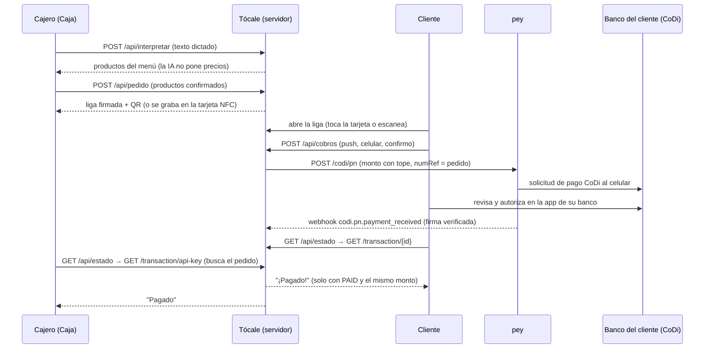

# PRD · Tócale

> Producto para el *DevDay Exchange Community Hackathon: Mexico City*. Sale de las respuestas de P12 en [`docs/PROYECTO.md`](PROYECTO.md) (7-nov, 14:19). "Tócale" es nombre provisional. La API está en [`docs/CONTRATO-API.md`](CONTRATO-API.md); el pitch, en [`docs/PITCH.md`](PITCH.md); la entrega, en [`docs/ENTREGA.md`](ENTREGA.md). ⚪ = no verificado.

## 1. Problema

En palabras de José, cliente de una taquería de la CDMX que vende mucho: "El cliente llega queriendo pagar con tarjeta, y el cajero de la taquería solamente les puede vender en efectivo. Se pierden ventas." (P12.2). Cuántas ventas se pierden no se ha medido (⚪).

**Bien público:** pagos digitales sin comisión ([`codi/01`](../codi/01-que-es-codi.md)) para cualquier puesto que hoy solo acepta efectivo, sin comprar terminal. La taquería es el primer caso, no el único.

## 2. Usuarios

| Usuario | Qué necesita | Dónde lo usa |
|---|---|---|
| **Cajero** | Cobrar sin efectivo, rápido, con las manos ocupadas, y saber con certeza que ya le pagaron | Pantalla **Caja** (`/`), en un celular Android con Chrome |
| **Cliente** (quien paga) | Pagar desde la app de su banco sin dar datos de más | Pantalla **Cliente** (`/p?o=…`), en su propio celular |
| **pey** | Más negocios cobrando con CoDi por su API, casos nuevos y retroalimentación (K02.7–K02.8) | Las rutas de su API en el flujo principal |

El negocio de la demo es ficticio ("Taquería El Ejemplo"), con menú y precios de ejemplo en `lib/menu.js`. No se nombra la taquería real.

## 3. La propuesta en una frase

Tocas la tarjeta (o escaneas el QR), escribes tu celular y pagas tus tacos con CoDi desde la app de tu banco; el cajero ve "pagado" sin terminal y sin comprobantes que revisar.

## 4. Alcance de la demo

**Dentro:**
1. **Caja:** armar el pedido con botones del menú o dictándolo con el micrófono del teclado; la IA de OpenAI lo convierte en productos del menú (`POST /api/interpretar`); el cajero corrige y confirma.
2. **Pedido firmado:** el servidor calcula el total desde el menú, firma el pedido y regresa una liga corta válida 3 horas, su QR y el monto a cobrar (`POST /api/pedido`).
3. **Tarjeta NFC reprogramable:** botón "Grabar en tarjeta" con Web NFC (solo Chrome, Opera o Samsung Internet en Android). Mientras no haya tarjetas, la misma liga se muestra como QR.
4. **Cliente:** ve el pedido y el monto, escribe su celular (teclado numérico, 10 dígitos), lee para qué se usa, confirma y recibe la solicitud de pago CoDi (`POST /api/cobros`, método `push`).
5. **Estado:** "Esperando tu pago" → "Pagado" en el celular del cliente y en la Caja, solo con confirmación de pey (`GET /api/estado`).
6. **Respaldo:** si la solicitud no llega, la Caja muestra un QR CoDi para escanear con la app del banco (método `qr`), con aviso de doble cobro.
7. **Webhook** de pey con firma verificada.
8. **SIMULACIÓN** completa y rotulada sin llaves; **PIN de caja** opcional.

**Fuera (por ahora):** base de datos, cuentas de usuario, varios negocios, menú editable, propinas, devoluciones (pey no las documenta, [`pey/README`](../pey/README.md)), pago con tarjeta bancaria (la liga de pago de pey las acepta, pero necesita cuenta `stripe`, [`pey/06`](../pey/06-api-ligas-de-pago.md)), grabar tarjetas desde iPhone, facturación, impresión de tickets y transcripción de voz con OpenAI (el dictado usa el micrófono del teclado).

## 5. Pantallas

**Caja (`/`)**
- Encabezado con el nombre del negocio y, si aplica, la franja **SIMULACIÓN**.
- Menú en botones grandes (+ y −) y un cuadro "Dicta o escribe el pedido" con el botón "Armar con IA"; lo que no se entendió se muestra aparte.
- Resumen: productos, total y, si el total pasa del tope, "Cobro de prueba: $1.00 (pedido: $130.00)".
- "Crear cobro" → liga, QR de la liga y "Grabar en tarjeta" (si el navegador lo permite; si no, explica que solo funciona en Chrome Android).
- Estado del pago del pedido (consulta cada 3 a 5 s) y botón "Mostrar QR CoDi (respaldo)".
- Campo de PIN cuando `pinRequerido` es `true`.

**Cliente (`/p?o=…`)**
- Nombre del negocio, productos, total y monto que se cobrará (con "Cobro de prueba" si aplica).
- Celular: `inputmode="numeric"`, 10 dígitos, etiqueta visible.
- Texto: "Tu número solo se usa para enviarte la solicitud de pago."
- Casilla "Recordar mi número en este celular", **apagada** por defecto; se guarda solo en ese teléfono.
- Botón "Enviar solicitud de pago" → "Abre la app de tu banco y autoriza el pago" → "¡Pagado!" o "Venció; intenta de nuevo".
- Ayuda: "¿No te llegó? Pide al cajero el QR CoDi."

Reglas de diseño: español de México; 360 px sin desplazamiento horizontal; botones de al menos 44 px; contraste AA; foco visible; todo usable con teclado (`AGENTS.md` §3). Marca: logos oficiales de pey sin recrearlos, sin inventar un "azul pey" y sin dar a entender que pey o Banxico patrocinan el proyecto; en textos formales, "pey®" y "CoDi®" ([`pey/12`](../pey/12-recursos-de-marca.md)).

## 6. Flujo del dinero

Quién le cobra a quién: la taquería (la cuenta `codi` ligada a la API key de pey) le cobra al cliente lo que consumió. En la demo, el dinero va a la cuenta de prueba que publica pey, porque una CLABE propia tarda 5 días hábiles en registrarse (K03.3).

## 7. Estados del cobro

| Estado | Cuándo | Qué ve la persona |
|---|---|---|
| `pendiente` | Se creó la solicitud o el QR y pey todavía no reporta pago | "Esperando tu pago…" |
| `pagado` | pey reporta `PAID` con el mismo monto | "¡Pagado!" (cliente) y "Pagado" (Caja) |
| vencido | Pasó `vence` (600 s) sin pago; lo calcula la interfaz porque pey no avisa rechazos ni vencimientos | "Venció; intenta de nuevo" |
| `no_verificable` | pey no responde o no reconoce el id | "No se puede verificar ahora" (nunca "pagado") |

Un pago que llega tarde gana (P5).

## 8. Reglas

1. **Monto máximo en el servidor:** `MONTO_MAXIMO_MXN`, 1 peso por defecto. Si el pedido vale más, se cobra el máximo y las dos pantallas dicen "Cobro de prueba" con ambos montos (`AGENTS.md` §3, K03.3: en pruebas se cobran de $0.01 a $1 que no se devuelven).
2. **Confirmación explícita:** ningún cobro sin `confirmo: true` después de ver el monto; además, el cliente autoriza en su banco.
3. **SIMULACIÓN:** sin `PEY_API_KEY`, las pantallas lo dicen de forma visible y ningún texto afirma que pey confirmó algo.
4. **Privacidad del celular:** solo se usa para la solicitud; no se guarda en el servidor ni en logs; "recordar" es opcional y vive en el teléfono del cliente.
5. **Pedido a prueba de cambios:** la liga va firmada (HMAC) y el servidor recalcula productos y total desde el menú; el navegador nunca manda montos.
6. **La IA propone, el código decide:** la salida de OpenAI es estructurada (productos del menú y cantidades) y se valida; el cajero confirma antes de crear el cobro.
7. **Llaves solo en el servidor** (`AGENTS.md` §4); PIN de caja recomendado al desplegar.

## 9. Criterios de aceptación

| # | Criterio | Cómo se comprueba |
|---|---|---|
| CA1 | Las pruebas automáticas pasan | `npm test` sin fallas |
| CA2 | Sin llaves, la app avisa SIMULACIÓN | `GET /api/salud` → `modo: "simulacion"`; franja visible en Caja y Cliente |
| CA3 | La Caja arma un pedido con botones y con texto | "cuatro de pastor y una horchata" → 4 y 1 de los productos correctos; total calculado por el servidor |
| CA4 | La liga no se puede alterar | Cambiar un carácter → `PEDIDO_INVALIDO`; liga de más de 3 h → `PEDIDO_VENCIDO` |
| CA5 | Validaciones del cobro | 9 dígitos → `TELEFONO_INVALIDO`; sin confirmar → `FALTA_CONFIRMACION` |
| CA6 | Tope de monto | Pedido de más de $1 con el tope por defecto → se cobra $1.00 y se ve "Cobro de prueba" |
| CA7 | Flujo completo en SIMULACIÓN | Caja → liga → Cliente → "Pagado" rotulado SIMULACIÓN, en el servidor local |
| CA8 | Webhook seguro | Firma inválida → `FIRMA_INVALIDA`; firma válida → 200 (pruebas con `fetch` simulado) |
| CA9 | Móvil y accesible | Capturas a 360 px sin desplazamiento horizontal; botones de 44 px o más; etiquetas y foco visible |
| CA10 | Cobro real (José, con llaves) | Solicitud de $1 o menos llega al celular, se autoriza y ambas pantallas dicen "Pagado"; `transactionId` y hora en `BITACORA.md`, sin el celular |
| CA11 | Tarjeta NFC (José, si compra tarjetas) | "Grabar en tarjeta" en Chrome Android y otro celular abre el pedido al tocarla (⚪ sin tarjetas al 7-nov, 14:19) |
| CA12 | Cero llaves y cero celulares en el repo y en logs | `python3 scripts/verificar_conocimiento.py` y revisión del diff |

## 10. Riesgos

| Riesgo | Mitigación |
|---|---|
| ⚪ Qué bancos reciben la solicitud de pago: la tabla de funciones por banco solo está en imágenes ([`codi/03`](../codi/03-actores-y-participantes.md)) | Probar primero con el banco de José ($0.01–$1); QR CoDi de respaldo |
| ⚪ Qué pasa si el celular no tiene CoDi activo en ningún banco: pey no lo documenta ([`pey/04`](../pey/04-api-codi-qr-y-push.md)); quien paga necesita la app de su banco con CoDi y una cuenta validada ([`codi/04`](../codi/04-como-paga-y-cobra-una-persona.md)) | Mensaje de ayuda y QR de respaldo |
| pey solo avisa pagos recibidos: no hay evento de rechazo ni de vencimiento ([`pey/04`](../pey/04-api-codi-qr-y-push.md)) | La interfaz marca "vencido" por tiempo |
| Doble cobro si el cliente paga la solicitud y también el QR; pey no documenta cancelación ni devoluciones | El QR solo aparece si se pide, con aviso; un segundo pago se devuelve en efectivo |
| Una tarjeta NFC sin bloqueo la puede reescribir cualquiera con una app | La pantalla del cliente muestra negocio, pedido y monto antes de pedir el celular; ⚪ tarjetas con contraseña de escritura |
| ⚪ pey no publica límite de peticiones | Consultas cada 3 a 5 s y alto al vencer ([`pey/07`](../pey/07-api-transacciones.md)) |
| La Caja busca el pago en la primera página de `GET /transaction/api-key` (80 resultados) | Suficiente para la demo; con mucho volumen hace falta base de datos |
| Sin llaves a tiempo | SIMULACIÓN rotulada (P11) |
| Leer la tarjeta: Android sin app (con NFC encendido) y iPhone XS o posterior sin app; iPhone 8 o X necesitan una app o el lector del Centro de control | La misma liga va también en QR |

## 11. Después de la demo

1. Base de datos para guardar los webhooks y los pedidos (la Caja dejaría de buscar en la lista de pey).
2. Tarjeta fija por mesa o lugar, con el pedido asignado en el servidor, para no grabar la tarjeta en cada orden.
3. Tarjetas con contraseña de escritura (⚪ y Web NFC no hace operaciones de bajo nivel).
4. Transcripción de voz con OpenAI (⚪ modelo `gpt-transcribe`, sin probar) para no depender del teclado.
5. Resumen de ventas del día para el dueño y conciliación con las transacciones de pey.
6. Cuenta CLABE propia del negocio (5 días hábiles, K03.3).

## Fuentes

| Dato | Fuente | Consultado |
|---|---|---|
| API de pey (push, QR, transacciones, webhooks, marca) | [`pey/`](../pey/README.md) | 2026-11-07 |
| CoDi: sin comisión, requisitos de quien paga | [`codi/`](../codi/README.md) | 2026-11-07 |
| Web NFC solo en Chrome, Opera y Samsung Internet de Android; requiere HTTPS y permiso | [Web NFC API (MDN, espejo)](https://docs.w3cub.com/dom/web_nfc_api) · [Chromium: Web NFC](https://www.chromium.org/developers/design-documents/web-nfc/) | 2026-11-07 |
| iPhone XS y posteriores leen tarjetas NFC con URL sin app | [Apple: Adding Support for Background Tag Reading](https://developer.apple.com/documentation/corenfc/adding-support-for-background-tag-reading) | 2026-11-07 |
| Modelo `gpt-6-luna` | [OpenAI: Models](https://developers.openai.com/api/docs/models) | 2026-11-07 |
