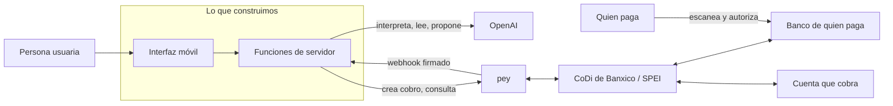

# Proyecto · Objetivo del hackatón y definición sistémica

> Documento rector. Dice **qué** hay que lograr, **por qué**, **con quién** y **bajo qué reglas**, antes de decidir qué se construye. El problema concreto (una taquería de la CDMX que solo acepta efectivo; José la conoce como cliente) se llena en la sección P12 y después se baja a `docs/PRD.md`. Secciones numeradas P1–P12 para citarlas ("según P6…"). Cada dato remite a su archivo de la base: [K00](../conocimiento/00-bases-del-concurso.md), [K01](../conocimiento/01-evento-verificado.md), [K02](../conocimiento/02-organizadores-y-que-buscan.md), [K03](../conocimiento/03-codi-y-api-pey.md), [K08](../conocimiento/08-criterios-y-jueces.md), [`pey/`](../pey/README.md) y [`codi/`](../codi/README.md).

## P1 · Objetivo del hackatón

**Lo que dice el reto escrito** (K00.2): prototipar herramientas de **bien público** con **OpenAI** y **CoDi**, cobrando a través de la **API de pey**. Ejemplos oficiales: cobro para comercios de barrio, comercio comunitario, flujos con QR y solicitudes de pago, y flujos empresariales sobre pagos instantáneos.

**Lo que se pidió en el arranque** (K00.3, notas de José del 7-nov):
1. Una solución **creativa**.
2. **De la mano de la nueva ley de pagos digitales**, aprovechándola.
3. Una **aplicación de un servicio, del que sea**, que **integre la API de pey** (que funciona con CoDi).
4. Se puede usar **Claude** además de las herramientas de OpenAI.

**Un producto para pey.** Según José, el hackatón es especialmente para hacer un producto sobre pey. Lo que pey busca, por lo que publica y por inferencia (K02.7–K02.8, ⚪ la parte inferida): que más negocios y servicios cobren con CoDi a través de su API, que es gratuita, de autoservicio y funciona con cualquier banco; casos de uso nuevos; y retroalimentación sobre su API y su documentación. Para este proyecto eso significa: **el cobro con pey va en el flujo principal, no de adorno**, y la demo muestra el ciclo completo de un cobro real.

## P2 · Objetivo del proyecto

**General:** que una persona resuelva un problema real (el de P12) con un **servicio** que **cobra con CoDi a través de pey**, donde la **IA de OpenAI** hace algo que un formulario no podría, desplegado en una URL pública y demostrable en **3 pasos**.

**Específicos** (cada uno se puede comprobar):

| # | Objetivo | Cómo se comprueba |
|---|---|---|
| O1 | Un cobro real con pey de punta a punta, de $0.01 a $1 | Id del cobro, hora del pago y pantalla de confirmación |
| O2 | La IA de OpenAI tiene un papel necesario y acotado | Salida estructurada validada por código; la persona confirma |
| O3 | Demo de 3 pasos en el celular, en el dominio de producción | URL pública probada dos veces |
| O4 | Sin llaves, todo el flujo corre en **SIMULACIÓN** rotulada | La pantalla dice SIMULACIÓN |
| O5 | Entrega completa: repo, README, video y pitch | Lista de K08.13 marcada |
| O6 | Todos los criterios de la rúbrica en 4 o más | Autoevaluación con K08.4–K08.5 |
| O7 | Entregado antes del domingo a las 12:00 (cierre a las 13:00) | Captura de la confirmación |

**Fuera de alcance:** cuentas de usuario complejas, varias empresas, devoluciones (pey no las tiene, `pey/`), base de datos si no hace falta, promesas de cumplimiento legal y datos personales reales.

## P3 · Requisitos

**Del concurso (obligatorios):**

| ID | Requisito | Cómo se cumple | Fuente |
|---|---|---|---|
| R1 | Usar OpenAI | Una llamada necesaria en el flujo principal | K00.2 |
| R2 | Cobrar con CoDi a través de la API de pey | Crear cobro → pago → confirmación por consulta o webhook | K00.2, K03, `pey/` |
| R3 | Bien público | El beneficio para la persona usuaria se dice en una frase | K00.2 |
| R4 | Entregar en el portal antes del domingo 8 a las 13:00 | Paquete de K00.6 | K00.5–K00.6 |
| R5 | Creatividad | Un ángulo propio explicable en una frase | K00.3, K08.5 |
| R6 | Aprovechar la ley de pagos digitales sin exagerarla | Adopción voluntaria y preparación; nada de obligaciones ni fechas que la ley no tiene | K00.4 |

**De calidad (reglas de este repo, `AGENTS.md`):**

| ID | Requisito |
|---|---|
| Q1 | Español de México; mobile-first a 360 px; botones de al menos 44 px; accesible (AA, teclado, etiquetas) |
| Q2 | Nada inventado; todo lo simulado dice SIMULACIÓN |
| Q3 | Dinero real con cuidado: confirmación explícita, tope en el servidor, montos de $0.01 a $1 en pruebas |
| Q4 | Llaves solo en el servidor; nunca en el navegador, el repo, los logs ni el chat |
| Q5 | Webhooks de pey con firma verificada |
| Q6 | Pruebas automáticas con `fetch` simulado y evidencia de cada avance en `BITACORA.md` |

## P4 · El sistema: actores y límites



**Límite del sistema:** dentro está solo nuestro código (interfaz y funciones). pey, OpenAI, Banxico, los bancos, Vercel y GitHub son externos: fallan, cambian o tardan, y el diseño tiene que aguantarlo (P6, P11).

| Actor | Qué quiere | Qué aporta | Fuente |
|---|---|---|---|
| Persona usuaria (por definir en P12) | Resolver su problema sin complicarse | El caso real | P12 |
| Quien paga | Pagar rápido, seguro y sin comisión | El pago desde la app de su banco | `codi/` |
| pey | Más servicios cobrando con su API, casos nuevos, retroalimentación | La API, la cuenta de prueba y los webhooks | K02.7–K02.8 |
| Banxico (CoDi y SPEI) | Pagos digitales instantáneos y gratuitos | La red de pagos | `codi/`, K03.1 |
| OpenAI | Usos interesantes y visibles de sus modelos | La API | K00.2, K02 |
| AI Builders México, UTOPÍAS y SEDECO | Bien público, adopción de pagos digitales, comunidad | El evento, mentores y jurado | K02 |
| Jurado y comunidad | Proyectos útiles que funcionen y se entiendan | La evaluación y el voto | K08 |
| José | Ganar con un proyecto honesto y útil | El problema, las decisiones y el pitch | K00 |
| Agentes (Claude Code, Codex) | Instrucciones claras y verificables | El código, las pruebas y la documentación | `AGENTS.md` |

## P5 · Flujos

**Dinero (CoDi con pey).** Detalle técnico: K03.4–K03.5 y `pey/04`, `pey/07`, `pey/09`; la parte de Banxico, `codi/`.

```mermaid
sequenceDiagram
    participant U as Persona usuaria
    participant A as Nuestro sistema
    participant P as pey
    participant B as CoDi / banco de quien paga
    U->>A: pide cobrar (con la ayuda de la IA)
    A->>A: valida monto y tope; la persona confirma
    A->>P: POST /codi/qr (o /codi/pn)
    P-->>A: id + QR (o folio de la solicitud)
    B->>P: quien paga escanea y autoriza en su banco
    P-->>A: webhook firmado (pago recibido)
    A->>P: GET /transaction/codi/qr/{id} (confirmación)
    A-->>U: "pagado", solo si pey lo confirma
```

**Información (IA).** Entrada de la persona (texto, voz o imagen) → OpenAI interpreta → **salida estructurada** → el código valida (montos, tope, catálogo, estado) → la persona confirma → acción (crear el cobro). **El modelo nunca confirma pagos ni decide montos solo** (K02.12, K08.5).

**Estados de un cobro.** `pendiente` → `pagado` (solo con PAID de pey y mismo monto) · `expirado` (sin pago al vencer; un pago tardío gana) · `no_verificable` (pey no responde o no reconoce el cobro con esa llave). Nunca se muestra "pagado" sin confirmación de pey (K03.4).

## P6 · Restricciones

| Restricción | Efecto en el diseño | Fuente |
|---|---|---|
| pey solo tiene producción; en pruebas se cobra dinero real de $0.01 a $1 que no se devuelve | Tope en el servidor, confirmación explícita y SIMULACIÓN rotulada sin llaves | K03.3, `pey/02` |
| La CLABE propia tarda 5 días hábiles | Usar la cuenta de prueba de pey en el concurso | K03.3 |
| pey no documenta idempotencia ni devoluciones | No reintentar creaciones a ciegas; no prometer reembolsos | `pey/04`, `pey/11` |
| Un webhook por llave; los previews de Vercel piden sesión | Registrar el webhook en el dominio de producción y consultar el estado como respaldo | K03.5 |
| La ley no obliga hoy a nadie a aceptar QR | Presentar el proyecto como adopción voluntaria y preparación | K00.4 |
| Repo público | Cero llaves y cero datos personales; los ejemplos son ficticios | K00.9 |
| Tiempo: el sábado cierra a las 16:00 y la entrega es el domingo a las 13:00 | Un flujo principal pequeño que funcione antes que muchas funciones | K00.5, K08.3 |
| La API de OpenAI se paga aparte de ChatGPT Plus | Llamadas pocas y cortas; camino sin IA si se acaba el saldo | K00 ⚪ costo por llamada sin medir |

## P7 · Arquitectura de referencia

Sirve para cualquier servicio; el PRD la ajusta.

- **Interfaz:** HTML, CSS y JavaScript sin framework ni build; móvil primero; el modo de pago siempre visible.
- **Servidor:** funciones de Vercel en Node.js 22; código compartido fuera de `api/` (`AGENTS.md` §5).
- **Rutas mínimas:** `GET /api/salud` (modo y si hay llaves, sin mostrarlas) · `POST /api/<acción de la IA>` · `POST /api/cobros` (exige confirmación) · `GET /api/estado` (consulta a pey) · `POST /api/webhook-pey` (firma verificada).
- **Estado:** la verdad del pago vive en pey; si hace falta guardar un pedido sin base de datos, se firma en el servidor para que el navegador no pueda alterarlo.
- **Pruebas:** `node:test` con `fetch` simulado; un recorrido de la demo en navegador antes de desplegar.

## P8 · Criterios de éxito (rúbrica de K08)

| Criterio (peso inferido) | Un 5 significa | Evidencia |
|---|---|---|
| C1 Impacto y alineación (25%) | Persona concreta, dolor medible, cobro CoDi y la ley bien usada | Frase de valor y dato con fuente |
| C2 Ejecución (25%) | URL pública en celular: crear cobro → pago → webhook verificado → acción | Id del cobro real y video |
| C3 OpenAI y herramientas (20%) | IA necesaria y acotada; uso visible de agentes con evidencia | Esquema de salida, commits con hora, bitácora |
| C4 Creatividad (20%) | Un ángulo propio en una frase | La frase del pitch |
| C5 Pitch y diseño (10%) | Problema → demo → impacto en 3 minutos; interfaz clara | Ensayo cronometrado |

## P9 · Entregables y calendario

| Cuándo | Qué |
|---|---|
| Sábado, en cuanto se defina P12 | `docs/PRD.md` con demo de 3 pasos y criterios de aceptación |
| Sábado, primera hora de construcción | Esqueleto desplegado en SIMULACIÓN |
| Sábado, antes de las 16:00 | Cobro real con pey en producción y video de respaldo |
| Domingo, antes de las 12:00 | Entrega en el portal: URL, repo con README, video y pitch (K00.6, K08.13) |

## P10 · Método de trabajo

- **Herramienta:** Claude Code dentro de GitHub Codespaces, programando solo con prompts; Codex CLI también está disponible. Paso a paso y biblioteca de prompts: [`docs/GUIA-CODESPACES.md`](GUIA-CODESPACES.md). Comandos por fase en `.claude/commands/`: `/arrancar` → `/prd` → `/construir` (las veces que haga falta) → `/verificar` → `/desplegar` → `/entregar`.
- **Ciclo:** una tarea a la vez; plan corto → construir → verificar → evidencia → commit. José aprueba lo irreversible (push a `main`, despliegues, cobros reales).
- **Lecciones del primer intento (se conservan):** escribir primero un contrato de API permite repartir el trabajo entre agentes en paralelo sin choques; la SIMULACIÓN completa sin llaves salva la demo; en SIMULACIÓN ningún texto dice que pey confirmó algo; una verificación independiente antes de dar algo por terminado encuentra errores que el autor no ve.

## P11 · Riesgos y mitigación

| Riesgo | Señal | Mitigación |
|---|---|---|
| No hay llaves de pey u OpenAI a tiempo | `/api/salud` dice que faltan | SIMULACIÓN rotulada; camino sin IA (reglas o captura manual) |
| pey responde 503 o falla la red | El estado no cambia | Mensaje "no se puede verificar"; reintento; video de respaldo |
| OpenAI sin saldo o lenta | Error 429 o tiempo de espera | Respuesta de respaldo sin IA; no bloquear el cobro |
| Falla el internet de la sede | Sin conexión | Hotspot del celular y video |
| Demasiadas funciones | Pasa de las 13:00 sin cobro real | Congelar funciones y cerrar el flujo principal (K08.3) |
| Datos personales o llaves en el repo | Revisión del diff | Verificador del repo y revisión antes de cada push |
| Citar mal la ley | Una frase con obligación o fecha | Usar solo lo de K00.4 |

## P12 · El problema (lo define José)

Estado: **respondido** (7-nov, 14:19). La respuesta 2 es de José, palabra por palabra; las demás son los borradores que José mandó construir ("Hazlo ya"). El producto que sale de aquí, **Tócale** (nombre provisional), está en [`docs/PRD.md`](PRD.md) y su API en [`docs/CONTRATO-API.md`](CONTRATO-API.md).

1. **¿Quién lo vive?** El cajero de una taquería de la CDMX que vende mucho pero solo cobra en efectivo, y sus clientes que llegan queriendo pagar sin efectivo. José es cliente de esa taquería, sin otra relación: no se nombra, y la app usa un negocio ficticio ("Taquería El Ejemplo") con menú y precios de ejemplo.
2. **¿Qué pasa hoy?** En palabras de José: "El cliente llega queriendo pagar con tarjeta, y el cajero de la taquería solamente les puede vender en efectivo. Se pierden ventas."
3. **¿Qué cuesta hoy?** Ventas que se pierden cuando el cliente no trae efectivo (⚪ sin cifra: nadie lo ha medido), tiempo dando cambio en la hora de más gente y el riesgo de manejar efectivo. Si aceptaran transferencias, el cajero tendría que revisar los comprobantes uno por uno.
4. **¿Qué haría la app, en una frase?** Tocas la tarjeta (o escaneas el QR), escribes tu celular y pagas tus tacos con CoDi desde la app de tu banco; el cajero ve "pagado" sin terminal y sin comprobantes que revisar.
5. **¿Dónde entra el cobro con pey y CoDi?** La taquería le cobra al cliente lo que consumió. El servidor pide a pey una solicitud de pago al celular del cliente (`POST /codi/pn`, con el número de pedido como `numRef` y un monto máximo en el servidor); el cliente la autoriza en su banco; el pago se confirma con pey (`GET /transaction/{id}`, y en la caja buscando el número de pedido en `GET /transaction/api-key`); el webhook `codi.pn.payment_received` trae el mismo `transactionId` ([`pey/04`](../pey/04-api-codi-qr-y-push.md), [`pey/07`](../pey/07-api-transacciones.md), [`pey/09`](../pey/09-webhooks.md)). Respaldo: un QR CoDi (`POST /codi/qr`) en la pantalla del cajero. CoDi no cobra comisión a quien paga ni a quien cobra ([`codi/01`](../codi/01-que-es-codi.md)) y la API de pey es gratuita "por el momento" ([`pey/01`](../pey/01-que-es-pey-y-codi.md)).
6. **¿Qué hace la IA de OpenAI que un formulario no podría?** El cajero dicta o escribe el pedido como lo diría en voz alta ("cuatro de pastor con todo y una horchata") y la IA lo convierte en productos del menú. Los precios y la suma los pone el código; la IA nunca decide montos. Un formulario lo obligaría a picar botones con las manos ocupadas en plena hora de más gente.
7. **¿Cómo aprovecha la ley de pagos digitales?** Como adopción voluntaria: la ley dice que los comercios "podrán implementar" pagos digitales (art. 11) y solo los sectores que designe la SHCP tendrán obligación (art. 13). La app prepara a un negocio de puro efectivo antes de que existan esas reglas, sin prometer que cumple con la ley (K00.4).
8. **¿Qué tiene de creativo?** Una tarjeta NFC reprogramable que lleva tu pedido: la tocas y pagas con CoDi, sin terminal y sin efectivo.

**Bien público (R3):** el reto escrito pide "bien público" (K00.2). Tócale se presenta como pagos digitales sin comisión para cualquier puesto que hoy solo acepta efectivo; la taquería es el primer caso, no el único.
