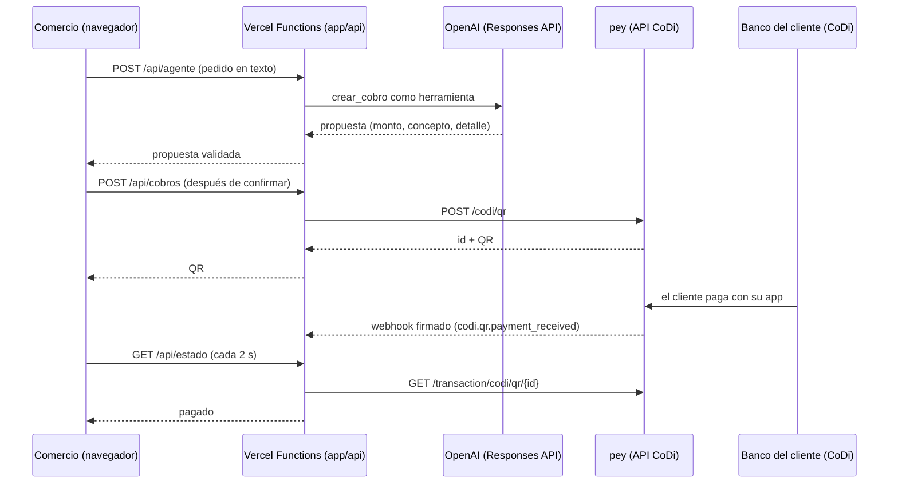

# [NOMBRE] — [FRASE DE VALOR]

> **Plantilla del README de entrega.** La Tarea 6 de Codex la llena con datos reales y la pone en el `README.md` de la raíz. Reglas: nada inventado (lo que falte queda como `[POR LLENAR]`), cero datos personales y rutas convertidas en enlaces relativos que existan. Borra este bloque al usarla.

**Demo en vivo:** [URL PRODUCCIÓN] · **Video (≤ 3 min):** [URL VIDEO] · **Video corto (60–90 s):** [URL VIDEO CORTO] · **Deck:** [URL O RUTA DEL PDF]

Hecho en el *DevDay Exchange Community Hackathon: Mexico City* (7 de noviembre de 2026) para el reto "Prototipa herramientas de bien público con OpenAI y CoDi", con Codex, la API de OpenAI y cobros CoDi vía la API de pey.

> **Modo de la demo:** [MODO PRUEBA: pagos CoDi reales de centavos a la cuenta de prueba de pey, porque registrar una CLABE ante Banxico tarda 5 días hábiles / cuenta del comercio / SIMULACIÓN, sin dinero real]. La pantalla siempre muestra el modo.

## El problema
[2–3 frases: persona (arquetipo, dicho como tal) y dolor.] [Un dato con su fuente: cifra — institución, año.]

## La solución
- **Cobra hablando:** el comercio dice lo que vendió y la IA arma el cobro.
- **Sin comisión:** QR CoDi de pey; el dinero va de banco a banco.
- **Confirmación real:** la pantalla cambia a PAGADO solo cuando pey lo confirma; nada de capturas.
- **Bien público:** [por qué, en una frase; licencia del código].

## Demo en 3 pasos
1. **[Paso 1]** — [qué hace la persona y qué ve]. 
2. **[Paso 2]** — [ ]. 
3. **[Paso 3]** — [ ]. 

## Cómo usarlo
**Para probarlo como juez (2 minutos):** abre [URL PRODUCCIÓN] en el celular → toca el ejemplo "[FRASE DE DEMO]" → Confirmar → [en modo prueba: escanea el QR con la app de tu banco y paga $1, que no se devuelve; o mira el video en el minuto X].

**Para correrlo:** ver `app/README.md` (variables de `.env.example`, servidor local, pruebas con `npm test --prefix app` y Vercel con Root Directory = `app`).

## Cómo lo construí con Codex y la API de OpenAI

**Lo que hizo la IA y lo que hice yo.** Codex escribió el código en [P] PRs, [M] de ellos en tareas paralelas; ChatGPT ayudó con el PRD, los textos y el pitch. Yo elegí el problema, escribí el contrato y los criterios de aceptación de cada tarea (`AGENTS.md` y `dia-del-evento/PROMPTS-CODEX.md`), probé cada PR en su preview y tomé las decisiones de la tabla.

| Hora | Etapa | Herramienta | Qué decidí | Evidencia |
|---|---|---|---|---|
| [10:30] | Idea y PRD | ChatGPT + base de conocimiento | [idea y por qué] | `docs/PRD.md` |
| [10:35] | Esqueleto y primer deploy | Codex (Tarea 1) + Vercel | Contrato fijo, modo SIMULACIÓN y desplegar antes de la primera hora | PR #[ ] |
| [11:10] | Pey, agente, interfaz y tiempo real | Codex (Tareas 2–5 en paralelo) | Carpetas separadas por tarea para que no choquen | PRs #[ ] · captura de las tareas |
| [12:45] | Pago real en producción | pey + app del banco | Confirmar con pey, no con capturas | Id del cobro · Webhook Logs |
| [13:05] | Pruebas, README y pulido | Codex (Tareas 6–7) | [ ] | PRs #[ ] |
| [14:45] | Congelado | — | Nada nuevo después de esta hora | versión [ ] |

**La API de OpenAI dentro del producto.**
- Responses API con function calling. Modelo: `[OPENAI_MODEL]`.
- La herramienta `crear_cobro` solo **propone** (monto, concepto y detalle). El servidor valida el monto, el tope `MAX_MONTO_MXN` y que el detalle sume. El QR se crea en pey solo cuando la persona confirma.
- Instrucciones del sistema: [resumen o enlace al archivo].
- Si la IA falla, el cobro sigue con "Capturar a mano".

**Qué falló y cómo lo corregí:** [1–2 líneas honestas].

## Arquitectura

- Frontend: HTML, CSS y JavaScript sin framework (`app/index.html`, `app/js/`).
- Backend: Vercel Functions en Node.js (`app/api/`). Sin base de datos: la verdad del pago vive en pey.

## Seguridad y privacidad
- Las llaves (`OPENAI_API_KEY`, `PEY_API_KEY`, `PEY_WEBHOOK_SECRET`) viven solo como variables de entorno del servidor; el repo público no contiene ninguna.
- Ningún cobro sin confirmación explícita; tope de monto en el servidor (`MAX_MONTO_MXN`).
- Webhooks verificados con Standard Webhooks: firma, hora y deduplicación por `webhook-id`.
- Datos que se guardan: [ninguno]. Datos que recibe el modelo: [solo el texto del pedido].

## Qué es real y qué es prueba
| Pieza | Estado |
|---|---|
| Pedido en lenguaje natural con la API de OpenAI | [Real] |
| QR CoDi con pey | [Real] |
| Pago | [Real, de centavos, a la cuenta de prueba de pey / SIMULACIÓN] |
| [Otra] | [ ] |

## Qué existía antes y qué se hizo en el evento
- **Antes (preparación):** base de conocimiento en Markdown (`conocimiento/`), plantillas (`plantillas/`), guías del día (`dia-del-evento/`) y reglas para agentes (`AGENTS.md`). Sin código del producto.
- **Durante el evento:** todo `app/`. El historial de git y los PRs tienen fecha y hora.

## Limitaciones honestas
- [p. ej. prototipo para un solo comercio; sin cuentas ni historial; la cuenta de prueba de pey no devuelve los pagos].
- [TODO(⚪) que quedaron en el código].

## Qué sigue
1. Piloto con [N] comercios de barrio en dos semanas: medir tiempo de cobro y pagos confirmados.
2. [Función más pedida, p. ej. corte del día].
3. Hackatón México (14 nov – 12 dic).

## Créditos y licencia
- DevDay Exchange Community Hackathon: Mexico City, organizado por AI Builders México con UTOPÍAS, SEDECO y pey.
- Licencia: [elige una, p. ej. MIT, para que cualquiera pueda reutilizarlo].
